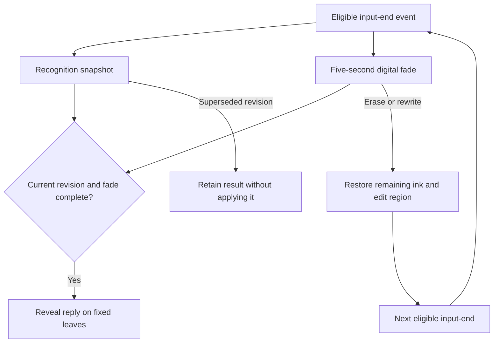

# MentalCityBeta / Enchanted Notebook — project handover

Prepared: **2026-10-18, America/Los_Angeles**. Product owner: **SakuraSan**. Product version: **alpha 0.4**, package `0.4.0-alpha.0`. This document records the implementation and evidence retained in the repository through the source checkpoint below. Browser, provider and physical-device results retain their original dates and scope.

## 1. Source, publication and document authority

| Record | Verified value |
| --- | --- |
| Development repository | `PaperStrange/IndiaGames` |
| Working branch | `toms_notebook` |
| Application/art source reviewed | `282124f007eea8a2db88b030fa089ff797acf0fd` |
| Reviewed source tree | `a120b8b9bb46b67502a6adafa399607fe28c9c96` |
| History at that checkpoint | 21 commits; 374 tracked files; 74 files in `docs/art-design/` |
| Latest published application | Sites version **13**, source `1ade48864d90afcc23a0b9b8ea1a84b101d0f095` |
| Deployment verification | Native deployment record reports `succeeded`; checked for this handover |
| Application address | https://enchanted-notebook-sakura.sakuraasuna.chatgpt.site |
| Sites project | `appgprj_6a9fab0922a481919c24beb053d58395` |
| Saved publication | `appgprj_6a9fab0922a481919c24beb053d58395~appgver_28480b68fe748191b56aa9cae1192ae0` |
| Deployment | `appgdep_6ac31cedde108191982b039b44d46e4b` |

The commit adding this handover is a documentation successor to `282124f`. Find its exact SHA with `git log -1 --format=%H -- HANDOVER.md`; verify the branch tip using the procedure in section 9. The publication remains version 13 for this documentation-only change. Product version, planning revision, documentation revision and Sites publication number are independent.

For current interaction behavior, use the implementation and the latest iteration evidence. [Agile progress](docs/iterations/02/AGILE-PROGRESS.md) and [BACKLOG-DELTA.json](docs/iterations/02/BACKLOG-DELTA.json) govern card status. Earlier README, workflow, version and local-memory passages retain historical checkpoint descriptions; interpret them alongside the current records linked here. Reference copies inside `docs/art-design/historical-documents/` preserve their original revision.

## 2. Product decisions to preserve

- The experience is a personal companion expressed through an interactive notebook: direct ink, a deliberate writing ritual, progressive replies and a tangible book appearance inspired by the requested Tom Riddle diary reference.
- The accepted physical direction is a **real paper notebook paired with its matching digital edition**. Physical ink stays on paper; the app performs recognition, fading and animated replies. Electronic answering hardware remains a future investigation.
- One companion identity belongs to each user and is shared across notebooks. Retrieval defaults to the current notebook; expanding scope requires the user's explicit control.
- Useful learned memories can be saved automatically with visible history and undo. Changes to reply instructions and tool strategy require review. Autonomous changes to application source or model weights are outside the implemented behavior.
- Built-in provider access and optional personal connections are supported by the configuration design. The selected-model lock, capability checks and configured spending limits remain authoritative.
- PaperQA is an example plugin. The architecture supports generic remote services. PaperReadingAgent currently contributes provider/configuration conventions; running its research functions requires a hosted service and integration acceptance.
- Preserve original writing and capture bytes independently of interpretation. Regional erasure affects the touched region. Editing never cancels already-running recognition; revision guards determine whether its result may be applied.
- Source-linked recall, durable data, recovery/sync, genuine provider evidence, measured latency/cost, privacy and contextual content handling are customer-baseline requirements.

Decision records: [MEMORY-LEARNED.md](docs/MEMORY-LEARNED.md), [LOCAL_MEMORY.json](docs/LOCAL_MEMORY.json), [Sprint 02](docs/iterations/02/SPRINT-PREPARATION.md).

## 3. Implemented work and completion boundaries

| Area | Work present in the reviewed source | Evidence or remaining boundary |
| --- | --- | --- |
| Notebook editor | Freehand pressure-aware strokes, pen/highlighter/eraser, undo/redo, placed text, notebook/page navigation, PDF reading and annotation, samples and export | Original baseline and later interaction records; physical stylus/IME acceptance remains open |
| Book appearance | Vellum/leather materials, layered page edges, gutter/spine shading, red ribbon, directional lighting, day/flat/reduced-motion options and animated forward/backward page presentation | [Art implementation review](docs/art-design/IMPLEMENTATION-AND-REVIEW.md); subjective visual approval and physical GPU measurements remain open |
| Input/reply lifecycle | Current-page revision guards, recognition/fade coordination, progressive lettering, original-ink retention, explicit composer submission and navigation suspension | [Behavior audit](docs/iterations/02/BEHAVIOR-AUDIT.md), ink tests and browser records |
| Page capacity | Fixed 760 × 1000 drawing-unit leaves, occupied-area placement and reply continuation | Layout regressions recorded; complete multi-leaf user input is MC-031 |
| Ink recovery | Move a draft to a fresh leaf, retain it as annotation, explicitly read it, preserve stroke identity/pressure and avoid repeated fading on return/reload | [Browser milestone](docs/iterations/02/BROWSER-INK-MILESTONE.md) |
| Recovery discoverability | Visible move action beside the composer, actionable space notice, compact Ink options, clear recovery state after a successful move and immediate continued writing | [Discoverability and continuation record](docs/iterations/02/INK-RECOVERY-DISCOVERABILITY.md); latest targeted suite: nine passes |
| Provider configuration | OpenAI, Anthropic, DeepSeek, DashScope, OpenRouter and custom endpoint configuration; Responses/chat/Messages transports; model capability/pricing controls and exact-model lock | Implemented adapters; actual provider coverage and billing reconciliation remain open |
| Keys and budget | Encrypted endpoint-bound personal credentials, settings concurrency checks, estimated cost reservations and run/activity records | Code-level mechanisms exist; complete production/security/cost acceptance remains open |
| Generic tools | Notebook HTTP v1 and supported MCP Streamable HTTP discovery/execution, enabled-action/notebook scope, citations and media artifacts | Live protocol, permission, egress and injection conformance remain open; PaperReadingAgent hosting is MC-025 |
| Companion memory | Bounded lexical/CJK retrieval, attributed excerpts, memory edit/forget/restore/history, tombstones and reviewable instruction proposals | Complete source-version recall and correction/deletion propagation gates remain open |
| Reply presentation | Handwritten, serif and typewriter text; emoji, compact tables, sticker/picture/video artifacts and existing demo media | Provider-generated media requires a tool result; diffusion-image handwriting replacement has not been integrated |
| Paper capture | Deliberate camera/file selection, rotate/crop, page label, durable original and prepared image, immutable retake links, duplicate retry, original download and source export/restore | MC-032 candidate implemented; compiled-Worker and browser evidence retained; full card acceptance remains open |
| Paper answering | Explicit Ask, server-loaded vision image, five-second fade, stale-result guards, transcription correction, source links and existing fixed-leaf replies | MC-033 candidate implemented; real image-to-provider replies and full correction/screening acceptance remain open |
| Mobile reuse | Shared React/TypeScript client, `dist-mobile` build configuration and Capacitor metadata | Native authentication/CORS, native projects, signing, stores and actual iOS/Android testing remain open |
| Product/design planning | Business-plan deck, architecture/decision records, baseline roadmap, 35 story cards, sprint preparation, risks, metrics, review and release criteria | Planning artifacts exist; demand, retention, payments and manufacturing outcomes have no accepted customer evidence |
| Art preservation | Dedicated research/proposals/materials/lettering/media/portraits/world-map/reference/evidence collection with a checksum register | 74 files; 73 registered payloads. MC-034/035 deliverables remain proposed |

### Input mechanisms

| Input route | Submission event | Recognition and reply behavior |
| --- | --- | --- |
| Composer | Explicit Enter/Send, respecting IME composition | Preserves drafting; no typing-pause submission. Manual placed text uses placement rules |
| Notebook handwriting | Input end after the existing 380 ms quiet interval when handwriting-on-pause is enabled, or explicit Read | Recognition and five-second fade start together. IME, active input and dialogs guard activation |
| Paper photo | Explicit Ask after saving/reviewing capture | Capture, preview, crop and navigation never submit; Ask starts current vision work and digital fade |
| Existing unsent page | New writing or an explicit action | Returning to a page or reloading restores visible ink and does not itself start another fade |

In live-provider mode, `lib/recognition-policy.ts` requires an image-capable configured route and reports missing capability. Device OCR is selected when the companion is in non-provider mode. TrOCR is English/single-line focused and its model load is significant. The transcription instructions request concise written text, preserve names/numbers/negation and mark unreadable words. They do not establish measured recognition accuracy.



This diagram describes lifecycle ownership. MC-033 still needs complete pre-reveal screening and integrated real-provider acceptance before its full criteria can close.

## 4. Architecture and operating boundaries

The application uses React 19, TypeScript, Vinext/Vite, a Cloudflare Worker, D1 records and R2 assets. `package-lock.json` pins the dependency resolution. The package requires Node **22.13.0 or later**. The existing browser runner uses Playwright **1.62.1**.

| Responsibility | Main files |
| --- | --- |
| Notebook/editor and recovery UI | `app/notebook-app.tsx`, `app/ink-recovery.tsx`, `lib/notebook.ts`, `lib/ink-draft.ts` |
| Ink geometry, lifecycle and layout | `app/use-ink-flow.ts`, `lib/ink-cycle.ts`, `lib/erase-ink.ts`, `lib/ink-text.ts`, `lib/input-placement.ts`, `lib/page-layout.ts`, `lib/paper-plane.ts` |
| Recognition | `lib/recognition-policy.ts`, `lib/handwriting.ts`, `lib/ocr.worker.ts` |
| Book rendering | `app/book-turn.tsx`, `app/parchment-material.tsx`, `app/paper-light.tsx`, `lib/paper-shaders.ts`, `app/diary.css`, `app/folio.css` |
| Capture client and source recovery | `app/paper-capture-dialog.tsx`, `app/use-paper-turn.ts`, `lib/prepare-photo.ts`, `lib/paper-capture.ts`, `lib/capture-recovery.ts` |
| Capture persistence/API | `lib/capture-store.ts`, `app/api/captures/route.ts`, `app/api/captures/[id]/route.ts` |
| Notebook persistence | `lib/notebook-journal.ts`, `app/api/notebook/route.ts`, `db/schema.ts` |
| Provider/router/transports | `lib/provider-registry.ts`, `lib/companion-policy.ts`, `lib/inference-transport.ts`, `lib/companion-stream.ts` |
| Memory, configuration, tools | `lib/companion-memory.ts`, `lib/companion-store.ts`, `lib/remote-plugins.ts`, `app/api/companion/route.ts`, `app/companion-settings.tsx` |
| Authentication boundary | `lib/server.ts`, `app/chatgpt-auth.ts`, Sites edge access |

The hosting manifest declares D1 `DB` and R2 `BUCKET`. Migrations `drizzle/0000_*`, `0001_*` and `0002_*` retain the notebook foundation, companion tables and `paper_captures` respectively. Preserve migrations and existing user records.

Capture records retain owner, notebook, page label, source ID and revision. Original and cropped/oriented image bytes remain separate. Retakes create new source IDs. Capture recovery verifies hashes and supports a bounded chain of up to 20 revisions and 45 MB of raw assets per export. These bounds do not constitute account-wide backup or disaster recovery.

The server currently accepts trusted edge identity headers and has a `private-site-owner` default. Its public/native multi-user authentication boundary remains an explicit release dependency. Local QA test identity headers prove storage scoping within that harness only.

Routing currently uses application task rules, capabilities, model lock, context limits and prices. Retrieval is bounded lexical search with at most eight excerpts and up to 500 learned records. Tool execution is bounded to three calls across two model rounds. Vector retrieval, LLM-directed scenario planning and a hosted PaperReadingAgent have separate future work.

### Service configuration

Use `.env.example` as a names-only template. Configure secrets through the approved runtime secret mechanism; keep them out of source, reports and tickets.

| Variable / setting | Purpose |
| --- | --- |
| `COMPANION_CONFIG_KEY` | Base64-encoded 32-byte encryption key for personal connections |
| `OPENAI_API_KEY`, `ANTHROPIC_API_KEY` | Optional built-in AI credentials |
| `OPENAI_MODEL`, `ANTHROPIC_MODEL` | Built-in model selection; template values are examples |
| `MODEL_INPUT_PRICE`, `MODEL_OUTPUT_PRICE` | Configured USD-per-million-token prices for the built-in custom model |
| `VITE_API_URL` | Mobile API origin, subject to native authentication/CORS work |
| Settings → Models | Personal endpoint/protocol/key, capabilities, reply/reasoning/vision selection and model lock |
| Settings → Tools | Service discovery and explicit action/notebook permissions |

A successful connection/model-list check establishes connectivity. Actual reply/vision calls, costs, error handling and source correctness need their own recorded runs. No provider key or new spending allowance was established by this handover. PaperReadingAgent requires an authenticated hosted wrapper compatible with the supported HTTP/MCP interface; no hosted service is included here.

## 5. Verification evidence retained

These are saved execution results, not a new application test run on 2026-10-18.

| Evidence | Recorded result | Scope and limits |
| --- | --- | --- |
| [Recovery checkpoint](docs/iterations/02/RECOVERY-CHECKPOINT.md) | Reconstructed candidate build/TypeScript, storage recovery and prior regression checks | Compiled Worker, independent local D1/R2 and test identities; live authentication/provider/device gates remain separate |
| [Browser milestone](docs/iterations/02/BROWSER-INK-MILESTONE.md) and [results](docs/iterations/02/evidence/results.json) | Nine browser checks; 20 selected regressions; build and TypeScript passed | Playwright/Chromium; desktop, phone and tablet viewports; real capture/storage paths |
| [Discoverability results](docs/iterations/02/evidence/ink-recovery-discoverability/regression-results.json) | Eleven of twelve cases passed in the recorded run | Read together with the focused phone rerun and its setup explanation |
| [Phone rerun](docs/iterations/02/evidence/ink-recovery-discoverability/phone-recovery-results.json) | Focused space-warning recovery passed | Actual bundled OCR exercised recovery; this is not a recognition-accuracy benchmark |
| [Continuation results](docs/iterations/02/evidence/ink-continuation/results.json) | All nine targeted scenarios passed, approximately 2.8 minutes | Visible move controls, retained/movable ink, no recurring destination popup, continued writing and quiet reload across three Chromium layouts |
| [Art register](docs/art-design/ASSET-REGISTER.json) | Payload sizes and SHA-256 recorded for 73 files | Includes research, reference copies and evidence; art/device approval remains open |

The latest interaction evidence is dated **2026-10-04 America/Los_Angeles / 2026-10-05 UTC**. It does not establish physical Safari/iPad/Pencil/Android camera behavior, low-memory OCR, real provider accuracy, current prices, market eligibility or a customer release.

Documentation verification on 2026-10-18 passed Git object-integrity checks, all 73 registered payload size/SHA-256 comparisons, 33 handover links and six README links, evidence-JSON inspection and whitespace checks. Only this handover and its README entry changed. Remote branch/file equality is checked after the documentation commit using section 9. Rebuilding and rerunning the application is a separate implementation verification step; this handover does not advance those results.

## 6. Agile state and next milestones

The retained register tracks **35 cards: 6 In progress, 2 Blocked, 27 Proposed, 0 Done**. Completed implementation slices are recorded inside broader cards. A full card closes only when all of its acceptance criteria and shared definition of done have evidence.

| State | Cards |
| --- | --- |
| In progress | MC-001 integration/audit, MC-003 durability, MC-006 ink interaction, MC-028 diary art, MC-032 paper capture, MC-033 captured-page reply |
| Blocked | MC-005 genuine provider smoke/usage; MC-024 customer-baseline release review |
| Proposed | MC-002, MC-004, MC-007–023, MC-025–027, MC-029–031, MC-034–035 |

MC-033 remains In progress while its live-provider acceptance is blocked. B1–B3 are tasks on parent cards and do not increase the 35-card total. The sprint forecast assumes staffing and capacity that remain unconfirmed; no new delivery date is committed by this document.

| Order | Work / cards | Required next result |
| --- | --- | --- |
| R0 readiness | B1–B3, MC-005, MC-021 | Actual authenticated test identities; permitted photo samples; configured provider and approved spend; physical iPad/Android access; named engineering/QA/design reviewers |
| R1 preserve a page | MC-032 plus MC-002/003/004/014/015/016/017 | Interrupted-upload/quota drills, actual account isolation, two-client handoff and concurrent retake handling; byte-identical source recovery with truthful save/sync status |
| R2 answer the page | MC-033 plus MC-005/006/008/009/011/012/018 | At least 30 genuine photo-to-reply trials; regional correction and independent interpretation/reply revisions; exact source navigation; stale/failure handling; screening before reveal; measured usage and p50/p95 timings |
| Design work alongside R1/R2 | MC-035 | A5-target dimensions in millimeters, shared parameter JSON, annotated/assembly drawings, bill of materials and physical evaluation procedure |
| R3 tangible spread investigation | MC-034 with MC-028 | One inspectable spread using MC-035 dimensions, page deformation/contact shadows/red ribbon, accurate ink mapping and physical-device measurements; recorded adopt/rework decision |
| Customer-baseline decision | MC-024 and all dependencies | Complete source recall, correction/deletion propagation, recovery/sync, privacy, content/reporting, plugin, eligibility, cost and device evidence for one exact candidate |

MC-033 retains the ordinary short-turn target of **p95 Ask-to-first-visible-reply ≤12 seconds including fade**. Capture-to-Ask effort is measured separately. Recognition, retries, stale work and content checks belong in cost accounting; unknown costs remain unknown. The full two-provider 100-turn-per-configuration gate, 100-probe recall evaluation and broader 300-annotation/20-writer comparison retain their own criteria.

After the paper journey: MC-029 adaptive device/topic timing, MC-030 bounded model-directed workflow routing, and MC-031 complete multi-leaf input. MC-025 PaperReadingAgent hosting follows generic plugin conformance. Customer studies, manufacturing and app-store submission remain gated. The machine-readable register currently records `m0_complete: false` and `customer_pilot_allowed: false`.

## 7. Artwork, reference files and planning materials

Start at [docs/art-design/README.md](docs/art-design/README.md). The folder contains art direction, research register, implementation review, material textures and briefs, Caveat font/license, reply media/captions, six companion portraits/profiles, world-map sources, original-video parts and review evidence. Runtime files keep their existing application paths.

The map is present at [docs/art-design/world-map/LUMINOUS_LEDGER_FANTASY_MAP_v06.png](docs/art-design/world-map/LUMINOUS_LEDGER_FANTASY_MAP_v06.png). Historical `/workspace/.../project_sources/04-...` attachment paths can disappear during workspace maintenance. Use the tracked asset. The retained v06 illustration and v05 location/source data have independent version labels; coordinate equivalence is unverified.

The full supplied video can be reconstructed with the checksum-validating helper, using a new output path:

```bash
mkdir -p work/reference-recovery
python docs/art-design/references/restore-original-video.py work/reference-recovery/original-notebook-demo.mp4
```

The helper preserves every source byte and refuses to overwrite an existing output. The compressed playable reference remains separately available. A supplied filename alone does not authenticate feature-film footage. External rendering repositories and game references are research candidates; their implementation and licenses require review before adoption.

| Material | Location |
| --- | --- |
| Architecture and interaction decisions | [ARCHITECTURE.md](docs/ARCHITECTURE.md), [WORKFLOW.md](docs/WORKFLOW.md), [MEMORY-LEARNED.md](docs/MEMORY-LEARNED.md), [LOCAL_MEMORY.json](docs/LOCAL_MEMORY.json) |
| Version history | [CHANGELOG.md](CHANGELOG.md), [VERSION-MANIFEST.md](docs/VERSION-MANIFEST.md), Git commit history |
| Baseline cards and management materials | [Baseline entry](docs/agile-baseline/00-START-HERE.MD), [prioritized backlog](docs/agile-baseline/02-PRIORITIZED-BACKLOG.MD), [QA criteria](docs/agile-baseline/03-READY-DONE-AND-QA.MD), [risks/dependencies](docs/agile-baseline/04-RISKS-DECISIONS-DEPENDENCIES.MD), [research/metrics](docs/agile-baseline/05-DISCOVERY-AND-METRICS.MD), [release review](docs/agile-baseline/06-REVIEW-RETRO-AND-RELEASE.MD) |
| Current planning and new cards | [Sprint 02](docs/iterations/02/SPRINT-PREPARATION.md), [progress](docs/iterations/02/AGILE-PROGRESS.md), [backlog delta](docs/iterations/02/BACKLOG-DELTA.json), `docs/iterations/02/Story-Cards/` |
| Business-plan deck and architecture proposal | `docs/art-design/historical-documents/Enchanted-Notebook-Business-Plan-v3.pptx`, `docs/art-design/historical-documents/Enchanted-Notebook-Architecture-Proposal.md` |

Earlier Google Drive backups were requested under `MentalCityBeta`. Their completeness/current contents were not reverified for this handover. The verified source handoff is this GitHub branch; source commits do not back up hosted D1/R2 user data, account credentials or runtime secrets.

## 8. Development restart and QA procedure

1. Obtain authorized Git access and clone the branch below, or inspect an existing checkout before using it. Workspace maintenance can remove local files. GitHub is the requested development branch; the separate Sites source repository retains deployment provenance.
2. Read this handover, the current story card, architecture and current iteration evidence. The user-provided `AGENTS.md` is a separate project instruction document and was read for this handover. No root `AGENTS.md` is tracked at the reviewed checkpoint; retrieve the authoritative project copy before future work. Preserve its requirements, including file-editor changes, project-local ignored intermediates, meaningful verification and preservation of Git history.
3. Use Node ≥22.13.0 and the locked dependencies. On a normal developer workstation run `npm ci`. On managed Sites use the current Sites skill's dependency helper. The repository also retains `npm run install:ci`; inspect its runtime assumptions before using it. Existing scripts use bash and GNU `timeout`.
4. Configure only the services required by the chosen card. Use purpose-written, permitted test pages and declare whether a provider is configured. Native application work requires its authentication boundary before production API use.
5. Run the appropriate checks below and preserve actual logs with the source SHA/environment. Review older tests before selection: `tests/companion.test.mjs` includes substituted transports; those do not satisfy the user's live-provider acceptance and must respect the current project testing instructions.
6. For any UI change, follow the current environment's browser-QA capabilities and rules. The repository contains a standalone Playwright runner; runtime availability and permission remain prerequisites. Never convert an unavailable run into a pass.
7. Update the affected card with criteria-level evidence and remaining failures. Commit one logical modification with its directly related documentation/evidence; synchronize and verify before a long interruption.

```bash
git clone --branch toms_notebook https://github.com/PaperStrange/IndiaGames.git enchanted-notebook
cd enchanted-notebook
node --version
npm ci
npm run build
node node_modules/typescript/bin/tsc --noEmit
node --test --test-concurrency=1 tests/capture-storage.test.mjs tests/page-layout.test.mjs tests/ink-cycle-behavior.test.mjs tests/notebook-journal.test.mjs tests/ink-draft.test.mjs
```

The capture tests use the compiled Worker and local storage. Read the test/server configuration before running on a new host. On a permitted browser-QA host with Chromium installed, use `npm run test:browser`; `PLAYWRIGHT_CHROMIUM_EXECUTABLE` can select a compatible existing executable. Mobile client compilation uses `npm run build:mobile`.

The browser runner exercises production client assets and the compiled Worker against local Miniflare D1/R2. It uses native file-input assignment, separate test identities and actual storage operations. Its limits are ten-second actions, sixty-second scenarios, a five-minute suite and a six-minute process watchdog. Outputs go under ignored `work/browser-results/`; selected durable evidence belongs with the corresponding iteration record. Evidence must distinguish emulated viewports from physical devices.

For application publication, use the current Sites source/save/deploy workflow for the existing project, preserve its audience, and confirm terminal deployment success. A GitHub commit alone does not publish the app. Documentation-only handover changes need no application deployment.

## 9. Commit, synchronization and checkpoint procedure

The historical source checkpoint remains an ancestor. Additive documentation commits preserve the existing application, assets and individual commit history. Never force-push or replace the branch history to synchronize this project.

On a workstation with authenticated Git access:

```bash
git status --short --branch
git log -1 --format='%H %s'
git push origin HEAD:refs/heads/toms_notebook
git rev-parse HEAD
git ls-remote origin refs/heads/toms_notebook
```

The local and remote SHAs must match. Check that the remote handover file matches the reviewed local bytes. If a connected GitHub API publishes the documentation, use a commit whose parent is the freshly read branch head, a fast-forward ref update with an expected-head check, and a fresh branch/file read afterward. A conflicting head requires inspecting the intervening work.

Keep source and evidence checkpoints in Git. Keep credentials and runtime caches outside commits. Do not repeat the earlier bulk base64/bundle transfer attempts: all 21 historical commits and their assets already exist on `toms_notebook`. The small documentation change can reuse that remote tree directly.

## 10. Historical source milestones

| Commit | Retained work |
| --- | --- |
| `7437dad` | Alpha 0.1 editor, samples, PDF/annotation and original appearance baseline |
| `03636fb` | Alpha 0.2 textured vellum, candlelight, page-turn presentation and drawer/dialog ordering |
| `8a20a4a` | Alpha 0.3 raised folio, projected ink coordinates, reply typography/media and streaming adapter |
| `d334d90`, `de2d21b` | Demo showcase, playable sample and product presentation |
| `857b4ea`, `6b49544`, `cdc856b`, `2cadd25` | Alpha 0.4 companion/provider/tool/memory implementation, compatibility fixes and documented verification |
| `dd56183`, `ae2b90d`, `d696112` | Subsequent source updates documented by the iteration-01 UX/placement records |
| `309226c` | Paper/app direction and Sprint 02 selection |
| `c766323`, `6ee22bd`, `fde7e57` | Paper capture/recovery reconstruction and implementation checkpoints |
| `72f5639`, `32ee141` | Browser capture and retained-ink recovery milestone |
| `7109d5d` | Discoverable recovery actions and actionable space notice |
| `1ade488` | Quiet destination after moving ink and uninterrupted continued writing; published version 13 |
| `282124f` | Consolidated art research, proposals, assets and evidence |

Use commit SHAs to locate historical source. Product milestone names remain in the journal; availability of corresponding tags on a particular remote must be checked separately.
