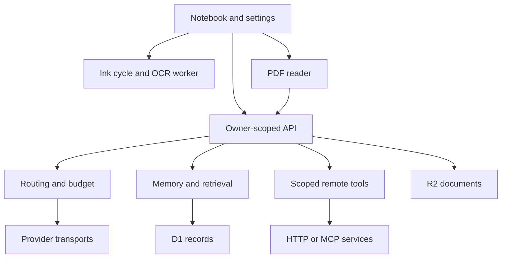

# Architecture

Product **alpha 0.4** · Documentation **docs-v4** · Artifact **v6-alpha04-2026-09-13**

The application owns canonical state and rendering; model output cannot directly edit the document. Strokes have IDs/revisions, recognized blocks retain original stroke references, and answers have exchange/model/source provenance. Navigation restores visible unsent ink and pauses its automatic reply. New input or explicit Read starts a cycle; page entry and reload cannot start one. Recognition jobs complete independently and apply only to the matching input revision.

| Module | Responsibility |
|---|---|
| `app/notebook-app.tsx` | Writing, books/pages, PDFs, reply rendering and saving |
| `app/use-ink-flow.ts`, `lib/ink-cycle.ts` | Shared input-end timestamp, recognition jobs, fade barrier and revision checks |
| `lib/handwriting.ts`, `lib/ocr.worker.ts` | Line grouping, pressure-ink crops and WASM TrOCR |
| `lib/erase-ink.ts`, `lib/ink-text.ts` | Regional stroke cuts, glyph erasure and replacement |
| `lib/provider-registry.ts`, `lib/companion-policy.ts` | Providers, routing, lock, capabilities, context and price guards |
| `lib/inference-transport.ts` | Responses, chat and Messages formats; normalized SSE |
| `lib/remote-plugins.ts` | Remote discovery, schema and permission checks, execution |
| `lib/companion-store.ts` | Encrypted keys, configuration concurrency and cost reservations |
| `lib/companion-memory.ts` | Provenance, history, tombstones, lexical retrieval and proposals |
| `app/api/companion/*` | Bounded orchestration and owner-scoped APIs |
| `app/companion-settings.tsx` | Identity, models, tools, memory, activity and appearance |

Migration 0000 is preserved; 0001 adds companion settings, memories, memory events, proposals and runs. No table is dropped. AES-256-GCM keys use fresh IVs and owner-bound authenticated data. Endpoint changes invalidate keys. Settings compare stored snapshots to reject stale connection-test writes. Proposal/configuration changes and memory/history changes use atomic D1 batches. Budget reservation uses one conditional insert to prevent concurrent overspend.

Context combines recent turns and up to eight attributed excerpts. Retrieval is lexical, not embedding search. Tool/notebook text is evidence rather than trusted instructions. Automatic memory requires a tool-capable model. Instruction changes require review; no self-modifying code runs. Vector RAG, background consolidation, measured improvement proposals and model-directed routing remain replaceable future modules.

Plugins are generic HTTP/MCP services, not specific PaperQA code paths. PaperReadingAgent currently supplies registry conventions; its Python functions need a hosted wrapper. V1 supports bearer authentication and supported 2025 MCP revisions, not OAuth/stdio installation. Public rollout needs native sessions and controlled outbound networking/DNS enforcement beyond the private deployment's endpoint filters.

Shared React/TypeScript and vector ink support mobile reuse. Layered geometry and bounded composited WebGL lighting simulate depth; they are not hardware ray tracing. Worker inference keeps OCR off the UI thread. Capacitor native projects, credentials and device certification remain external gates.

## Paper capture candidate — sprint-02-r2

`app/paper-capture-dialog.tsx` owns deliberate photo selection and review. `lib/prepare-photo.ts` creates an oriented/cropped PNG without EXIF. `app/api/captures` and `lib/capture-store.ts` persist owner-scoped source metadata in D1 and original/derived bytes in R2. Migration 0002 adds `paper_captures`. Each retake has a new ID and parent reference; a repeated matching upload is idempotent. SHA-256 fingerprints reject changed content under an existing ID.

`lib/capture-recovery.ts` exports a bounded parent-first revision chain and verifies hashes before restore. Recovery supports up to 20 revisions and 45 MB of raw assets per export. `app/use-paper-turn.ts` starts vision and fade at explicit Ask, invalidates superseded results without cancelling recognition, and sends current text into existing reply pagination. Page source metadata and reply links retain the exact capture ID. Original and derived bytes remain separate from model interpretation. Photo selection sends no model request.

Compiled-Worker persistence tests and existing ink/pagination regressions pass. The Playwright suite runs production client assets and the compiled Worker against independent local D1/R2. Actual-provider runs, photo-region correction and physical-device validation remain open; [current evidence](iterations/02/BROWSER-INK-MILESTONE.md) governs completion claims.

`lib/ink-draft.ts` computes movable unsent input and performs one journaled source/destination mutation. Stroke IDs and pressure, recognized blocks and erased regions move together. The destination records `inkSourcePageId`; moved stroke revisions invalidate previous recognition results. Saved annotation intent excludes both original strokes and formatted text from subsequent automatic recognition. `app/ink-recovery.tsx` exposes move, annotation and explicit read without a compulsory modal.

Unsent input alone does not open recovery. The panel appears for an overlap, a space failure or an explicit Ink options request. A successful move clears that request and its notification, then announces the result only to assistive technology. The destination remains editable and unsent; ordinary writing and reload do not reopen recovery.

Photo crop controls remain editable while the derived preview is prepared. Generation checks accept only the latest crop; saving requires a matching prepared image. Original download fetches authenticated bytes, reports failures in the capture panel and creates a named browser download. Compact save indicators keep accessible names when their visible labels are hidden.

## Planned 3D additions — sprint-02-r2

The accepted direction adds a physical notebook paired with its digital edition. Proposed capture data separates immutable original image bytes, derived crop/orientation, physical page identity, interpretation revision and companion turn. Owner-scoped source resolution links each answer to the exact capture revision; pairing identifiers do not grant access. Capture durability, idempotency, two-client handoff, export/import and permission controls reuse and extend the existing storage boundaries.

Photo input uses explicit Ask. A configured vision provider interprets the current image; local OCR belongs to non-provider mode. Both preserve original evidence and revision guards. The document model remains independent of any Three.js/React Three Fiber investigation. MC-034 evaluates one deformable spread and its coordinate mapping; MC-035 supplies physical dimensions and binding design. Production renderer adoption depends on actual input/device evidence.

These modules are proposed in [Sprint 02](iterations/02/SPRINT-PREPARATION.md); they are not deployed capabilities. Existing provider routing, model lock, memory permission and pre-reveal checks remain required. The electronic answering-book option is future discovery.
