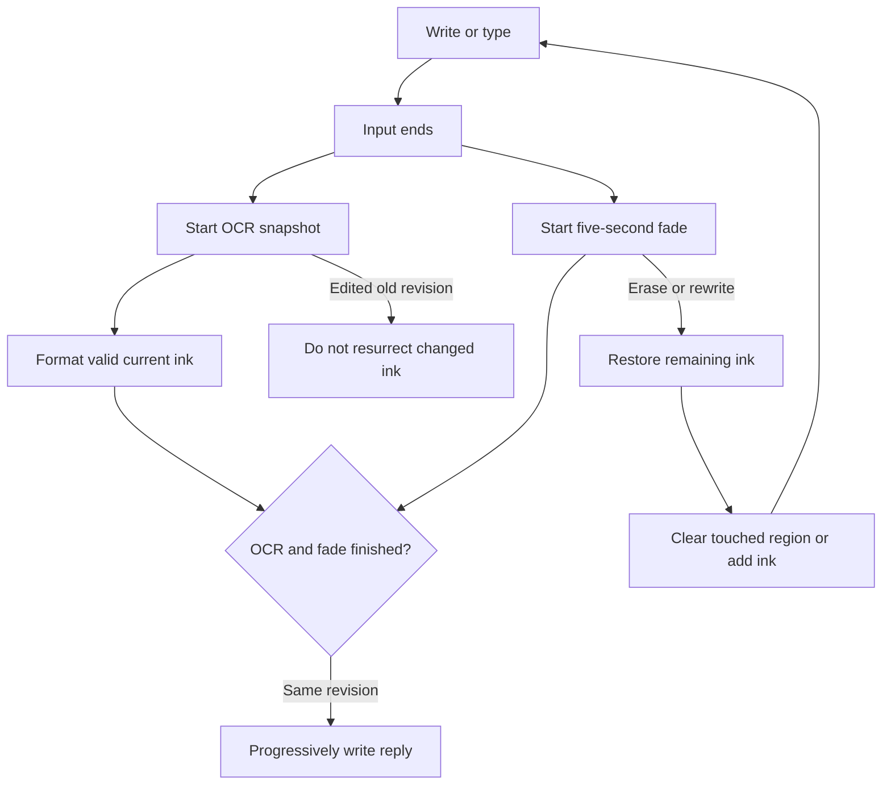

# Interaction and development workflow

Product **alpha 0.4** · Documentation **docs-v4** · Artifact **v6-alpha04-2026-09-13**

Latest conversation decisions supersede docs-v3's proposed recognition-confirmation dialog.

1. Render ink immediately. After 380 ms of quiet, recognition and fading start at the same timestamp. IME composition, active pointers and open dialogs suspend automatic activation.
2. Run local OCR in a worker or cloud OCR with the configured vision model. Apply the best match without confirmation. Keep originals.
3. Erasing during fade restores remaining text before clearing intersecting glyphs/stroke segments. Rewriting and erasing never cancel OCR jobs. Revision checks prevent stale application; the next input-end starts another cycle.
4. Reply only when recognition and the five-second fade are complete on the active matching page. Missing providers/errors restore input with actionable feedback.
5. Stream answer deltas, sources and artifacts. Persist model/tool/usage details. Stopping retains partial output and recoverable source ink.

## Development sequence

1. Restore the exact source checkpoint; read the interaction contract, architecture and QA. Preserve older product tags.
2. Define one concrete acceptance case and canonical state ownership before implementation.
3. Implement the smallest complete flow with replaceable recognition/provider/tool adapters.
4. Test races that can lose or resurrect ink, credentials, memory or budget. Fake transports belong in automated tests, not live replies.
5. Check actual browser interaction; compile hosted and mobile bundles. Record paid-service and physical-device checks separately.
6. Advance documentation independently of product version. Commit code, decisions and evidence together; push checkpoints before long interruptions.
7. Build and publish that exact revision, preserving private access. Verify terminal deployment status before describing the version as live.

## External gates

Connect a paid provider for real response/vision measurements; host PaperReadingAgent research functions if needed; add native authentication/CORS, signing and store metadata; test Apple Pencil, Android stylus/IME, low-memory OCR and assistive technologies on physical devices. These are not claimed complete by the web alpha.

## Planned paper workflow — sprint-02-r2

Paper capture has explicit submission: capture/import, select notebook/page, durably preserve original and source revision, then Ask. Ask starts current vision recognition and the digital five-second fade together. Correcting or retaking creates a new revision; existing jobs continue without applying stale results. The current response appears on fixed digital leaves and opens the exact original through its source link. Ordinary paper ink remains unchanged.

Execution order, capacity, regression checks and baseline prerequisites are defined in [Sprint 02](iterations/02/SPRINT-PREPARATION.md). MC-032–035 are proposed implementation/design work. Conversation profiles and multi-leaf input in MC-029–031 follow that sprint. Customer pilot execution requires the complete MC-024 baseline.
