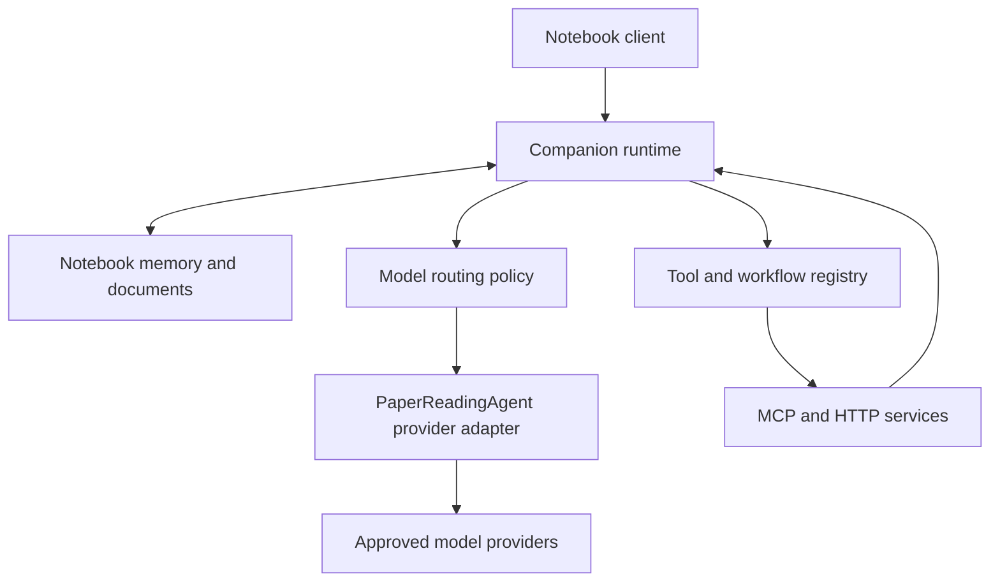

# Enchanted Notebook Architecture Proposal

The recommended design is a persistent notebook companion with interchangeable model providers and tools. PaperReadingAgent supplies a reusable starting point for provider configuration; PaperQA becomes one optional research capability. The notebook owns its identity, memories, documents, interaction state, and permissions across the web, iOS, and Android.

This is a proposed architecture for discussion. Alpha 0.3 is the implementation baseline. The proposed interfaces, memory system, and routing behavior have not been implemented or validated in the notebook.

## Product direction

The defining interaction remains writing on a physical-looking book: capture ink immediately, understand it, and let a relevant response appear progressively on the paper. Configuration should make that interaction dependable without dominating the writing surface.

The architecture should support three independent choices: **who the companion is**, **which model handles a task**, and **which external capabilities it can use**. A change of model should preserve the companion’s preferences and relevant history. Adding a research tool should not require changing the notebook renderer. Changing paper lighting should not affect recognition or inference.

For the first release of these capabilities, the recommended integration target is the notebook product. A ChatGPT/Codex plugin can later expose selected capabilities from the same service through its own adapter. Installing a tool in ChatGPT and configuring a model provider for the notebook are separate operations. OpenAI’s documentation likewise distinguishes provider connection configuration from plugin packaging, skills, and MCP connections.[^6][^7]

## Evidence from other systems

These are documented patterns and architectural lessons, rather than a benchmark ranking or an instruction to adopt every framework.

| System | Documented pattern | Recommendation for the notebook |
| --- | --- | --- |
| Codex configuration | A provider definition specifies connection details such as the endpoint, protocol, authentication, and headers.[^6] | Keep provider connections separate from persona, tool grants, and routing rules. |
| OpenAI plugin packaging | Plugins bundle a stable identity, skills, and MCP dependencies. Packaging and server deployment are separate concerns.[^7] | Use versioned capability packages; do not equate a GitHub URL with an operational service. |
| MCP | Standardizes tools, resources, prompts, transport, and discovery; leaves model use and context management to the host.[^8] | Support MCP through a backend adapter while retaining a separate model-provider interface. |
| Dify | Distinguishes tools, models, agent strategies, endpoints, data sources, and triggers; its manifest describes versions, runtime, permissions, and extensions.[^10][^11] | Distinguish callable tools, complete workflows, and model providers. Reuse the classification idea without importing the entire Dify runtime. |
| LiteLLM | Offers deployment selection, retries, fallback behavior, and optional budgets. Automatic tier selection has separate configuration.[^12][^13][^14] | Reuse suitable provider infrastructure, then define notebook-specific routing rules and evaluate them. |
| Open WebUI | Separates model tools from application Functions; Python extensions execute server-side code.[^15] | Begin with trusted backend adapters and authenticated remote services. A plugin manifest alone does not provide isolation. |
| Letta | Current MemFS uses versioned memory files, with selected files always in context and others loaded when needed. Its default memory filesystem has no vector index.[^20] | Separate durable memory from active context; preserve versions and provenance. Add semantic retrieval where it improves actual recall. |

Compatibility needs explicit versioning. The inspected MCP revision is **2026-07-28** and documents discovery and stateless request changes. Its sampling primitive is deprecated. Existing servers may implement earlier revisions, so compatibility must be checked for each adapter and SDK rather than inferred from the label “MCP.” HTTP authorization and the notebook’s own access policy are also distinct responsibilities.[^8][^9]

LiteLLM’s optional deployment policies are not proof that a consuming application has enabled them. Its budget documentation also identifies deployment dependencies and edition-specific features; for example, shared spend tracking uses Redis and tag budgets are marked Enterprise. A minimal notebook router should avoid depending on optional features before their operational cost is justified.[^13]

## PaperReadingAgent assessment

The static review is pinned to main commit **f8fae1976552ecfedb785a747add2b972fc12e85**, dated September 2, 2026. No repository code was executed or modified. Findings below describe the inspected implementation, not verified production behavior.

The most reusable module is **provider_config.py**. It has four built-in provider definitions—DeepSeek, DashScope, OpenAI, and OpenRouter—plus custom JSON registration, endpoint/model defaults, key resolution, and a key-free listing. It uses standard-library imports. Its configuration loading is a useful starting point for an injected, server-controlled provider registry.[^1]

**engine.py** constructs separate text, vision, and embedding configurations for LiteLLM. Each configuration currently has one selected deployment. The existing EngineAdapter also imports and exposes PaperQA settings, documents, indexes, evidence, and answers. Importing that complete adapter would bring the paper workflow into ordinary notebook inference. The connection-building portion should be separated from PaperQA-specific settings construction.[^2]

The HTTP service is currently organized around a **six-step paper workflow**, with configuration, sessions, execution records, and scientific-text translation. Its SSE channel exposes workflow traces and completion events. Answer text arrives through the completed step; this is not the answer-token stream required for ink appearing as a model generates it. There is no explicit cancellation route connecting the observation stream to the executing job.[^3][^4]

Sessions are process-local PaperQA objects keyed by session ID. The inspected HTTP path does not establish authenticated user ownership of those sessions. Localhost binding and CORS configuration suit the prototype’s local use but do not establish a hosted multi-user boundary. The preferred integration avoids inheriting this session store: inference can accept a bounded context package while the notebook retains durable state.[^3][^5]

No MCP server or plugin manifest was found in the reviewed tree. AgentOps manages development specifications and a reporting ledger; it does not execute model routing. The OpenRouter “auto” model delegates selection upstream. The inspected path does not configure an application-owned task classifier, health-based cross-provider fallback policy, or budget enforcement.[^1][^2][^28]

The provider verification script includes configuration checks, a key-separation regression check, a real DeepSeek request, and rejection checks using placeholder credentials for other providers. These tests do not demonstrate successful inference for every listed provider. The pinned commit’s [CI run succeeded](https://github.com/PaperStrange/PaperReadingAgent/actions/runs/33656259627), but its automatic workflow is offline verification and frontend builds; live E2E checks are separate.[^26][^27]

### Required integration work

“Required” here means required to meet the notebook’s requested experience, not necessarily a change that must live in PaperReadingAgent.

| Change | Recommended location | Reason |
| --- | --- | --- |
| Extract provider registry and normalized connection building | Small shared module maintained with PaperReadingAgent | Both products can reuse provider definitions without importing PaperQA or copying code that later diverges. |
| Add a generic inference interface | Thin adjacent Python service, or notebook-owned backend adapter | Accept messages and generation options; return normalized content, actual model, usage, and errors. |
| Add answer-token streaming and cancellation | Inference adapter and notebook run controller | Support progressive ink, interruption, and preserved partial answers. |
| Bind credentials to approved provider endpoints | Backend configuration boundary | Current settings allow a caller’s api_base alongside a server-resolved key. Hosted requests must not redirect that key to an unrestricted endpoint.[^2] |
| Authenticate requests and isolate ownership | Notebook backend and service-to-service boundary | Scope every context, asset, run, and result to its authorized owner. |
| Test the extracted contract | Shared module/service tests | Verify concurrent provider separation, endpoint restrictions, normalized errors, stream completion, and cancellation. |

A wrapper could prove the integration without initially modifying the source repository. Shared extraction is preferable once the boundary is agreed. The existing paper workflow can continue using its own consumer adapter. The original extracted module should also receive explicit licensing/versioning before distribution; a routing-only package does not need to bundle PDF parsing dependencies.

## Proposed component boundaries

The diagram describes ownership and calls, not a requirement to deploy a separate microservice for every box.

The existing web client remains responsible for pen input, page movement, lighting, layout, and rendering. The companion runtime owns each request’s lifecycle: recognition, context assembly, routing, tool use, response streaming, persistence, cancellation, and recovery.

The existing TypeScript backend can remain the authenticated product boundary. A small Python service is a reasonable home for reuse of PaperReadingAgent and its LiteLLM dependencies. This keeps Python and paper-processing dependencies off mobile devices. These are logical interfaces first; a queue, separate vector database, or additional service should be introduced for a concrete workload.

The notebook’s durable store remains authoritative. Provider-side conversation IDs, tool caches, and remote research jobs may be useful execution aids, but they cannot be the only copies of user history. OpenAI provides durable conversation objects and opaque compaction items; those are useful within its API, but a portable product should retain its own readable records and reconstruction path for switching providers.[^18][^19]

## Plugin and provider contracts

A small versioned manifest should identify the package, package version, manifest schema version, capability IDs, supported contract versions, transport, configuration schema, credential references, and requested access. A package may supply more than one capability, but each capability needs an explicit invocation contract.

Three capability kinds are sufficient initially:

| Kind | Input and result | Examples |
| --- | --- | --- |
| Model provider | Messages, assets, model options; content/events, model identity, usage | PaperReadingAgent provider adapter, direct provider adapter |
| Tool | Typed arguments; typed result with provenance | Search selected notes, recognize ink, retrieve a document passage |
| Workflow | Goal plus approved context; job progress and structured deliverables | PaperQA literature review, comparison across papers |

Tools should declare whether they read, write, or transmit data, and what assets they can accept. Authentication grants must enforce this scope; self-declared permissions are descriptive metadata. A research plugin receives selected documents or passages, not unrestricted access to every notebook.

Each invocation needs a request ID, contract version, deadline, owner-derived access scope, and cancellation behavior. Results need structured errors and provenance. Long operations should use durable job IDs, progress, and resumable result retrieval. Idempotency is necessary before automatically retrying operations with external side effects.

The UI should distinguish **available**, **configured**, **connected**, and **enabled for this notebook**. A installed-looking switch must never imply that an absent service or unconfigured credential is working. Opening a plugin should show its purpose, settings, data access, connection test, and recent failures.

The product can share these backend capabilities with a future ChatGPT/Codex integration. That adapter would need the appropriate MCP surface and plugin packaging; a notebook inference endpoint alone does not create a ChatGPT plugin or replace ChatGPT’s selected model.[^7][^8]

## Model routing and configuration

Start with explicit task policies and manual override. Learned routing can be introduced after a small evaluation set shows where explicit rules fail.

| Task | Initial policy | Expected interaction |
| --- | --- | --- |
| Read handwriting | Select a verified recognition/vision capability for the language and input type | Show editable recognition before uncertain text becomes a question. |
| Ordinary companion reply | Prefer a low-latency model that satisfies required capabilities | Stream answer text as it arrives. |
| Explain or solve a difficult question | Use an appropriate reasoning profile | Show genuine progress and allow cancellation. |
| Research selected papers | Invoke a research workflow with document scope and a cost/time budget | Return evidence and citations; stream workflow progress separately from answer text. |
| Generate media | Use an explicit media capability | Return a persistent artifact with provenance; indicate if generation is still running. |

A provider record describes the connection and verified features. A routing policy describes task preferences, permitted models, fallback order, latency/cost constraints, and required capabilities. A companion profile describes language, tone, teaching style, response length, and identity. These records should remain independent.

Before selecting a candidate, filter by allowed provider, required modality, tool-call support, structured-output support, context capacity, health, and remaining budget. Cost or latency ordering applies only among eligible candidates. A fast text-only fallback must not silently replace a vision model needed to read handwriting.

Show the actual selected model and any fallback in a compact reply-details view. Allow simple choices such as Auto, Fast, or Thorough, with advanced controls for model IDs and routing rules. Avoid promising model capabilities solely from a configured name; model catalogs and account access change.

Do not concatenate two providers’ answers if a stream fails midway. Preserve the partial answer and offer a clear retry or continuation strategy. Reconstruct subsequent context from the notebook’s canonical records. Provider-specific opaque state should only be reused where supported.

## Memory, character, and context engineering

Long-term storage, active context, retrieval, and personality consistency solve different problems. A larger context window alone does not provide dependable long-term recall. Anthropic’s context-engineering guidance emphasizes selection, compaction, structured notes, and focused subagents. LongMemEval separately tests extraction, multi-session reasoning, temporal reasoning, updates, and abstention, which are useful dimensions for notebook acceptance tests.[^16][^22]

The recommended memory design has five layers:

| Layer | Contents | Update and retrieval policy |
| --- | --- | --- |
| Companion identity | Name, tone, teaching approach, boundaries, visual style reference | Versioned configuration controlled by the user/product; included in each relevant run. |
| User preferences | Language, explanation depth, accessibility and response-format preferences | Explicit settings or reviewable learned suggestions; scoped to the user. |
| Active working memory | Current question, nearby ink, recent dialogue, selected passage, unfinished task | Small bounded context with checkpoints; expires or is summarized when the task changes. |
| Notebook knowledge | Notes, corrected transcripts, documents, supported facts and decisions | Persist with source IDs and versions; retrieve by topic, keywords, semantics, and time as needed. |
| Historical archive | Earlier turns, original ink, superseded preferences, completed research | Retain according to user controls; retrieve when needed rather than including everything in every prompt. |

These layers should share one ownership model. Keep raw ink, recognized text, user correction, and assistant interpretation as separate linked records. A model’s guess must not silently replace the learner’s original writing. A remembered fact should link to the source that supports it and record whether it is explicit, inferred, superseded, or rejected.

Start with one companion identity across notebooks and separate knowledge per notebook. Cross-notebook retrieval can be a user-controlled option. This preserves continuity while avoiding unrelated topics overwhelming an answer. People should be able to inspect, edit, forget, or disable learned memories.

RAG provides retrieved evidence at answer time. Use exact/keyword matching alongside semantic retrieval, with notebook/owner filters, source-page links, and version-aware indexing. Re-rank or expand retrieval only when it improves quality on representative questions. An empty retrieval result should produce an honest uncertainty statement, not a fabricated recollection.

Summaries are derived indexes, not replacements for source records. Preserve unresolved questions, corrections, dates, and source IDs when compacting. Background consolidation should update records incrementally, detect conflicts, and keep a revision history. Deletion must propagate to chunks, embeddings, summaries, caches, and future memory retrieval; retaining invisible derived copies would undermine a “forget” control.

Letta’s current MemFS provides a useful example of versioned, inspectable memory and a distinction between always-present and selectively loaded material. Its background “dreaming” illustrates consolidation outside the immediate reply path. These patterns can be implemented with notebook-owned storage; adopting Letta itself is an optional future decision.[^20][^21]

## Harness engineering and controlled improvement

Here, a harness means the surrounding software that makes model execution repeatable: run states, context assembly, tool permissions, deadlines, retries, checkpoints, output validation, traces, and evaluation. Anthropic’s long-running coding-agent work supports explicit progress artifacts and meaningful verification; applying those principles to notebook conversations is a design inference, not evidence that its coding results transfer automatically.[^17]

A run should move through identifiable states such as recognized, accepted, retrieving, generating, completed, cancelled, or failed. A stale reply from an earlier page or edited question must not overwrite newer work. The same controller should support ordinary text and longer research, while keeping their progress signals distinct.

If **RSI** means recursive self-improvement, the recommended first interpretation is a controlled improvement loop: collect explicit corrections and outcome signals, propose a change to prompts or routing, evaluate it against held-out cases, review the change, and promote a version that can be rolled back. The system should not automatically rewrite its core identity, permissions, or production code from its own generated feedback.

Self-Refine studies iterative answer refinement without additional model training. ACE studies incremental context adaptation through generation, reflection, and curation. These motivate experiments with bounded refinement and reviewable memory updates; neither establishes guaranteed improvement or reliable recall for this notebook. Additional model passes also consume time and budget.[^23][^24]

The concern about “diffusion uncertainty” is interpreted as consistency across generated answers and media. Durable memory belongs in the application’s state regardless of the model family. For the notebook’s appearance, keep paper geometry, handwriting fonts, lighting behavior, and accepted assets stable. Generative media can use stored references and persisted outputs; repeatedly generating the entire book would make its appearance less predictable.

## Handwriting and the magical response flow

Handwriting recognition should be another replaceable capability. Google Cloud Vision, for example, documents handwriting extraction with page, block, paragraph, and word structure. That establishes a candidate technology, not measured accuracy on this notebook’s languages, cursive, or equations.[^25]

Typed text should bypass OCR. Pen input should preserve vector strokes and produce a clean image or digital-ink representation for a suitable recognizer. Recognition should expose uncertain spans or alternatives where the engine supports them. A correction pass may regularize spacing and obvious spelling, but must preserve names, numbers, equations, and negation unless the user accepts a change.

The proposed interaction is:

1. Ink appears immediately under the pen.
2. After a pause, recognition starts with visible status; continued writing cancels or supersedes the stale recognition request.
3. The user can inspect or correct the recognized text. Automatic continuation remains available when the selected mode and recognition quality support it.
4. The companion starts from that recognized intent and approved context.
5. The original ink fades only after the request is accepted, while genuine answer deltas appear on the page.
6. Failure or cancellation preserves the original ink and any partial answer.

The output contract should support text, emojis, math, tables, citations, images, stickers, and video references. Font selection belongs to the renderer. A media result should identify a real stored artifact, its type, and origin. Workflow progress, generated answer text, and media completion are different events; showing a progress stream as though it were answer generation would recreate the present disappointment.

Perceived responsiveness should improve through immediate pen feedback, early acknowledgement, cancellation, streaming, and background retrieval/indexing. Measure acknowledgement latency, recognition latency, first-answer latency, total time, and animation frame time separately. No network-dependent “real time” guarantee should be made before measuring actual devices and providers.

## Proposed development sequence and acceptance gates

| Stage | Deliverable | Evidence required before calling it complete |
| --- | --- | --- |
| Architecture agreement | Confirm integration target, companion scope, memory defaults, and routing ownership | Recorded decisions and a small agreed interface contract. |
| Alpha 0.4 foundation | Companion settings, one real provider integration, normalized streaming, OCR review, and richer material lighting | Answers depend on typed/recognized input; actual model is visible; pen/page interactions survive errors and cancellation. |
| Extensibility slice | Registry, one MCP or HTTP tool adapter, PaperQA as an optional workflow, connection diagnostics | A second tool can be added without modifying the notebook renderer or model connection code. |
| Memory slice | Durable preferences, source-linked recall, editable memory, forgetting, and context compaction | Tests cover changed facts, older sessions, abstention, ownership, and deletion across derived indexes. |
| Routing and mobile hardening | Measured task policies, fallback rules, background-job resume, device performance | Capability-preserving fallbacks and consistent state across sessions/devices; separate native packaging and release work. |
| Controlled adaptation | Offline prompt/routing experiments and versioned memory consolidation | Improvements survive held-out evaluation without regressions in latency, grounding, or personality consistency. |

The acceptance set should include difficult handwriting, English/Chinese mixed input, numbers and mathematical signs, contradiction and correction, long sessions, model switching, tool failure, and interrupted streams. A small initial set should be curated from representative notebook tasks; expand it when concrete failures reveal missing coverage.

Privacy and ownership tests should verify that one user cannot retrieve another user’s notes, guessed run IDs cannot access results, and a disabled plugin receives no further notebook context. These checks directly support the proposed multi-user architecture.

## Decisions for discussion

**Recommended defaults:** integrate PaperReadingAgent into the notebook first; maintain one companion identity with knowledge scoped per notebook; use explicit routing with manual override; make learned memories inspectable and reversible; treat RSI as evaluated, reviewable adaptation.

Two product choices remain most consequential: whether the companion is primarily a lasting personal companion or a research/tutoring workspace, and whether long-term memory may be learned automatically or should initially require explicit “remember this” actions. These choices affect tone, memory scope, onboarding, and evaluation more than the choice of database or agent framework.

The next development step should follow those decisions. The existing notebook and PaperReadingAgent remain separate working products while the shared provider boundary is agreed.

## Sources

Sources are primary documentation, inspected repository code, and original research. Living documentation was checked on September 9, 2026; installed versions and deployment compatibility still require verification during implementation. Repository observations are limited to the pinned code review and the cited CI record.

[^1]: PaperStrange. [PaperReadingAgent: provider_config.py](https://github.com/PaperStrange/PaperReadingAgent/blob/f8fae1976552ecfedb785a747add2b972fc12e85/paper-qa-script/provider_config.py). September 2, 2026 snapshot.

[^2]: PaperStrange. [PaperReadingAgent: engine.py](https://github.com/PaperStrange/PaperReadingAgent/blob/f8fae1976552ecfedb785a747add2b972fc12e85/paper-qa-script/app/engine.py). September 2, 2026 snapshot.

[^3]: PaperStrange. [PaperReadingAgent: FastAPI backend](https://github.com/PaperStrange/PaperReadingAgent/blob/f8fae1976552ecfedb785a747add2b972fc12e85/paper-qa-script/reactflow-paperqa-prototype/backend/main.py). September 2, 2026 snapshot.

[^4]: PaperStrange. [PaperReadingAgent: orchestration.py](https://github.com/PaperStrange/PaperReadingAgent/blob/f8fae1976552ecfedb785a747add2b972fc12e85/paper-qa-script/app/orchestration.py). September 2, 2026 snapshot.

[^5]: PaperStrange. [PaperReadingAgent: session_store.py](https://github.com/PaperStrange/PaperReadingAgent/blob/f8fae1976552ecfedb785a747add2b972fc12e85/paper-qa-script/app/session_store.py). September 2, 2026 snapshot.

[^6]: OpenAI. [Advanced Configuration](https://learn.chatgpt.com/docs/config-file/config-advanced). Living documentation; accessed September 9, 2026.

[^7]: OpenAI. [Package your plugin](https://developers.openai.com/plugins/build/plugins). Living documentation; accessed September 9, 2026.

[^8]: Model Context Protocol. [Architecture overview](https://modelcontextprotocol.io/docs/2026-07-28/learn/architecture). Protocol 2026-07-28; accessed September 9, 2026.

[^9]: Model Context Protocol. [Authorization](https://modelcontextprotocol.io/specification/2026-07-28/basic/authorization). Protocol 2026-07-28; accessed September 9, 2026.

[^10]: Dify. [Choose a Plugin Type](https://docs.dify.ai/en/develop-plugin/getting-started/choose-plugin-type). Living documentation; accessed September 9, 2026.

[^11]: Dify. [Plugin Manifest](https://docs.dify.ai/en/develop-plugin/features-and-specs/plugin-types/plugin-info-by-manifest). Living documentation; accessed September 9, 2026.

[^12]: LiteLLM. [Router — Load Balancing](https://docs.litellm.ai/docs/routing). Living documentation; accessed September 9, 2026.

[^13]: LiteLLM. [Provider Budget Routing](https://docs.litellm.ai/docs/proxy/provider_budget_routing). Living documentation; accessed September 9, 2026.

[^14]: LiteLLM. [Auto Router](https://docs.litellm.ai/docs/auto_router). Living documentation; accessed September 9, 2026.

[^15]: Open WebUI. [Plugins](https://docs.openwebui.com/features/extensibility/plugin/). Living documentation; accessed September 9, 2026.

[^16]: Anthropic Applied AI. [Effective context engineering for AI agents](https://www.anthropic.com/engineering/effective-context-engineering-for-ai-agents). September 29, 2025.

[^17]: Justin Young / Anthropic. [Effective harnesses for long-running agents](https://www.anthropic.com/engineering/effective-harnesses-for-long-running-agents). November 26, 2025.

[^18]: OpenAI. [Compaction](https://developers.openai.com/api/docs/guides/compaction). Living documentation; accessed September 9, 2026.

[^19]: OpenAI. [Conversation state](https://developers.openai.com/api/docs/guides/conversation-state). Living documentation; accessed September 9, 2026.

[^20]: Letta. [MemFS](https://docs.letta.com/concepts/memfs). Living documentation; accessed September 9, 2026.

[^21]: Letta. [Memory & dreaming](https://docs.letta.com/configuration/memory). Living documentation; accessed September 9, 2026.

[^22]: Di Wu et al.. [LongMemEval: Benchmarking Chat Assistants on Long-Term Interactive Memory](https://arxiv.org/abs/2410.10813v2). March 4, 2025 revision; ICLR 2025.

[^23]: Qizheng Zhang et al.. [Agentic Context Engineering: Evolving Contexts for Self-Improving Language Models](https://arxiv.org/abs/2510.04618v3). March 29, 2026 revision; ICLR 2026.

[^24]: Aman Madaan et al.. [Self-Refine: Iterative Refinement with Self-Feedback](https://arxiv.org/abs/2303.17651). Initially submitted March 30, 2023.

[^25]: Google Cloud. [Detect handwriting in images](https://docs.cloud.google.com/vision/docs/handwriting). Living documentation; accessed September 9, 2026.

[^26]: PaperStrange. [Provider-switch verification](https://github.com/PaperStrange/PaperReadingAgent/blob/f8fae1976552ecfedb785a747add2b972fc12e85/verify/verify_provider_switch.py). September 2, 2026 snapshot.

[^27]: PaperStrange. [CI workflow and successful run](https://github.com/PaperStrange/PaperReadingAgent/blob/f8fae1976552ecfedb785a747add2b972fc12e85/.github/workflows/ci.yml). September 2, 2026 snapshot.

[^28]: PaperStrange. [AgentOps script](https://github.com/PaperStrange/PaperReadingAgent/blob/f8fae1976552ecfedb785a747add2b972fc12e85/scripts/agent-ops.py). September 2, 2026 snapshot.

