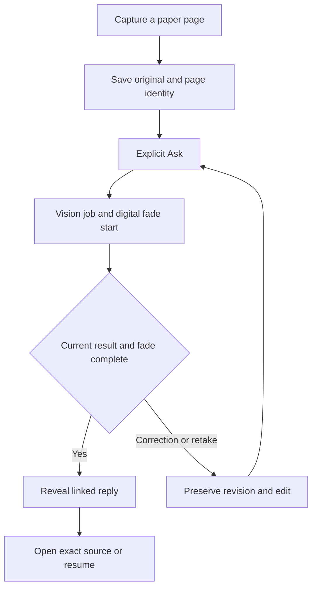

# Sprint 02 — a paper page that the companion can answer

Planning revision: 2. Decision date: 2026-10-03 America/Los_Angeles / 2026-10-04 UTC. Product direction accepted by SakuraSan: a real paper notebook paired with its matching 3D app edition. The execution forecast below requires named staffing, service access and calendar dates before commitment. Source reviewed: `d696112d9ae6e94ffec2bc9e2c3db4f6bbf1dda7`, published Site version 9, package `0.4.0-alpha.0`.

## Sprint goal

An internal tester captures a handwritten paper page, reopens its saved original after restart, explicitly asks the companion, receives a genuine vision-provider reply on fixed digital leaves, and opens the exact captured source behind that reply. A matched physical-book design and one interactive 3D spread demonstrate the intended appearance separately from this data flow.

Internal testing uses purpose-written test pages. Customer use of private diaries and the two-week customer pilot require the full MC-024 baseline review. Source-linked recall, sync and recovery, live providers, measured latency/cost, privacy and content handling remain baseline requirements.

## Ordered work and capacity

Planning assumption from the initial pack: two engineers for ten working days, 20 nominal engineer-days; 14 allocated and six reserved for integration, defects and uncertainty. QA: five days, four allocated and one reserved. Product research: two days. Design/prototyping: two specialist days requiring an available owner. These are allocation budgets, not measured velocity or confirmed staffing. Implementers confirm remaining effort before the sprint starts.

| Order | Work item | Required sprint output | Engineer-days | Other capacity |
|---|---|---|---:|---|
| 1 | Baseline tasks B1–B3 | Verified ownership, storage, provider, source and measurement boundary | 6 | 2 QA days |
| 2 | [MC-032](Story-Cards/MC-032.md) | Deliberate photo capture, page identity, durable original, retake and recovery | 3 | 1 QA day |
| 3 | [MC-033](Story-Cards/MC-033.md) | Current-source vision reply, correction, source navigation, measured real run and failure recovery | 3 | 1 QA day |
| 4 | [MC-034](Story-Cards/MC-034.md) | One 3D spread with deformation and accurate interaction; recorded adoption decision | 2 | Design input shared with MC-035 |
| 5 | [MC-035](Story-Cards/MC-035.md) | Dimensioned paper-notebook specification matching the digital design | 0 | 2 specialist days shared with MC-034 |
| 6 | MC-007 / MC-023 preparation | Pilot protocol, participant criteria, measures and recruitment plan | 0 | 2 Product/research days |
| | Allocated total | | 14 | 4 QA + 2 design + 2 Product days |

Reserve time is not additional feature capacity. Limit active engineering work to two cards and QA review to two. B1–B3 are tasks on existing cards, not additional story IDs or blanket closure of their parent cards. MC-034 is a time-bounded investigation: its output includes measured limitations and an adopt/rework decision. A failed prototype does not replace the working editor.

If reviewed estimates exceed capacity, remove MC-034 from the sprint first, preserving MC-035's dimensions for its later execution. If the core paper journey still exceeds capacity, change the duration before commitment while retaining its acceptance requirements. Missing design capacity queues MC-035 and the corresponding 3D decision. Missing live-provider access blocks MC-033. No prerequisite is replaced by fabricated success.

## Baseline tasks preceding the paper journey

| Task | Existing cards | Required evidence for this sprint's boundary |
|---|---|---|
| B1 — Ownership and processing, 2 engineer-days | MC-001, MC-002, MC-017 | Two actual test identities cannot access one another's captures, thumbnails, source links or replies. Processing destination and retention are visible; revocation stops new requests; routine logs omit page content and secrets. |
| B2 — Durable page and handoff, 2 engineer-days | MC-003, MC-004, MC-014, MC-015, MC-016 | Original bytes and metadata survive acknowledged save/restart, interrupted upload and duplicate retry. Two-client handoff and concurrent retake preserve revisions. Export/import restores bytes and source association; local-only and server-synced state are distinguished. |
| B3 — Genuine answering and trace, 2 engineer-days | MC-005, MC-008, MC-011, MC-012, MC-018 | A configured vision route respects model lock and scope; source citations resolve correctly. Actual usage includes recognition, replies, retries, stale jobs and content checks. Unsupported readings and unsafe output follow reviewed handling before reveal. |

Task budgets cover remaining implementation and verification after reviewing existing code. Full two-provider runs, the 100-probe recall evaluation, service-disaster recovery, market eligibility and every original acceptance criterion remain on their parent cards until evidenced. A task-level check does not mark a parent Done. Remaining effort may require a changed sprint duration.

## Paper input and reply sequence

1. Photograph or import one page, orient/crop its digital copy, and associate it with a user-owned notebook and physical page label. Pairing identifiers identify an object; they never grant access.
2. Save the original and source identity before acknowledging capture. Keep it accessible throughout processing. Crop/orientation produces a derived version. Exclude location metadata from outbound provider data.
3. Capture/import/review never submits automatically. Explicit Ask defines input end for paper capture. At that event, vision recognition and the digital five-second fade begin together. Physical ink remains unchanged. Camera handling does not inherit the surface quiet timer.
4. Provider mode uses the configured vision-capable route. Offline/non-provider mode may offer local OCR. A failed live route preserves the input and explains the failure. Preserve names, numbers and negation; interpretation never invents missing handwriting. Digital corrections do not require a mandatory confirmation dialog.
5. Corrections restore remaining digital ink before regional erasure. Retakes create capture revisions. Running recognition jobs continue; stale results cannot change current text or reveal on another page. Explicit resubmission starts the next current cycle.
6. Reveal a screened reply only after current recognition and fade complete. Replies continue on fixed leaves. Provider/context/layout limits retain the complete original and explain the actual limit without silent truncation.
7. Source records identify owner, notebook, page, capture revision and image region where available. Keep the original independently of transcription. A photo has no verified historical pen order; a replay is a visual approximation.

One companion per user, current-notebook retrieval default, explicit cross-notebook permission, automatic memory with history/undo, selected-model lock and reviewed strategy changes remain intact. Paper input adds an acquisition mode without broadening memory permissions.

## Ordered work following this sprint

| Work | Placement | Acceptance retained |
|---|---|---|
| MC-029 adaptive conversation rhythms | After the paper journey | Device/input-method and profile controls in [Conversation policy](CONVERSATION-POLICY.md) |
| MC-030 model-directed scenario workflow | After the paper journey and relevant M0 prerequisites | Bounded routing, budgets, permissions and two-provider evidence; existing provider controls remain baseline work |
| MC-031 complete multi-leaf input turn | After the paper journey | Complete-turn identity, correction and recovery; existing long-reply pagination receives regression checks now |
| MC-022 broad handwriting comparison | M1 after M0 | The 300-annotation, 20-writer benchmark; MC-033's narrower photo checks do not close it |
| MC-025 PaperReadingAgent hosting | After baseline plugin conformance | Generic integration and hosting requirements |
| Full 3D renderer adoption / expanded MC-028 art | After MC-034 evidence review | Existing input, GPU and physical-device acceptance |
| Electronic answering book, smart-pen integration, continuous camera/AR capture | Future discovery | Dedicated product decision and evidence before implementation |
| Manufacturing run and customer pilot | After physical fit review and MC-024 | Internal demonstrations never authorize customer rollout |

## Milestones

| Checkpoint | Window from agreed start | Evidence | Decision |
|---|---|---|---|
| R0 — Ready | Before day 1 | Named owners; B1–B3 remaining effort; provider/spend; physical devices; test-page permissions; design capacity | Confirm ten-day forecast or record changed duration before starting |
| R1 — Preserve a page | By day 4 | MC-032 restart/retry, B1 isolation, B2 restore and handoff | Answering proceeds when its storage and access dependencies pass |
| R2 — Answer the page | By day 8 | MC-033 real traces, corrections, source navigation, failed route and stale-job checks; B3 measurements | Review integrated behavior against the declared workload |
| R3 — Design and integration review | Days 9–10 | MC-034 findings if staffed; MC-035 design files; candidate QA and per-card evidence | Accept completed cards individually and issue a separate MC-024 status |

MC-035 begins in parallel with baseline work and supplies its dimension sheet by day 2 if staffed. MC-034 can begin after its geometry/input interface is reviewed and an engineering slot is available. It takes those dimensions and compares behavior with the existing editor. Its rendering engineer owns device measurements and the investigation report within the two-day budget; no extra QA allocation is assumed for this investigation. QA's four allocated days cover baseline and the integrated paper journey on the actual candidate and physical devices. Mock replies never satisfy provider or end-to-end criteria.

## Sprint completion and customer baseline

Internal review covers: capture two distinct pages; restart; retry interrupted upload; second-client handoff; reject another owner's source; ask a real provider; correct and retake during processing; open the exact original; retain a long reply on fixed leaves; export/import source recovery. Existing typed/Pencil/finger input, page turns, regional erasure and composer submission receive regression checks.

Record failures as well as successes. Retain MC-012's ordinary short-turn p95 first-visible-reply target of at most 12 seconds including fade. Measure photo acquisition separately from Ask-to-first-visible-reply. Include crop, upload and server stages in their relevant intervals. Report counts, provider/model, language, cold/warm state, device, attempted/successful-turn cost and missing billing data. Unmet targets remain open.

Every MC-024 dependency remains required before a customer pilot: identity, durability, sync, correction, exact recall, correction/deletion propagation, memory controls, provider lock, measured costs, plugin boundaries, sync faults, disaster recovery, export/delete, processing privacy, grounded/content-screened output, incident reports, market eligibility and physical-device behavior. Photo capture adds ownership, original recovery, versioned source links and processing disclosure to these gates. The visual investigation does not substitute for them.

Pilot preparation reuses MC-007/023. Proposed study after baseline approval: 12 regular notebook users over two weeks; at least 8 complete the flow unaided; at least 6 repeat voluntarily on three days in week two. Define capture failures, recognition corrections, screen-transition friction, original recovery and useful-reply criteria before recruitment. These are product-decision thresholds, not population estimates. Do not send invitations without explicit user authorization.

## Tracking

- [Current card statuses](AGILE-PROGRESS.md)
- [Machine-readable scope](BACKLOG-DELTA.json)
- [Historical observations and current QA additions](BEHAVIOR-AUDIT.md)
- [Digital investigation](Story-Cards/MC-034.md) and [physical design](Story-Cards/MC-035.md)

Product acceptance: SakuraSan. Engineering, QA, design and privacy reviewer identities remain unassigned. This planning revision claims no capture integration, 3D asset, physical prototype, live-provider result or new completed card.
