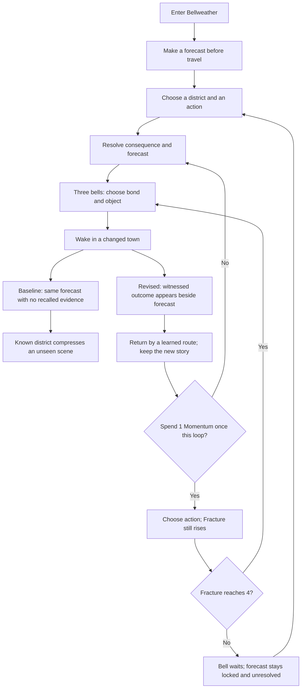

# One-day GameJam: make knowledge buy a minute

The Contrast build now lets a player spend 1 earned Momentum on a route visited in an earlier loop to take an extra action before the next bell. The new encounter keeps its complete story and choices. A visible forecast memory quotes only an outcome the player has already witnessed. Original remains available for comparison. The opening dialog now offers “Try GameJam / Contrast” directly, followed by “Begin Contrast run”; the comparison edition no longer requires starting Original first.

This is a tested interaction hypothesis, not proof of demand or a claim of a globally unique mechanic.

## What we played before changing anything

On 2026-10-05 the Bell agent drove Chromium with visible browser clicks, beginning on commit `369f0da82696caab98f8f68ede78f49da286d590`. The first Original route was Bell Square → Flooded Archive → Glassworks, choosing Help Mina → Listen → Steady, then anchoring Mina + chalk map. The first three predictions were correct, wrong, wrong. A second, informed Contrast run followed the same choices, correctly predicted all three outcomes, then revisited Bell Square in loop two.

The coordinator independently played an Original route and its ending. Their additional observed problem: on the first visit to the changed loop-two Archive scene, “Skip mastered scene” spent a visit and Momentum but granted no new route. A known district was being treated as a known scene.

Observed friction:

- The second-loop forecast repeated with no nearby record of the outcome already witnessed. The Contrast journal listed actions, not forecast evidence.
- Contrast accumulated 3 Momentum on the played first loop but exposed no spending action. Source inspection then confirmed that its existing skip control was always hidden.
- The new loop-two Bell Square scene became “Only the change remains.” Its full masquerade context disappeared even though the two choices were new. This was district-level compression applied too early.
- Midnight offered names of bonds and objects without explaining an actionable benefit. This jam does not claim to have solved that wider design issue.

Switching modes did **not** erase the Original run: it opened a separate, initially unstarted Contrast run. The initial visual impression of a reset was corrected after checking behavior and state ownership.

Evidence: [baseline action trace](evidence/baseline-action-trace.json), [first encounter](evidence/02-baseline-first-encounter.png), [anchor board](evidence/03-baseline-anchor-board.png), [Contrast loop-two baseline](evidence/05-baseline-contrast-return.png). Screenshot 04 captures the newly opened Contrast introduction, despite its early filename.

## Observed and revised journeys



The emotional arc we want to test is “I was guessing → I understand one thing → my understanding gives me room to act.” Only the actions and displayed consequences above were observed. Curiosity, competence, relief and care for the townspeople remain human-playtest hypotheses.

## Why someone might choose this game

The proposed player job is to become more capable by understanding a mystery, within one browser sitting. A specific loop-two promise is more credible than “a deep time-loop adventure”: **yesterday's knowledge buys one minute to help someone today**. The implemented minute changes the action budget; it does not yet establish whether the extra action feels emotionally important.

The market reading constrains this claim. [Mobius's developer interview](https://www.mobiusdigitalgames.com/news/alex-the-nomai) describes curiosity and exploration as the focus of Outer Wilds. Knowledge-driven progress already exists. The [PC Gamer review of the 2025 Roottrees remake](https://www.pcgamer.com/games/puzzle/the-roottrees-are-dead-review/) values reduced research friction while separately discussing limited attachment to its cast. That is a critic's report on the remake, not our play of the original browser version. The coordinator maintains separate firsthand evidence for released browser games; those experiences are not manufactured from store descriptions here.

For browser distribution, [itch.io's HTML5 documentation](https://itch.io/docs/creators/html5) supports a compact HTML/CSS/JS build and configurable embed. Our differentiating pitch is the complete, short prediction → earned minute → changed choice experience, not a journal, time loop, or map in isolation. Browser feasibility is tested; platform demand, conversion, repeat play and device preference are not.

## What changed and why

1. `learnedBells` is filled only when an actual boundary resolves. Wrong or missing predictions still produce witnessed evidence. The record survives midnight, stays isolated per mode, and clears on a fresh run.
2. A familiar route can reserve a borrowed minute once per loop from loop two onward. Reserving is free and reversible; spending happens atomically with the next choice. A district visited only in the current loop does not qualify.
3. A successful borrowed visit changes inventory, anchors and Fracture but does not advance the phase or resolve/reward a prediction. The following normal visit resolves that locked forecast once. Fracture 4 overrides borrowed time and forces midnight.
4. New world-specific scenes retain their full narrative, even in a previously visited district. Only an already selected scene in the same world can use the short return text.
5. After committing a choice, map travel, mode switching and “Choose elsewhere” wait for resolution, preventing an unresolved action or purchased minute from being abandoned or duplicated.

Original keeps its baseline skip mechanic for comparison, including the district-level skip limitation above. The small committed-action navigation guard applies to both modes. The borrowed-minute and learned-forecast features are Contrast-only.

## Validation performed

- Build and existing static checks passed, including syntax, story/engine boundary, references, and byte-for-byte dist rebuild.
- Existing CDP smoke assertions passed for split and single-file builds over HTTP. The shared helper's first launch collided with a Chromium profile; rerunning with a unique temporary profile passed. The existing environmental Google Fonts certificate failure remains a warning; system fallbacks render.
- Three rule tests passed: earlier-loop route eligibility, Momentum/once-per-loop budget, and catastrophe override.
- The browser journey used actual visible controls with **no game-state injection**. It verified earned evidence; new scene context; reversible reservation; mode isolation; navigation lock; no early/double forecast reward; a fourth visit in loop two; completed ending; restart reset; and a dangerous borrowed choice still triggering midnight.
- A 390 × 844 viewport played through loop one and a borrowed return with no horizontal overflow and a 44px or taller borrow button. An actual 821 × 462 iframe was started, played, resolved and advanced without horizontal overflow. These are Chromium layout checks, not physical touchscreen or Safari coverage.

[Automatic after-action trace](evidence/after-action-trace.json) · [new encounter and reserved minute](evidence/07-after-new-scene-borrow.png) · [borrowed result](evidence/08-after-borrowed-result.png) · [completed arc](evidence/09-after-completed-arc.png) · [phone-width layout](evidence/10-after-mobile-borrow.png) · [compact iframe](evidence/11-after-821x462-embed.png).

Run locally:

```sh
python3 -m http.server 8113
node build.mjs
python3 tests/check_static.py
node --test tests/echo-time.test.cjs
PLAYWRIGHT_MODULE=/path/to/playwright node tests/browser_journey.cjs
```

`tests/browser_journey.cjs` accepts `BELL_URL` and `CHROME_BIN`. It has no production dependency on Playwright. `dist/` is generated by `build.mjs`; do not edit it by hand.

The coordinator’s review found that the original start modal blocked the top mode toggle. A focused follow-up used real clicks on the new in-dialog entry, began Contrast, checked the Original default path separately, and verified the entry in the single-file build and at phone width.

## Human validation gate

Before calling this a differentiator, observe at least six new players, assigning three to each first-build order. Have them try both builds with the same objective; record order and learning effects. This is formative discovery, not a statistically powered experiment.

Ask for a next-step theory **before** they click a forecast. Observe whether they cite something actually witnessed, whether they find the borrowed minute without coaching, whether they can explain its Fracture tradeoff, and whether the extra action changes their plan. Afterwards ask which particular person or moment mattered and why. Record repeated-reading time, mistaken attempts to change a locked forecast, completion, and voluntary second-run choice.

Predeclared jam gate: at least four of six can explain the earned extra action and use it without intervention; no repeatable loss/duplicate-reward bug; at least three can name a concrete choice they would otherwise have missed. If they use the button only because it glows, or cannot connect the effect to prior learning, revise the mechanic before expanding content. These thresholds are design decisions, not validated industry benchmarks.

Known limits: no durable save across a page reload; bonds/objects still need stronger consequence explanation; the three forecast answers remain authored and fixed; no meaningful difficulty balancing or human reading-time estimate; no claim of empathy, enjoyment or retention based on agent play alone.

## Cooperative project boundaries

`js/data.js` owns authored story and schedules. `js/echo-time.js` owns pure eligibility/clock rules and can be tested without the browser. `js/engine.js` owns state transitions and rendering. `index.html`/`css/main.css` own layout. Browser journey evidence is separate from source and market claims. This boundary lets a narrative author, systems developer and playtest owner work without all editing the same story file. Keep one game per branch, checkpoint source/evidence together, regenerate the build, then let the coordinator review before the remote sync.
