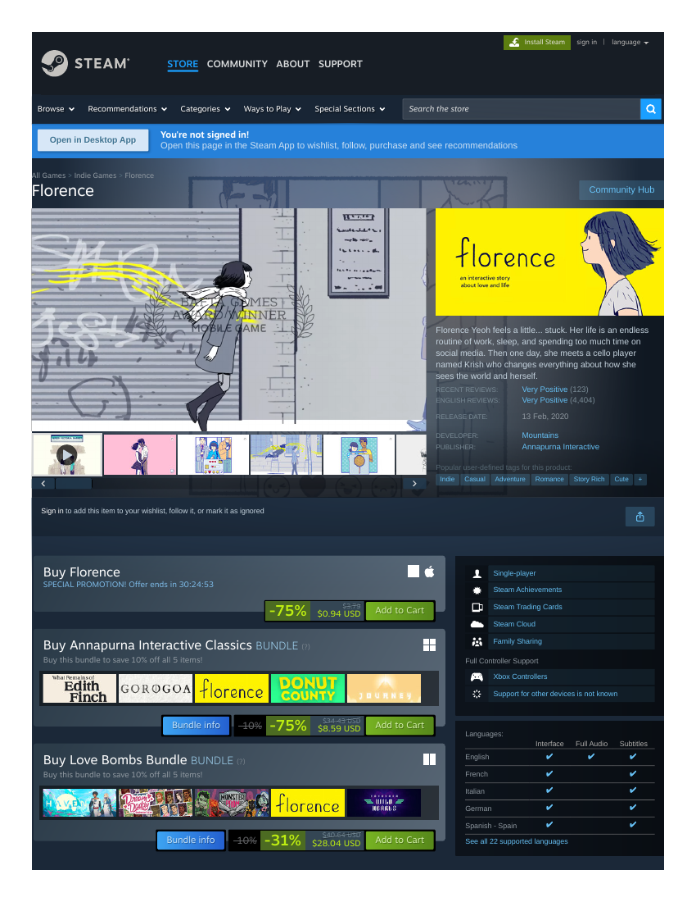

# Market research record — Florence (Memorable Moments original M6)
**Filed:** 2026-10-20 · **Method:** paywalled-competitor rule — storefront capture + trailer archived + facts recorded; the player slot is filled by a substitute (novena — see its record), because Florence is a paid native install with no browser edition.
**Source:** Steam store page as displayed 2026-10-21 (capture: `florence-storefront-capture.pdf`, this folder). Facts as displayed; no conversions.

- **Price:** $0.94 USD at −75% ("SPECIAL PROMOTION!"; regular $3.79) — as displayed in the Buy box.
- **Platforms:** Windows, macOS.
- **Release:** 13 Feb 2020 (Steam edition; the work originates earlier on mobile).
- **Developer / Publisher:** Mountains / Annapurna Interactive.
- **Reception:** Very Positive — 14,934 reviews across all languages (4,404 English); recent reviews Very Positive (123).
- **Genres / tags:** Adventure, Casual, Indie — tags: Indie, Casual, Adventure, Romance, Story Rich, Cute.
- **Positioning (paraphrased):** a young woman stuck in a work-sleep-phone routine meets a cellist, Krish, who changes how she sees the world — an interactive story about love's small routines.
- **Trailer archived:** `florence-trailer.mp4` (Florence – Release Date Trailer, 24 MB, 0:33), pulled from the Steam CDN.
- **Player-record status:** NOT played (paid native). Substitute novena played complete — Florence's own tactile, wordless handling of a relationship's arc remains the unanswered question for a future purchase decision.

## Evidence gallery (embedded)
The captures are filed under `evidence/` in this package (market records: beside the record, in `market-research/`). PDF captures are shown as rendered page views; PNG captures are embedded as-is.

*Steam storefront as displayed 2026-10-21 — $0.94 at −75% (page 1).*

