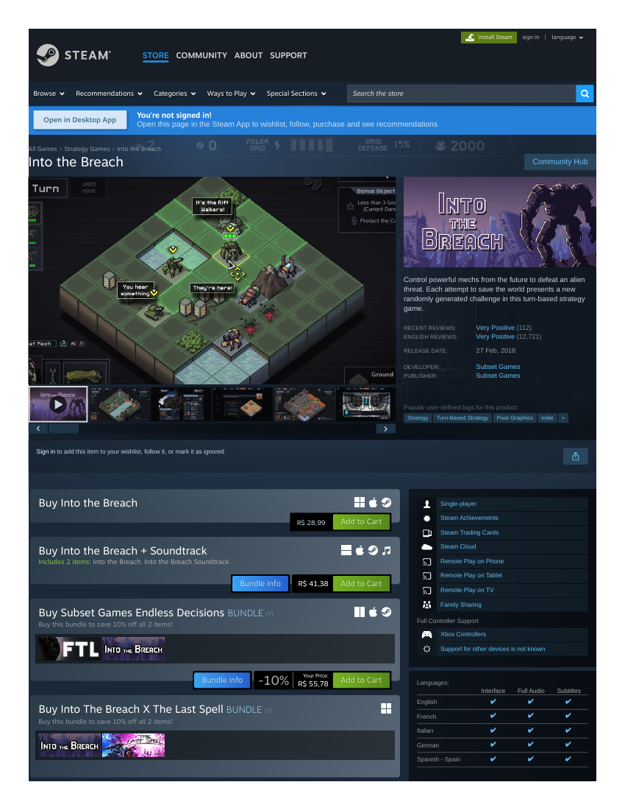
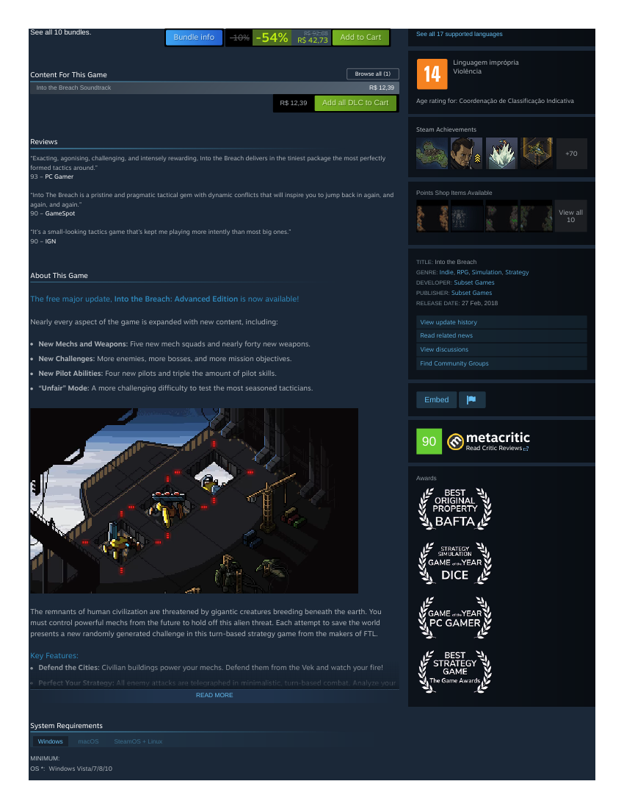

# Market-research record — Into the Breach (Thirteenth Bell competitor B3)
**Filed:** 2026-10-20 · **Perspective:** MARKET RESEARCH (not a player record — the game was not played)
**Why:** Sakura's paywalled-competitor rule (2026-10-20). B3 remains unplayed: native install behind a purchase, which is Sakura's call. A browser-playable family substitute (Desktop Dungeons) is under separate verification.
**Sources:** live Steam storefront capture, 2026-10-20 (PDFs banked in this folder: `into-the-breach-storefront-top.pdf`, `into-the-breach-storefront-about-sysreq.pdf`); trailer archived from Steam's CDN (`into-the-breach-announcement-trailer.mp4`, 51 MB, verified MP4). No purchase, no account.

## Commercial facts (as displayed, 2026-10-20)
- **Price — currency caveat:** the store session displayed prices in **R$ (BRL)**: R$ 28,99, no discount active. **The USD price was not observed in this session and is marked [OPEN]** — no conversion is asserted.
- **Release:** 27 Feb 2018 (Steam). **Developer / Publisher:** Subset Games.
- **Platforms (Steam):** Windows, macOS, SteamOS + Linux (unusually broad for its size; Linux support noted — relevant only if Sakura ever authorizes a native-install route).
- **Traction:** Recent reviews Very Positive (112); English reviews Very Positive (12,721); all languages 19,131 total reviews.
- **Presentation video:** "Into The Breach - Announcement Trailer" is the store's only trailer (archived here).

## Market read (labeled interpretation)
A compact tactics game still selling at undiscounted list seven years after release, with Very Positive depth across ~19k reviews — durable validation of the perfect-information, small-grid, run-based tactics design the matrix targets. Its multi-platform footprint (including Linux) makes it the most installable of the paid Bell slots if a purchase is ever approved.

## Evidence gallery (embedded)
The captures are filed under `evidence/` in this package (market records: beside the record, in `market-research/`). PDF captures are shown as rendered page views; PNG captures are embedded as-is.

*Steam storefront, top of page (page 1).*

*The capture's About + System Requirements page (page 2 of the filed PDF).*

