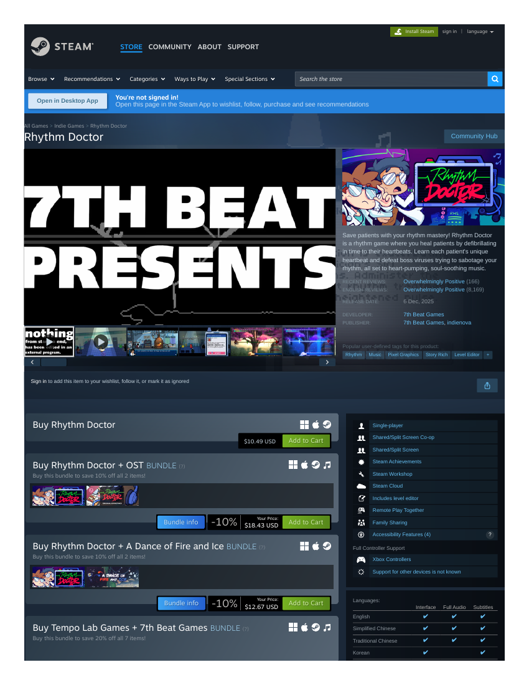

# Market research record — Rhythm Doctor (Vivid original V6)
**Filed:** 2026-10-20 · **Method:** paywalled-competitor rule — storefront capture + trailer archived + facts recorded; the player slot carries the Friday Night Funkin' substitute attempt (see its record) plus this game's own access verdict (see `../records/rhythm-doctor--access-check-2026-10-20.md`: the historical free demo was Flash-based and is dead; no living browser demo exists).
**Source:** Steam store page as displayed 2026-10-21 (capture: `rhythm-doctor-storefront-capture.pdf`, this folder). Facts as displayed; no conversions. (This session's Steam pages rendered prices in mixed currencies across titles — Rhythm Doctor displayed in USD.)

- **Price:** $10.49 USD, no discount shown. (Cross-note: the developer's itch page lists the same release at $20 minimum — a different storefront on a different day; see the access check in `records/`. Both figures are as displayed where captured.)
- **Platforms:** Windows, macOS, SteamOS + Linux.
- **Release:** full release 6 Dec 2025; Early Access began 26 Feb 2021.
- **Developer / Publisher:** 7th Beat Games / 7th Beat Games, indienova.
- **Reception:** Overwhelmingly Positive — 25,177 reviews across all languages (8,169 English); recent reviews Overwhelmingly Positive (166).
- **Genres / tags:** as displayed — Action, Casual, Indie, Strategy, Free To Play (the "Free To Play" listing is the page's own display; the Buy box price above is what the page charges) — tags: Rhythm, Music, Pixel Graphics, Story Rich, Level Editor.
- **Positioning (paraphrased):** heal patients by defibrillating on the seventh beat of their heartbeats — a one-button rhythm game where every patient teaches a new rhythm.
- **Trailer archived:** `rhythm-doctor-trailer.mp4` (Official Release Date Trailer English, 27 MB, 1:28), pulled from the Steam CDN.
- **Player-record status:** NOT played (paid native; no browser demo). The FNF substitute attempt documents the family's other barrier: real-time rhythm play is outside this operation's input envelope regardless of title.

## Evidence gallery (embedded)
The captures are filed under `evidence/` in this package (market records: beside the record, in `market-research/`). PDF captures are shown as rendered page views; PNG captures are embedded as-is.

*Steam storefront as displayed 2026-10-21 — $10.49 (page 1).*

