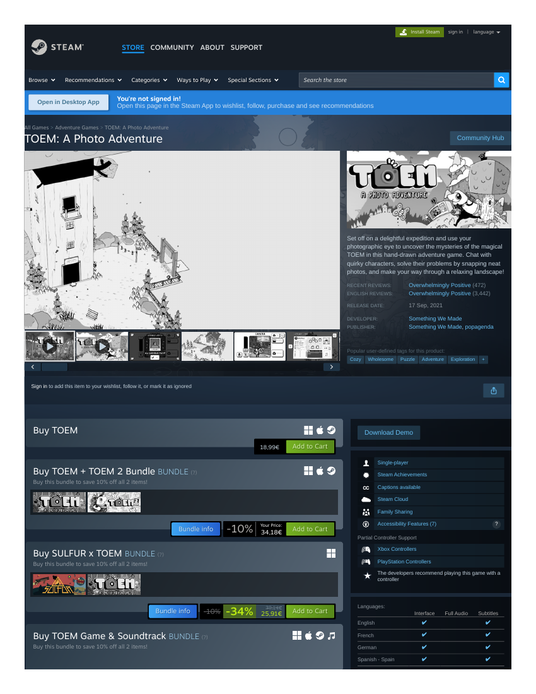

# Market research record — TOEM: A Photo Adventure (Vivid original V4)
**Filed:** 2026-10-20 · **Method:** paywalled-competitor rule — storefront capture + trailer archived + facts recorded; the player slot is filled by a substitute (Beyond the Trees — see its record), because TOEM is a paid native install with no browser edition.
**Source:** Steam store page as displayed 2026-10-21 (capture: `toem-storefront-capture.pdf`, this folder). Facts as displayed; no conversions. (This session's Steam pages rendered prices in mixed currencies across titles — TOEM displayed in euros.)

- **Price:** 18,99€, no discount shown.
- **Platforms:** Windows, macOS, SteamOS + Linux.
- **Release:** 17 Sep 2021.
- **Developer / Publisher:** Something We Made / Something We Made, popagenda.
- **Reception:** Overwhelmingly Positive — 10,185 reviews across all languages (3,442 English); recent reviews Overwhelmingly Positive (472).
- **Genres / tags:** Adventure, Casual, Indie — tags: Cozy, Wholesome, Puzzle, Adventure, Exploration.
- **Positioning (paraphrased):** a hand-drawn expedition where you chat with quirky characters and solve their problems by snapping photos, crossing a relaxing landscape toward the magical TOEM phenomenon — photography as social errand.
- **Trailer archived:** `toem-trailer.mp4` (Accolades Trailer, 50 MB, 1:08), pulled from the Steam CDN.
- **Player-record status:** NOT played (paid native). Substitute Beyond the Trees played (7 rounds) — TOEM's request-driven photography inside a storybook world remains the unanswered question for a future purchase decision.

## Evidence gallery (embedded)
The captures are filed under `evidence/` in this package (market records: beside the record, in `market-research/`). PDF captures are shown as rendered page views; PNG captures are embedded as-is.

*Steam storefront as displayed 2026-10-21 — 18,99€ (page 1).*

