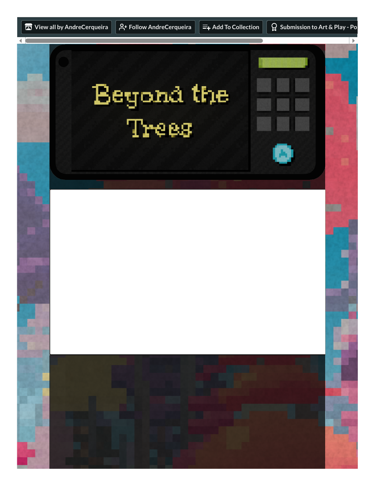

# Player record — Beyond the Trees (Vivid competitor V4 — SUBSTITUTE for TOEM)
**Filed:** 2026-10-20 · **Source:** live browser play, itch.io (andrecerqueira.itch.io/beyond-the-trees; by AndreCerqueira/HelderRodrigues; a Pombal Game Jam 2026 entry, listed Free, updated 20 Oct 2026), first-person player voice
**Role in the matrix:** substitute for TOEM (V4), a paid native install. Beyond the Trees preserves V4's core verb — your device becomes a camera: look around a place, find subjects, line up the shot, snap, and keep the photograph. Discovery swept itch's photography tag (118–120 browser/free candidates) and rejected: Shutter Stroll, Beasts of Maravilla Island, Interior Worlds, 1,000 Heads Among the Trees (all paid), Toripon (download-only), Shutterbug by vividfax (free browser, but its controls require moving/resizing the physical browser window — impossible in a managed browser — and recent comments report a black camera), Fotoshu and Alphabet Maze (photography as theme, not verb), Kelp Forest Snap! (a goal-less WIP sandbox). Runners-up noted, unplayed: StickerScout (web demo), Click! by Claus (Pico-8).
**What the substitute leaves unanswered:** TOEM's photos complete characters' requests inside a storybook world — photography as social errand. Beyond the Trees is a timed arcade round with no characters or requests, and its scoring (promised by its own page copy) was **never observed in seven rounds** — see the gap note below.
**Coverage:** DEEP PARTIAL — the game's only mode (timed rounds) completed 7 times, 15+ photographs taken; stopped at the Game Over screen of round 7. Blind: no guides.
**Evidence — read before trusting:** all four full-page PDF captures are **identical title-state shells** (coordinator render check: same image, the game's loaded title/phone frame with a blank lower canvas — they prove the game loaded and show its phone UI, but none of the gameplay beats). One was banked in `evidence/` labeled as a shell; its PDF original was removed in the 2026-10-22 post-embedding cleanup (view embedded below; original in git history — see `../notes/cleanup-2026-10-22.md`). The play account below rests on the session report, labeled as such.

## The loop, from the seat
The game presents itself inside a phone frame: a 3×3 gallery, a round shutter button, and a timer bar. On Enter, the phone becomes a viewfinder — a pastel forest of pink, purple, and yellow trees, framing corners, a centre reticle. In the browser build you look with WASD/arrows and shoot with Space/Enter or the on-screen button. The page's own description of the contract: "Every shot gets scored based on your framing and the quantity of birds."

Seven rounds taught me its real shape. Birds are *tiny* — an orange-white speck at the frame edge, a brown shape on the centre trunk, a bright blue bird at the right edge — and arrow-key panning moves the view only a little, so re-centring on a spotted bird is a slow negotiation with the draining timer bar (green → yellow → red). Camera orientation persists between rounds: I started later rounds still staring at the ground or sky from the last round's final pan. Every Space press — even flat yellow ground or empty sky — was kept as a gallery thumbnail: collection alone is not judgment, and blank shots felt like wasted film inside a generous 9-slot gallery. At Game Over, your shots come back as large prints beside the thumbnails — the one moment the game looks back at what you made.

## The honest gap
Across seven rounds I never saw a numeric score or rating popup, though the page promises ratings and a personal best. The feedback I actually observed was collection and the Game Over print display. The score claim is the game's copy, **not** an observation — this record does not upgrade it.

## Tooling (separate from the game)
The PDF printer timed out or returned "Unavailable" several times before recovering; page screenshots of the Unity build were intermittently withheld by the browser's privacy check, and several rounds ended mid-observation-cycle — part of why my framing was often poor. An audio-listen attempt at the Game Over screen returned a one-word fragment, so the "listen closely" birdsong cue could not be verified through this tooling.

## Evidence gallery (embedded)
The captures are filed under `evidence/` in this package (market records: beside the record, in `market-research/`). PDF captures are shown as rendered page views; PNG captures are embedded as-is.

*Title-state shell — all four captures are this identical loaded-title frame (Unity canvas); it proves the game loaded and shows its phone UI, not a gameplay beat.*

