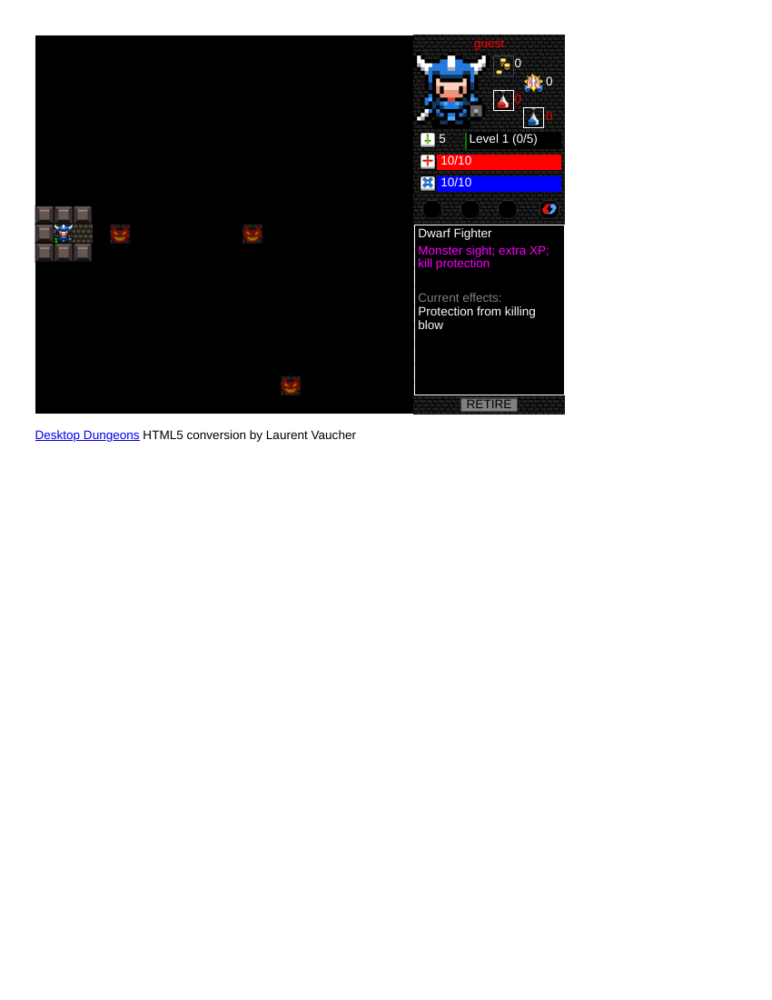
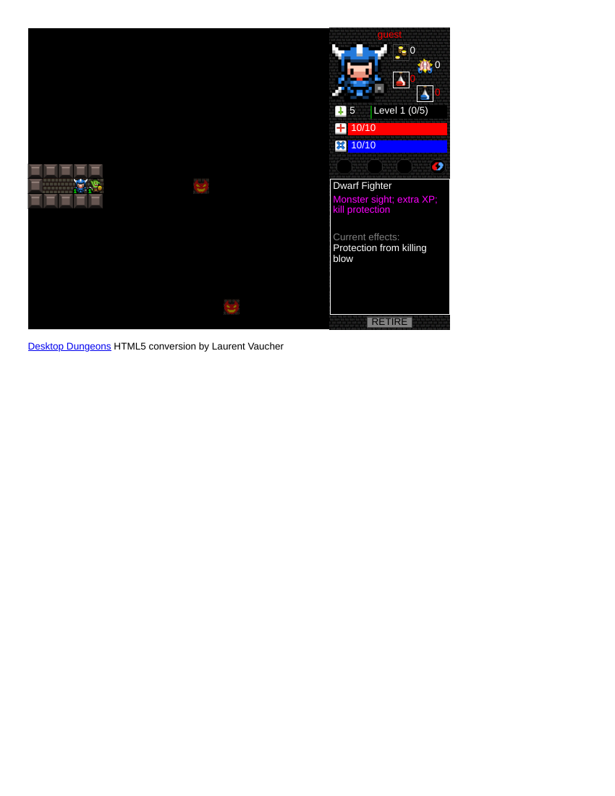
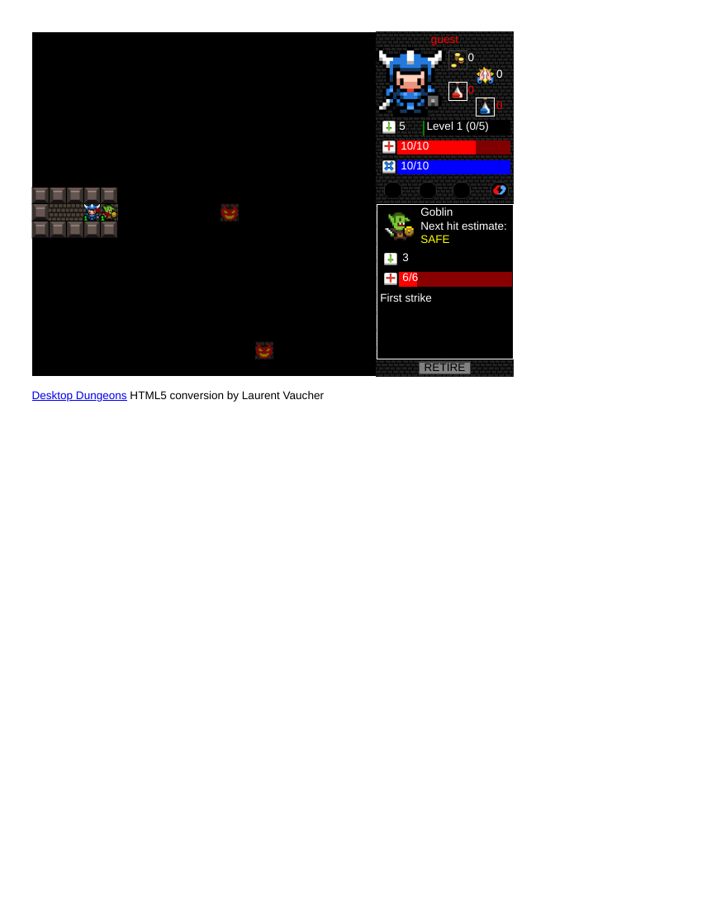
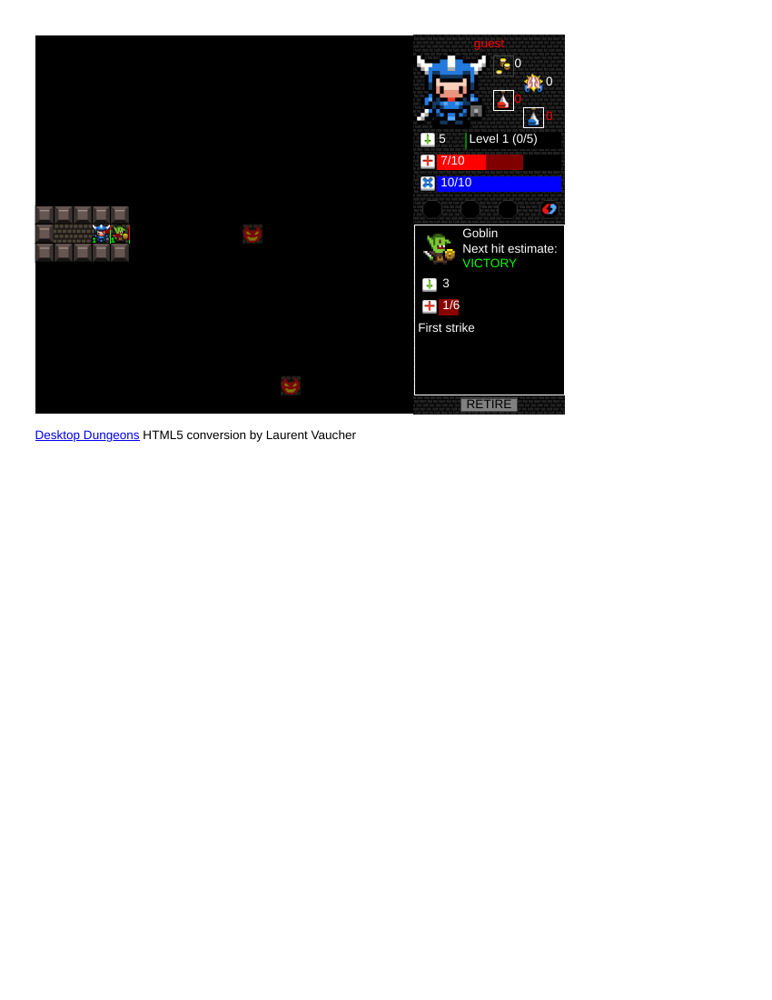
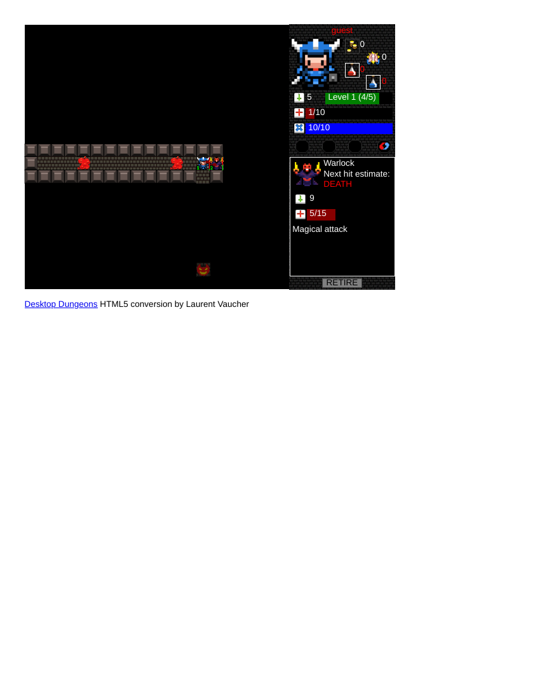
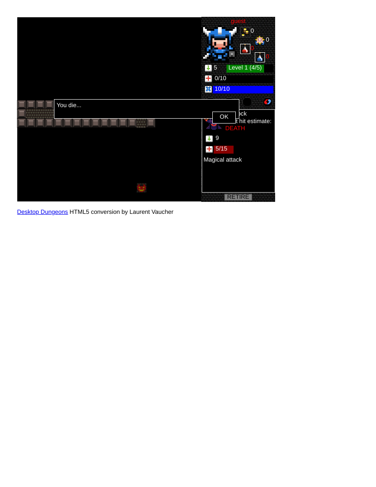
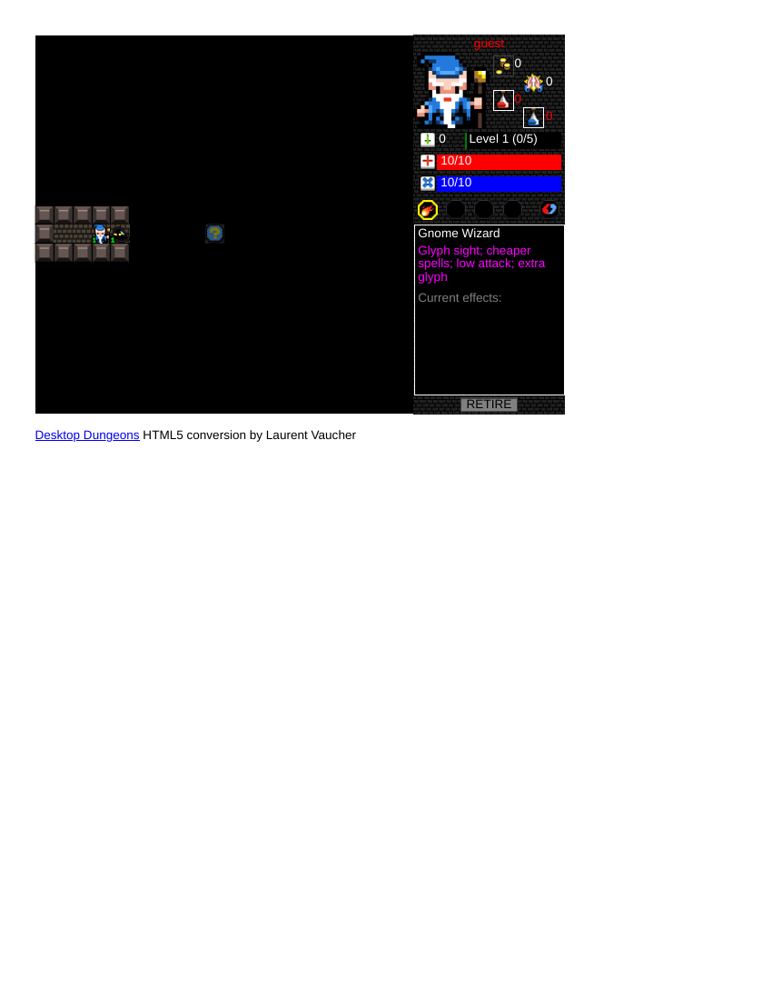

# Player record — Desktop Dungeons, HTML5 edition (Thirteenth Bell competitor B3 — SUBSTITUTE for Into the Breach)
**Filed:** 2026-10-20 · **Source:** live browser play at https://www.desktopdungeons.net/HTML5/ (official domain; page footer: "HTML5 conversion by Laurent Vaucher" of QCF Design's game), first-person player voice
**Role in the matrix:** substitute for Into the Breach (B3), a paid native install. Desktop Dungeons preserves B3's family — compact tactics under perfect information, where repeated short runs reward better decisions: one small dungeon per run, every enemy's stats and the outcome of your next hit shown *before* you commit, health as the resource that exploration replenishes.
**What the substitute leaves unanswered:** Into the Breach's squad dimension — three mechs, telegraphed enemy intent you manipulate by pushing units around. Desktop Dungeons is a solo hero and its enemies don't telegraph multi-unit intent. Recorded as the gap.
**Coverage:** FULL PLAY of one complete run to death, plus a partial second (tutorial) stage. Played as profile "guest" — no download, no purchase, no account. Blind: no walkthroughs or guides (the teaching dialogs quoted below are the game's own in-dungeon text).
**Evidence:** 7 full-page PDF captures banked in `evidence/` of the filed package, render-verified by the coordinator (the mid-run fight shows the Goblin at 1/6 with a VICTORY estimate; the death screen shows "You die..." with the warlock at 5/15).

## The run (Dwarf Fighter, "Tutorial Dungeon Alpha")
An honest discrepancy first: I clicked "Normal" with Human/Fighter selected, but the game loaded its own scripted Tutorial Dungeon Alpha as a Dwarf Fighter, teaching dialogs included. I played what the game gave me.

The dungeon is a fogged corridor complex. Every newly revealed tile restored +1 HP — health *is* exploration, the loop the game teaches in its own dialogs. I read each enemy before engaging (stats + "Next hit estimate"): a goblin (6 HP, first strike) — killed; a zombie (9 HP, Undead) — killed; 4/5 XP banked.

At the corridor's end, a Level 2 warlock (attack 9 magical, 15 HP) blocked the only way south. The tutorial's own dialog advised ignoring him "for now" — but every reachable tile was already revealed, so no healing or levelling route existed. My contrary call, made with the estimate reading DEATH: my Fighter's "Protection from killing blow" was unspent. Hit 1: warlock 10/15, me 1/10. Hit 2: the protection fired — warlock 5/15, me still 1/10, effect consumed. Hit 3 killed me. "You die..." — warlock at 5/15. Whether a route past him existed that I failed to find, I cannot say; the record keeps the question open rather than blaming the design.

## Second stage (partial)
Death advanced the tutorial instead of ending it: I became a Level 1 Gnome Wizard, picked up the BURNDAYRAZ glyph (fireball: 5 mana, 4 damage, no retaliation), and reached a goo blob (attack 3, 6 HP, 50% physical resist). **Exact stop point:** wizard at full 10/10 HP and 10/10 MP, one tile west of the blob. The click needed to arm the spell in its glyph slot would not register with my input tools despite repeated attempts (clicks, presses, drags, holds, keys) — a tooling limit, reported as such; I did not waste health probing a 0-attack wizard's melee against 50% resist.

## The matrix question (B3): does foreknowledge make the player more responsible for failure?
Completely. The game showed me the estimate — DEATH — and I chose the gamble anyway, for a stated reason (no other route existed; the protection was a real, priced asset). When it failed, there was nobody to blame: the information was perfect, the decision was mine. That is the Into the Breach feeling in miniature — failure as authorship.

## Other access facts (for the record)
The itch.io listing is download-only (Windows/macOS/Linux); the official Legacy page's free 2010 alpha is a PC/Mac **download**, not browser play; on Steam the game is a paid download, and "Desktop Dungeons: Rewind" has a free demo that is likewise a Steam download (600 MB), not browser play. The HTML5 build above is the only browser route, and it is on the official domain.

## Evidence gallery (embedded)
The captures are filed under `evidence/` in this package (market records: beside the record, in `market-research/`). PDF captures are shown as rendered page views; PNG captures are embedded as-is.

*Run start — the tutorial dungeon (page 1).*

*Fight frame (page 1).*

*Fight frame (page 1).*

*Mid-run fight — Goblin at 1/6, estimate VICTORY (page 1).*

*The warlock standoff at 1 HP (page 1).*

*Death screen — 'You die...', the warlock at 5/15 (page 1).*

*Second stage stop point — the Gnome Wizard before the goo blob (page 1).*

