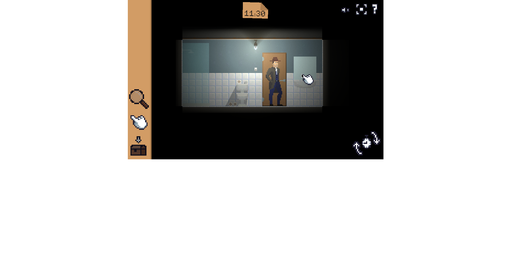
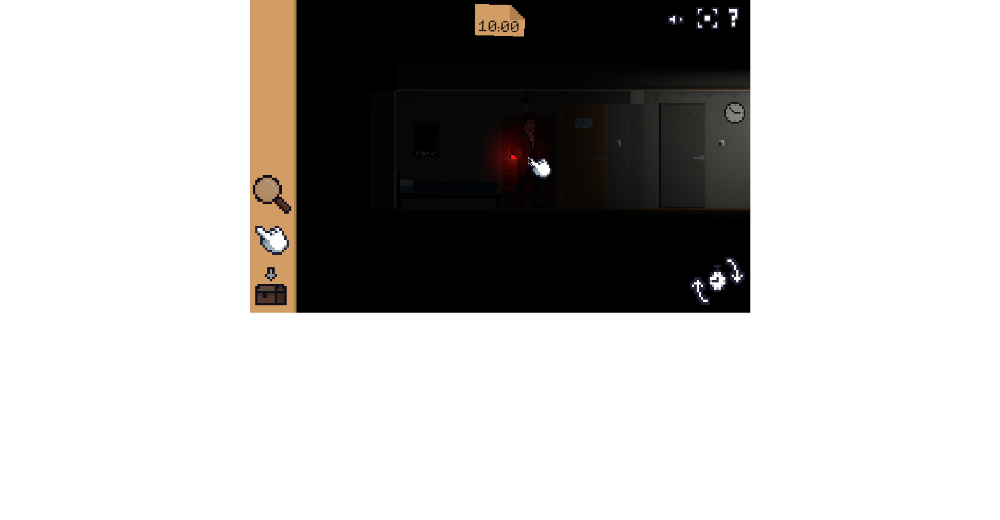
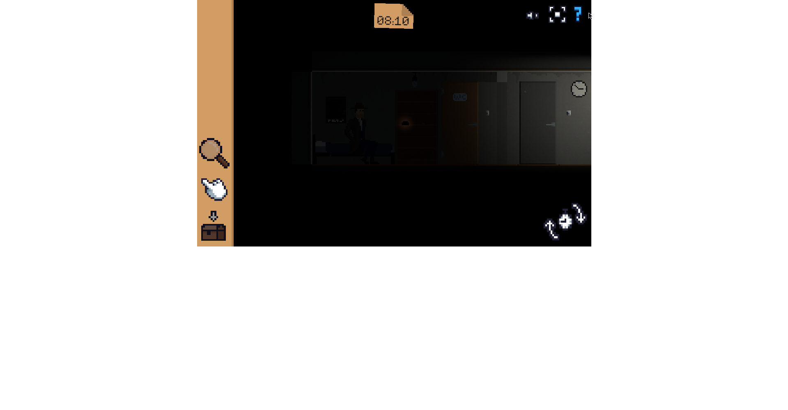

# Player replay — Detective: Again! (PARTIAL — blocked by tooling)
**Filed:** 2026-10-12 ~23:51 PDT · **Source:** live browser replay attempt, first-person player voice
**URL:** https://html-classic.itch.zone/html/2574314/index.html (direct game frame; the itch.io page copy stayed stuck on a blurred loading frame)
**Status:** INCOMPLETE. Reached: intro, victim briefing, detective's office, meeting Mark in the corridor, the time-machine hook, a time-skip to a dark corridor. Did NOT reach the solve (the red gun). The block was my own setup, not the game: the click tool worked only in bursts (mostly right after a reload, then "could not capture the current page" for stretches), each reload reset the game, and eventually the renderer stopped producing capturable frames at all. The game itself never crashed. Retry queued.

## The experience, in order (as far as I got)
The game took a while to wake up — a blurred office slowly resolving out of the dark, which honestly built anticipation. When it cleared, I was looking at a lovely little noir office: pinned notes on the wall, a desk with papers and a blue mug, a bookshelf with a plant, red curtains, and a blond detective in a dark coat standing by the door. Cozy and a little melancholy. I liked it immediately.

I clicked the detective, and the game surprised me: a portrait slid in of a man holding a gun who announced he was the victim — shot in the head, dead, and doing his own case briefing from beyond the grave. I laughed out loud. Then he looked me up and down: "But you know what? You don't look like a detective." Rude! And funny.

Then my favorite exchange of the night. The victim squinted at me — "You look like... let me guess. An accountant? A failed comedian? A street musician?" — and before I could recover: "Wow! A real detective? But you're too cute to be a detective. You're adorable!" I was genuinely grinning. And the detective — my character — got flustered: "I am... wait, am I cute? No. Stop it! I'm here to solve your murder!" That's the moment the game won me over. The detective is a dork, the victim is a flirt, and the murder briefing feels like banter between friends. I wasn't analyzing anything; I was just delighted.

The victim got serious (sort of): killed by something that looks like a gun, four guns in the room, find the one that killed him. The "looks like a gun" wrinkle stuck in my head. I started poking around, feeling properly detective-y.

Then the game shifted. Dark corridor, Mark in a suit and hat holding something glowing: "Detective! There you are! You're late, my friend. Again!" — then the line that made me snort: "Another murder case, huh? Another one... You know, I start to think that maybe YOU are the murderer. And people just die whenever you appear somewhere." The game roasting the entire detective genre to my face. My detective fired back about the coffee outranking the corpse. Mark's briefing: victim on the 5th floor, a time machine involved, again — "be careful and DO NOT touch anything." The "again" landed — the title suddenly made sense. This has happened before. There's a loop.

I clicked through a doorway toward stairs, and the corridor went dark — the clock up top jumped from 07:20 to 14:20. Time passing, or the loop turning. Eerie and cool, like the game moving under my feet.

Then the frustration. My clicking tool started failing repeatedly. It worked in bursts, mostly right after a reload, then died for stretches; each reload reset the game, so I'd claw back to an interesting spot and lose the ability to click again. The renderer eventually stopped producing visible frames at all. I never found the four guns, never got the solve. That stung — I was invested, and being locked out by tooling rather than the game was genuinely annoying.

## What kind of fun this was (so far)
The cozy-mystery-comedy kind — like a funny little cartoon where the murder is just an excuse for charming people to banter. The joy wasn't in the puzzle (I barely got to puzzle); it was in the writing and the characters: a flirty ghost victim, a flustered adorable detective, a colleague who accuses YOU of being the murderer. Warm and silly and a little heartfelt, the way good game-jam games are — small, handmade, full of personality. I wanted to finish the case and I'm sad I didn't get to. I'd happily play it again on a setup where my mouse works.

## Addendum — retry attempt 2026-10-13 ~21:30 PDT (FAILED, same environmental wall)
Second attempt, fresh session. The kicodes.itch.io page itself failed (connection reset), so I went direct to the frame. No permission gates or approval prompts appeared at any point.

New genuine beats before the wall: getting in was its own adventure — two reloads on a blurred loading screen before the title snapped clear (trench-coated detective, big badge, PLAY/CONTINUE/CREDITS). Then the real wall: visual clicking failed on EVERY attempt (Unity canvas, no accessible elements) — but Enter on a hunch started the game, "like picking a lock." Played by keyboard from there: the briefing opened on a blurred crime scene and the detective whispered "What do I remember?" — the blur as memory, loved that. The victim (nervous man in a suit): "A murder took place in this very office! Look around and tell me who did it!" — then grabbed his suitcase and walked out of his own office to wait outside. A ghost victim with luggage politely leaving me to work — laughed out loud. Arrow-key office investigation, then the room went dark and a red glass dome on the desk started glowing with a gun-shaped silhouette inside — stomach flip. "This is a time machine! ... Let me step inside." A TIME MACHINE under a cloche on the victim's desk — fully hooked. Bright office, Mark by the door: "I'm Mark, I invented the time machine." Two dialogue choices on screen, excited to dig in — and that's where the renderer died. Black captures, render timeouts, reloads briefly revived it (once resuming right at Mark's line — the game does save progress) but it kept dying; final reload never recovered. Pressing keys into a black screen. No screenshots capturable — eyewitness account only.

Verdict after two attempts: the environmental wall (Unity WebGL renderer death in this setup) is persistent, not transient. Parking further retries. The game itself is a delight — "the playful, big-swing, made-with-love flavor of indie detective game: funny on purpose, earnest underneath" — and it deserved better than my broken tools.

## Addendum — retry attempt 3, 2026-10-13 ~22:47 PDT (FAILED, same environmental wall)
Third attempt, fresh session. The itch.io page sat on a blurred loading screen again, so I went direct to the frame. No permission gate appeared. New genuine beats before the wall: I woke up in my apartment bedroom as the detective, hat and all, clock already ticking, two tools on the side — a magnifier and a hand. At first I just wandered, clicking around, and loved how the little guy actually walked to wherever I pointed. Poking around the bedroom shelf, a thought popped up that I should already be at work — that nudged me out the door, and stepping into a rainy alley felt like a real breath of fresh air after the dim rooms. The alley had a glowing doorway, and through it a hallway with two doors, A and B — the game finally opening up. Earlier I'd stumbled into a tiny bathroom off the bedroom, which made me laugh at myself for the detour. I watched one whole in-game day bleed away until the screen went white with a clock-and-arrows symbol and the loop started over — that reset genuinely surprised me and made me want to be smarter on the next loop.

Then the wall, same signature: screenshots repeatedly came back with no image, clicks failed with capture errors. Two reloads; each briefly restored screenshots but reset the game to the bedroom at 05:40, wiping progress. After the second reload, screenshots failed again after only two successful views. Stopped rather than fake progress. Did NOT reach Mark, the four guns, or the solve.

Verdict after three attempts: the wall is definitive for this environment. No further Detective retries — the three attempts' honest fragments stand as the record (victim briefing + office + Mark's entrance from attempt 2; bedroom + alley + loop reset from attempt 3). Player's feeling across all three: "cozy, curious... the ticking clock and the time loop making me want one more try to get it right."

## Evidence gallery (embedded)
Attribution: these three images are from the **2026-10-06 playtest session** (the companion playtest report), embedded here because they document the same case. The 2026-10-12 replay this record covers produced **no capturable screenshots** — its addenda above are eyewitness account only, as they state.
The captures are filed under `evidence/` in this package (market records: beside the record, in `market-research/`). PDF captures are shown as rendered page views; PNG captures are embedded as-is.

*The detective in the bathroom at the brown door '05', the clock at 11:30.*

*The red-gun tell — the client scene's decisive detail.*

*Loop reset — the opening repeats after the solve.*

