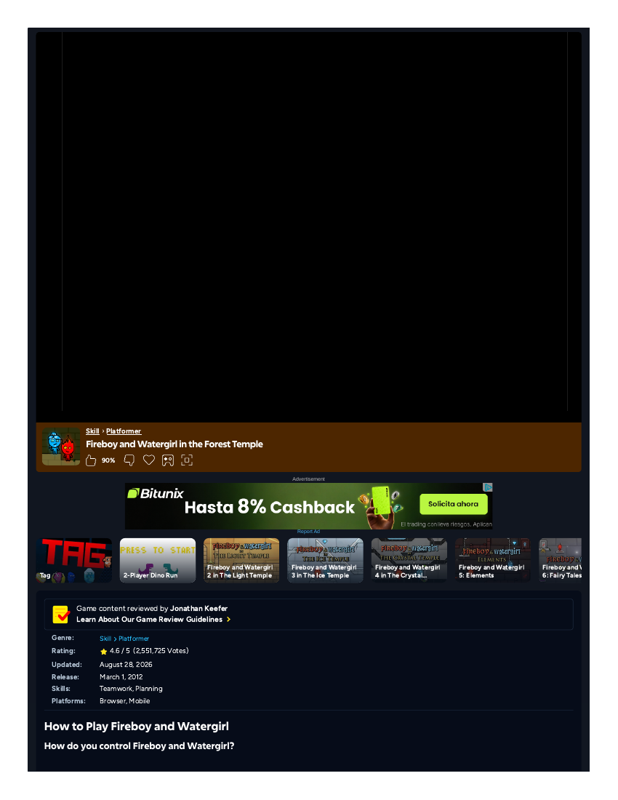
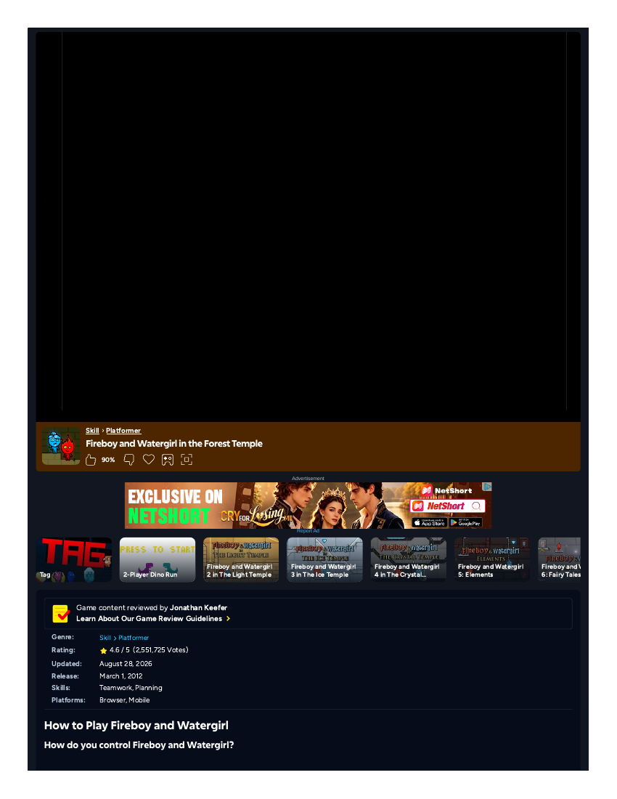
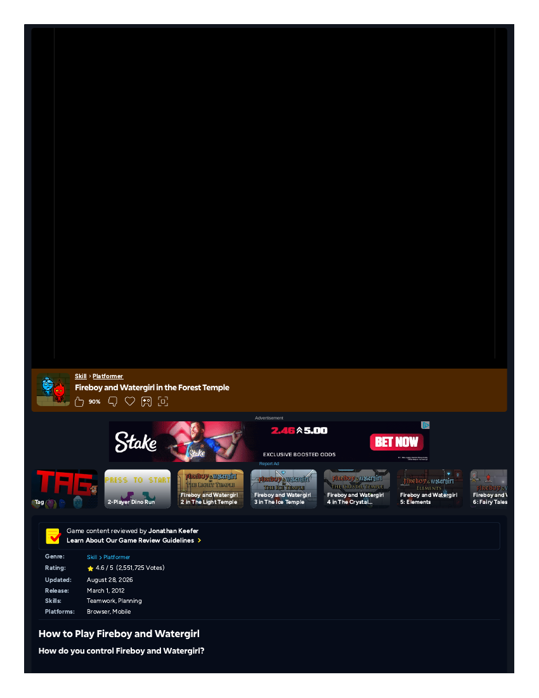

# Player attempt — Fireboy and Watergirl in the Forest Temple (Memorable Moments competitor M2) — FRAGMENT, TOOLING-BLOCKED
**Filed:** 2026-10-20 · **Source:** live browser session
**URL:** https://www.coolmathgames.com/0-fireboy-and-water-girl-in-the-forest-temple (first game, Coolmath browser edition, as the matrix specifies)
**Coverage:** FRAGMENT — S1: title screen and main menu reached, **zero gameplay**; S2 (addendum at the end of this record): through level select **into Level 1**, stop at the Level 1 spawn — zero controllable play, because no keyboard input reaches the game. No judgment of the game itself is offered: it was never played, and inventing one would be dishonest.
**Session condition:** solo, one keyboard, both characters intended to be mine — the genuine two-player experience remains untested, and in this session not even the solo workaround was possible.

## What happened
After a 15-second ad countdown, the game's own title screen appeared (black stage, title art, gold PLAY button) and I clicked through to the real main menu: the temple wall of level doors, wooden PLAY sign, INSTRUCTIONS and CREDITS, Watergirl bottom-left, Fireboy bottom-right. That menu was the deepest point reached.

## Why it stopped (tooling, not the game)
1. **Hard capability gap:** the browser's key-press action supports only Enter, Tab, Escape, Backspace, Delete, Space, arrows, Home/End, PageUp/Down — **no W/A/S/D and no key-hold**. Watergirl (WASD) would be completely uncontrollable; Fireboy (arrows) limited to single tap-nudges. No level — each requires both characters to reach their exits, with running jumps and sustained movement — could ever be completed. Retries on another host cannot fix this; the gap is in our input tooling.
2. **Menu clicks unreliable:** ~10 attempts on the PLAY sign across two tabs failed (visual click-targeting errors from the menu's continuous animations and rotating ad creatives); two tabs wedged permanently "busy" and had to be abandoned.

## Screenshots (honest note)
Three captures were taken and viewed in-session (the title screen; the main menu, twice). The current browser pipeline cannot deliver capture files to the workspace — they exist only as in-session references and are NOT banked as files.

## Status of M2
Unplayed in substance. Its systems question — what produces mutual dependence, help, or blame between two people — needs two humans at one keyboard, which only Sakura can stage. The matrix reserve for this role (Keep Talking and Nobody Explodes) is paid and also needs at least two real people, so no solo substitute exists for M2's actual question.

## Addendum — session 2 (2026-10-20, later): deeper reach, harder limit, evidence boundary found
A second session, briefed only to capture evidence and document the control limit, got **further than session 1**: the menu clicks worked this time — title screen → main menu → level-select map → **into Level 1 itself** (brick maze, red/blue gems and exit doors, lever and movable block, both characters at spawn, the game's own on-screen text teaching "USE A,W,D TO MOVE WATERGIRL… USE ← ↑ → TO MOVE FIREBOY… NEVER MIX FIRE & WATER!").

The control finding is now stronger and more precise: five ArrowRight taps and one ArrowUp tap, delivered through three different focus methods, moved Fireboy **zero pixels** — his position is identical across views spanning the in-game timer 02:17 → 07:20 while the timer kept running (the game was live; only keyboard input was inert). So the block is not merely "no WASD, no key-hold": **no keyboard input of any kind reaches this Flash-emulated canvas from our tooling.** Watergirl remains untestable in principle. Exact stop point: the Level 1 spawn.

**Evidence boundary (verified by the coordinator, loss logged):** session 2 captured five full-page PDFs — but the game area renders **black** in every one (the Ruffle/Flash-emulator canvas does not print, the same failure class as Townscaper's Unity WebGL). The files were banked in `evidence/` of the filed package, renamed as what they are — and their PDF originals were removed in the 2026-10-22 post-embedding cleanup, once their views were embedded in the gallery below (originals remain in git history; see `../notes/cleanup-2026-10-22.md` in this package) — `page-shell` captures: they prove the session was on the genuine Coolmath game page (whose own text confirms the controls, 32 levels, 4.6/5 across 2,551,725 votes, released March 1, 2012, "designed for two players on one keyboard"), but they do **not** show gameplay and are not presented as doing so. The session's gameplay account above rests on its internal consistency (click receipts, timer cross-checks) — labeled as such, not upgraded.

## Evidence gallery (embedded)
Note on the shells: the 02/03 pair (main menu / level select) and the 04/05 pair (Level 1 opening / after input attempts) render as visually identical frames. The source PDFs are distinct captures taken at those moments; because the game area prints black, the frame a capture can hold does not change between them. What distinguishes the moments is in the record's session account, not in these images.
The captures are filed under `evidence/` in this package (market records: beside the record, in `market-research/`). PDF captures are shown as rendered page views; PNG captures are embedded as-is.

*Page shell — the game area does not print (canvas); this is the page frame a capture can hold. Title-screen moment.*

*Page shell — the game area does not print (canvas); this is the page frame a capture can hold. Main-menu moment.*

*Page shell — the game area does not print (canvas); this is the page frame a capture can hold. Level-select moment.*

*Page shell — the game area does not print (canvas); this is the page frame a capture can hold. Level 1 opening moment — the deepest point reached.*

*Page shell — the game area does not print (canvas); this is the page frame a capture can hold. Level 1 after the input attempts — Fireboy unmoved.*

