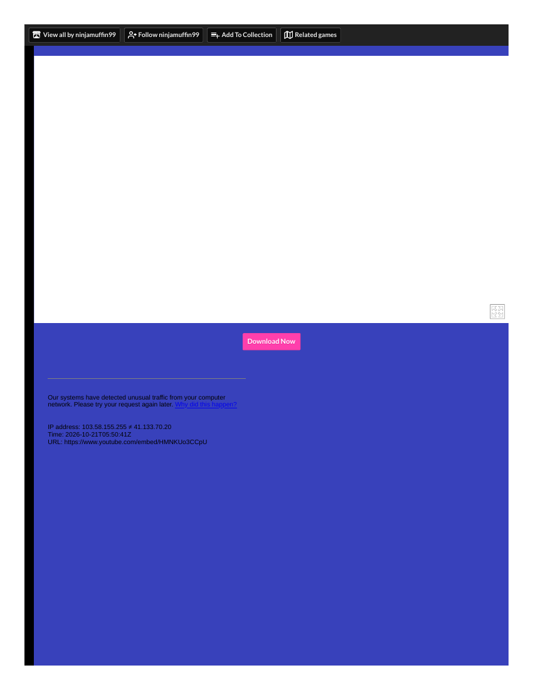
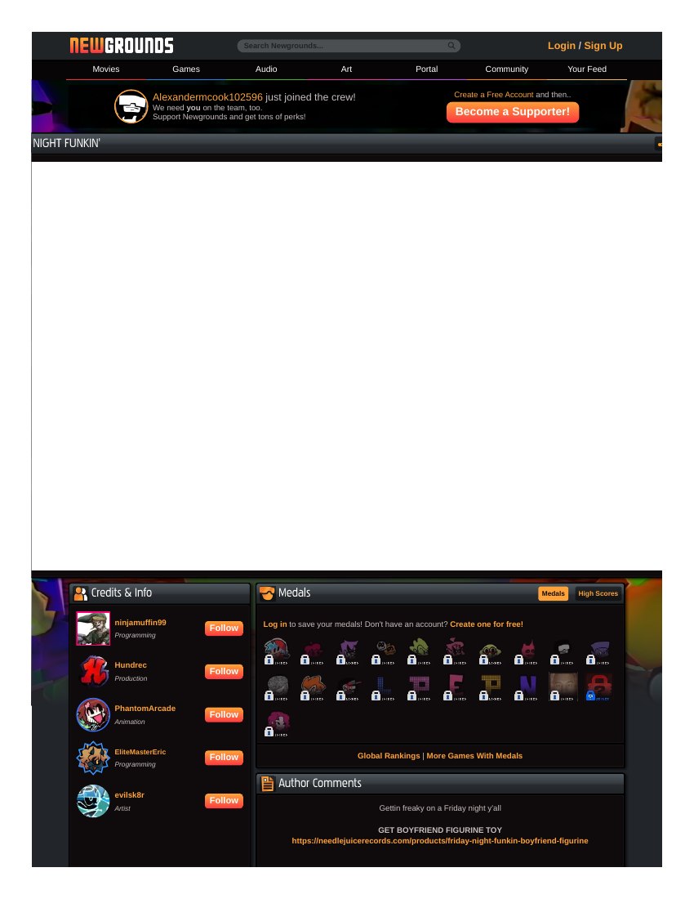

# Player attempt — Friday Night Funkin' (Vivid competitor V6 — SUBSTITUTE for Rhythm Doctor)
**Filed:** 2026-10-20 · **Source:** live browser play (official Newgrounds page, linked from the game's itch.io page; build v0.8.6, by ninjamuffin99 and the Funkin' crew), first-person player voice
**Role in the matrix:** substitute for Rhythm Doctor (V6), which has no living browser demo (see its access-check record). FNF preserves the rhythm family: read a scrolling chart, judge input timing against music.
**Coverage:** PARTIAL, tooling-limited — menus fully navigated; Tutorial attempted twice (failed both); Week 1's Bopeebo attempted twice (failed both); **no song passed**. The failures are attributed to our input pipeline, not the game (see Tooling). No judgment of the game's difficulty or feel is offered beyond what the menus and the first phrases showed.
**Evidence — read before trusting:** all seven full-page PDF captures from this session are **page shells**: the game's HTML5 canvas renders black/blank in print (the same failure class as Townscaper and Fireboy). Three were banked in `evidence/` labeled as shells (the itch title page ×2 and the Newgrounds page at the Bopeebo game-over); their PDF originals were removed in the 2026-10-22 post-embedding cleanup (views embedded below; originals in git history — see `../notes/cleanup-2026-10-22.md`); the other four were the identical shell repeated and are logged here by session timestamps rather than banked. The play account below rests on the session's detailed report (menu structure, track names, attempt pattern, glimpsed scores) — labeled as such.

## What happened
Title → Main Menu (STORY MODE / FREE PLAY / MERCH / OPTIONS) → Story Mode. The story menu lists the Tutorial ("TEACHING TIME") above Week 1, "DADDY DEAREST" (tracks: Bopeebo, Fresh, DadBattle). I selected Week 1 on NORMAL.

- **Tutorial, attempt 1:** played through Girlfriend's call-and-response phrases, hit some notes, last visible score ≈810 (readout partly covered by the HUD — approximate) before the health bar emptied: Game Over.
- **Tutorial, attempt 2 (the permitted retry):** echoed the opening phrases, then health collapsed during sections that passed between my views: Game Over, no legible final score.
- **Bopeebo, attempt 1:** a menu keypress started the week before my view caught up; the song ran with effectively no input: Game Over at 0.
- **Bopeebo, attempt 2:** played actively at the notes I could see (including a Down note on my receptor); health drained through unseen sections: Game Over. Fresh and DadBattle never unlocked — story mode gates them behind Bopeebo.
- This build shows an accuracy/results screen only after a full week is completed; I never reached one, so no accuracy figure exists in this record.

## Exactly where I stopped
The Bopeebo Game Over screen, Week 1 (Normal), after the permitted retry — having also used the retry on the Tutorial.

## Tooling (the actual finding of this attempt)
Two compounding limits: (1) key presses reached the embedded game only intermittently (menu selections routinely took 3–5 attempts); (2) each view-and-act cycle consumed several real seconds while the charts run in real time at ~100 BPM, so whole sections scrolled past unseen. The Tutorial's chart is sparse, slow call-and-response that a first-time player at a local keyboard would find gentle — the design caused none of these failures. **Conclusion for the V6 slot: real-time rhythm play is outside this operation's input envelope, the same class of limit as Fireboy's two-player keyboard and Make it Meme's social loop: it needs a human at a local machine.** Rhythm Doctor itself additionally needs a purchase (its access record stands).

## Evidence gallery (embedded)
The captures are filed under `evidence/` in this package (market records: beside the record, in `market-research/`). PDF captures are shown as rendered page views; PNG captures are embedded as-is.

*Page shell — this capture prints blank (a white first page, black remainder); nothing of the game or the page survived in it. It is embedded so the failure is visible, not described.*

*Page shell — the itch page frame of the second capture: the page body and its Download button render; the game embed area prints white (page 1).*

*Page shell — the Newgrounds page frame at the Bopeebo game-over moment: header, medals, and comments render; the game area prints white (page 1).*

