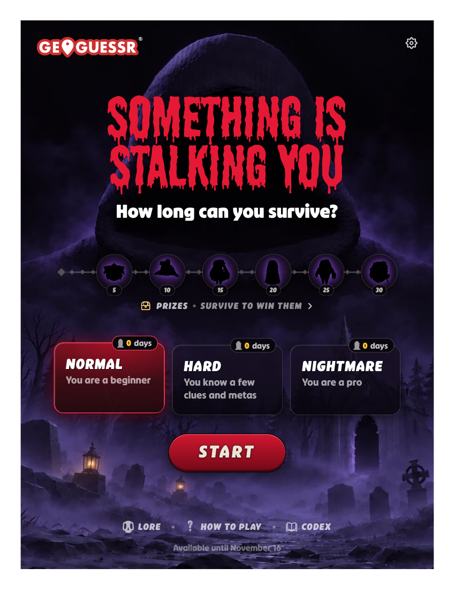
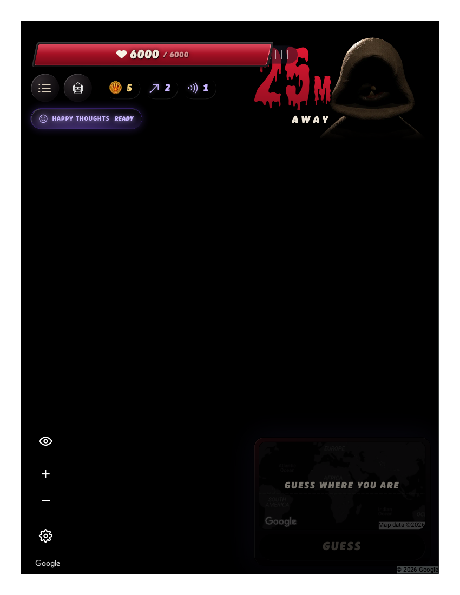
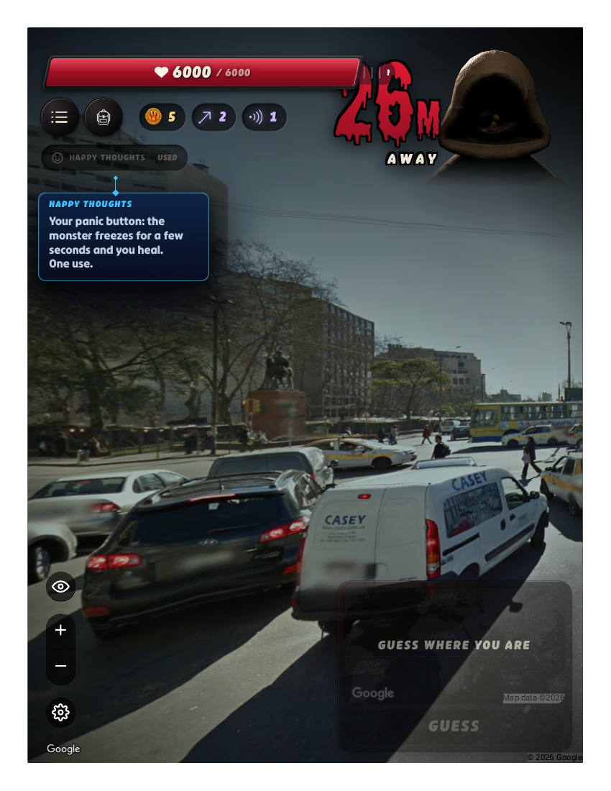
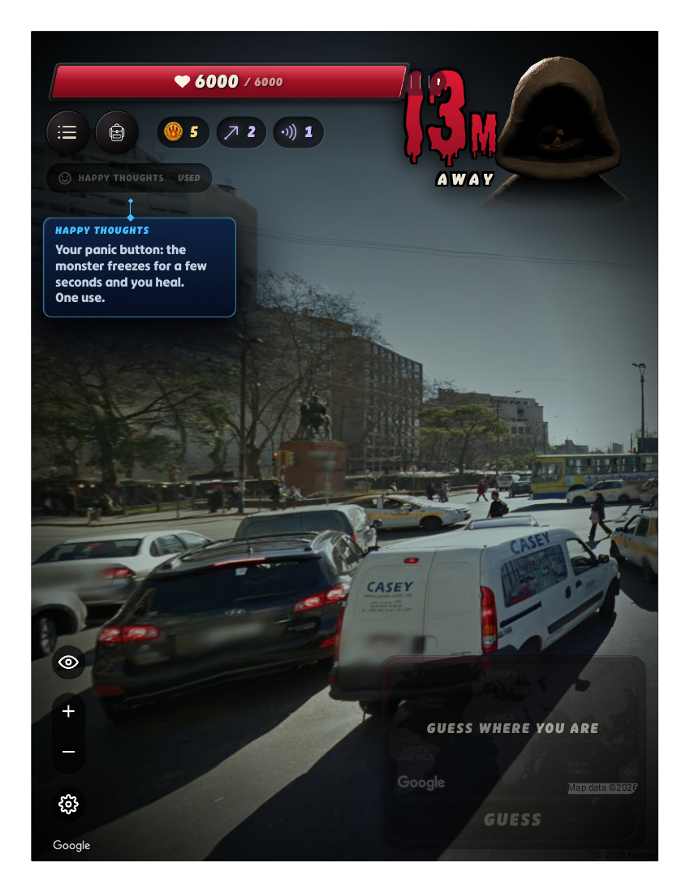
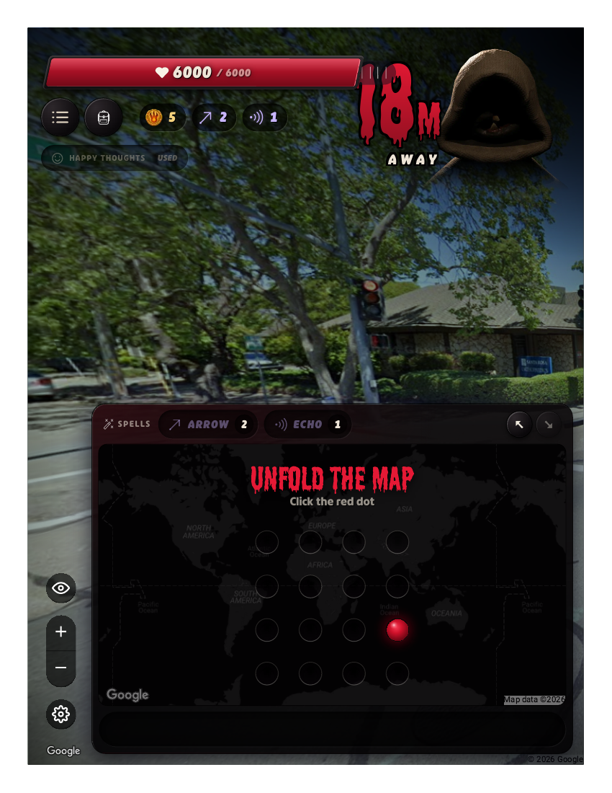
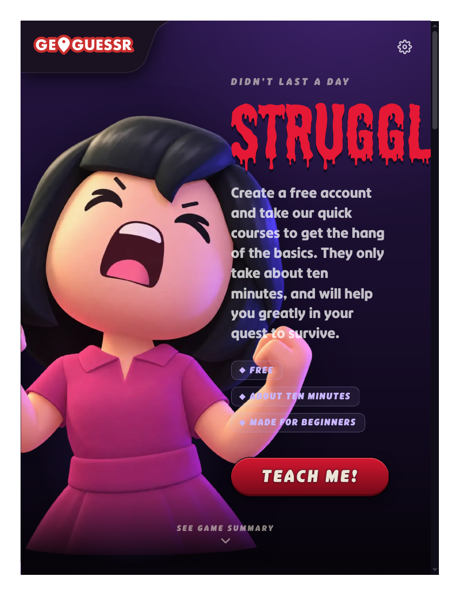

# Player record — GeoGuessr / HorrorGuessr (Memorable Moments competitor M4)
**Filed:** 2026-10-20 · **Source:** two live browser sessions, first-person player voice
**URL:** https://www.geoguessr.com (main game) · https://www.geoguessr.com/horrorguessr (free Halloween mode)
**Coverage:** PARTIAL PLAY with an access finding. The main GeoGuessr game is account-walled (see below) and was not played. The free no-account mode, HorrorGuessr, was played honestly across two sessions — six runs total, 0 days survived, 0 pins placed. The matrix's core M4 question (shared simultaneous guessing; how much communication happens before guesses lock) remains UNTESTED: it lives in the account-walled main game and needs at least an account, which only Sakura can authorize.
**Evidence:** session 2's beats are banked as full-page PDF captures in `evidence/` of the filed package (7 files, verified against the session report). Session 1's captures exist only as in-session references and are NOT banked — stated plainly, per the evidence standard.

## Access finding (session 1, 2026-10-20)
A no-account visitor to geoguessr.com is offered a "Sign up to play" panel (Google / Apple / Facebook / email) for the main modes. No plan names or prices are displayed to visitors — the offer is binary: create an account, or play the free limited-time Halloween mode. No free daily challenge, demo, or single-player map exists outside HorrorGuessr. A "PLAY SETERRA NOW!" link points to GeoGuessr's separate free quiz site.

## HorrorGuessr — what it is
A survival twist on GeoGuessr, free with no account ("Free to play, no account needed" — printed on its own summary screens), available until **November 16**. Each day, the Black Pano Monster starts 30m away and closes in **in real time**; to survive the day you must guess your Street View location. Guessing first requires the "Unfold the map" red-dot mini-game, then placing a pin and pressing GUESS. Wrong guesses cost health (further off = more damage); being caught ends the run. Score = days survived. Difficulties: NORMAL / HARD / NIGHTMARE. The tutorial warns it is "brutally hard."

## Session 1 (3 runs, NORMAL — captures not banked)
- Run 1 — US residential street (E Chestnut St, brick apartments, yellow hydrant): explored 2 steps, caught before opening the guess map. "CAUGHT BEFORE THE GUESS."
- Run 2 — Sweden (ICA grocery, Swedish flags, road 140): used Happy Thoughts (+400 health, brief monster freeze), started the unfold mini-game, caught before placing a pin.
- Run 3 — Japan (Takatsuki: TAKATSUKI bus, 7-Eleven, left-hand traffic): froze the monster, opened the guess map, clicked the red dot 6 times — the map never fully unfolded before the catch.

## Session 2 (3 runs, NORMAL — PDF captures banked)
- Run 1 (Case Nº4895) — 6th Ave, arid sun, Page Dental Center, red SUV, radio tower. My scenery-only read: United States (Page, Arizona came to mind); summary confirmed "Last seen: UNITED STATES." Caught at 8m before opening the map; never placed a pin.
- Run 2 (Case Nº9274) — white-and-yellow taxis, a statue, a glass tower, a van marked "CASEY www.casey.com.uy" on C. Cnel. Brandzen. My read: Montevideo, Uruguay; summary confirmed "Last seen: URUGUAY." Caught while opening the guess map.
- Run 3 (Case Nº2844) — Doyle Park Dr / Montgomery Dr signs, US lights, lush trees. My read: United States, possibly Santa Rosa, California (city unconfirmed; summary confirmed only "UNITED STATES"). I reached the unfold mini-game at 22m and captured it — and the capture itself cost the run: the monster closed ~16m during the PDF capture and one observation, and my red-dot click landed on the game-over frame.

**Final state:** 0 days survived across six runs; every run ended "CAUGHT BEFORE THE GUESS" at full health (6000/6000) — the failure is never health, it is always *time*.

## What the mode actually teaches a first-time player (player view)
The geography skill is real — signage, plates, language, vegetation, and road furniture genuinely narrow the world in seconds. But the binding constraint is interface speed under a real-time threat: reading the world is only half the game; converting the read into an unfolded map and a placed pin before the monster arrives is the other half, and it is the half that killed every run. Happy Thoughts buys seconds, not safety.

## Tooling (separate from the game)
Real-time play vs agent action latency is the structural issue: each browser action/observation takes many seconds while the monster advances ~1m per couple of seconds — and evidence capture (a full-page PDF) is the slowest action of all, measurably costing distance in Run 3 of session 2. One region click was refused as "covered" (session 2, Run 2); element references went stale across game transitions. In session 1, /horrorguessr rendered blank once and a single reload fixed it. No CAPTCHAs or bot walls in the free mode; the end-screen account upsell was ignored throughout. No account was created, no trial started, no payment details entered in either session.

## Evidence gallery (embedded)
The captures are filed under `evidence/` in this package (market records: beside the record, in `market-research/`). PDF captures are shown as rendered page views; PNG captures are embedded as-is.

*HorrorGuessr start screen (page 1).*

*Run 1 — live view in blackout (page 1).*

*Run 1 end screen (page 1).*

*Run 2 — live view (page 1).*

*Run 2 — the monster closing in: the in-frame readout says 13 m (the capture's filename keeps the session's 20 m label from the moment it was triggered; the counter kept falling while the capture rendered) (page 1).*

*Run 3 — the unfold-map minigame (page 1).*

*Run 3 end screen (page 1).*

