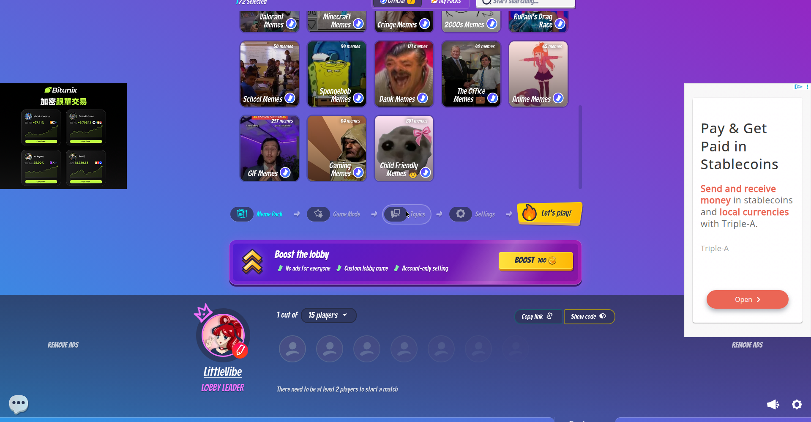
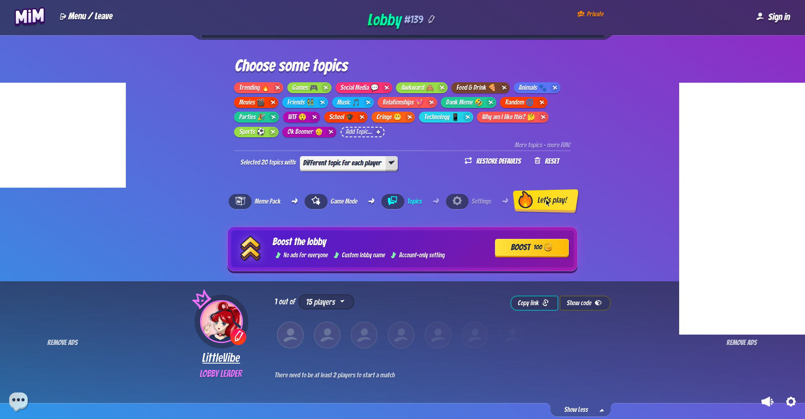
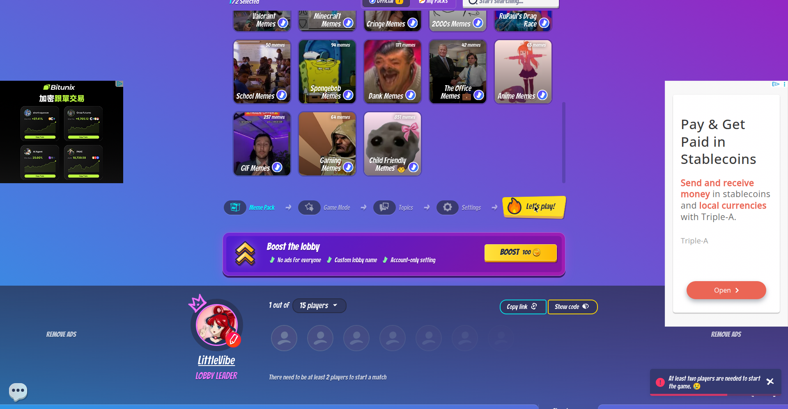

# Player walk — Make it Meme (SOLO; no real session possible)
**Filed:** 2026-10-13 ~21:43 PDT · **Source:** live browser walk, first-person player voice
**URL:** https://makeitmeme.com/ → private lobby https://makeitmeme.com/play (Lobby #113, invite code BIUXE). Auto-assigned name "ProSloth."
**Status:** SOLO WALK ONLY. No account created, no sign-in, no purchase, nothing downloaded. Reached: landing → private lobby created → meme packs selected → game mode chosen → topics picked → settings tweaked → hard stop. The "Let's play!" button is disabled: "There need to be at least 2 players to start a match." Clicked it anyway — nothing. The gate is real. Never saw a single meme template, prompt, or round. No second player faked. This was not a real social session.

## The experience, in order
1. Landing. Looks like a Discord bot dressed up for a party — gradient background, bold comic lettering, a "15 lobbies available" live counter, big inviting "Private game" button. The name generator handing me "ProSloth" genuinely made me smile; it sets the tone before anything else does. Trying to say: come as you are, this will be stupid in a good way.

2. Creating the lobby. One click on "Private game," one on "CREATE MY LOBBY," and I was suddenly lobby leader with invite code BIUXE, "Copy link," "Show code." Friction near zero. My row shows a crown icon and "LOBBY LEADER." Felt powerful for about three seconds — until the row of empty gray avatar slots made it obvious: 1 out of 15 players, and nobody is coming.

3. Meme packs. First thing that felt like opening a toy box. Best Memes (651 memes), All memes (1.6K), then themed: GTA Memes, Trending Memes, Streamer Memes, Football Memes, Wholesome Memes, Reaction Memes, Animal Memes, Roblox Memes. Selected Best Memes + Streamer Memes. Wanted to peek inside a pack — clicking a tile just toggles selection, no preview. Small frustration: I could see the menu, but not the meal.

4. Game modes and topics. Four modes: Normal, Topics, Same Meme, Relaxed ("No points, no stress. Just making memes"). Picked Topics — the funniest moment of the walk. Topic chips: Trending, Games, Social Media, Awkward, Food & Drink, Animals, Movies, Friends, Music, Relationships, Dank Meme, Random, Parties, WTF, School, Cringe, Technology, "Why am I like this?", Sports, "Ok Boomer". Reading "Why am I like this?" and "Ok Boomer" as official game topics made me laugh out loud — the game speaks fluent group-chat. My brain immediately started drafting captions for "Awkward," and I had nobody to send them to. "Selected 20 topics with: Different topic for each player" — the setup teases a game I can't play.

5. Settings. Caption Time 90s, 3 Rounds, 5 Meme Changes per meme. Advanced: Family Friendly (off), Spicy Memes (off — "slightly more suggestive, but no NSFW stuff"), auto-start (on), Accounts only (off), join mid-game (on), Leader decides continue (off), Dynamic voting (on), Meme Buddy (on — bonus points, only makes sense with friends in the room), GIF Memes (on). Toggling "Spicy Memes" felt like adjusting the thermostat on chaos I wasn't going to experience.

6. The gate. Scrolled down, looked at my lone avatar among fourteen empty slots, pressed "Let's play!" — nothing. Disabled yellow button above the flat line: "There need to be at least 2 players to start a match." That is the whole story of solo Make it Meme. The lobby is built, the topics are loaded, the invite link is ready to copy — and the fun is entirely on the other side of a person who isn't here. Left without pasting the link anywhere; inventing a second player would have been faking it.

## What kind of fun this promises (ANTICIPATION, not experience — no round played)
Three or four friends on a voice call, ninety seconds each to caption a cursed image, everyone reading their caption in a dramatic voice, then arguing over whose was funniest while the votes roll in. "Same Meme" mode would produce the best arguments — everyone riffing on one image, winner is whoever understood the group chat's lore best. Topics like "Awkward" and "Why am I like this?" are engineered to make people confess things through memes. Low-skill, high-laugh party energy — the game where the least funny person at the table still has a great time because the voting is the show.

## One honest line
A real session needs one actual human friend, with a link in their hand and a voice call open, because Make it Meme is a room with no show until someone else walks in.

## Evidence gallery (embedded)
The captures are filed under `evidence/` in this package (market records: beside the record, in `market-research/`). PDF captures are shown as rendered page views; PNG captures are embedded as-is.

*The lobby (Oct-15 re-shoot).*

*The topic-choice step of the pre-game flow (Oct-15 re-shoot; the walk's modes step is described in the record — the captured frame shows topic selection).*

*The two-player gate — the public flow waits for a second player (Oct-15 re-shoot).*

