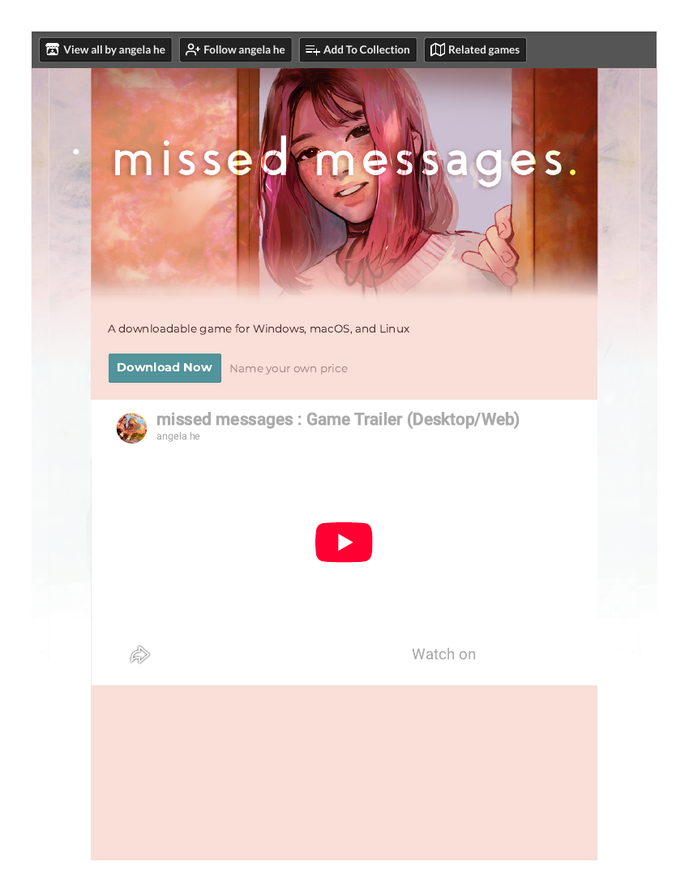

# Access check — missed messages. (would-be Memorable Moments M6 substitute)
**Filed:** 2026-10-20 · **Source:** live browser check of itch.io
**Verdict: NOT browser-playable — download only.** The candidate fails as a Florence substitute under the browser-only rule and is recorded as an access result, not a play.

- The URL in the assignment brief (angela-he.itch.io/missed-messages) returns an itch.io 404.
- The game's actual live listing is **zephyo.itch.io/missed-message** (singular), by angela he — rated 4.8/5 from 2,651 ratings, listed as a Visual Novel.
- The listing has **no browser/HTML5 build**: no "Run game" button, no embed, and "More information" lists Platforms as Windows, macOS, Linux only.
- Access offered: "Name your own price" downloads — missedmessages.zip (45 MB, macOS), missedmessagesLinux.zip (28 MB), missedmessagesWindows.zip (28 MB); a goodies zip unlocks at $5+. The page describes 4 endings, 15–30 minutes per play-through, and carries a content warning for mentions of suicide and self-harm.
- Evidence: full-page PDF of the live listing banked with this record (filed in the package at `evidence/missed-messages-listing-page-capture.pdf`).
- Nothing was downloaded, bought, or signed into. Playing it would require a download (and a price decision at $0+) — outside the browser-only conditions; it stays a possible future native-install candidate, not a browser record.

The M6 player slot therefore moves to the next substitute attempt (a DOM-rendered browser vignette — see the novena task), with Florence itself still staged as a purchase decision.

## Evidence gallery (embedded)
The captures are filed under `evidence/` in this package (market records: beside the record, in `market-research/`). PDF captures are shown as rendered page views; PNG captures are embedded as-is.

*The live itch listing — download-only, no browser build (page 1).*

