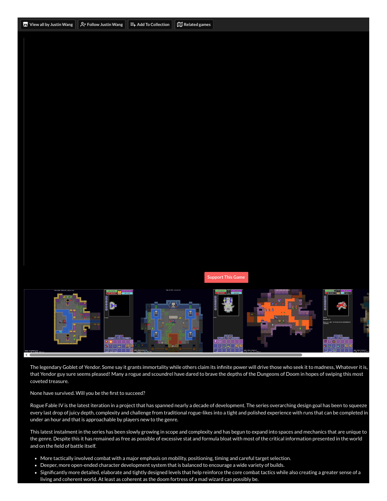

# Player replay — Rogue Fable IV (Thirteenth Bell competitor B4 — SUBSTITUTE)
**Filed:** 2026-10-20 · **Source:** live browser play, first-person player voice
**URL:** https://itch.io (free browser build, v0.26, by Justin Wang)
**Role in the matrix:** substitute for Slice & Dice (B4), which has no browser-playable demo (see its access-check record). Rogue Fable IV preserves B4's family — strategy/tactics, roguelike runs: repeated compact runs that reward better decisions under uncertainty.
**What the substitute leaves unanswered:** Slice & Dice's specific verb system — a party whose members' abilities are dice faces you allocate — has no equivalent here. RF4's randomness is procedural generation and terrain, not dice allocation. Recorded as the gap, per the matrix's reserve rule.
**Coverage:** FULL PLAY per the assignment's definition — two complete runs, both played to death, with learning demonstrably applied between them. No walkthroughs, guides, or strategy sources consulted. No account, no payment.
**Screenshot note (honest):** captures were taken and viewed in-session (early grid fight; the "CRI 3" pool-edge hit and the game's own WATER tooltip; the blink-mushroom teleport; both death screens; the Run 2 character sheet). The current browser pipeline cannot deliver capture files to the workspace — they exist only as in-session references and are NOT banked as files.

## Run 1 (Human Warrior) — learning by bruising
I waited a turn to let two bats close and ate a free hit for it (HP 40→38). At a pool's edge I took a critical hit — only afterward did I read the game's WATER tooltip: standing on unstable footing (water, rubble) makes every physical attack against you a critical. Fighting across a bridge over a pit and over rubble taught the same lesson twice more. Boxed in at a ledge, I made the run's fatal decision: I jumped into the pit. I survived the fall (HP 29→16) but landed in The Upper Dungeon 2/4 in a scripted ambush — the Wizard Yendor's minions. I killed his goblin and skeleton, clicked my healing flask in the inventory and saw nothing happen, and was chased down a corridor and killed by a blue caster's lightning at turn 79 — one corridor from both the next stairs and a healing mushroom. Death screen: "YOUR LEVEL 1 WARRIOR WAS KILLED IN THE UPPER DUNGEON."

## Run 2 (Human Warrior) — the lessons went to work
A spear-throwing Goblin Archer sniped me from a pond for ~29 HP across a long chase. This time I refused to fight standing in water — and discovered the crit rule cuts both ways: I killed rats queued in a flooded breach and later the archer itself with critical hits, because *they* were standing in water. I fought at a one-tile chokepoint, cornered the kiting archer in a one-wide channel, and — safely out of combat at 11 HP — tested the flask properly: it is click-to-use, "FULLY HEALED!" (HP 11→40). Which means Run 1's Warrior died holding a working full-heal potion I had failed to use. Fully healed, I reached the stairs on foot (no pit jump), descended, and found the same Yendor ambush room asleep; I killed one archer in its sleep, stepped on a blue BLINK mushroom by accident (a click-to-choose teleport — a genuine surprise), and killed the second archer (XP 42%). Then the blue caster — the same enemy type that killed Run 1 — burned me from 14 HP to 6 while I fought its escorts in the open. I fled toward healing mushrooms and died at turn 117, two tiles short of safety. Final sheet: Warrior, STR 11 / DEX 10 / INT 10, Protection 2, Shields Up 1, Gold 0.

## How the combat felt
Honest, positional, unforgiving — and it always showed me the rule after it hurt me. Terrain is the real weapon: water, rubble, chokepoints, bridges. Ranged enemies are the true threat to a melee Warrior because they kite and snipe. Learning carried over measurably (117 turns vs 79; XP 42%; a proper descent instead of a pit jump) and still wasn't sufficient: I repeated Run 1's core mistake — fighting a caster's escorts in the open — and died to the same enemy in the same room. A lesson queued for a Run 3 I did not start.

## Exactly where I stopped
Run 2, dead at turn 117 in The Upper Dungeon 2/4, Level 1 Warrior, XP 42%. Zones 3/4 and 4/4 never reached; nine other classes never tried; red/purple mushroom effects never confirmed.

## Tooling (separate from the game)
Slow iframe load; FPS fell to 3–5 in the second zone; single key presses and dialog clicks intermittently dropped or needed repeating; click-to-move auto-walk once routed me through hazardous shallows; the browser keyboard has no letter keys, so the [M]-key mushroom quick-travel was untestable (same keyboard limitation recorded in the Fireboy & Watergirl fragment). No ads, bot checks, sign-in walls, or purchase prompts.

## Session 2 (2026-10-20, later) — second independent play, two more runs
A second blind session (seeds 152960584312 / 152963221765) independently corroborates this record's core findings and adds its own: **Run 1** died at T:75 on floor 2/4 (XP 44%) to a Goblin Archer — after bleeding HP to an unexplained damage source later identified as the Goblin Miner's thrown bombs (11 DMG), drinking the full-heal at 8 HP, and dying at 1 HP by clicking a chest while a third archer still lived. **Run 2** died at T:182 on floor 2/4 (XP 74%, best yet across both sessions) to a bat — after applying bomb discipline, identifying every enemy by tooltip before engaging, cornering three of four archers, and finally dying to the whip goblin's crits while retreating across shore rubble — the same UNSTABLE-terrain rule, relearned the hard way. Cross-session constants: rubble/water crits, grass as a two-way dodge field, flask color lying (green = full heal, purple = energy), full heal held for ≤14 HP, archers kiting choke points. What did not transfer, again: safety at "only" 21 HP.

**Evidence status of session 2 (loss logged):** its six full-page PDF captures are **page shells** — the coordinator render-checked them: all show the itch page with a black game area (differing md5s, identical visuals). One was banked in `evidence/` labeled as a shell; its PDF original was removed in the 2026-10-22 post-embedding cleanup (view embedded below; original in git history — see `../notes/cleanup-2026-10-22.md`); the rest are logged here by session timestamps. The session-2 account therefore rests on its report, whose internal detail (seeds, turn counts, timers, XP, exact tooltip texts) is consistent with session 1's independent findings — corroboration, labeled as such, not visual proof.

## Evidence gallery (embedded)
The captures are filed under `evidence/` in this package (market records: beside the record, in `market-research/`). PDF captures are shown as rendered page views; PNG captures are embedded as-is.

*Page shell — the game area does not print (canvas); this is the page frame a capture can hold. All six session-2 captures are this identical shell; the rest are logged in the record.*

