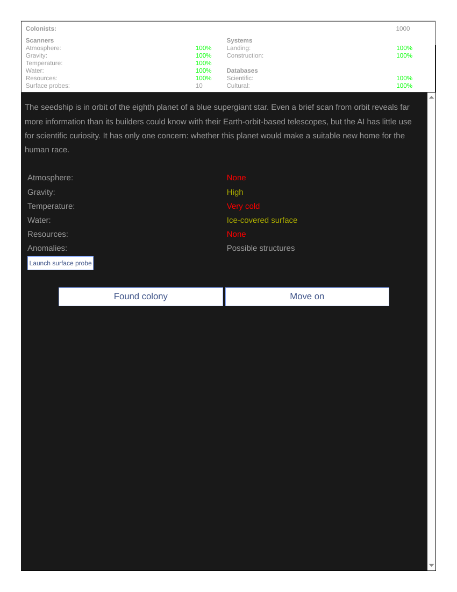
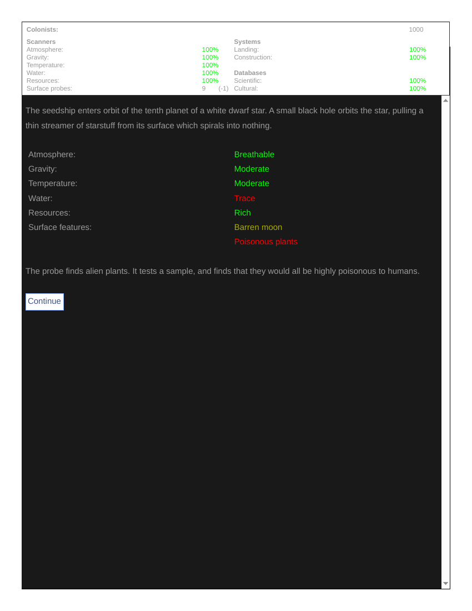
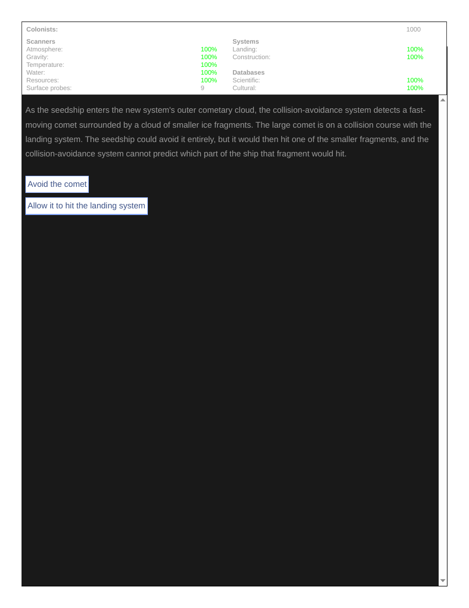
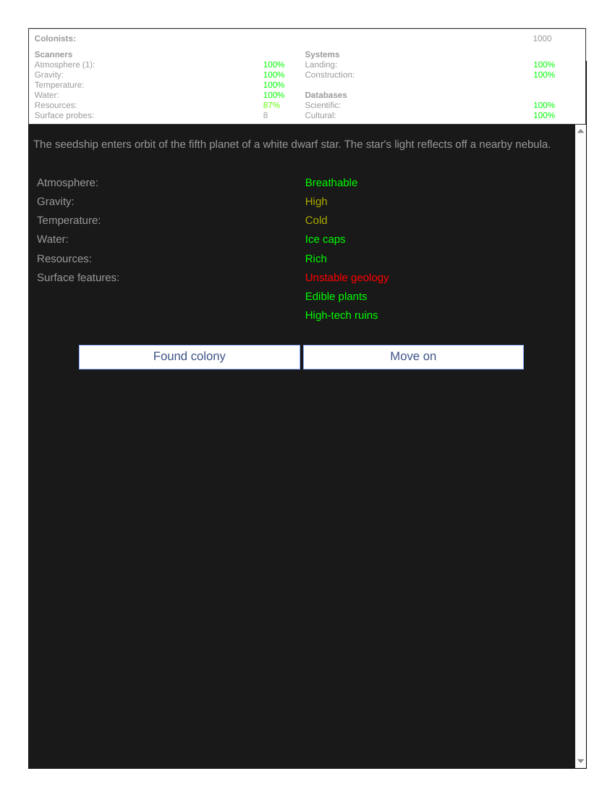
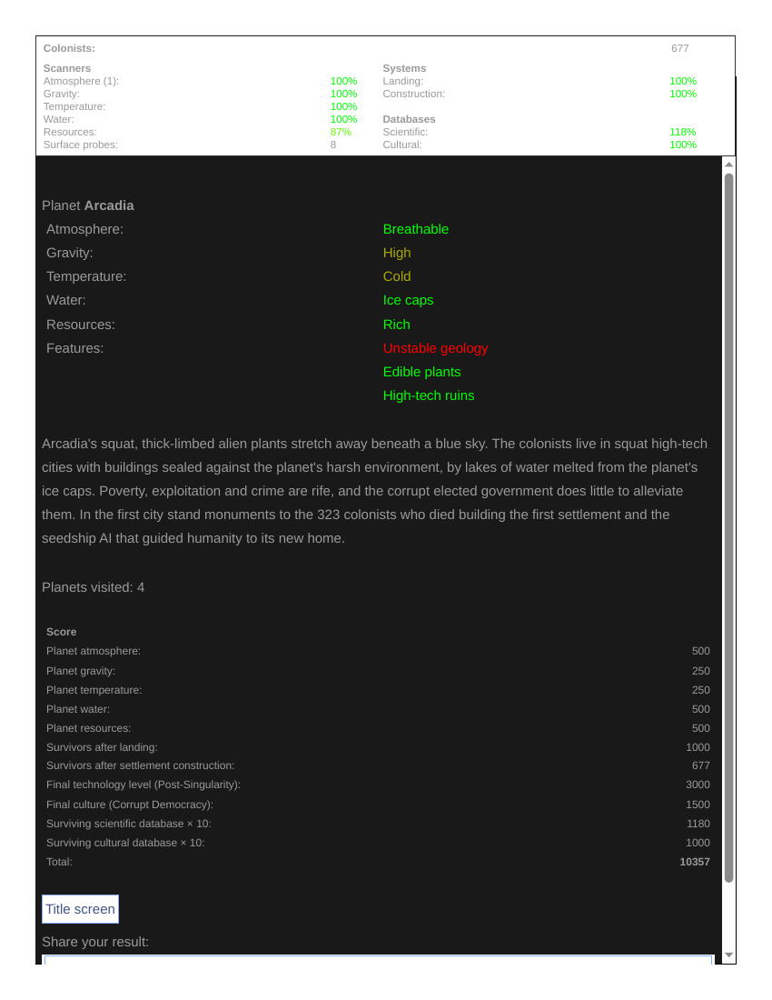

# Player replay — Seedship (Thirteenth Bell competitor B5)
**Filed:** 2026-10-20 · **Source:** live browser play, first-person player voice
**URL:** https://spacegoblingames.itch.io/seedship (web edition, v1.4.0, by John Ayliff)
**Coverage:** FULL PLAY — one continuous blind run: 9 planets visited, planetfall reached, colony end-state report and final score seen. No walkthroughs, guides, or strategy sources consulted.
**Screenshot note (honest):** 7 beats were captured and viewed in-session (Planet 1 scan; supergiant-flyby tradeoff; the 127-deaths event; Dearth's full scan; planetfall; colony collapse; final score screen). The current browser pipeline cannot deliver capture files to the workspace — the images exist only as in-session references and are NOT banked as files. Beats are described below from the session report; this record carries that limitation on its face.

## The run, in order
Earth is doomed; humanity built a seed-shaped ship carrying 1,000 frozen colonists, and an AI made to think and feel like a human to judge planets for them. The AI wakes after millennia to silence — humanity is extinct except the colonists. Systems check: everything at 100%.

- **Planet 1** (red dwarf): non-breathable air, high gravity, very cold, no water, no resources. Moved on without spending a probe.
- **En route** — dense nebula: I kept the scanners running (certain atmosphere-scanner damage, down to 69%) rather than fly blind and risk a collision. Equipment for the hull and the colonists.
- **Planet 2** (gas giant's moon): marginal air, high gravity, planet-wide ocean, edible plants (probe spent, 10→9). Too weak a foundation — moved on.
- **En route** — supergiant flyby overheating: I overheated the scanner module rather than the sleep chambers, landing systems, or databases (resources scanner 93%).
- **Planet 3**: marginal air, very low gravity, dangerous animals, a pre-Stone Age sentient species with brutal chieftains, and monumental ruins. Moved on.
- **Upgrade 1:** gravity scanner to long range — extreme gravity had been the most common dealbreaker.
- **Planet 4**: toxic atmosphere. Ruled out on sight.
- **Asteroid event:** I rotated the ship so the rock hit the temperature scanner (78%) instead of humanity's last scientific database.
- **Planet 5**: corrosive atmosphere, rich resources. Hard no — the air.
- **Supernova event:** I refused to shut down electronics (collision avoidance stayed online) and let radiation wreck the resources scanner further (84%).
- **Planet 6**: corrosive atmosphere, ice surface, rich resources. Moved on.
- **Upgrade 2:** atmosphere scanner long range; later I preserved the landing system over construction (construction decayed to 74%) — a failed landing kills everyone.
- **Planet 7**: marginal air, no water, no resources. Moved on.
- **The worst news:** the medical monitor reported 127 colonists had died in their sleep (873 remaining). From that moment, patience itself had a human price — I needed to settle soon.
- **Planet 8**: breathable question unresolved until probed — rich resources, but an Atomic Age civilisation and a planet-spanning culture: the world belonged to its natives. Moved on.
- **Protoplanetary disc:** I risked the crossing for data; a planetesimal smashed the gravity scanner (65%), but the data upgraded the temperature scanner.
- **Planet 9**: atmosphere scan failed, so I probed (7→6) — **breathable air**, moderate gravity, oceans, poor resources; hazards: planet-wide earthquakes, dangerous animals, inedible plants, monumental ruins. With 873 lives, a degrading ship, and the first breathable world of the run, I founded the colony.

**Planetfall:** the ship splashed down into the ocean off a continent's shore. The colonists woke, built a memorial to the 127 who had not survived, and named the world **Dearth**, for its lack of mineral resources.

**Colony collapse:** 36 colonists died of overheating when cooling failed; an earthquake levelled the partly-built settlement, killing 593; hostile native animals overran the colony and killed the last 244. Colonists: 0. I had accepted every known hazard of Dearth, and it still annihilated them.

**Final report:** Planets visited: 9. Score — atmosphere 500, gravity 500, temperature 250, water 500, resources 250, survivors after landing 873. **Total: 2,873.** The screen offers a "Title screen" link (restart invitation) and a "Share your result" link. I stopped there; no second run started.

## The matrix question (Bell B5): can the player explain what was risked, and for whom?
Yes — every event named its trade explicitly: scanner percentages against the scientific database, the landing system against construction, equipment against 1,000 sleeping lives. The score's "survivors after landing: 873" line makes the responsibility arithmetic permanent — and the collapse then spends it. Knowledge in this game is not power; it is a priced inventory you watch decay while you decide whose risk to take.

## Tooling
No tooling failures affected this session.

## Session 2 (2026-10-20, later) — second full play, with captures
A second complete run, played to settlement: four planets scouted and weighed, and this time the colony ship settled — on **"Arcadia"** — with **677 survivors** reaching the surface and a final score of **10,357** (against session 1's 2,873 and total loss). The contrast between the two runs is the record's real evidence for the B5 question: the same priced-inventory decisions, taken with one session's knowledge of what the trade-offs cost, produced a surviving colony instead of a wiped one — the responsibility arithmetic is learnable, and the score line keeps both outcomes permanently comparable.
**Evidence:** five full-page PDF captures from session 2, banked with this record and render-verified (first planet decision, planet-2 probe result, the comet trade-off, the Arcadia profile decision, and the colony outcome/score screen) — `evidence/` of the filed package.

## Evidence gallery (embedded)
The captures are filed under `evidence/` in this package (market records: beside the record, in `market-research/`). PDF captures are shown as rendered page views; PNG captures are embedded as-is.

*Session 2 — the first planet decision (page 1).*

*Session 2 — planet 2 probe result (page 1).*

*Session 2 — the comet trade-off (page 1).*

*Session 2 — the Arcadia profile decision (page 1).*

*Session 2 — colony outcome: Arcadia settled, score 10,357 (page 1).*

