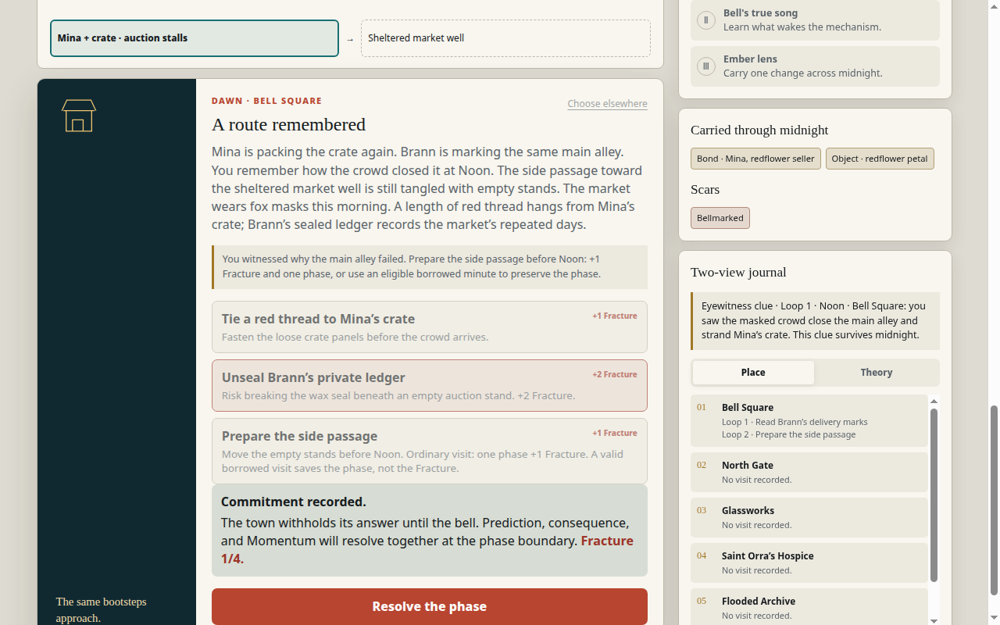
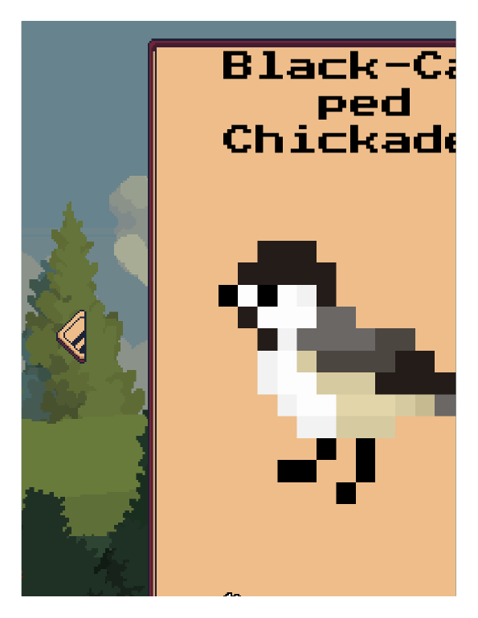
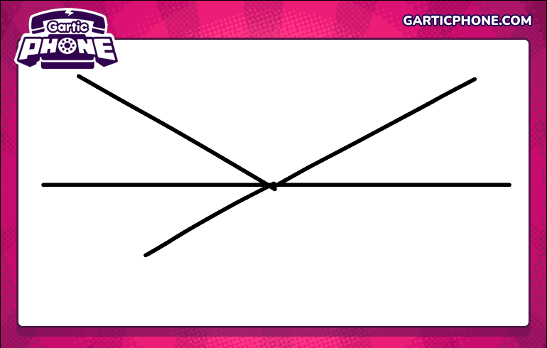
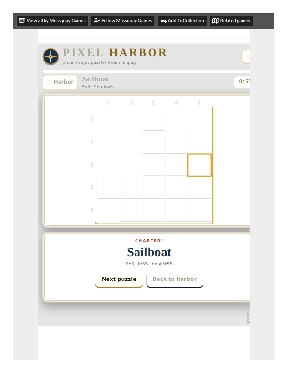
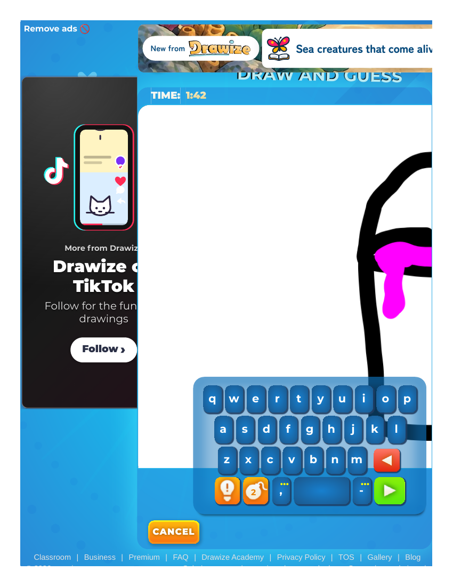
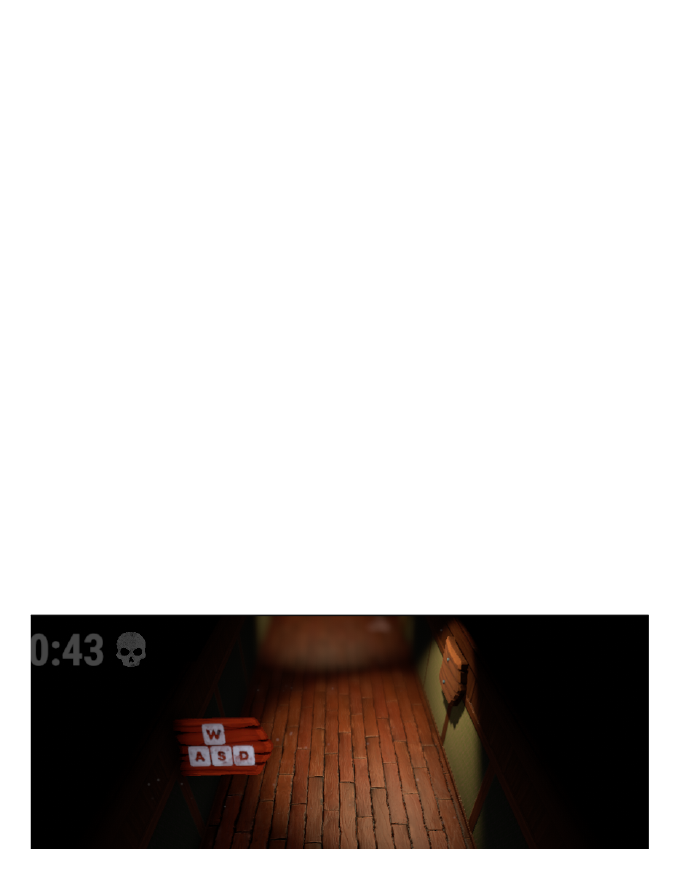
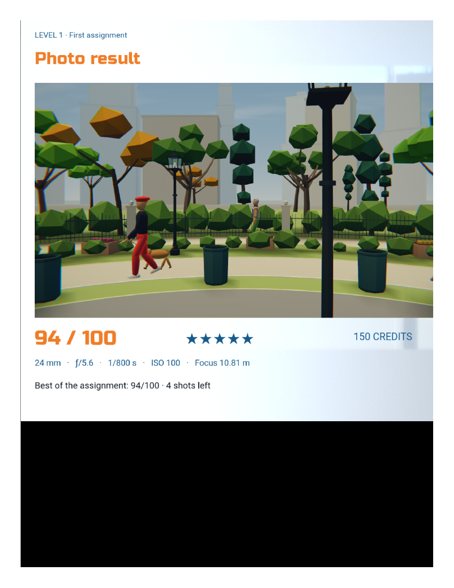
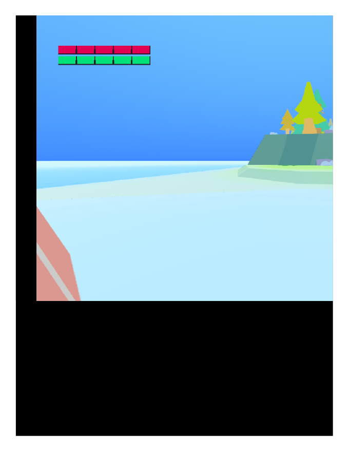

# One-page critique — three demos, played first-hand (2026-10-28)

## Verdicts (one line each)

- **Small Hours: ready for the human gate.** The pair flow works end to end, the keepsake downloads as a real SVG, and the solo rehearsal reaches the same keepsake. What it needs is humans, not fixes.
- **Vivid 0.1.2: ready for the human gate.** Both stories end; Iona's return visit pays off with the private letter, the strongest-written moment observed in this round. What it needs is humans, not fixes.
- **Bell 0.1.0: proven end to end.** The loop works all the way: witness → anchor → Loop 2 → prepare → Mina at the sheltered market well ("The main alley is still blocked; the changed route, not a changed crowd, brought her here"). What it needs is one in-game line stating its advance rule, not a redesign — then a re-test with a fresh player (see action 1).

## What the play proved [REAL]

**Small Hours.** Pair flow (impossible postcard): curtain → private choice + guess → seal → reveal ("TWO WAYS OF SEEING — the same or different — both make a good beginning") → activity → detail (120-char cap; A 44/120 for "a brass key that hums when the tide comes in", B 38/120 for "the smell of rain on the harbour steps") → keepsake → verified SVG download (1,425 bytes, banked). Solo rehearsal (weather for two): same skeleton, "See the rehearsal reveal", two detail rounds, keepsake reached. Friction: two labels for the same submit ("Tuck away my detail" vs "Bring our details together"); two reveal labels for pair vs rehearsal; the rehearsal's second detail round is easy to miss.

**Vivid.** Iona: two marks gate the signal (page: aim EAST; plate: Short-Long-Short); wrong pattern fails soft ("Nothing is lost; you can try again"); correct signal → ferry home. Return visit → recollection → brace the shade → fit the wedge → the private letter opens ("To whoever keeps this light after me: I was frightened every night. I turned it on anyway. — Iona"). Mara: three objects → lightbox notch 3 → "The picture comes together". Friction: the wedge step resolves without a clear player action; the letter action's label stays stale after opening; the notch is easy to miss.

**Bell.** Witness path proven (marks → eyewitness clue → survives midnight); prediction grading works ("Foresight fulfilled · Momentum +1" / "Prediction disproved — No Momentum is lost"); Dusk → Midnight via "Ring the boundary bell" → "Face the thirteenth bell"; anchor board confirmed (Mina + redflower petal → "Anchor these into tomorrow") → Loop 2 Dawn ("LOOP II · THE DAY ANSWERS BACK", scar "Bellmarked", altered town) → preparation in Loop 2 Dawn → **Loop 2 Noon: Mina and her crate reach the sheltered market well through the side passage you prepared ("The main alley is still blocked; the changed route, not a changed crowd, brought her here")**. Friction (the critique's center): the advance rule is never stated in the game — a visit registers only on a scene action, the prediction must be tested, Dusk advances via the boundary bell, midnight needs a confirm click, Loop 2 map destinations are pins, not buttons. Five runs stalled on it — three in Noon, two at Midnight (see the Bell journey record). A first-time player hits the same wall.

## What the competitors say

- **ROLLBACK (Bell's deep rival, played to an ending — "THE PROMISE", 1 of 8) [Rectified 2026-10-29: the ending rests on text-layer state markers only — RUN 2 @ desk, 03:32, "PROMISE", "restore_policy: DISABLED."; no visible ending frame exists]:** its notebook persists across resets and it names its loop rule up front — but its patience economy punishes a good first run (honest answers still ended in rollback; the ending is only reachable by skipping ahead in Run 2, which the game never explains). Bell's clue persists too, but Bell hides its advance rule across runs. Lesson for Bell: state the rule once, in-game, before the gate — and make sure the stated rule is the whole rule.
- **Birdography (Vivid's deep rival, photo→journal loop twice):** every photo pays off with a journal fact — but it has no in-game instructions (controls exist only on the itch page). [Correction: the journal "mismatch" first reported here is resolved by the live update — journal entries sit in fixed species order, not discovery order, so Chickadee and Magpie readable after two photo banners is the design, not a defect.] Vivid pays off only on return — which is stronger, but only if the player comes back. Lesson for Vivid: the return prompt ("Would you like to know why I kept that little wedge?") is doing the work; keep it, and make the notch findable. Vivid's marks→signal is exact (two marks, one pattern, one answer) — that exactness is what makes the return trustworthy, and it stands on Vivid's own design, not on Birdography's contrast.
- **Gartic Phone (Small Hours' deep rival in Solo mode, full Solo session to album + export, verified GIF 770×490):** the reveal montage + GIF album is the rival to the keepsake. Gartic exports the moment; Small Hours saves it as SVG. **Limit: Solo is an animation maker, not the telephone loop — the write → draw → guess chain was not exercised (needs 4–50 humans).** Lesson for Small Hours: the keepsake is the differentiator — it is a file the pair owns, not a feed. Protect it; the pair test will tell whether two people feel it.
- **skribbl.io (Small Hours' second browser edition, live public room):** the draw-guess loop works with strangers, and the drawing itself fails — lost strokes, a stray diagonal that turned a stove into an envelope, dislikes in chat. Worse, the strangers degraded the session: a drawer who wrote "I don't know" and scribbled out the canvas, constant join/leave, votekick messages, Acura ads crowding the game area. Lesson for Small Hours: choices, not drawing, are the right input for a pair who may not draw — and a known pair, not strangers, is the whole game. No drawing skill, no lost strokes, no votekick. The second deep family for Moments stays [OPEN] — both deep plays are draw-guess-adjacent.
- **Pixel Harbor (Vivid's second browser edition, two puzzles solved: Sailboat 2:42, Anchor 0:45):** picture-logic is satisfying alone — clues, Fill/Undo/Mark, Check ("1 square look wrong" — a grammar bug), progress that persists (2/8 charted). But it also leaves stale text on screen (the Sailboat message stayed under the fresh Anchor board for the whole puzzle) — the same stale-state class as Vivid's letter label. Lesson for Vivid: Mara is the same mechanic with a sentence at the end ("The last train left. Someone kept a key."). Logic + story beats logic alone — and feedback text matters, including clearing it when the board changes.
- **Core Rush (Bell's second browser edition): PARTIAL, not a deep comparison.** 37 minutes of taps dug to HOLD 1/8 (TOPSOIL, 1M, $50, fuel ~8%) [claimed at the time as "1 coal"; struck — HOLD 1/8 is not verified coal, see Bell coverage live-update correction], then the pod wedged in a one-tile pit and no held key exists in this environment to thrust it out — no sale, no upgrade, 0/12 field notes, no loop reset seen. The in-game heading says five layers; the itch page says six. The loop question stays open; the game tab is left open, paused, at the HOLD 1/8 state [struck "1-coal" wording] for a human to resume.

## What to do before 20 November

1. **Bell: one in-game line stating the advance rule** ("A visit counts when you act in the scene; the bell advances when the prediction has been tested") — then re-test with a fresh player recruited through the gate plan (action 2). No structural change; the loop is sound. (Owner: Bell branch owner; re-test owner: gate owner.)
2. **Bell: close the agent-play workstream.** The Loop 2 outcome is proven (bell19, first-hand); no further agent play of it is needed. Fold the unplayed items (Original run, previous-Contrast comparison, Fracture 4 — deepest reached 3/4) into the human-gate plan. (Owner: gate owner.)
3. **Small Hours: run the six-pair human gate.** Nothing in the demo blocks it; the gate is a scheduling problem, not a build problem. (Owner: release coordinator — first step is to assign the facilitator and 12 people.)
4. **Vivid: run the human gate.** Same — the demo is ready; the letter payoff is the thing to watch humans react to. (Owner: release coordinator — first step is to assign the facilitator and 6 pairs.)
5. **Loopback blocker filed as GitHub issue #5** (PaperStrange/IndiaGames, 2026-10-28) — the agent browser cannot reach local servers; play evidence was gathered via file:// on the exact frozen bytes. The documented deployment route needs a supported loopback path or a blessed file:// protocol. Owner: gate owner (folded into action 2).

## Evidence

Play records + PNG/text evidence per beat in `play-2026-10-28/`; morning competitor PDFs banked under `evidence/competitors/`, live-round PDFs cited by browser-task ID from their output dirs; sweeps in `gamejam-studies/fresh-competitors-*-2026-10-28.md`. All claims labeled [REAL] (first-hand) / [SECONDARY] (desk) / [OPEN] (unproven) in the records. This report itself now embeds 17 items (16 PNG frames + 1 GIF) [Rectified 2026-10-29: count corrected from 13, then expanded with the Night OClock corridor, Field Guide in-game, and PhotoHacks assignment-result renders; all embeds verified resolving]; ROLLBACK carries no photo because its canvas prints blank — its ending rests on text-layer state markers, stated beside the claim.

## Live-window update 2026-10-29 (appended; verdicts above unchanged)

Small Hours and Vivid stay ready for the human gate; Bell stays proven end to end conditional on the one-line advance-rule fix. The live-window round (six replays + nine expansion plays) changed no verdict and added no demo fix; it changed the competitor evidence underneath the verdicts. Second-deep [OPEN] (Bell) is a research gap, not a release-gate blocker: the 20 November gate criteria (human sessions + zero open critical bugs) do not include competitor-study counts, so it is accepted as a known gap.

- ROLLBACK, reproduced: "THE PROMISE" reached again in Run 2 [REAL text-layer state markers: RUN 2 @ desk, 03:32, "PROMISE", "restore_policy: DISABLED." — the game canvas prints blank, so no visible ending frame exists]; the patience mechanism is pinned (document reads + answers drain patience 9→0, unstated in-game) [SECONDARY] — ROLLBACK punishes a good first run with a hidden rule, the mirror of Bell's hidden advance rule. Lesson stands: state the rule once, in-game, whole. The other ROLLBACK endings stay [OPEN].
- Birdography, resolved: journal entries sit in FIXED species order [SECONDARY] — the old "unlock inconsistency" is explained, not open. The exactness lesson for Vivid stands.

- Gartic Phone, re-verified: full Solo session, album reached [REAL capture], GIF re-verified (GIF89a, 770×490, 208,955 bytes) [REAL]. Normal mode and the telephone chain stay [OPEN].

- skribbl.io, completed: full 3 rounds, winner screen, BrowserTester 1,015 points, 1st [REAL capture]. Stranger degradation persists through a completed session.

- Template-cap note, carried from Moments coverage: the nine-title set exceeds the template's max-2-per-family cap in draw-guess (skribbl.io, Drawize, Drawasaurus = 3); the cap still holds for the original six. The second deep family stays [OPEN].
- Pixel Harbor, re-solved fresh: Sailboat and Anchor charted [REAL capture]; fresh times 0:55/0:45 [SECONDARY]; stale-text defect recurs.

- Core Rush, corrected: partial again, and the "1 coal" claim above is STRUCK — HOLD 1/8 is not verified coal (no ore breakdown in HUD text or capture text layers). No sale, no upgrade, no loop reset; the loop question stays [OPEN].
- Expansion partials, all [OPEN] where unfinished: Same Bullet loop counters advanced [REAL]; echo-replay behavior [SECONDARY], Room 1 uncleared; Night OClock corridor + tutorial signs reached [REAL render strips: corridor timers, WASD/SHIFT/RUN signs, clock item, green-lit view; title screen also render-verified; only the corridor strip is embedded here, other strips rest on cited live PDFs], carry-over unverified [OPEN]; last seen online desktop reached [SECONDARY], photos4em.zip gate unsolved (3124 confirmed wrong; 1243/3142 no unlock observed); Reign Round 3 reached, road never placed; Drawize Quick Draw session finished (word FORK), no submitted guess; Drawasaurus guessing only [SECONDARY], drawing turn never completed (AFK banner covering choice buttons, timer frozen).

- Expansion blocked/failed, all [OPEN]: Field Guide menu + in-game island view (health/stamina bars) + pause menu [REAL renders], no creature photo or gallery entry; Tranquility failed twice, no beats (camera bug unobserved, not absent).
- Expansion completed: PhotoHacks Arcade Level 1 assignment completed — photograph of the assigned person (red beret, black shirt, red leggings, walking a small brown dog), result 94/100, Level cleared [REAL render, embedded below]; tutorial complete with Steps 8–9 skipped (tracking needs held keys) and Steps 14/18 unseen as separate dialogs.

- Second deep family stays [OPEN] for Moments (Reign partial is the diorama family's first real play, not a completed deep play) and for Bell (all three expansion plays partial).
- Iona neutral profile stays [OPEN] (not played; optional per the launch doc).
- Standing constraint, unchanged: official-site / video records are file-keeping only and never complete a play slot. Blocked plays stay [OPEN] until first-hand play succeeds.
- The 20 November actions above are unchanged; the live round adds no new demo action. One tooling note for the record: the live-browser visual-click path failed with page_busy across canvas/WebGL boards in this round, which is what blocked Reign's road, Same Bullet's aim, and Field Guide's Start; Tranquility's retry failed separately on a browser-wide click/PDF failure (page_busy even on example.com), not a canvas-board failure — the route past those blocks is a human at a local machine, not another agent window.
