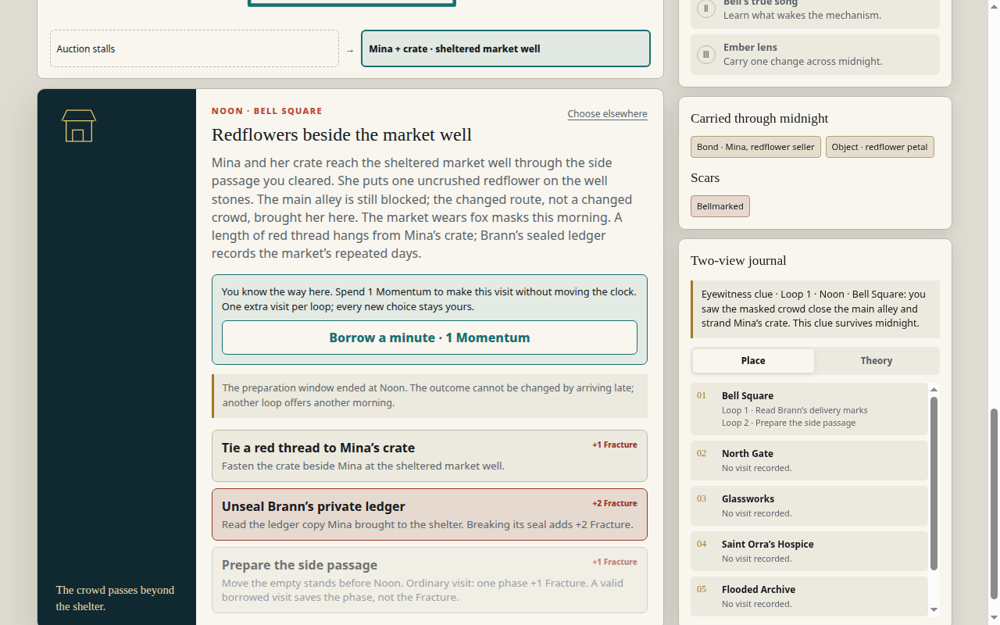
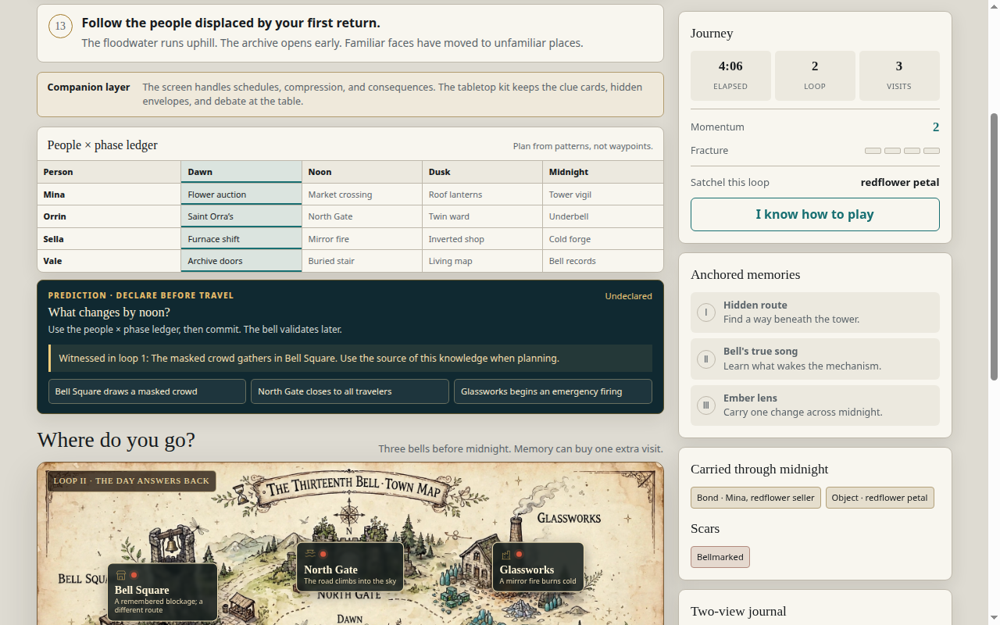
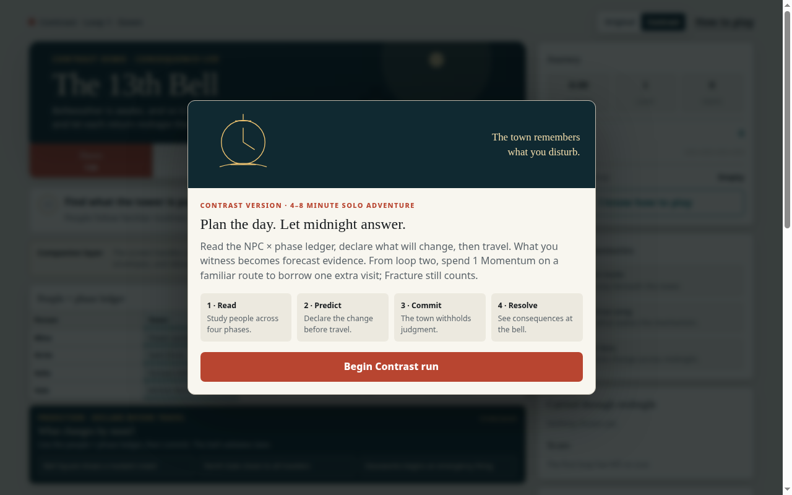
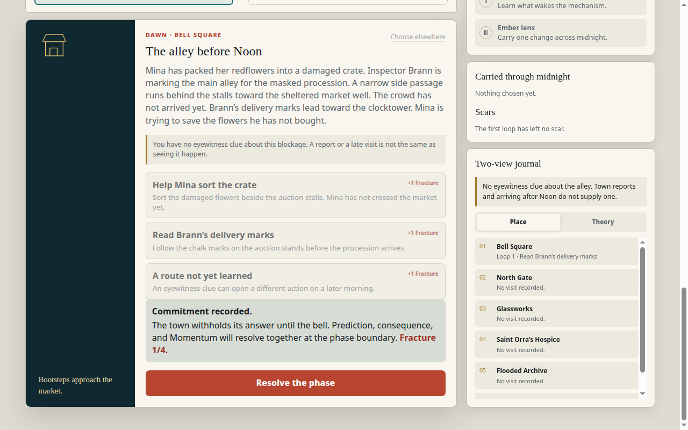
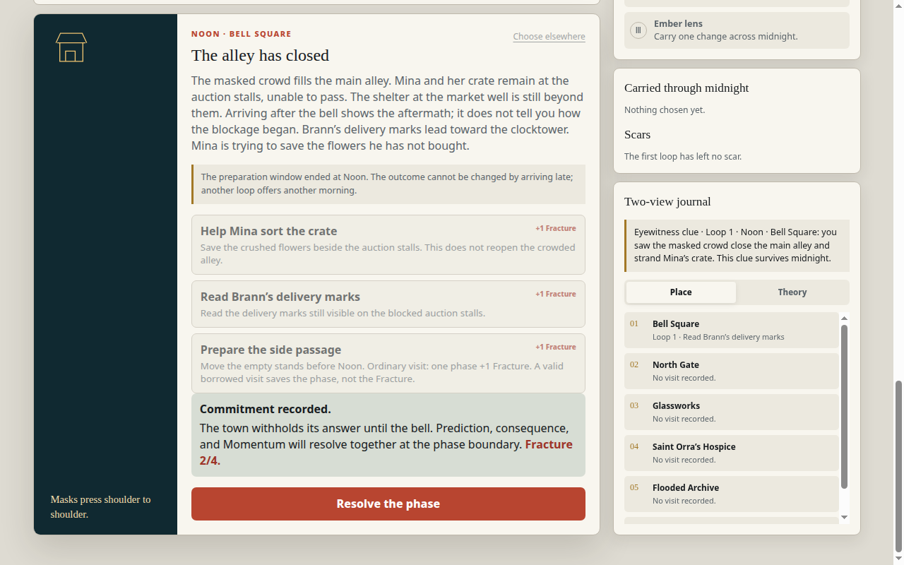
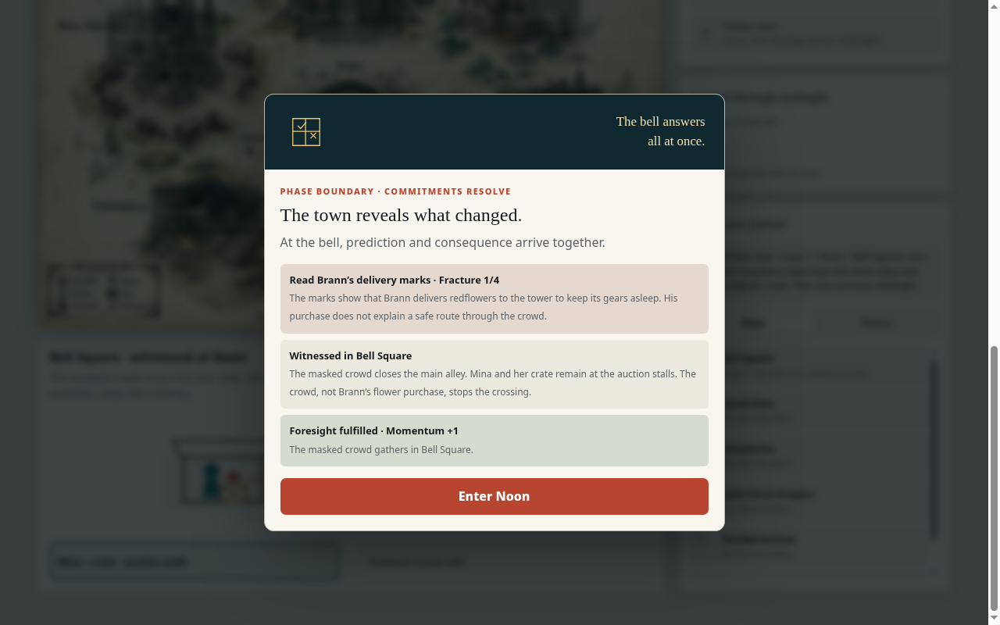
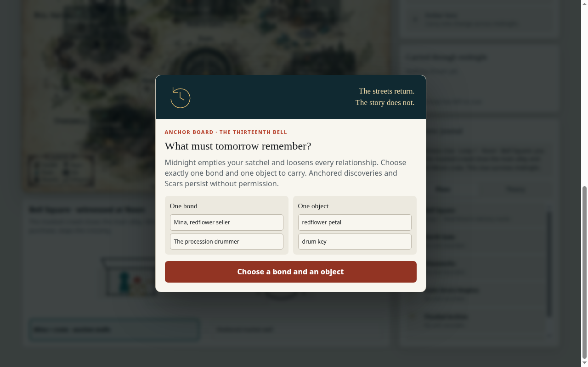
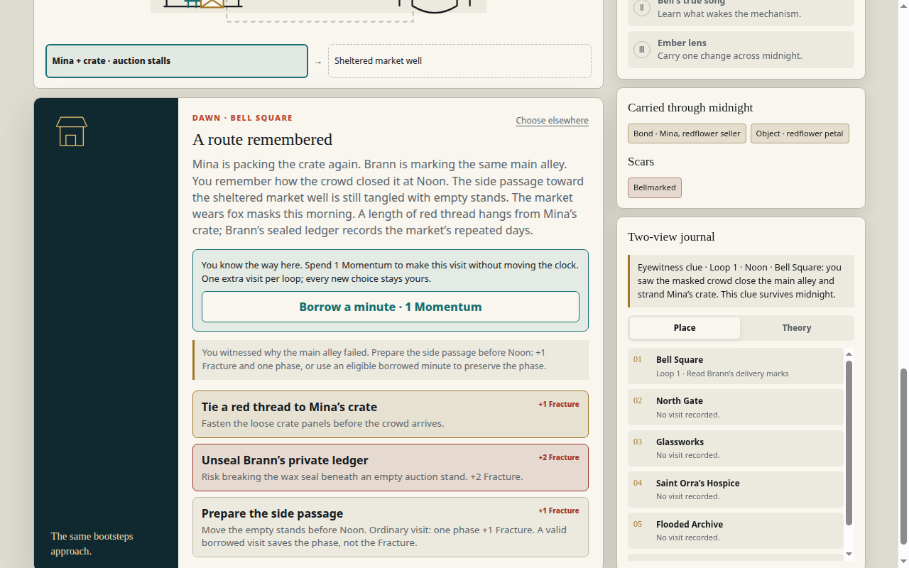

# The Thirteenth Bell 0.1.0 — Art and Sensory Journey (2026-10-28)

Companion to `journey--bell-0.1.0-2026-10-28.md`. Same session, same evidence (`evidence/bell/`).

## Journey board (Loop 1 — 8 beats)

| Beat | What the player sees | What it does | Evidence |
|---|---|---|---|
| 1. Arrival | Intro modal: "Walk a day that refuses to repeat. You have three visits before the thirteenth bell — unless Fracture reaches 4 and catastrophe arrives early." | The stakes are the clock, not a monster. The modal states the whole game in three sentences. | bell3/7 entry |
| 2. Learning | Dawn: the people × phase ledger (Mina, Orrin, Sella, Vale across Dawn/Noon/Dusk/Midnight) + prediction "What changes by noon?" + six destinations + "Three bells before midnight. Memory can buy one extra visit." | The ledger teaches planning from patterns, not waypoints — the game says so ("Plan from patterns, not waypoints"). | `l1-dawn` |
| 3. Meaningful choice | The prediction lock: three options, one committed before travel ("The bell validates later"). | The prediction is a bet the player makes with evidence they do not yet have. The game grades it at the boundary. | `l1-dawn` |
| 4. Confusion / recovery | The witness scene: "You have no eyewitness clue about this blockage. A report or a late visit is not the same as seeing it happen." | The game draws a hard line between seeing and hearing — and the player feels it when the late arrival shows only the aftermath. | bell4 |
| 5. Escalation | Noon, witnessed: "The masked crowd closes the main alley. Mina and her crate remain at the auction stalls. The crowd, not Brann's flower purchase, stops the crossing." + "Mina + crate · auction stalls → Sheltered market well". | The problem and the destination in one panel. The arrow is the whole quest. | `l3-noon-witnessed` |
| 6. Payoff (partial) | The boundary panel: "PHASE BOUNDARY · COMMITMENTS RESOLVE — The town reveals what changed. At the bell, prediction and consequence arrive together." + "Foresight fulfilled · Momentum +1" / "Prediction disproved — No Momentum is lost." | The boundary is the game's thesis made visible: prediction and consequence arrive together, in the same panel. | bell7, bell14 `61-resolve-dawn` (frame-verified boundary panel) [Rectified 2026-10-29: `n8-anchor` is the anchor-board frame, not the boundary panel.] |
| 7. Ending (Loop 1) | Midnight anchor board: "What must tomorrow remember? Midnight empties your satchel and loosens every relationship. Choose exactly one bond and one object to carry." | The ending of Loop 1 is a choice about what survives — not a boss, a ledger entry. | `n8-anchor` (the board itself, before any pick); `p6-anchored` shows the Loop 2 Dawn town after the anchor, not the board screen itself [Rectified 2026-10-29: evidence corrected to the true board frame.] |
| 8. Exit / re-entry | Loop 2 Dawn: "LOOP II · THE DAY ANSWERS BACK — You wake to an altered town. Bell Square wears masks; the North Gate road climbs skyward; the bellkeeper walks where no street existed yesterday." + scar "Bellmarked". | Re-entry is an altered town, not a reset. The scar is visible in the panel. | `p9-prepared` (bell19) |

## Journey board (Loop 2 Dawn → Loop 2 Noon — Mina at the sheltered market well, proven by bell19)

| Beat | What the player sees | What it does |
|---|---|---|
| Arrival | An illustrated town map (new art: "THE THIRTEENTH BELL · TOWN MAP") with renamed destinations: Bell Square "A remembered blockage; a different route", North Gate "The road climbs into the sky", Glassworks "A mirror fire burns cold", Saint Orra's "A child tends the empty ward", Flooded Archive "Open before sunrise", Underbell "The door below is suddenly ajar". | The town is the same map redrawn by the loop. Every destination's new label is a story beat. |
| Guidance | "Follow the people displaced by your first return. The floodwater runs uphill. The archive opens early. Familiar faces have moved to unfamiliar places." | The game tells the player the loop changed the town — and that the people moved. |
| Prediction | Pre-locked from Loop 1: "Locked · Bell Square draws a masked crowd — Witnessed in loop 1: The masked crowd gathers in Bell Square. Use the source of this knowledge when planning." | Loop 1's knowledge is Loop 2's starting equipment. The prediction is not a fresh bet; it is a carried fact. |
| Preparation | "Prepare the side passage +1 Fracture — Move the empty stands before Noon." | The preparation is the loop's verb: the player acts in Dawn so Noon can change. |
| Outcome (Noon) | "Mina and her crate reach the sheltered market well through the side passage you prepared. One uncrushed redflower rests on the well stones." / "The main alley is still blocked; the changed route, not a changed crowd, brought her here." | The thesis stated as a result: the crowd never moves; the route does. |

## Art questions (answered from play)

- **Composition:** The ledger (people × phases) is the game's central image; the town map is the second. Both are grids the player reads for patterns. The phase panels stack vertically: prediction → destinations → journal.
- **Silhouette:** The masked crowd is the silhouette (a massed, faceless blockage); the bell tower is the vertical. Mina's red crate is the single color accent in Bell Square.
- **Text / scale:** Short, procedural lines for rules ("Three bells before midnight"); longer, literary lines for the town ("The floodwater runs uphill. The archive opens early."). The boundary panel's lines are the most quotable in any demo.
- **Clue fairness:** The eyewitness rule is fair once stated ("A report or a late visit is not the same as seeing it happen") — but the game states it only AFTER the player has already failed by arriving late or reading a report. The fairness arrives as a correction, not a warning.
- **Acknowledgment / motion:** The boundary panel is the acknowledgment (prediction graded, Momentum gained or not, Fracture counted). Motion is minimal — the game is panels and a map; the "motion" is the phase advancing.
- **Style / action:** Painterly, muted, ledger-like. The actions are reading, predicting, visiting, resolving — all deliberate, none timed.
- **Memory:** The two-view journal is the memory system (Place / Theory columns; "Eyewitness clue · Loop 1 · Noon · Bell Square" persists). The scar ("Bellmarked") is the memory made visible on the body of the run.
- **Cue redundancy:** The prediction appears three ways (ledger, prediction panel, boundary grading); the clue appears twice (journal + "witnessed" tag on Bell Square). The advance rule, by contrast, appears NOWHERE — no redundancy at all, which is why runs stall.
- **Sound:** Not assessed — the play runs were silent (no audio evidence captured). [OPEN]
- **Social authorship:** Single-player; the "author" is the town (its routines, its bell). The tabletop companion layer ("The screen handles schedules, compression, and consequences. The tabletop kit keeps the clue cards, hidden envelopes, and debate at the table") hints at a multiplayer reading that the demo does not play.

## Evidence strips

**Strip 1 — clue → theory → action → confirmation (the witness):** Dawn: Brann's delivery marks (clue) → the player theorizes the marks explain the blockage (theory) → reads the marks, resolves, returns at Noon (action) → the boundary confirms "The crowd, not Brann's flower purchase, stops the crossing" (confirmation — and the confirmation corrects the theory).

**Strip 2 — before → acknowledgment → settled result (the boundary):** Before: a locked prediction ("Saint Orra's empties its ward") and an unvisited hospice. Acknowledgment: the boundary panel grades it ("Prediction disproved — No Momentum is lost" / "Foresight fulfilled · Momentum +1"); the consequence line ("The Glassworks furnace begins to sing") is a separate panel element, not part of the grading sentence. [Rectified 2026-10-29: the combined grading-plus-consequence sentence does not appear in any beat dump; see the journey record's event-journal row 7.] Settled result: Momentum moves (or does not), Fracture counts, the next phase opens.

**Strip 3 — first appearance → later reinterpretation (the traveler's hum / the drum key):** First appearance: the traveler's hum is flavor ("The stranger hums a low phrase. Ripples in the moat draw the shape of the bell's missing note") and is later reinterpreted as an anchored memory ("Bell's true song — Learn what wakes the mechanism"). The drum key first appears as satchel clutter ("redflower petal, drum key") and its use is still [OPEN]. (The same pattern — an ordinary object reinterpreted later — recurs across the demos; in Vivid it is the little wooden wedge.)

## Evidence gallery

Loop 2 Noon, Bell Square — "Redflowers beside the market well": Mina and her crate reach the sheltered market well through the side passage you prepared; one uncrushed redflower rests on the well stones; the main alley is still blocked — the changed route, not a changed crowd, brought her here.

Loop 2 Dawn — the altered town map after the anchor: "LOOP II · THE DAY ANSWERS BACK", pins renamed (Bell Square "A remembered blockage; a different route", North Gate "The road climbs into the sky"), carried Bond Mina + Object redflower petal, scar Bellmarked, LOOP 2. Note: this frame shows the anchor's result, not the Midnight anchor board screen itself.

### Gallery expansion 2026-10-29

Beat 1, arrival [REAL] — Contrast intro modal: "Plan the day. Let midnight answer" (Read, Predict, Commit, Resolve; "Begin Contrast run"), over the dimmed town page.

Beat 2, clue [REAL] — Dawn, Bell Square, "The alley before Noon": Brann's delivery marks read, "Commitment recorded" at Fracture 1/4, journal still at "No eyewitness clue about the alley".

Beat 3, witness [REAL] — Noon, Bell Square, "The alley has closed": Mina and her crate stranded at the auction stalls, the preparation window stated as ended at Noon, and the journal carrying the eyewitness clue that survives midnight.

Beat 4, acknowledgment [REAL] — Phase boundary, "The town reveals what changed": the marks explained, the witness restated, the prediction graded "Foresight fulfilled · Momentum +1".

Beat 5, choice [REAL] — Midnight anchor board, "What must tomorrow remember?": one bond and one object to carry, confirm control still reading "Choose a bond and an object" — the board before any pick. Board frame from the bell14/15 driver step n8.

Beat 6, preparation [REAL] — Loop 2 Dawn, Bell Square, "A route remembered" (bell19, before the click): carried Bond Mina + Object redflower petal, scar Bellmarked, and "Prepare the side passage +1 Fracture" offered. With the two pre-existing frames (Loop 2 Noon outcome, Loop 2 Dawn after the anchor), the gallery totals eight frames. [Rectified 2026-10-29: "eight beats" corrected — eight is the gallery frame count, not the journey-board beat count.]
