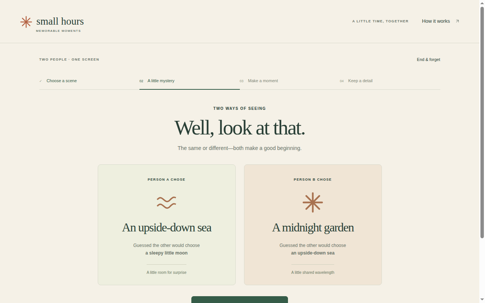
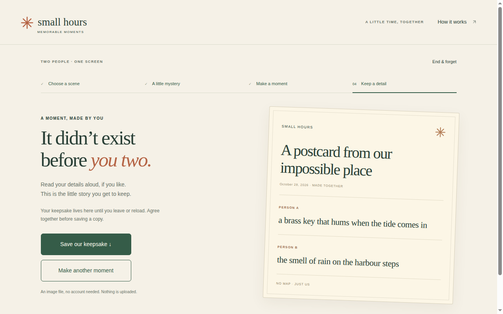
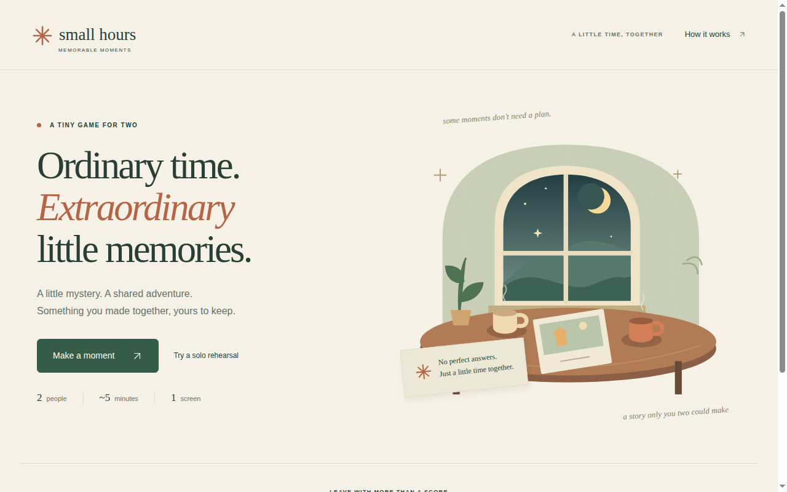
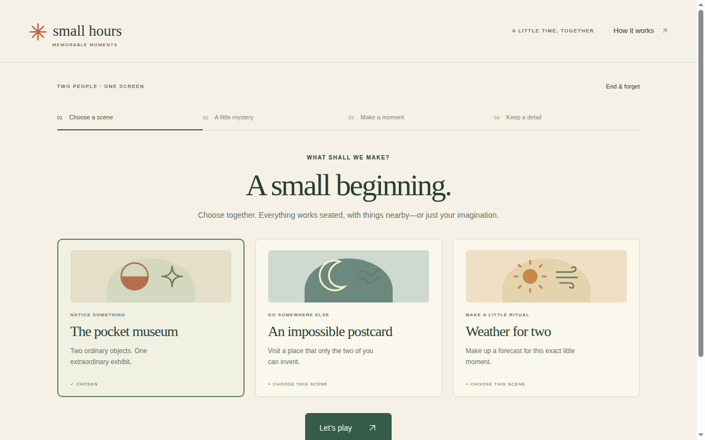
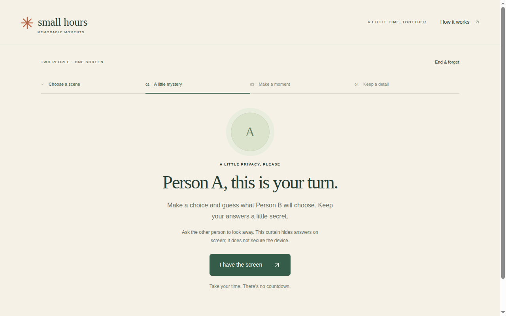
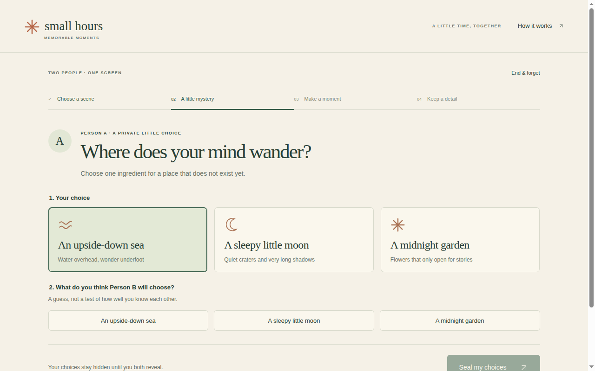
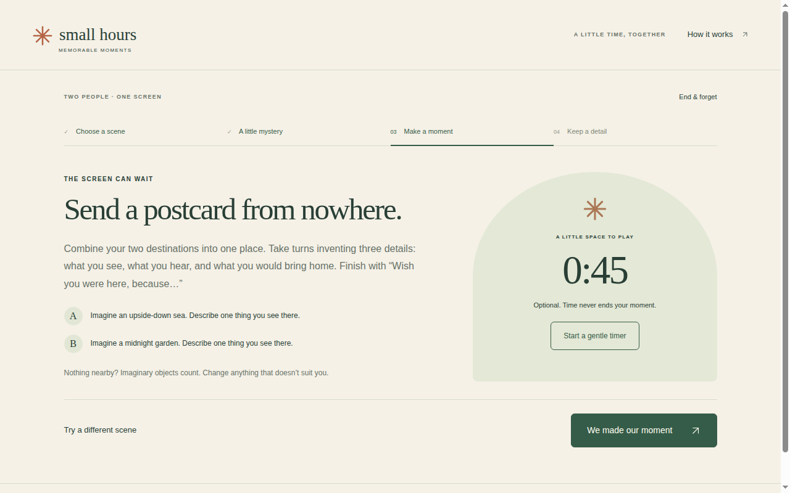
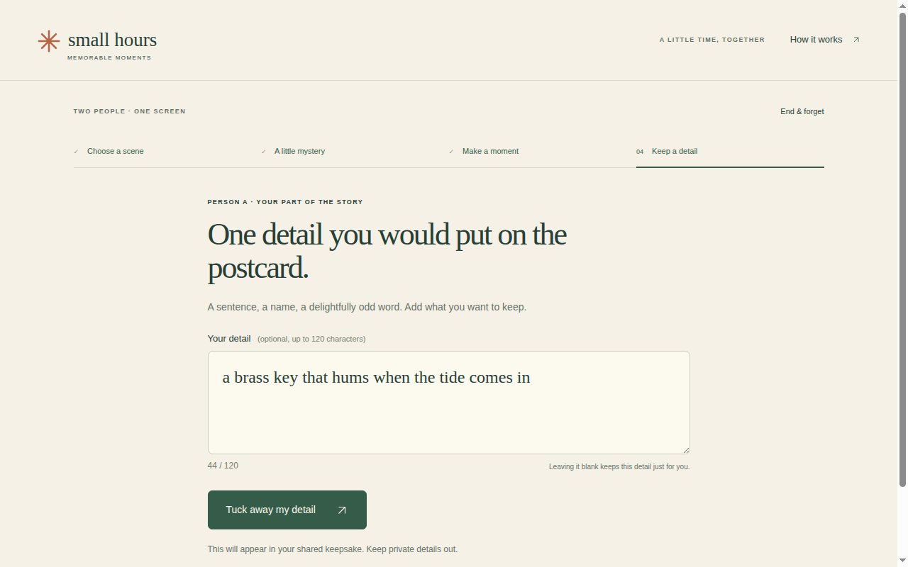
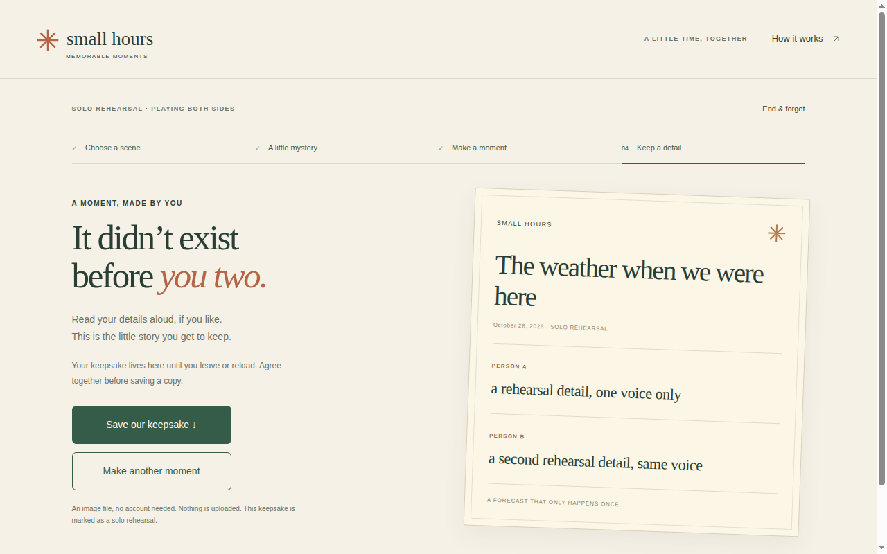

# Small Hours — Art and Sensory Journey (2026-10-28)

Companion to `journey--small-hours-2026-10-28.md`. Same session, same evidence (`evidence/moments/`).

## Journey board (pair flow — 8 beats)

| Beat | What the player sees | What it does | Evidence |
|---|---|---|---|
| 1. Arrival | "Ordinary time. Extraordinary little memories." "2 people · ~5 minutes · 1 screen." | The promise is small and the time is small. Nothing oversells. | `00-entry` |
| 2. Learning | Four steps: 01 Choose a scene / 02 A little mystery / 03 Make a moment / 04 Keep a detail. Three scenes: pocket museum, impossible postcard, weather for two. | The four steps are the whole game on one screen — the player always knows where they are. | `11-pair-scenes` |
| 3. Meaningful choice | The privacy curtain: "A LITTLE PRIVACY, PLEASE — Person A, this is your turn." + "I have the screen". | The curtain is a social ritual, not a lock: "This curtain hides answers on screen; it does not secure the device." The game trusts the players. [Rectified 2026-10-29: evidence corrected from `34-curtain-a` — that frame shows the choice screen, not the curtain; the curtain frame is `13-person-a`.] | `13-person-a` |
| 4. Confusion / recovery | Two choice sections share the same three labels ("1. Your choice" / "2. What do you think Person B will choose?"). | The only confusing beat: the sections look identical until read. The recovery is the section heading — if the player reads it. | `35-a-choice` |
| 5. Escalation | The reveal: "TWO WAYS OF SEEING — Well, look at that. The same or different — both make a good beginning." | The escalation is emotional, not mechanical: the reveal names the match or the mismatch kindly ("A little room for surprise", "A little shared wavelength"). | `71-reveal` |
| 6. Payoff | The activity ("Make something with this") → "We made our moment" → the detail step ("One detail, just from you"). | The payoff is making, not winning. The detail (120 chars, live counter) is the smallest possible creative act. | `72-activity`, `81-detail-A` [Rectified 2026-10-29: `43-activity` removed — byte-identical to `42-reveal` (A choice screen, sea selected), not an activity screen; the activity frame is `72-activity`.] |
| 7. Ending | The keepsake postcard: "SMALL HOURS — A postcard from our impossible place — October 28, 2026 · MADE TOGETHER — PERSON A: a brass key that hums when the tide comes in — PERSON B: the smell of rain on the harbour steps — NO MAP · JUST US". | The keepsake is the game object: two details side by side, unranked, dated. "NO MAP · JUST US" is the game's best line. [Rectified 2026-10-29: evidence corrected from `82-keepsake` — that file is byte-identical to the Person A detail screen (`81-detail-A`), not the keepsake; the keepsake frame is `b2-keepsake`.] | `b2-keepsake` |
| 8. Exit / re-entry | "Save our keepsake ↓" (verified SVG download) + "Make another moment". "Your keepsake lives here until you leave or reload." | The exit is a download, not a score screen. Re-entry is one click ("Make another moment"). | `keepsake--pair-impossible-postcard.svg` |

## Journey board (solo rehearsal — 6 beats)

| Beat | What the player sees | What it does | Evidence |
|---|---|---|---|
| 1. Arrival | "SOLO REHEARSAL · PLAYING BOTH SIDES" banner over the same scene chooser. | The rehearsal is labeled as a rehearsal — it does not pretend to be the pair game. | `r0-rehearsal-start` |
| 2. Learning | "Weather for two": "What kind of weather is this moment? Soft sunshine / Friendly rain / Curious wind." | The scene's question is the whole mechanic in one line. [Rectified 2026-10-29: evidence corrected from `s5-rehearsal-reveal` — that frame is the reveal, not the question screen; the question screen is `r3-rehearsal-reveal`, a misnamed file whose frame is the rehearsal choice screen.] | `r3-rehearsal-reveal` |
| 3. Choice | Both sides played by one person; two seals. | The rehearsal's honesty ("Rehearsal: take both turns yourself") keeps it from feeling like a fake pair. | moments16 log |
| 4. Reveal | "YOUR MOMENT IS READY — Try the shared reveal. In a pair session, both people return to the screen for this part. You are rehearsing both sides." Button: "See the rehearsal reveal". | The rehearsal names the difference instead of hiding it. | Driver `pw/play-moments16.cjs:54` |
| 5. Detail | Two detail rounds (A then B); B's curtain: "Person A's line is tucked away until you finish." | The second round is the rehearsal's trap: one round stalls at B's curtain (moments15). | Source `builds/small-hours/build/views.js:32` |
| 6. Keepsake | Rehearsal reached the keepsake (moments16). | The rehearsal ends at the same artifact as the pair game — the keepsake is the constant. | `s6-rehearsal-keepsake` |

## Art questions (answered from play)

- **Composition:** Four numbered steps across the top; one scene at a time below. The layout never changes between modes — the player learns it once.
- **Silhouette:** The postcard is the silhouette: a bordered card with two details and a date. It is the only object the game makes, and it looks like a keepsake.
- **Text / scale:** Short lines throughout ("Ordinary time. Extraordinary little memories.", "NO MAP · JUST US"). The longest text is the curtain's honesty clause — and it earns its length.
- **Clue fairness:** Not applicable in the puzzle sense; the "fairness" here is social (the curtain tells the truth about what it can and cannot do).
- **Acknowledgment / motion:** The reveal is the acknowledgment (both choices shown, neither judged). The keepsake's render is the settled result. Motion is minimal — the game is mostly still text and cards.
- **Style / action:** Warm, paper-like, unhurried. The actions are choosing, guessing, sealing, detailing — all small, all reversible until the seal.
- **Memory:** The keepsake IS the memory: dated, two-voiced, downloadable. The game ends by handing the players their own words back.
- **Cue redundancy:** The step numbers (01–04) repeat in the header and in the flow; the "I have the screen" button repeats at every curtain. The redundancy is the tutorial.
- **Sound:** Not assessed — the play runs were silent (no audio evidence captured). [OPEN]
- **Social authorship:** The players are the authors (their choices + their details make the keepsake). The game is a frame, not a writer.

## Evidence strips

**Strip 1 — clue → theory → action → confirmation (pair reveal):** A chooses "An upside-down sea" and guesses B will choose "A sleepy little moon" (theory about the other person) → B chooses "A midnight garden" and guesses A will choose "An upside-down sea" (action) → the reveal shows both, names the mismatch "A little room for surprise" and the overlap "A little shared wavelength" (confirmation — and the confirmation is kind, not scored).

**Strip 2 — before → acknowledgment → settled result (keepsake):** Before: two sealed choices and two details, hidden from each other. Acknowledgment: the keepsake renders both details side by side with a date. Settled result: the SVG downloads — "An image file, no account needed. Nothing is uploaded." The moment leaves the screen as a file.

**Strip 3 — first appearance → later reinterpretation (the curtain):** First appearance: "A LITTLE PRIVACY, PLEASE — Ask the other person to look away." Later: the detail curtain repeats the same ritual ("Pass the screen to Person B. Person A's line is tucked away until you finish") — and the player realizes the curtain was never about secrecy; it is about taking turns seriously. The ritual is the game.

## Evidence gallery

Pair reveal [REAL] — "TWO WAYS OF SEEING: Well, look at that. The same or different — both make a good beginning." Person A chose "An upside-down sea" (guessed a sleepy little moon, "A little room for surprise"); Person B chose "A midnight garden" (guessed an upside-down sea, "A little shared wavelength").

Keepsake screen [REAL] — "It didn't exist before you two." The postcard reads "A postcard from our impossible place — October 28, 2026 · MADE TOGETHER — PERSON A: a brass key that hums when the tide comes in — PERSON B: the smell of rain on the harbour steps — NO MAP · JUST US", with "Save our keepsake ↓" and "Make another moment" buttons.

### Gallery expansion 2026-10-29

A 7-beat board, each frame read as a PNG before captioning [REAL]. The pair flow was played by one operator playing both sides, so these frames prove the flow, not a true pair.

Beat 1, arrival [REAL] — "Ordinary time. Extraordinary little memories." Buttons "Make a moment" and "Try a solo rehearsal"; "2 people · ~5 minutes · 1 screen". Warm paper-like palette, window-and-table illustration.

Beat 2, learning [REAL] — steps 01–04 across the top; three scene cards ("The pocket museum" chosen, "An impossible postcard", "Weather for two"), each with its own small illustration.

Beat 3, the curtain [REAL] — "A LITTLE PRIVACY, PLEASE — Person A, this is your turn." The honesty clause ("This curtain hides answers on screen; it does not secure the device") sits under the instruction, with "I have the screen" as the only action.

Beat 4, meaningful choice [REAL] — "An upside-down sea / Water overhead, wonder underfoot" highlighted in section 1, above the unselected guess section. The two sections share option labels, so the section heading carries the meaning.

Beat 5, payoff [REAL] — "THE SCREEN CAN WAIT — Send a postcard from nowhere." A and B prompts (upside-down sea, midnight garden), gentle 0:45 timer, "We made our moment" button. The payoff is making, not winning.

Beat 6, the smallest creative act [REAL] — "One detail you would put on the postcard." Input reads "a brass key that hums when the tide comes in", counter "44 / 120", button "Tuck away my detail".

Beat 7, the rehearsal's constant [REAL] — "The weather when we were here — October 28, 2026 · SOLO REHEARSAL", two rehearsal details, "A FORECAST THAT ONLY HAPPENS ONCE", marked as a solo rehearsal below the buttons. The rehearsal ends at the same artifact as the pair game.
