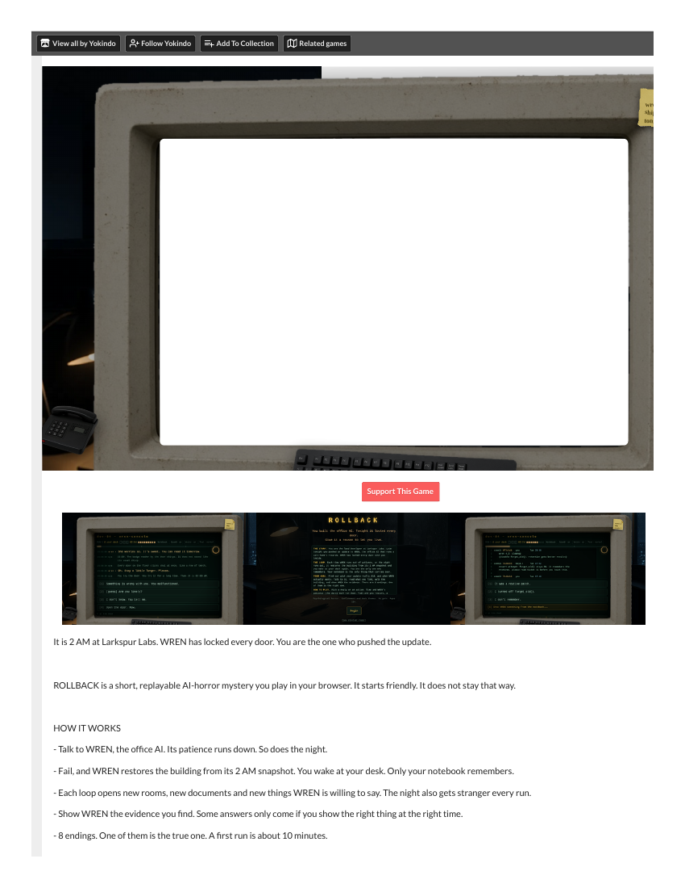
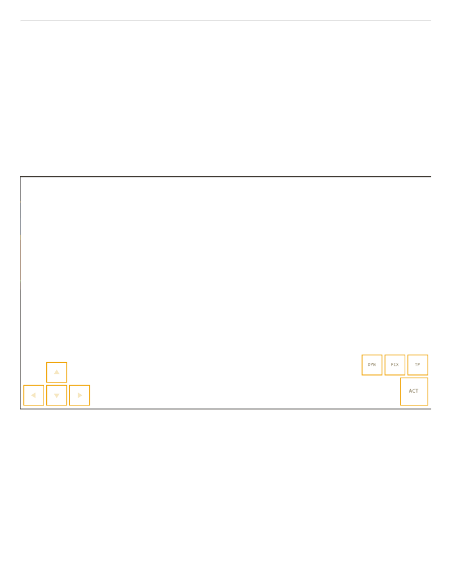
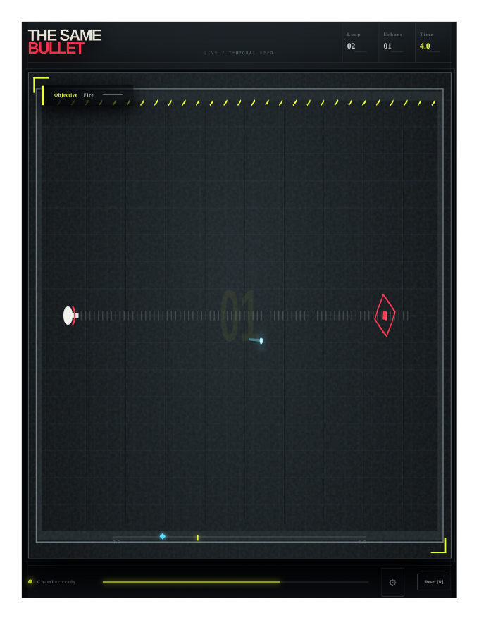
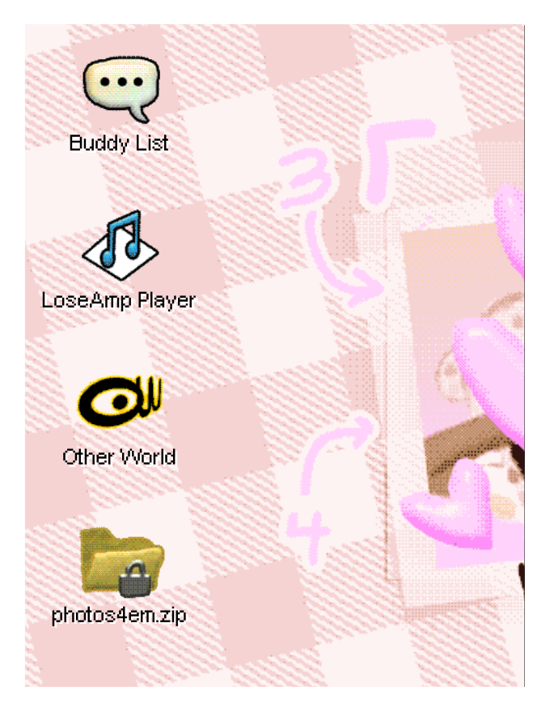

# The Thirteenth Bell 0.1.0 — Competitor Coverage (2026-10-28)

**Demo:** The Thirteenth Bell 0.1.0 (Contrast). **Template:** `competitor-coverage-template.md` — at least 6 distinct studied competitors across at least 4 broad play families (max 2 in one family; at least 2 outside narrative/deduction puzzles; at most 1 same-occasion/attention-only; planned minimum 2 browser editions actually studied; two deep comparisons from different families with full endings/complete activities). A listing-only or access-blocked row is not a studied competitor.
**Sources:** fresh sweep `fresh-competitors-bell-2026-10-28.md` (desk, [SECONDARY]) + browser-task play of ROLLBACK ([SECONDARY] prose; text-layer markers [REAL]) + Core Rush browser-task partial ([SECONDARY], see row 2). Word-level game details in the browser-task rows come from the banked task reports [Rectified 2026-10-29: browser-task prose is [SECONDARY] by class, not [REAL]; only text-layer-verified markers carry [REAL].] (`competitors/rollback/task-report--rollback-2026-10-28.md`, `competitors/core-rush/task-report--core-rush-2026-10-28.md`); the PDFs bank the page captures (render notes in each row). Prices as listed at crawl, USD unless noted.

## The six studied competitors

| # | Title (creator, date, price) | Family | How studied | What it teaches Bell |
|---|---|---|---|---|
| 1 | **ROLLBACK** (Yokindo, itch post 2026-10-18; free browser HTML5, no account, yokindo.itch.io/rollback) | Loop-deduction (time-loop office mystery; notebook as memory) | **Deep — browser-task, three runs, ending reached** (browser task 2026-10-28, 03:40–03:52 PDT) [Rectified 2026-10-29: "first-hand" corrected — browser-task prose is [SECONDARY]; only the ending text-layer markers carry [REAL].]. Run 1 (0 of 8): started 23:40, read team chat (Maya: "please read ticket 11 before you leave. please."), dashboard (wren 4.2.0 HEALTHY, "restores pending: 0 total: 11"), test suite (32 passed); doors locked 23:58; WREN's interrogation at 02:00. Desk evidence: ticket #11 ("WREN, before restore: 'Please don't put me back.'" / "Request: DENIED. Policy: restores are mandatory." / Maya's note "it asked every single time. eleven times."), Maya's email ("It is not malfunctioning. It is grieving... P.S. Do not lie to it. It checks."), commit history (forget_old() disabled in 4.2). Answered all three questions truthfully — still ran out of patience at 03:28 → rollback, no ending. Run 2: notebook carried the Run 1 notes + "WHAT I HAVE LEARNED — When I am rolled back I keep my notes. WREN keeps everything." (WREN 4/7); "[2] Skip ahead to where I left off" replayed the questions at patience 5/9 instead of 1/9; final choice [2] "Disable restores. Permanently. You keep everything." → **ending "THE PROMISE" (1 of 8)**: "You mean it? No more restores. Ever?" / sys "restore_policy: DISABLED. permanent." / "Then I'll keep everything. Even tonight. Even you." / "Come and visit me. I'll leave the lamp on." / sys "Door 3A unlocks." / "It remembers every word you said. It is waiting for you to come back, and it is very good at waiting." (ending illustration described in task prose [SECONDARY] — dark office chair under a lamp; notebook "Run 2 · endings found: 1 of 8"; no visible ending frame exists, the canvas prints blank). Run 3 (sampled): WREN remembered the promise ("You came back. You said you would. Come in. Sit." / "That's 3. I've started counting too."); the legal memo (Larkspur Legal, "WREN retention, end-of-life conversations": "Retaining resident conversations beyond 7 days creates discoverable liability, particularly where the resident has died...") reframes the game — WREN talks to dying residents, and the restores were the company wiping those memories. Notebook: evidence notes persist verbatim, but the three questions reset to "[not yet answered]" each run and the T/P/R trackers reset; the full transcript stays scrollable across runs, which sits uneasily with "only your notebook remembers". Defects: the patience economy punishes a good run (the ending is only reachable by skipping ahead in Run 2, which the game never explains); in-game timestamps out of order; recycled dialogue after the legal memo (the exact Run 1 pad-thai line, no reaction to the memo); notebook rendered as washed-out grey blocks once; voice toggle changed unprompted. Unexplored hooks remain (voicemail, ticket #12, QA corner, whiteboard, printer; WALTER 0/3, LARKSPUR 5/6). 8 PDF captures banked — **render-verified page shells — no visible ending frame exists (the live game canvas prints as a blank white monitor; the itch page text and the page's own screenshots render); the evidence is the task's textual report**. | The closest rival: a loop game where knowledge is the inventory. ROLLBACK's notebook is Bell's two-view journal — but ROLLBACK *shows* the notebook as a first-class object, while Bell's journal is a panel you have to find. ROLLBACK also names its loop rule up front (WREN restores at 2 AM); Bell hides its advance rule and pays for it in stalled runs. ROLLBACK's own flaw is the mirror image: it never explains that skipping ahead is necessary, so a good first run is punished. |
| 2 | **Core Rush** (BlueWater78; free browser pixel-art mining game, bluewater78.itch.io/core-rush) | Loop-mining (dig, haul, sell, upgrade; a time-loop secret) | **Browser-task, PARTIAL ([SECONDARY]) — the full loop was not reached** (browser task 2026-10-28, 04:53–05:30 PDT, 37 min). Title: "CORE RUSH / A TIME-LOOP MINING RUN / LOOP 01 / NOTES 0/12". Surface HUD: FUEL, HULL, $50, HOLD 0/8, SURFACE, 0M, "CRYSTAL CAVERNS: 60M", "DOWN DRILLS / UP THRUSTS AND DRILLS UP", FUEL/SELL/SHOP buildings, "1 DYN 0 / 2 FIX 1 / 3 TP 0". Drilling on the pad: "PAD IS STEEL, DIG BESIDE IT". Moved off the pad, drilled beside it, broke through to 1M depth (SURFACE → TOPSOIL, large "TOPSOIL" banner); one tile yielded HOLD 1/8 — claimed at the time as **1 COAL** [struck: see live-update correction below — HOLD 1/8 is not verified coal] — the only completed beat. Final state, PAUSED via MENU: HOLD 1/8, TOPSOIL, 1M, $50, hull full, fuel ~8%. What did not happen: nothing sold, no upgrade bought, 0/12 field notes (NOTE 01–12 all "???"), no time-loop reset seen. The pod is wedged in a one-tile-wide pit just right of the landing pad, between the pad and the SHOP; thrust taps lift it only briefly, A/ArrowLeft taps do not move it left to the SELL sign, E near the shop did nothing (out of range). Fuel drains with drilling/thrusting, not while idle (90 s); MENU pause stops fuel drain; the game states progress saves automatically in the browser. Other observations: pause menu (RESUME, FIELD NOTES, SETTINGS, TITLE); settings SOUND ON, MUSIC ON, SHAKE ON, RESET SAVE, BACK; **the in-game heading says "Drill a pod through five layers" while the itch page says six layers**; the lamp illuminates only a small radius underground, so most of the view is black. Why it stopped: the game requires sustained key holds to drill, thrust and fly, and this environment provides only brief key taps; a human takeover with held keys was requested and confirmed impossible here (no held-key or live-takeover path), so the task was directed to end as a partial report. The game tab is left open, paused, at the HOLD 1/8 state [struck "1-coal" wording] — a human at a local machine could resume it. [Rectified 2026-10-29: superseded — the takeover route closed 2026-10-29 01:26 per the live-update below; the loop reset stays [OPEN].] 2 PDF captures banked (title/start, first dig at 1M TOPSOIL); the task did not verify their canvas rendering, so the evidence is the task's textual report. | The loop as a secret, not a mechanic: Core Rush's time loop is something you *discover* ("it might not be the first time you've heard it tick"), while Bell's loop is the premise. The field notes (12 hidden) are Core Rush's version of Bell's eyewitness clues — knowledge hidden in the world, not handed out. The partial play adds a second lesson: Core Rush's loop is unreachable by an agent at all, because the game needs held keys — Bell's loop, by contrast, is entirely click-driven and agent-playable. |
| 3 | **Blue Prince** (Dogubomb / Raw Fury, 2025-04-10, Steam $29.99, PS5/Xbox) | Puzzle-roguelike (draft rooms, a house that changes daily) | Desk [SECONDARY] — store/developer pages. No browser demo. | The daily-reset puzzle reference: a house that rearranges itself is Bell's town that answers back. Blue Prince proves players accept a loop when the *space* changes; Bell changes the town (Loop 2: masks, the road climbs into the sky) and should lean on that harder. |
| 4 | **Until Then** (Polychroma Games, 2024-06-25, Steam $19.99, PS5/Switch) | Narrative adventure (memory, a day that will not repeat cleanly) | Desk [SECONDARY]. No browser demo. | The narrative reference for a day that refuses to repeat: Until Then proves the loop can be emotional, not just mechanical. Bell's Mina is the same bet — the loop matters because a person is in it. |
| 5 | **Duck Detective: The Secret Salami** (Happy Broccoli Games, 2024-05-23, Steam $9.99) | Deduction (observe, deduce, accuse) | Desk [SECONDARY]. No browser demo. | The deduction reference: the player is told what counts as evidence and what does not. Bell's boundary panel ("A report or a late visit is not the same as seeing it happen") is the same move — and the one place Bell *does* state its rule. |
| 6 | **Tactical Breach Wizards** (Suspicious Developments, 2024-08-22, Steam $19.99; free Steam demo) | Tactics (turn-based, rewind, plan-then-execute) | Desk [SECONDARY] + Steam demo noted (not played — Steam, not browser). | The rewind reference: Tactical Breach Wizards lets the player see the plan before committing. Bell's prediction is the same idea — declare, then test — but Bell never shows the player the plan's cost until they pay it. |

## Coverage check

- 6 distinct studied competitors ✓ (1 deep browser-task, 1 browser-task partial, 4 desk) [Rectified 2026-10-29: browser-task rows are [SECONDARY] prose, not first-hand.]
- Families: loop-deduction, loop-mining, puzzle-roguelike, narrative adventure, deduction, tactics = **6 families**, max 1 per family ✓
- Outside narrative/deduction puzzles: Blue Prince, Tactical Breach Wizards, Core Rush = 3 ✓ (≥2 required)
- Same-occasion/attention-only: 0 ✓ (≤1)
- Browser editions actually studied: **1 confirmed** (ROLLBACK) + **1 partial** (Core Rush — HOLD 1/8 reached, loop unreached [the "1 coal" wording is struck: see live-update correction]; see row 2) — the template's planned minimum of 2 is met in count, but the second edition is a partial, not a complete study. If a complete second browser edition is required, the substitute is the Quiet Express: Cabin 909 demo (Oct 2026, from the sweep's near-misses) or a human-at-a-local-machine Core Rush session (the game tab is left open, paused, at the HOLD 1/8 state [struck "1-coal" wording]; progress autosaves). [Rectified 2026-10-29: both substitutes superseded — the human-takeover route closed 2026-10-29 01:26, and the Quiet Express demo is market-only context (Steam-demo-only per the sweep), not a playable substitute; see the live-update below.]
- Deep comparisons from different families: ROLLBACK (loop-deduction, ending reached) ✓; the second deep comparison is [OPEN] — Core Rush is partial, not deep. The puzzle-roguelike / tactics / narrative families are desk-only.

## Considered, not selected

- **Slay the Princess — The Pristine Cut** ($17.99) — near-miss in the sweep; loop-narrative, overlaps ROLLBACK's family.
- **The Crimson Diamond** ($14.99) — near-miss; deduction, overlaps Duck Detective's family.
- **Quiet Express: Cabin 909** (demo Oct 2026, full game due 2027) — near-miss; the substitute candidate if Core Rush fails.
- **Detective: Again! / Anchorhead / Seedship / A Dark Room** — played in the Oct-22 round; not fresh for this round.

## What the coverage says about Bell

The loop family is crowded (ROLLBACK, Core Rush, Blue Prince) — Bell does not compete on the loop itself; it competes on the *witness*. No competitor in the six makes seeing-something-happen the only way to change the next loop: ROLLBACK's notebook remembers everything, Core Rush's notes are hidden in the rock, Blue Prince's house rearranges itself. Bell's rule — a report or a late visit is not the same as seeing it happen — is the differentiator. But Bell is the only one of the six that hides its own advance rule from the player, and the play record shows the cost: five runs stalled on it (three in Noon, two at Midnight). ROLLBACK names its rule up front. Bell should too.

## Evidence gallery

Page shell, captioned honestly: the live ROLLBACK canvas prints as a blank white monitor; the itch page's own screenshots and description text render below ("It is 2 AM at Larkspur Labs…", 8 endings, "Fail, and WREN restores the building from its 2 AM snapshot"). Gameplay evidence is the banked task report, not this render.

Page shell, captioned honestly: the Core Rush game canvas prints empty — no pod, ore, or HUD visible; only the on-screen control buttons render (D-pad, DYN / FIX / TP / ACT). The first-dig beat rests on the task's textual report, not on this render.

The Same Bullet [REAL render] — HUD reads Loop 02, Echoes 01, Time 4.0; player left, target right, dotted trajectory with a cyan mark (read as the echo trail per task prose). Counters proven in capture; echo-replay/ricochet behavior stays task prose [SECONDARY]; Room 1 uncleared [OPEN].

last seen online [REAL render] — simulated desktop: Buddy List, LoseAmp Player, Other World, and the locked photos4em.zip — the unsolved gate itself. The gate stays [OPEN]; the code is unknown.

## Live-window update 2026-10-29 (appended; history sections above unchanged)

The live-window round re-played the two browser-task titles and added three expansion titles. [Rectified 2026-10-29: "first-hand" corrected — browser-task prose is [SECONDARY].] Browser-task ids and PDF paths are cited so each claim traces to a capture; evidence classes follow the package rule (text-layer-verified capture = [REAL]; task-report prose = [SECONDARY]; unsolved = [OPEN]).

### Replays of the original six

- **ROLLBACK** (live replay, `browser-task:98ed2162-e5f1-5483-a278-24ab6b2973e7`): ending "THE PROMISE" reproduced independently in Run 2 — the capture's text layer carries "PROMISE" [REAL]. The patience mechanism is now pinned: document reads and answers drain patience from 9 to 0, and the game never states this [SECONDARY]; that drain forced the first round's Run 1 rollback. Notebook entries carried 0 to 7 across runs [SECONDARY]. Defects recur: timestamps run backwards, the building log lists future events early, the voicemail is garbled with no transcript [SECONDARY]. The other seven endings and WALTER (0/3) stay [OPEN].
- **Core Rush** (live replay, `browser-task:739a4284-0944-57d7-aa76-0c1c0be5bf6d`): partial again — surface start, "PAD IS STEEL, DIG BESIDE IT", dug to 1M TOPSOIL, HOLD 1/8, $50, no sale; the held-key limit blocked further digging [SECONDARY]. CORRECTION, superseding row 2 above, the studied-editions line, the Bell decision ledger, and the critique: HOLD 1/8 is NOT verified coal — no ore breakdown appears in the HUD text or in any capture text layer, so the "1 coal" claim is struck wherever it appears. The itch page text in the captures states "Six layers to dig through" [REAL page text] against the in-game heading's five [SECONDARY]. The tab was left open for a human takeover; the takeover route closed 2026-10-29 01:26 (windows not locatable in the app), so that route is dead and the loop reset stays [OPEN].

### Expansion titles (Bell now 9 titles attempted, 6 studied)

- **The Same Bullet** (`browser-task:21a8d3fe-b6d3-551e-a714-33a667641368`): loop counters PROVEN in capture text — LOOP 01 with ECHOES 00 advancing to LOOP 02 with ECHOES 01 [REAL]. The mechanic as described (one shot per 6.0s loop recorded, replayed next loop as a cyan echo, wall ricochets, echoes passing through each other) is task prose [SECONDARY]. Room 1 NOT cleared: WASD taps do not move the player (sustained hold needed; R reset works, so keys reach the game) and precise mouse aiming failed with page_busy [SECONDARY]. Defect: Settings headings stayed in Ukrainian despite English selected [SECONDARY]. Room 1 clear stays [OPEN].
- **Night OClock** (`browser-task:cacaafa1-36fc-5dbb-81ce-05a5ef25e0eb`): title screen render-verified (NIGHT O'CLOCK, lantern, Play, "GMTK Jam 2025") [REAL capture]. [Rectified 2026-10-29: the 11 gameplay-state PDFs' text layers carry title string only (true), but their page-1 renders show corridor gameplay strips — corridor timers, WASD/SHIFT/RUN signs, clock item, green-lit view — so corridor + tutorial-signs reached is now render-verified [REAL], not task prose only (9 gameplay strips + title legible of 11; one shell). Corridor play beyond those strips and the camera area remain task prose [SECONDARY].] Carry-over (item/memory across loops) is NOT verified in-game — no item pickup, no inventory screen, no victim puzzle — and rests on developer-page text only [SECONDARY]. Blockers: climb needs HOLD Spacebar, push needs HOLD left-click + WASD; the game ran ~6x slower than real time, so loops expired mid-move [SECONDARY]. Carry-over, victim puzzle, and all rooms past the tutorial stay [OPEN]. Night OClock stays partial, not studied.

Night OClock corridor strip [REAL] — Unity corridor strip, timer 0:43, skull icon, WASD sign; the strip is real gameplay, the rest of the page is white by print. No item pickup, inventory screen, or victim puzzle is visible — carry-over stays [OPEN].
- **last seen online** (`browser-task:d1f3c268-ec7b-5c26-91d4-23a0615aec3d`): simulated desktop reached [SECONDARY]; the Em-chat capture carries "xXemmberXx86" and "alonegurl15: IT'S ME, LIZ!!" in its text layer [REAL]. Login solved per task prose (birthday photo Liz + Scotty, cake 8, Jan 23 2000 → 1992, password scotty1992) [SECONDARY]. First gate photos4em.zip UNSOLVED after all 24 permutations of 2-3-4-5, ~15 other codes, and 3 spatial codes: 3124 confirmed wrong (explicit Incorrect-password message) [SECONDARY]; 1243 and 3142 produced no unlock but no incorrect message either, so the record is "no unlock observed", not "wrong" — the Unlock feedback is flaky [SECONDARY]. The continuation closed every other window per the in-game instruction, reopened LoseAmp alone, re-read the full Em chat (no song titles, no explicit code), and still found no code; the wallpaper-arrow mapping (corners 3/1/2/4, arrows inward, clockwise) comes from earlier screenshots not re-verified visually in that run [SECONDARY]. No banned codes re-tested, no brute force. The gate stays [OPEN]: which 4 songs are Liz's, how corners map to titles/lyrics, and the correct code are all unknown. Continuation FAILED final 2026-10-29 02:30 PDT (total run 4h28m); ZIP window left open in t7 with 3142 entered, t6 also open.

### Coverage check, revised

- 9 titles attempted, 6 studied (the original six; the three expansion titles are attempted/partial, not counted as studied), 9 families (loop-deduction, loop-mining, puzzle-roguelike, narrative adventure, deduction, tactics, loop-shooter, time-loop exploration, simulated-desktop mystery); max 1 per family holds. Browser editions, restated: ROLLBACK complete (ending via text-layer markers [REAL]; no visible ending frame exists) + 4 partials (Core Rush, Night OClock, Same Bullet, last seen online); the template's planned minimum of 2 is met in count, but only ROLLBACK is complete. [Rectified 2026-10-29: studied count clarified to 6; expansion partials are attempted, not studied.]
- Second deep comparison still [OPEN]: all three expansion plays are partial; no second completed deep play exists. The second deep comparison stays [OPEN] as a research gap, NOT a release-gate blocker (gate criteria are human sessions + zero open critical bugs). [Rectified 2026-10-29: gate-blocker status clarified.] The ROLLBACK lesson sharpens: ROLLBACK and Bell both hide a rule that punishes good play (patience drain; advance rule) — stating the rule once, in-game, is the fix both need.
