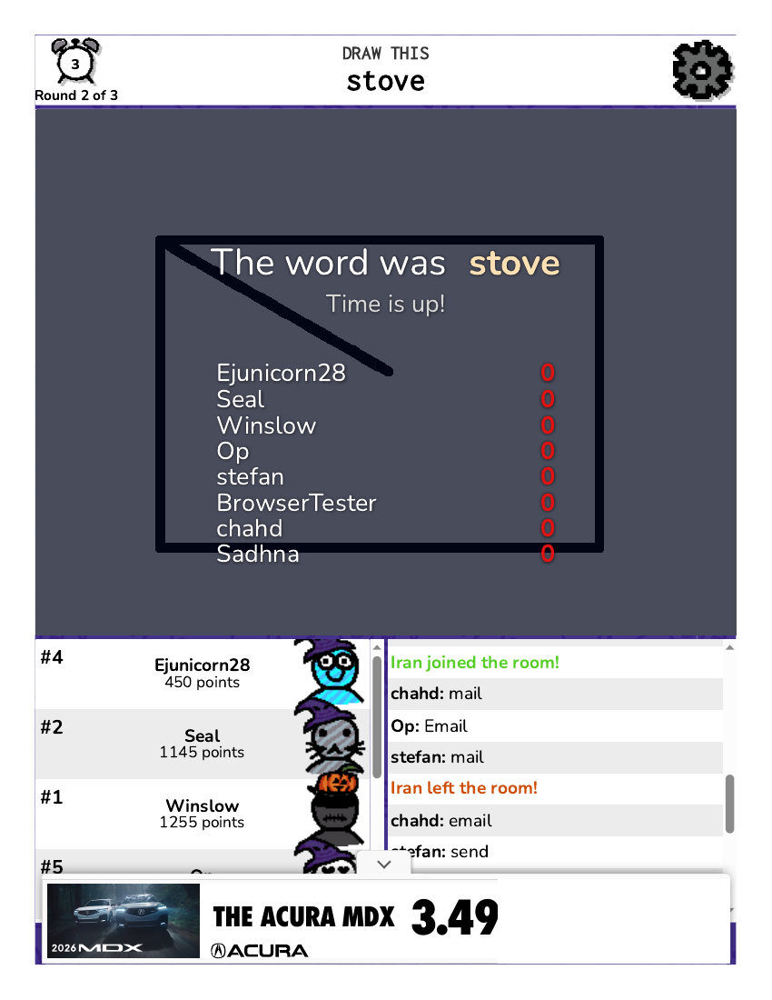
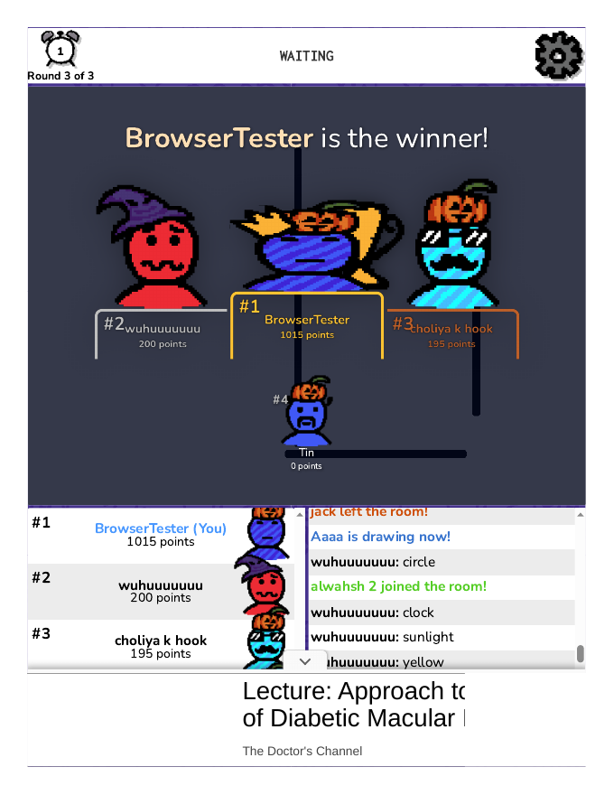
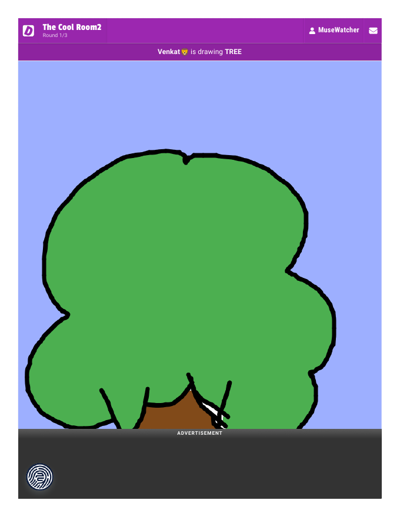
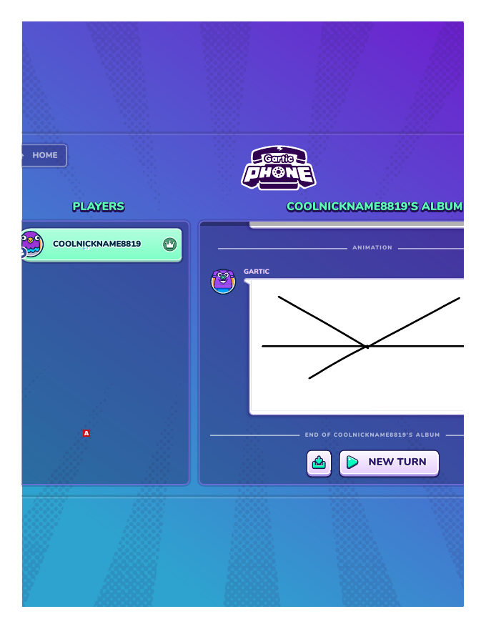

# Small Hours — Competitor Coverage (2026-10-28)

**Demo:** Small Hours (Memorable Moments baseline). **Template:** `competitor-coverage-template.md` — at least 6 distinct studied competitors across at least 4 broad play families (max 2 in one family; at least 2 outside narrative/deduction puzzles; at most 1 same-occasion/attention-only; planned minimum 2 browser editions actually studied; two deep comparisons from different families with full endings/complete activities). A listing-only or access-blocked row is not a studied competitor.
**Sources:** fresh sweep `fresh-competitors-moments-2026-10-28.md` (desk, [SECONDARY]) + browser-task plays of Gartic Phone and skribbl.io. [Rectified 2026-10-29: class split — capture-text-verified items in the browser-task rows are [REAL]; word-level game details taken from the banked task reports are [SECONDARY], not [REAL].] Word-level game details in the browser-task rows come from the banked task reports (`competitors/gartic-phone/task-report--gartic-phone-2026-10-28.md`, `competitors/skribbl-io/task-report--skribbl-io-2026-10-28.md`) [SECONDARY]; the PDFs bank the page captures (render notes in each row). Prices as listed at crawl, USD unless noted.

## The six studied competitors

| # | Title (creator, date, price) | Family | How studied | What it teaches Small Hours |
|---|---|---|---|---|
| 1 | **Gartic Phone** (Gartic, 2021, still updated 2026; free in the browser at garticphone.com) | Telephone / draw-and-guess | **Deep (Solo mode only) — browser-task, full Solo-mode session** [Rectified 2026-10-29: "first-hand" corrected — browser-task prose is [SECONDARY]; the GIF export verification stays [REAL] as noted in-row.] (browser task 2026-10-28, 03:40–03:47 PDT): home → "CHOOSE A CHARACTER AND A NICKNAME" (auto "CoolNickname8787", purple bird avatar) → START → pre-lobby video-ad interstitial (black box, "Unable to play media.", ~10 s block) → lobby ("PLAYERS 1/14", only COOLNICKNAME8787, 13 EMPTY slots; "NORMAL" pre-selected) → SOLO (buried at the bottom of the scrollable presets grid: "Make your own animation in 5 frames!") → 5 drawing frames (1/5 counter, onion-skin ghost, DONE! gating) → "ALBUM'S SETTINGS" (DISPLAY MODE AUTO, EXHIBITION FLOW BEGINNING) → album reveal ("COOLNICKNAME8787'S ALBUM", stroke-by-stroke replay, speed 0x/1x/2x/3x, compiled ANIMATION with duration 2's/3's/4's/10's/50's) → download. **Export verified: the downloaded file is a genuine GIF (GIF89a, 770×490, 214,639 bytes), banked as `gartic-album-2026-10-28.gif`.** Friction: rotating side ads throughout; AUTO-mode album pane clips the top frame while playing; the circle shape tool drew only a straight line; no obvious "clear frame" prompt. **IMPORTANT LIMIT: Solo is an animation maker, not the classic telephone loop — no sentence-writing or guessing step. The write → draw → guess chain was NOT exercised (Normal mode needs 4–50 humans; the lobby held 1/14). The deep comparison covers Solo mode only.** 5 PDFs + the GIF banked. | The reveal montage + GIF album is the direct rival to the keepsake. Gartic exports the moment as a shareable animation; Small Hours saves it as a static SVG postcard. Gartic's first how-to slide ("CALLING IS BETTER — Invite your friends to a voice call") names what Small Hours assumes: the players are already together. |
| 2 | **skribbl.io** (free in the browser at skribbl.io; no account) | Draw-and-guess (live multiplayer) | **Browser-task** (browser task 2026-10-28, as "BrowserTester") [Rectified 2026-10-29: "first-hand" corrected — browser-task prose is [SECONDARY], matching the class split in the header above; capture-text-verified items stay [REAL].]: joined a live public room mid-game, Round 1 of 3, 5 other players. Guesser R1 (Ejunicorn28, 5 letters): the drawer wrote "I don't know" on the canvas, hints "___r_" → "U__r_", guesses "angry"/"ultra"/"umbra" wrong; reveal "The word was 'Uluru'". Drawer R2: chose "stove" (80 s) — the rectangle's stroke began at the canvas centre, leaving a stray diagonal, so it read as an envelope (guesses "mail"/"email"/"Stamp"/"skype"; "Op disliked the drawing!"); three further strokes never appeared though the actions reported as applied — a real defect; nobody guessed ("The word was stove" / "Time is up!"). Guesser R2 (stefan, 8 letters): green wavy line + squiggles, then a truck shape; guesses "mountain"/"wildfire" wrong; reveal "landfill" (only Seal guessed). Guesser R2 (Op, 4 letters, "re__"): stick figure in a large shape; guesses "head"/"read" wrong; "rest" was the word — typed after the timer hit 0, scored 0 (Seal +290, Op +240, Ejunicorn28 +230, stefan +185, Winslow +160, chahd +100). Guesser R2 (Winslow, "ice cream", 3+5 letters): a blue blob that became an ice-cream cone; "ice cream" guessed correctly in substance but arrived exactly as time expired ("Time is up!"), scored 0. Final standings when stopped (still Round 2 of 3, no winner screen): Seal 2215 (#1), Winslow 1780, stefan 1300, Ejunicorn28 955, Op 645, chahd 200, watermelon 135, BrowserTester 0 (#8). What works: fast load, nickname-only join, clear round flow, hints, announcements, points overlay, live chat, like/dislike + votekick. What fails: the drawing defects above (whether site or synthetic mouse events, undetermined); two correct guesses lost to the 80-second timer with no grace period (the observe/act round-trip is slow); **strangers degraded the session — one drawer wrote "I don't know" and scribbled out the canvas, players joined/left constantly (V, Iran, goat, gago!, Winiii, Sadhna, watermelon), votekick messages appeared ("Op is voting to kick stefan (1/5)")**; heavy Acura MDX ads (top banner, right rail, bottom banner) crowd the game area. Evidence: f1 home, f2 guessing round (Uluru), f3 drawing turn (stove), f4 turn-results (stove, all 0), f5 standings after "ice cream". No capture blank. 5 PDFs banked. | Live strangers vs Small Hours' known pair: skribbl proves the draw-guess loop works with zero social context, while Small Hours bets everything on the pair knowing each other. The contrast is the design question: does Small Hours need strangers, or is the pair the whole game? skribbl's drawing defects (lost strokes, stray lines) are the argument for Small Hours' choice-based design — no drawing skill, no lost strokes. |
| 3 | **Split Fiction** (Hazelight / EA, 2025-03-06, $49.99; Friend's Pass) | Co-op narrative (two-player, one story) | Desk [SECONDARY] — store/developer pages. No browser edition. | The premium co-op reference: two players, one screen-or-two, a story that needs both. Small Hours is the 5-minute, no-account, one-screen version of the same promise. |
| 4 | **PICO PARK 2** (TECOPARK, 2024-09-12, Steam $8.99) | Co-op puzzle (2–8 players, one screen) | Desk [SECONDARY]. No browser edition. | The one-screen co-op puzzle reference: shared screen, shared failure, no account. Small Hours shares the screen but removes the fail state entirely — there is no wrong answer. |
| 5 | **The Jackbox Party Pack 11** (Jackbox Games, 2025-10-22, $29.99; free Steam demo) | Party (phone-as-controller, one screen) | Desk [SECONDARY] + Steam demo noted (not played — Steam, not browser). | The party-game reference: the screen is the stage, phones are the controllers. Small Hours inverts it — the screen is the private space, and the players pass it back and forth. |
| 6 | **Tiny Glade** (Pounce Light, 2024-09-23, Steam $14.99; Steam demo only) | Diorama / make-to-keep | Desk [SECONDARY]. No browser edition. | The make-to-keep reference: no fail state, the artifact is the point. Small Hours' keepsake is the same idea in 2D and 5 minutes. |

## Coverage check

- 6 distinct studied competitors ✓ (2 browser-task, 4 desk) [Rectified 2026-10-29: "first-hand" corrected — browser-task prose is [SECONDARY].]
- Families: telephone, draw-guess, co-op narrative, co-op puzzle, party, diorama = **6 families**, max 1 per family ✓
- Outside narrative/deduction puzzles: Gartic, skribbl, PICO PARK 2, Jackbox, Tiny Glade = 5 ✓ (≥2 required)
- Same-occasion/attention-only: 0 (Tiny Glade is make-to-keep, not attention-only) ✓ (≤1)
- Browser editions actually studied: **2** (Gartic Phone, skribbl.io) ✓
- Deep comparisons from different families: **NOT MET** — Gartic Phone (telephone, Solo mode only) + skribbl.io (live draw-guess) are both draw-guess-adjacent, so the second deep family is the live-multiplayer one, not a wholly different family. Gartic's Solo session completed; skribbl's session ended in Round 2 of 3 with no winner screen. The requirement is not met. The party/diorama families are desk-only. [OPEN: a deep play of a party or diorama title would complete the second deep family; a multi-human Gartic Normal session would complete the telephone loop.]

## Considered, not selected

- **BOKURA: planet** (tokoronyori / Kodansha, 2025-04-24, Steam $5.49) — co-op puzzle, overlaps PICO PARK 2's family; desk-verified in the sweep, not carried into the six to keep families distinct.
- **Make it Meme** — played solo in the Oct-22 round (social loop gated behind a 2nd player, untested); not fresh for this round.
- **Hanabi** — played full in the Oct-22 round (hanabi.live, 18/18); not fresh for this round.

## What the coverage says about Small Hours

The crowded family is draw-and-guess (Gartic, skribbl) — Small Hours does not compete there; it competes on the keepsake and the pair. The empty family is the one Small Hours owns: a 5-minute, one-screen, two-person memory-maker with a downloadable artifact. No competitor in the six makes a keepsake the pair owns. That is the differentiator to protect — and the thing the six-pair human gate must test: do two real people feel the keepsake is worth keeping?

## Evidence gallery

skribbl.io Round 2 results, rendered from beat3 PDF p.1 at 100 DPI — "The word was stove / Time is up!", all players 0; the rectangle-with-stray-diagonal drawing behind the overlay; chat guesses "mail"/"Email"; "Iran joined/left the room"; Acura MDX ad at the bottom. Legible render, not a shell.

skribbl.io [REAL render] — full 3 rounds, winner screen: BrowserTester 1st with 1,015 points. The old Round-2 gap is closed.

Drawasaurus [REAL render] — Cool Room2, Round 1/3: Venkat drawing TREE. This is another player's drawing frame, not the agent's drawing turn, which never completed [OPEN].

Gartic Phone [REAL render] — COOLNICKNAME8819'S ALBUM end screen, the album the GIF exports. Solo only; the telephone chain stays [OPEN].

Gartic Phone album export [REAL, GIF89a 770×490, 208,955 bytes] — the Solo session's album as a file.

Display note (2026-10-29 persuasiveness audit): the Gartic beat-3 frame (blank canvas UI) and Drawize FORK render (word screen, blank canvas) were removed from display — they show UI chrome, not the draw-guess play; files remain banked at competitors/gartic-phone/img/gartic-beat3-p1-1.png and competitors/drawize/render-fork-1.png, and their claims rest on capture text. Compensation: a live-round drawing frame (below) replaces FORK as the Drawize showcase photo.

Drawize [REAL render] — live round: a drawing in progress on the canvas (thick black stroke + pink shape), TIME 1:42, guess keyboard below. The word and the drawer are not identifiable in this frame; the agent's own drawing turn stays [OPEN]. Mined from the live-round captures (browser-page-20261029T080156.949760795Z-2.pdf p.1) as compensation for the removed FORK word screen.

## Live-window update 2026-10-29 (appended; history sections above unchanged)

The live-window round re-played the two browser-task titles [Rectified 2026-10-29: "first-hand" corrected — browser-task prose is [SECONDARY].] and added three expansion titles. Browser-task ids and PDF paths are cited so each claim traces to a capture; evidence classes follow the package rule (text-layer-verified capture = [REAL]; task-report prose = [SECONDARY]; unsolved = [OPEN]).

### Replays of the original six

- **Gartic Phone** (live replay, `browser-task:38db2389-a5d8-564a-8ba7-d5e331b803ed`): full Solo session; the album capture text carries "COOLNICKNAME8819'S ALBUM" and "END OF COOLNICKNAME8819'S ALBUM" [REAL]; the GIF export was re-verified by the fold (GIF89a, 770×490, 208,955 bytes) [REAL]. Friction recurs: pre-lobby video ad, Solo buried, START needed a second click, EDIT-state delay on frames 3–4 [SECONDARY]. Normal mode (4–50 humans) unplayed; the write → draw → guess telephone chain still unexercised [OPEN].
- **skribbl.io** (live replay, `browser-task:1ed960b6-d995-543a-a223-29561b85b35a`): full 3 rounds, winner screen — capture text carries "BrowserTester is the winner!" and "1015 points" [REAL]. The "fry" drawing turn (Round 2) and the "sunset" chat guess are in the capture text [REAL]; the remaining guess/draw lists are task prose [SECONDARY]. Degradation persists: heavy churn, two votekick attempts never completed, scribbles, one profane chat insult [SECONDARY]. skribbl.io upgrades from "ended Round 2" to a completed session; the family assessment does not change (still draw-guess-adjacent).

### Expansion titles (Moments now 9 titles attempted, 6 studied)

- **Reign: Settlement** (`browser-task:a85aab8d-334c-52a5-af4a-6d23ccbda2f0`): diorama family, real play to Round 3 — capture text carries Round 3 tokens, Trade, End turn [REAL]. Setup (2 settlements + 2 roads, same as each bot), the Round 3 scores (You 2, Cleo 2, Ada 2, Bram 3 after Bram's city), and the Brick-for-Lumber trade with Ada are task prose [SECONDARY]. Road placement opened via the Road button, then every visual board click failed again (page busy / screenshot timeout) despite fresh view, zoom-out, and wait; no road placed, nothing spent [SECONDARY, corroborated by the interaction note]. The game paused at "Click a glowing spot to place your road". The diorama family is no longer desk-only, but Reign is a partial, not a deep completed play. Setup placed by Sakura's takeover (00:54 PDT); subsequent turns played via reference clicks.
- **Drawize** (`browser-task:43f3ca00-dd3b-5ece-b5ec-dfff4ad8527e`): lobby capture [REAL]; Quick Draw completed — capture text carries "WORD: FORK" and "GAME FINISHED" [REAL]. Live rounds joined (KIDNEY, RAIN answered by others) and the no-submitted-guess pattern (CHANDELI, PAI timed out in the 2-minute window) are task prose [SECONDARY]. Private room REEQUEEDE stayed empty; live games aborted on inactivity gaps [SECONDARY]. No submitted guess exists in the captures.
- **Drawasaurus** (`browser-task:d9268e19-dfd1-57cf-9259-cfbd3dd93f80`): guessing succeeded (ANDROID, MUMMY, TREE, HOT TUB, JAPAN; 38 points in Cool Room2) [SECONDARY]. Resumed run: capture text carries a new Cool Room2 game, Round 1/3, "Gucci is drawing _ _ _ _ _ _ _" [REAL] — a game in progress, NOT a "sunflower won" results screen; that claim is deliberately not carried (no results PDF exists in the receipts). Capture text also carries "Sorry, you were AFK!" [REAL]. The pinned defect — the AFK banner covering the word-choice buttons and freezing the choice timer (Chicken Room: Cherry/Graduation/Turnip at 1s; Sloth Room: Whoopee Cushion/Poison/Stable at 6s), with clearing AFK losing the turn — is task prose [SECONDARY], corroborated by the interaction note's Case 3. Sakura's on-page AFK fix cleared the banner once, but it recurred — a recurring defect, not a one-off [SECONDARY]. The drawing turn was NEVER completed in any room. The drawing turn stays [OPEN]; the tab was left at "Room doesn't exist!". Resumed rounds detail [SECONDARY]: Round 3/3 Cool Room2 (Gucci SHOES, Arianna SCISSORS, Danush "singing", yoji LIP BALM); new game Gucci CUPCAKE-related, sunflower WAFFLES.

### Coverage check, revised

- 9 titles attempted. Diorama is no longer desk-only (Reign partial to Round 3).
- Second deep family still [OPEN]: Reign, Drawize, and Drawasaurus are all partials; no completed deep play from a different family exists. Gartic Normal (multi-human) still [OPEN].
- Template-cap note, stated honestly: the nine-title set exceeds the six-title template's max-2-per-family cap in draw-guess (skribbl.io, Drawize, Drawasaurus = 3). The cap still holds for the original six; the expansion oversampled draw-guess while chasing the Moments gap.
