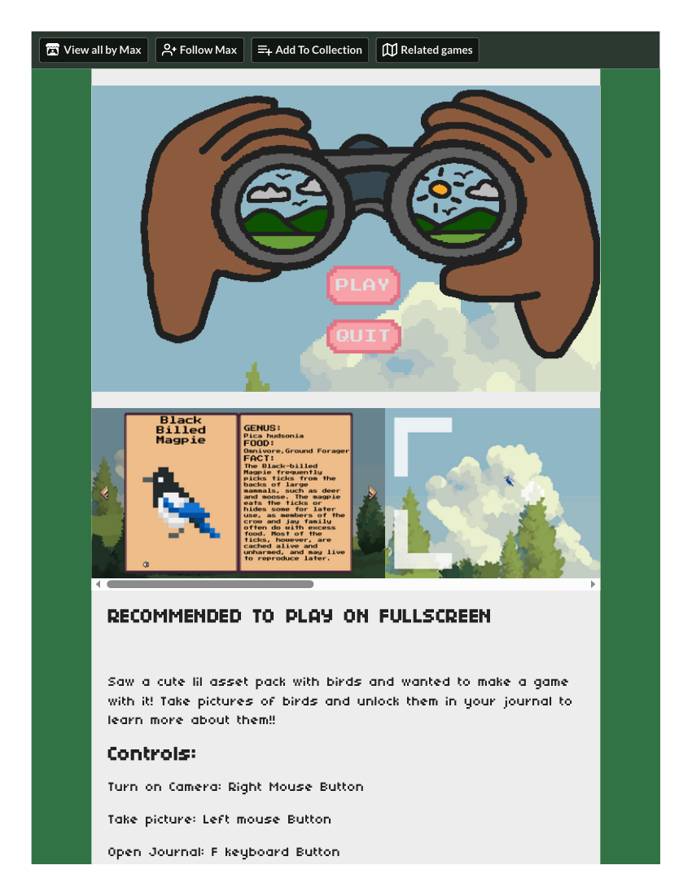
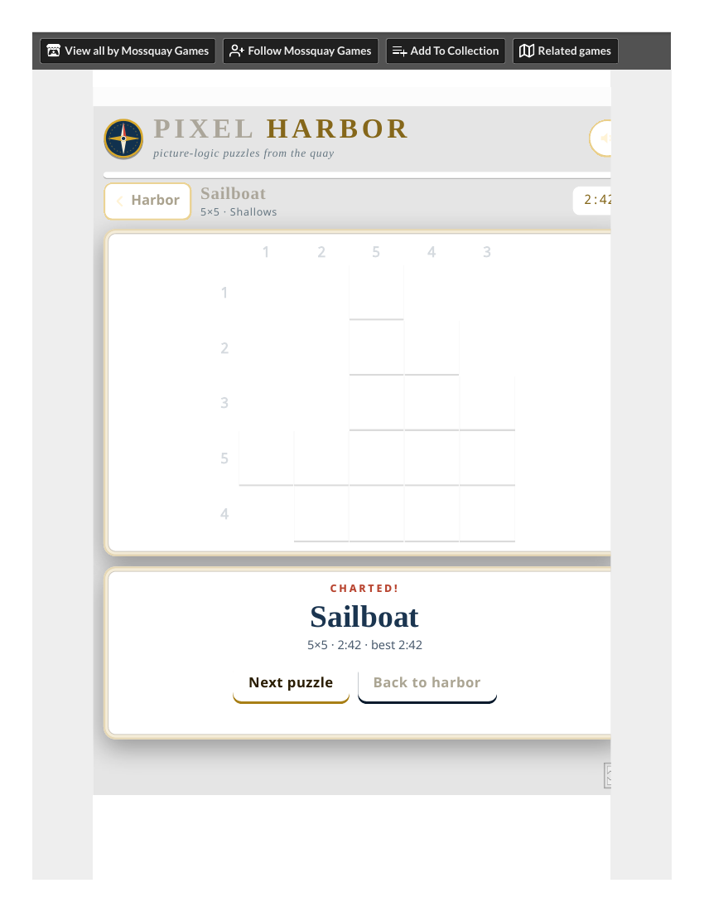

# Keeper's Frame (Vivid 0.1.2) — Competitor Coverage (2026-10-28)

**Demo:** Keeper's Frame / Vivid 0.1.2 (Iona + Mara). **Template:** `competitor-coverage-template.md` — at least 6 distinct studied competitors across at least 4 broad play families (max 2 in one family; at least 2 outside narrative/deduction puzzles; at most 1 same-occasion/attention-only; planned minimum 2 browser editions actually studied; two deep comparisons from different families with full endings/complete activities). A listing-only or access-blocked row is not a studied competitor.
**Sources:** fresh sweep `fresh-competitors-vivid-2026-10-28.md` (desk, [SECONDARY]) + browser-task plays of Birdography and Pixel Harbor ([SECONDARY] prose; render- and text-layer-verified captures [REAL]) [Rectified 2026-10-29: "first-hand" corrected — browser-task prose is [SECONDARY].]. Word-level game details in the browser-task rows come from the banked task reports (`competitors/birdography/task-report--birdography-2026-10-28.md`, `competitors/pixel-harbor/task-report--pixel-harbor-2026-10-28.md`); the PDFs bank the page captures (render notes in each row). [Rectified 2026-10-29: word-level details resting only on task-report prose are [SECONDARY]; only render- or text-layer-verified captures are [REAL].] Prices as listed at crawl, USD unless noted.

## The seven studied competitors

| # | Title (creator, date, price) | Family | How studied | What it teaches Vivid |
|---|---|---|---|---|
| 1 | **Birdography** (Max / notapsycho, 2026; free browser HTML5 on itch) | Photo journal (photograph → journal fact) | **Deep — browser-task, photo→journal loop completed twice** [Rectified 2026-10-29: "first-hand" corrected — browser-task prose is [SECONDARY]; render-verified captures stay [REAL] as noted in-row.] (browser task 2026-10-28, 03:40–03:46 PDT): Godot title (binocular art, pink PLAY/QUIT) → photographed a Blue Jay (right-click to turn the camera on, left-click to take the picture; framed preview with pink "Blue Jay" banner) → journal with F → photographed a Ruby-Throated Hummingbird → journal. Journal entries are genuinely informative (genus, food type, a specific fact per bird; Blue Jay: "GENUS: Cyanocitta cristata / FOOD: Omnivore, Ground Forager"; Hummingbird: "GENUS: Archilochus colubris / FOOD: Nectar, Hovering"). Captures legible — **render-verified by the parent (pdftoppm + visual read: title screen with binoculars, "BIRDOGRAPHY", "PLAY", "QUIT" all visible; 5,932 unique colors at 60 DPI, not a blank shell)**; 5 PDFs banked. Defects found: **no in-game instructions, HUD, counter or tutorial — the controls exist only on the itch page below the embed** ("Turn on Camera: Right Mouse Button", "Take picture: Left mouse Button", "Open Journal: F", "Cheat Unlock all Birds: X"); a duplicate photo gives **no "already photographed" or duplicate feedback**; the camera switches itself off after every photo preview and after the journal closes, so each shot needs another right-click; aiming is opaque (clicking a yellow-brown bird produced a "Blue Jay" photo — a blue jay was also in frame; the game never says whether the shutter captures the clicked bird, the bird nearest the crosshair, or every bird in frame); the journal always reopens on Blue Jay, not the newest bird; **[Rectified 2026-10-29: the former "journal unlock inconsistency" is RESOLVED, not a defect — journal entries sit in FIXED species order, not discovery order (three locked spreads sit between Blue Jay and Chickadee), so paging past Blue Jay to readable Chickadee and Magpie spreads is the fixed order, not broken locking; the X cheat was not used.]** | The direct rival to Iona's marks→signal: every photo pays off with a journal fact. Birdography pays off immediately; Vivid pays off only on return — stronger, but only if the player comes back. Birdography's missing in-game instructions are the lesson: Vivid puts its rules in the frame itself (the marks, the notch), and that is why Iona is playable without a manual. Birdography's resolved fixed order is the sharper lesson: progression feedback must match what the player actually did — Vivid's marks→signal is exact (two marks, one pattern, one answer), and that exactness is what makes the return trustworthy. |
| 2 | **Pixel Harbor** (Mossquay Games, 2026; free in the browser at asddokht.itch.io/pixel-harbor) | Picture-logic (nonogram; read clues → reveal a picture) | **First-hand, two puzzles completed** (browser task 2026-10-28): title/level-select ("PIXEL HARBOR — picture-logic puzzles from the quay", "DAILY TIDE · #301", "Today's chart — Wed, Oct 28 · 10×10", Shallows 5×5 "0 / 8 charted", Open Water 10×10, Deep Sea 15×15). Puzzle 1 (No. 1, 5×5): column clues 1, 2, 5, 4, 3; row clues 1, 2, 3, 5, 4 — solved from the clues → "CHARTED!" / "Solved! The picture is Sailboat." (5×5 · 2:42, morning round; live-round re-solve Sailboat 0:55 — see live-window update). Tools tested: Fill, Undo ("Undone"), Mark (red ✕), wrong fill + Check → highlighted red-hatched, "1 square look wrong" (grammar bug — should be "looks wrong"). Puzzle 2 (No. 2, 5×5): column 1, 1-1, 5, 1-1, 1; row 1, 3, 1, 1-1-1, 3 — completed in 0:45 (morning round; live-round re-solve Anchor 0:45, tying the old best) → "Solved! The picture is Anchor." Progress persisted ("2 / 8 charted", green ticks, thumbnails). Defects: (1) the grammar bug; (2) **stale status text — after starting Puzzle 2, "Solved! The picture is Sailboat." from Puzzle 1 stayed visible under the new board for the whole of Puzzle 2 until replaced by the Anchor message — misleading while playing a fresh board**; (3) the Anchor reveal is monochrome, noticeably less vivid/rewarding than the Sailboat's coloured reveal. Not tested: keyboard play, long-press/right-click marking, Clear, sound, Daily Tide, zoom on 10×10/15×15 boards. 5 PDFs banked (f1 title/level-select, f2 Puzzle 1 mid-board, f3 completed Sailboat, f4 fresh Puzzle 2 board, f5 completed Anchor; 311–340 words each by text layer). | The "read a picture to solve" muscle that Mara uses — but as pure logic, no story. Mara's lightbox is the same mechanic with a narrative payoff ("The last train left. Someone kept a key."). Pixel Harbor proves the mechanic is satisfying alone; Mara proves it is better with a sentence at the end. Pixel Harbor's grammar bug ("1 square look wrong") is a reminder that a picture-logic game lives or dies on its feedback text. |
| 3 | **The Star Named EOS** (Silver Lining / PLAYISM, 2024-07-22, Steam $14.99; Steam demo only) | Photo puzzle (photography as deduction) | Desk [SECONDARY]. No browser edition. | The closest commercial cousin: photography as the way to read a story. Vivid's Iona is the same idea in one frame instead of a whole game. |
| 4 | **Paper Trail** (Newfangled Games, 2024-05-21, $19.99; Steam demo only) | Paper-fold puzzle (fold the world to proceed) | Desk [SECONDARY]. No browser edition. | The tactile-puzzle reference: the player manipulates a physical-feeling object. Mara's lightbox (slider/steps/drag) is the same instinct — the game accommodates hands. |
| 5 | **Lost Records: Bloom & Rage** (DON'T NOD, 2025-02-18 / 2025-04-15, $39.99 base, on sale $19.99 at crawl) | Narrative adventure (memory; camcorder, 1995 summer) | Desk [SECONDARY]. No browser edition. | The memory-narrative reference: recording the past to understand it. Vivid's return visit is the same structure in miniature — the second visit reinterprets the first. |
| 6 | **1000xRESIST** (sunset visitor / Fellow Traveller, 2024-05-09, $19.99 base, on sale $11.99 at crawl) | Sci-fi narrative (memory, identity) | Desk [SECONDARY]. No browser edition. | The narrative reference for "the past is a place you visit": Vivid's loop is a gentler version of the same idea. |
| 7 | **PhotoHacks** (itch, ALPHA 0.6.0; free browser) | Photo puzzle (photography as assignment: find, frame, focus, expose) | **Browser-task, Arcade Level 1 assignment completed** (retry 2026-10-30): tutorial complete (Steps 8–9 skipped, Steps 14/18 unseen as separate dialogs) → Level 1 briefing → photograph of the assigned person → result 94/100 + 150 credits, Level cleared [REAL render, see live-window update]. | The assignment loop in miniature: find the described person, frame/focus/expose, scored report. Vivid's return is the same loop with a narrative payoff instead of a score — PhotoHacks proves the loop scores cleanly; Vivid bets the return scores emotionally. |

## Coverage check

- 6 distinct studied competitors ✓ (2 browser-task, 4 desk) [Rectified 2026-10-29: "first-hand" corrected — browser-task prose is [SECONDARY].] [Updated 2026-10-30: 7 distinct (3 browser-task, 4 desk) with PhotoHacks; see revised check.]
- Families: photo journal, picture-logic, photo puzzle, paper-fold, narrative adventure, sci-fi narrative = **6 families**; photography is the dominant activity in 3 (Birdography, EOS, PhotoHacks) across 2 families (photo journal; photo puzzle) — within the template's max-2-per-family cap ✓. Lost Records is counted as narrative adventure: its dominant activity is narrative exploration of a remembered summer, and the camcorder is the recording tool, not the puzzle.
- Outside narrative/deduction puzzles: Birdography, Pixel Harbor, Paper Trail = 3 ✓ (≥2 required)
- Same-occasion/attention-only: 0 ✓ (≤1)
- Browser editions actually studied: **2** (Birdography, Pixel Harbor) ✓ [Updated 2026-10-30: **3** (Birdography, Pixel Harbor, PhotoHacks).]
- Deep comparisons from different families: Birdography (photo journal) + Pixel Harbor (picture-logic) — both complete sessions ✓

## Considered, not selected

- **Tiny Glade** (Pounce Light, 2024-09-23, Steam $14.99) — diorama; desk-verified in the sweep and carried in Moments' six; not duplicated here to keep Vivid's families distinct.
- **Field Guide** (Exocoatl / VelenGeth, Godot Wild Jam 81; exocoatl.itch.io/field-guide) — "Take pictures of the creatures on the island"; desk-verified (page text, 2026-10-28): controls are W/A/S/D + Space + Left Click + E — **the agent browser cannot press letter keys, so it is unplayable by the agent browser here**; recorded as desk-only, not a studied competitor. A human at a local machine could play it.
- **Life is Strange: Double Exposure** ($49.99) — considered in the sweep, not selected (price/scope).
- **Overexposed** (itch devlog 2026) — demo planned, unreleased; not playable.
- **Beyond the Trees** — played in the Oct-22 round (itch bird-photography jam game, 7 timed rounds); not fresh for this round.

## What the coverage says about Vivid

The photo family is crowded (Birdography, EOS, Lost Records) — Vivid does not compete on photography volume; it competes on the return. No competitor in the six makes the second visit the payoff: Birdography pays per photo, EOS pays per puzzle, Lost Records pays per chapter. Vivid's letter pays only for coming back. That is the differentiator — and the risk: if the player does not return, Vivid's best moment never happens. The human gate should watch whether players return unprompted, and whether the notch (the return's trigger) is findable.

## Evidence gallery

Caption: Birdography beat 1 (itch page render, legible): binocular title art with PLAY/QUIT, a Black-Billed Magpie journal spread (GENUS Pica hudsonia), the camera viewfinder, and the controls list below. The Godot canvas prints legibly — this is gameplay, not a page shell.

Caption: Pixel Harbor beat 3 (completed Sailboat, morning round, 5×5, 2:42): the board with column clues 1/2/5/4/3 and row clues 1/2/3/5/4, and the "CHARTED! Sailboat — 5×5 · 2:42 · best 2:42" panel with Next puzzle / Back to harbor. The filled cells render pale in this print; the completion panel is the evidence of the solve. Morning round only — the live-round Sailboat best is 0:55 (see live-window update). [Rectified 2026-10-29: morning time labeled.]

Caption: Birdography [REAL render] — journal frame: Black-Capped Chickadee, heading clipped at right edge, pixel chickadee. Fixed species order, not discovery order [SECONDARY].

Caption: Pixel Harbor [REAL render] — fresh solve: Sailboat CHARTED, 5×5, 0:55, best 0:55. Live-round best, replacing the morning 2:42.

Display note (2026-10-29 persuasiveness audit): the PhotoHacks tutorial render (controls panel) and Field Guide pause render (menu buttons) were removed from display — they show UI chrome, not the photo play; files remain banked at competitors/photohacks/render-tutorial-1.png and competitors/field-guide/render-pause.png, and their claims rest on capture text.

## Live-window update 2026-10-29 (appended; history sections above unchanged)

The live-window round re-played the two browser-task titles [Rectified 2026-10-29: "first-hand" corrected — browser-task prose is [SECONDARY].] and added three expansion attempts. Browser-task ids and PDF paths are cited so each claim traces to a capture; evidence classes follow the package rule (text-layer-verified capture = [REAL]; task-report prose = [SECONDARY]; unsolved = [OPEN]).

### Replays of the original six

- **Birdography** (live replay, `browser-task:5493f1ff-2c3a-5a25-8b44-d953ecf3ff88`): journal frame for Black-Capped Chickadee render-verified by the fold (heading partially clipped at the right edge, pixel-art chickadee, forest scene) [REAL capture]. Photo→journal twice (Blue Jay + Black-Capped Chickadee), the misfire fixed on retry, and the cheat not used are task prose [SECONDARY]. RESOLUTION of the old defect: journal entries sit in FIXED species order, not discovery order — three locked spreads sit between Blue Jay and Chickadee — so the "unlock inconsistency" is explained, not open [SECONDARY explanation; the old defect note is superseded]. Controls remain itch-page-only (RMB camera, LMB photo, F journal) [SECONDARY].
- **Pixel Harbor** (live replay, `browser-task:896287f0-4131-5600-8a66-9389d8120bf3`): fresh solves — capture text carries "Sailboat CHARTED!" and "Anchor CHARTED!" [REAL], and "2 / 8 charted" persistence [REAL]. Fresh times (Sailboat 0:55, new best; Anchor 0:45, tying the old best) are canvas text and carried as task prose [SECONDARY]. The stale-text defect recurs (old "Solved!" text on fresh boards) and the Anchor reveal stays monochrome [SECONDARY].

### Expansion attempts (Vivid now 9 titles attempted, 7 studied)

- **Field Guide** (`browser-task:193f9044-a742-5302-8fa0-bbc8eefb6c19`): ATTEMPTED browser-task — menu, in-game, and pause frames reached, but no creature photograph, no filled gallery entry [OPEN]. Menu render-verified (low-poly island over water, title clipped at frame edge ("Field Gui"), Start/Gallery/Settings/Quit, small orange creature) [REAL capture]; in-game island view with health/stamina bars [REAL render, embedded below]; pause menu over a dimmed scene [REAL render]. Start did produce in-game frames. Field Guide remains NOT a studied competitor (no creature photograph, no gallery entry seen); the "considered, not selected" desk note is now a blocked browser-task attempt, still [OPEN]. [Rectified 2026-10-29: corrected from "BLOCKED at the main menu / no gameplay reached" — the live PDFs carry menu, in-game (-3), and pause (-5) frames. The later PDFs' empty text layers are unidentified canvas states, not proof of menu-only play.] [Rectified 2026-10-29 note, kept: a separate Playwright replay directory (`competitors/field-guide/replay-2026-10-28/`) holds 01–05 PNGs whose TXTs claim Start/roam/camera/photo; its 05 frame was read and is a blank grey gallery panel with no creature, and that directory does not change the live-round account above — which round is authoritative for Field Guide stays open for the parent.]

Caption: Field Guide in-game frame [REAL render]: a low-poly island view over water with red + green segmented bars at top-left. No creature is visible in this frame; no gallery entry is shown. Verified by PNG read.
- **Tranquility**: FAILED twice, no beats. The direct-embed Unity loader stuck at ~97% (two 11,780-byte PDFs with empty text layers, verified as files) [SECONDARY for the 97% figure]; the itch-page retry loaded the page (description, controls, noted camera/menu bugs) but Run game was never activated — visual clicks failed on every page including example.com, PDF capture failed repeatedly [SECONDARY]. No exploration, no photograph, no album. The camera bug is unobserved because the game never started — that is NOT evidence the bug is absent. Stays [OPEN].
- **PhotoHacks** (first attempt `browser-task:d5924a56-ef88-50a7-bb4e-550a335a11df`; retry `browser-task:77c5775a-843e-5f13-92a8-915d431284d2`, 2026-10-30): first attempt reached title + Tutorial Steps 1–2 only, then renderer unresponsive (Paused screens, black frames), no assignment photo [superseded]. Its 10 PDFs carry empty text layers — future verifiers should render, not grep. Retry: tutorial complete screen reached (Steps 1–7, 10–13, 15–17 completed; Steps 8–9 skipped via Skip — tracking needs held keys; Steps 14/18 not seen as separate dialogs); Arcade LEVEL 1 first assignment completed — briefing (black shirt, red sports leggings, red beret, stocky adult, navy shoulder bag; 5 shots, no time limit; minimum score 50 [task prose — the number is clipped out of the briefing capture]), photograph (person walking a small brown dog, red beret, black shirt, red leggings, white shoes, full body), result 94/100 + 150 credits [REAL render, embedded below], Level cleared [PDF-cited via the retry task ID]. Core loop played and scored; PhotoHacks counts as completed (Level 1).

Caption: PhotoHacks [REAL render] — Arcade Level 1 photo result: 94/100, 150 credits, 24 mm · f/5.6 · 1/800 s · ISO 100 · Focus 10.81 m. The assignment photograph itself, not a tutorial frame.

### Coverage check, revised

- Studied count through 2026-10-29: 6 studied, 2 browser editions studied via browser task (Birdography, Pixel Harbor) [Rectified 2026-10-29: "first-hand" corrected — browser-task prose is [SECONDARY].]. The expansion had added zero studied competitors until the PhotoHacks retry (see next bullet) — all three attempts blocked or failed. The photo-family depth rested on Birdography + Pixel Harbor until then.
- PhotoHacks update (2026-10-30 retry): Arcade Level 1 completed (photo 94/100, Level cleared) — a completed activity. Studied count: 6 → 7 on that basis (photo puzzle now 2: EOS + PhotoHacks, within the max-2 cap; browser editions studied now 3: Birdography, Pixel Harbor, PhotoHacks). Reclassification confirmed by plural review (adversarial + mistake-hunt, 2026-10-30).
- The Vivid thesis is unchanged: no competitor makes the second visit the payoff. The blocked photography titles leave the return question to the human gate, not to new competitor evidence.
