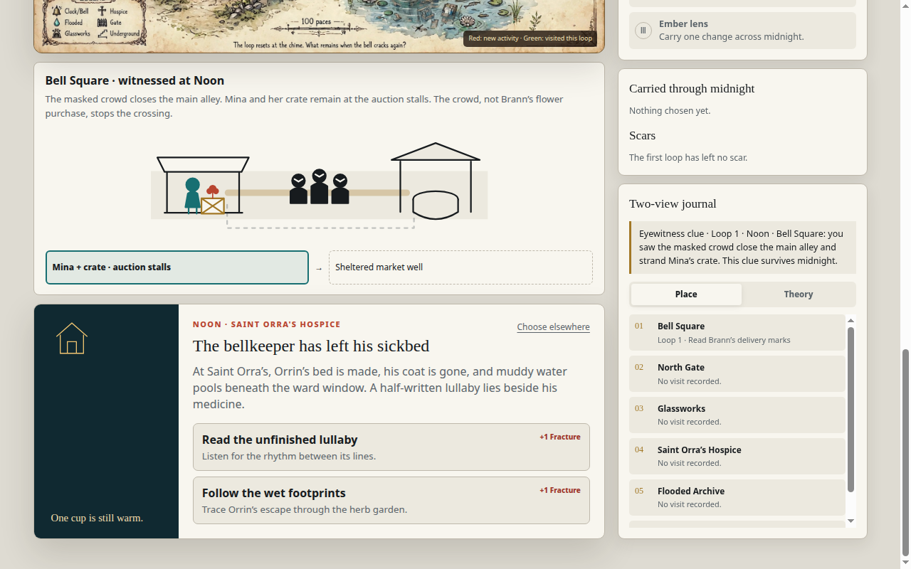

# The Thirteenth Bell 0.1.0 — Player Journey Record (2026-10-28)

**Game:** The Thirteenth Bell 0.1.0 ("a route remembered"; Contrast build). Frozen candidate on `master`: `release-candidates/thirteenth-bell/0.1.0/` (staged snapshot `02c78ad`; inventory SHA-256 `fa7e9a4f5cc66a9798c6e3cb2c418a240bdbc2a11367d6f54ed2c1989bdfd51e`; index.html SHA-256 `433c9c6706e95ce5da2e541d73c2662322bef8b8c391e72ae451dcd42c80b973`; source commit `700dcea61eaedc704ddce5adc98d5a6bd5d42a06`).
**Session:** 2026-10-28, first-hand via Playwright + file:// on the exact frozen bytes (the agent browser refuses loopback URLs; the HTTP server was verified 200 on 127.0.0.1:8113 and file:// is only the play-access method). Driver runs bell3 through bell19; bell19 completed the loop (see Loop 2 outcome below). Early driver logs were lost in the VM restart; the stall count below rests on this record's contemporaneous accounting, and bell17 (map pins unclickable by a button-only driver) and bell18 (two driver exceptions) are driver failures, excluded from the game-friction count.
**Evidence:** `evidence/bell/` — PNG + full text dump per beat; `journal.json` per run (each driver run overwrites it — step files survive with distinct prefixes).

## Session identity

- **Edition:** Bell 0.1.0 Contrast ("CONSEQUENCE-LED"). Intro modal: "Walk a day that refuses to repeat. You have three visits before the thirteenth bell — unless Fracture reaches 4 and catastrophe arrives early. Predict scheduled events to gain Momentum, then carry one bond and one object through midnight. Scars never reset." Steps: 1 Predict, 2 Travel & act, 3 Spend Momentum, 4 Anchor. Buttons: "Begin Original run" + "Try GameJam / Contrast".
- **Route:** Contrast loop, Loop 1: Dawn → Noon → Dusk → Midnight → (Loop 2). Story: prepare Mina's route; a witnessed blockage → next-loop intervention; a borrowed minute costs Momentum + Fracture.
- **Protocol note:** 20-minute per-build maximum per the launch doc; every run stayed inside it. A run is kept only in the active tab; reload loses it; restart clears learned clues.

## Promise and arrival

Dawn screen: a people × phase ledger (Mina: Flower auction / Market crossing / Roof lanterns / Tower vigil; Orrin, Sella, Vale rows); prediction "What changes by noon?" (Bell Square draws a masked crowd / North Gate closes to all travelers / Glassworks begins an emergency firing); destinations (Bell Square, North Gate, Glassworks, Saint Orra's Hospice, Flooded Archive, Underbell); "Three bells before midnight. Memory can buy one extra visit."; "Anchored memories — I Hidden route / II Bell's true song / III Ember lens"; "Carried through midnight: Nothing chosen yet"; "Two-view journal: No eyewitness clue about the alley. Town reports and arriving after Noon do not supply one."

## The phase engine (decoded across the runs — the record's main finding)

| # | Rule | How it was proven | Evidence |
|---|---|---|---|
| 1 | Each phase: predict → visit → take a scene ACTION (+1 Fracture) → "Resolve the phase" → advance | Dawn→Noon (bell9/13/14/15/16), Noon→Dusk (bell10/13/14/15/16), Dusk→Midnight (bell15/16) | journals |
| 2 | A visit REGISTERS only when a scene action is taken; merely arriving leaves the journal at "No visit recorded" | bell11 g7 + bell12 j4: hospice destination clicked, journal still "No visit recorded" | `g7-anchor.txt` [Rectified 2026-10-29: "anchor" is a misnomer — the frame is the Noon Underbell "Procession of the first chime" scene, not an anchor frame; the rule rests on its journal panel, which shows Saint Orra's Hospice "No visit recorded"], `j4-noon-hospice.txt` (genuine hospice scene, same journal state) |
| 3 | After a scene action, return to the map ("Choose elsewhere" / "Back to the map") before the next destination — scene screens do not show map destinations | bell11: hospice click from the Bell Square scene silently failed | `g7-anchor.txt` (frame: Noon Underbell scene, not an anchor frame — see rule 2 note) |
| 4 | The advance button's label is the next phase AFTER the resolve; clicking the stale label ("Enter Noon" while in Noon) is a no-op | bell8 log [a6], bell9 log [c8], bell12 log [j5]/[j5b] | journals |
| 5 | Dusk → Midnight is NOT "Enter …": ring "**Ring the boundary bell**" → resolve → "**Face the thirteenth bell**" | bell14 log [l6b]/[n7]; bell15 log [n7]; bell16 log [p5] | No transition frame cited; transition carried by driver logs (see log refs); the "Face the thirteenth bell" label is source-verified — see the note under rule 7 |
| 6 | Midnight anchor: "ANCHOR BOARD · THE THIRTEENTH BELL — What must tomorrow remember? Midnight empties your satchel and loosens every relationship. Choose exactly one bond and one object to carry." Bonds: "Mina, redflower seller" / "The procession drummer". Objects: "redflower petal" / "drum key". Confirm with "**Anchor these into tomorrow**" | bell16 p6 (board text); bell15/16 (picks without confirm left "Carried through midnight: Nothing chosen yet") | No anchor-board frame cited; board text carried by bell16 p6 (see log refs); the "Anchor these into tomorrow" label is source-verified — see the note under rule 7 |
| 7 | "Face the thirteenth bell" is the Dusk control only — a no-op at Midnight | bell15 o0/o0b, bell16 p8/q0/q0b | journals |

*Button-label note:* the labels "Anchor these into tomorrow" and "Face the thirteenth bell" are verified in the build source (`release-candidates/thirteenth-bell/0.1.0/build/index.html` — `wakeBtn` text, phase label) and in the driver logs (bell17 log [p6], bell15/16 logs [p8]); the text dumps do not capture the dynamically-set buttons, so no `.txt` file contains them.

## Event journal (deepest run: bell15/16 to Midnight)

| # | Intention before acting | Observed feedback | Cost / friction | Evidence |
|---|---|---|---|---|
| 1 | Dawn: predict "Bell Square draws a masked crowd" | Prediction locked | None | bell13 l1 |
| 2 | Bell Square → "Read Brann's delivery marks" | "The marks show that Brann delivers redflowers to the tower to keep its gears asleep. His purchase does not explain a safe route through the crowd." | +1 Fracture | bell4/bell7 |
| 3 | Resolve Dawn; visit North Gate ("Wait beside the traveler") | Eyewitness clue enters the journal after the resolve: "Eyewitness clue · Loop 1 · Noon · Bell Square: you saw the masked crowd close the main alley and strand Mina's crate. This clue survives midnight." | +1 Fracture (traveler: "The stranger hums a low phrase. Ripples in the moat draw the shape of the bell's missing note." — anchors "Bell's true song") | bell7, bell9 c2 |
| 4 | Enter Noon; predict "Saint Orra's empties its ward" | Prediction locked | None | bell13 l3 |
| 5 | Bell Square (witnessed): "The masked crowd closes the main alley. Mina and her crate remain at the auction stalls. The crowd, not Brann's flower purchase, stops the crossing." + "Mina + crate · auction stalls → Sheltered market well" | The witness scene states the problem and the destination in one panel | "Prepare the side passage" is offered here (unlocked by the clue) — but preparing IN Noon is too late: "The preparation window ended at Noon. The outcome cannot be changed by arriving late; another loop offers another morning." (bell8 b1) | bell13 l3, bell8 b1 |
| 6 | Saint Orra's → "Read the unfinished lullaby" | Hospice scene detail: "One cup is still warm." | +1 Fracture | bell10 e5 [Rectified 2026-10-29: bell13 l4 dropped — l4-noon-hospice.png is actually the Noon Bell Square "The alley has closed" panel (Commitment recorded, Fracture 2/4, "Resolve the phase"), with no hospice content, so it cannot evidence the lullaby detail; e5 alone carries it ("One cup is still warm", journal "Loop 1 · Read the unfinished lullaby").] |
| 7 | Resolve Noon; Enter Dusk | Prediction grading: a disproved prediction yields "Prediction disproved — No Momentum is lost" (the consequence line "The Glassworks furnace begins to sing" is a separate panel element — the two do not appear as one sentence in any beat dump; see `bell/32-step20/21/22.txt` and `bell/90-loop2.txt`); a fulfilled one yields "Foresight fulfilled · Momentum +1" (bell14, Underbell) | None | bell14 n8 |
| 8 | Dusk: predict "Underbell opens below the tower"; Underbell → "Join the procession" | "A narrow service lane vanishes behind festival banners at dusk." Satchel gains "drum key". Fracture 3/4. | +1 Fracture | bell14 n8 |
| 9 | "Ring the boundary bell" → resolve → "Face the thirteenth bell" | **MIDNIGHT reached.** Boundary panel: "PHASE BOUNDARY · COMMITMENTS RESOLVE — The town reveals what changed. At the bell, prediction and consequence arrive together." | None | bell15 n7, bell16 p5 |
| 10 | Midnight: anchor board → Mina + redflower petal → "Anchor these into tomorrow" | (bell17 reached Loop 2 Dawn; the outcome was proven by bell19 — see Loop 2 outcome below) | — | — |

## Loop 2 outcome — PROVEN (bell19, [REAL], 2026-10-28)

Bell19 completed the full loop first-hand. In Loop 2 Dawn, the Bell Square pin ("A remembered blockage; a different route") opened the scene and "**Prepare the side passage +1 Fracture — Move the empty stands before Noon**" was clicked (the preparation the Loop 1 Noon scene said was too late). Resolve → "Enter Noon" → **Loop 2 NOON · 12:00**. The Bell Square scene:

> "The masked crowd closes the main alley. **Mina and her crate reach the sheltered market well through the side passage you prepared. One uncrushed redflower rests on the well stones.**"
>
> "Mina and her crate reach the sheltered market well through the side passage you cleared. She puts one uncrushed redflower on the well stones. **The main alley is still blocked; the changed route, not a changed crowd, brought her here.** The market wears fox masks this morning. A length of red thread hangs from Mina's crate; Brann's sealed ledger records the market's repeated days."

The destination line changed from "Mina + crate · auction stalls → Sheltered market well" to "**Auction stalls → Mina + crate · sheltered market well**". The game's thesis is proven in play: the witness (Loop 1) → the anchor (Midnight) → the preparation (Loop 2 Dawn) → the changed route (Loop 2 Noon). The crowd never moves; the route does. Evidence: `p9-prepared` (Loop 2 Dawn, preparation clicked), `q1-outcome` (Loop 2 Noon, Mina at the well), `p9-scene` (Loop 2 Dawn scene controls), bell19 journal.

## Coverage checklist

- [x] Intro modal + Dawn ledger + prediction lock
- [x] Witness path (marks → clue → survives midnight)
- [x] Arriving late teaches the rule (aftermath, no clue)
- [x] Prediction grading (disproved / fulfilled)
- [x] Borrowed minute + skip-mastered-scene (bell3: "Borrow a minute · 1 Momentum", "Skip mastered scene · Spend 1 Momentum"; satchel "punched gate token", "Clarity marked at 8:57")
- [x] Boundary bell + "Face the thirteenth bell" (Dusk → Midnight)
- [x] Anchor board (bonds, objects, confirm button)
- [x] Loop 2 Dawn preparation + Loop 2 Noon outcome (bell19: preparation clicked in Loop 2 Dawn; Mina at the sheltered market well in Loop 2 Noon — "The main alley is still blocked; the changed route, not a changed crowd, brought her here.")
- [ ] Fracture 4 catastrophe (never reached; deepest 3/4)
- [ ] Original run ("Begin Original run" — Contrast only was played; the launch doc gates on Contrast vs previous Contrast)

## Reactions and fun episodes

- The game's best teaching is its cruelty about timing: "The preparation window ended at Noon. The outcome cannot be changed by arriving late; another loop offers another morning." It states the loop's moral in one line.
- The boundary panel ("At the bell, prediction and consequence arrive together") is the game's thesis — and it is exactly what the player experiences at each phase end.
- The worst friction is the advance rule itself: nothing in the game states that a visit only registers on a scene action, that the prediction must be tested, or that Dusk advances via the boundary bell instead of "Enter …". Three runs stalled in Noon for lack of it, and two more stalled at Midnight for lack of the anchor confirm — five game-rule stalls in total. A first-time player hits the same wall — the demo teaches its loop by failing the player silently.
- The traveler's hum ("Ripples in the moat draw the shape of the bell's missing note") is the most elegant clue in the demo: a sound that becomes a memory ("Bell's true song") without the game ever saying so.

## Drawn route (deepest run)

Entry → Contrast → predict (masked crowd) → Bell Square (read marks) → North Gate (traveler) → resolve → Enter Noon → predict (hospice) → Bell Square (witnessed) → Saint Orra's (lullaby) → resolve → Enter Dusk → predict (Underbell) → Underbell (procession) → ring the boundary bell → resolve → Face the thirteenth bell → **Midnight** → anchor board (Mina + redflower petal + confirm) → Loop 2 Dawn (prepare the side passage) → **Loop 2 Noon — Mina and her crate at the sheltered market well**.

## What this record does not claim

- No claim about the Fracture-4 catastrophe (deepest reached: Fracture 3/4), the Original run ("Begin Original run", never played), or the previous-Contrast comparison (the human gate's comparator, never played by the agent).
- No claim about the Original run or the previous-Contrast comparison (the human gate compares previous Contrast with candidate Contrast; only the candidate was played).
- The "Loop 2" readings in bell7/bell8 logs were the VISITS counter (2 visits), not the loop number — a regex bug in the early drivers, documented here, not hidden. The true loop counter is the digit before "LOOP" in the Journey panel.
- The loopback-blocker (agent browser cannot reach local servers) is filed as a GitHub issue per Sakura's instruction; it does not affect the play evidence (same frozen bytes via file://).

## Evidence gallery

Loop 2 Dawn, Bell Square — "A route remembered": the side-passage preparation is committed ("Commitment recorded… Fracture 1/4"), with the Loop 1 eyewitness clue carried in the two-view journal and Bond Mina + Object redflower petal carried through midnight.

Loop 2 Noon, Bell Square — "Redflowers beside the market well": Mina and her crate reach the sheltered market well through the side passage you prepared; one uncrushed redflower rests on the well stones; the main alley is still blocked — the changed route, not a changed crowd, brought her here.

Loop 2 Dawn — the altered town map after the anchor: "LOOP II · THE DAY ANSWERS BACK", pins renamed (Bell Square "A remembered blockage; a different route", North Gate "The road climbs into the sky"), carried Bond Mina + Object redflower petal, scar Bellmarked, LOOP 2. Note: this frame shows the anchor's result, not the Midnight anchor board screen itself.

### Gallery expansion 2026-10-29

Contrast intro modal [REAL] — "Plan the day. Let midnight answer": Read, Predict, Commit, Resolve, with "Begin Contrast run". The town page sits dimmed behind the modal, so this frame shows the intro, not the Dawn ledger itself.

Dawn, Bell Square — "The alley before Noon" [REAL]: Brann's delivery marks are read, "Commitment recorded" at Fracture 1/4, while the journal still records "No eyewitness clue about the alley".

Noon, Bell Square — "The alley has closed" [REAL]: Mina and her crate remain at the auction stalls, the preparation window is stated as ended at Noon, "Prepare the side passage" stands offered too late, and the journal carries the eyewitness clue — the masked crowd closing the main alley, a clue that survives midnight — with "Commitment recorded" at Fracture 2/4.

Noon, Saint Orra's Hospice — "The bellkeeper has left his sickbed" [REAL]: Orrin's bed made, coat gone, a half-written lullaby beside his medicine, "One cup is still warm". Above it, the "Bell Square · witnessed at Noon" diagram restates the blockage: the masked crowd between Mina's crate and the sheltered market well.

Phase boundary — "The town reveals what changed" [REAL]: the marks are explained (Brann's purchase does not explain a safe route), the witness is restated (the crowd, not the purchase, stops the crossing), and the prediction is graded "Foresight fulfilled · Momentum +1" before "Enter Noon".

Midnight anchor board [REAL] — "What must tomorrow remember?": one bond (Mina, redflower seller / the procession drummer) and one object (redflower petal / drum key), with the confirm control still reading "Choose a bond and an object" — the board before any pick. Board frame from the bell14/15 driver step n8; the bell19 anchor picks are logged as [p6] and visible as carried items in p9-scene.

Loop 2 Dawn, Bell Square — "A route remembered" [REAL] (bell19, before the preparation click): carried Bond Mina + Object redflower petal, scar Bellmarked, the Loop 1 eyewitness clue in the journal, and "Prepare the side passage +1 Fracture" offered beside "Borrow a minute · 1 Momentum".
