# Small Hours — Player Journey Record (2026-10-28)

**Game:** Small Hours (Memorable Moments baseline, frozen `docs/gamejam/milestone-2026-10-27/small-hours-baseline.zip`, build SHA-256 `fa4ca1930fc1964d929bca9704c5f0bba89dc9cc46208d34294a1e1ae5c458e3`, 8 files, 58,313 bytes; source `ca7fb8ea0fa7ceb1a9fd1c8ab238a71a47e9c649`).
**Session:** 2026-10-28, first-hand via Playwright + file:// on the exact frozen bytes (the agent browser refuses loopback URLs; the HTTP server was verified 200 on 127.0.0.1:8111 and file:// is only the play-access method). Two routes played: the pair flow (one operator playing both sides, honestly labeled — not a true pair) and the solo rehearsal end to end.
**Evidence:** `evidence/moments/` — PNG + full text dump per beat; keepsake SVG banked as `keepsake--pair-impossible-postcard.svg`.

## Session identity

- **Edition:** Small Hours baseline (Game Jam experiment 001), "2 people · ~5 minutes · 1 screen".
- **Routes:** (1) Pair flow, scene "An impossible postcard"; (2) Solo rehearsal, scene "Weather for two".
- **Operator:** one agent playing both Person A and Person B in sequence (pair flow) and both sides in rehearsal. No second human was present. All "both contribute" observations are therefore flow proofs, not pair proofs.

## Promise and arrival

Entry screen: "Ordinary time. Extraordinary little memories." Buttons: "Make a moment" + "Try a solo rehearsal". The promise is a small shared memory made in about five minutes, kept as a downloadable keepsake ("An image file, no account needed. Nothing is uploaded").
Scene chooser (steps 01–04: Choose a scene / A little mystery / Make a moment / Keep a detail). Scenes: "The pocket museum" (pre-chosen), "An impossible postcard" (GO SOMEWHERE ELSE), "Weather for two" (MAKE A LITTLE RITUAL). "Let's play — Both feel like joining? Start with Person A. Either person can stop at any time."

## Event journal (pair flow — impossible postcard)

| # | Intention before acting | Observed feedback | Cost / friction | Evidence |
|---|---|---|---|---|
| 1 | Start the pair flow | Scene chooser; "The pocket museum" pre-chosen | None | `11-pair-scenes` |
| 2 | Choose "An impossible postcard" | Scene locked in; "Let's play" appears | The scene card's button carries the title text; the click target is the card, not a separate button | `12-scene-chosen` |
| 3 | Begin as Person A | Privacy curtain: "A LITTLE PRIVACY, PLEASE — Person A, this is your turn. Make a choice and guess what Person B will choose... Ask the other person to look away. This curtain hides answers on screen; it does not secure the device." + "I have the screen" | The curtain is honest about its limits (hides, does not secure) — good | `13-person-a` |
| 4 | A chooses "An upside-down sea / Water overhead, wonder underfoot"; guesses B will choose "A sleepy little moon" | Choice + guess recorded; "Seal my choices" | Two choice sections share the same three option labels — section-scoped clicks are required (the driver first clicked the wrong section in an early run) | `35-a-choice` [Rectified 2026-10-29: `36-a-guess` and `37-a-seal` removed — both are the same A choice screen, a sleepy little moon selected, guess row entirely unselected; neither shows a guess or a seal, and no distinct guess/seal frame exists in moments/. A's guess is attested by `71-reveal`.] |
| 5 | Hand to Person B | **Curtain: "Pass the screen to Person B. Person A's choices are tucked away. Now it's your turn to choose, then guess."** — B's turn starts behind the curtain | The curtain guards the handover itself. (An earlier draft of this record claimed there was no curtain — wrong: the 30-series driver clicked through it without dumping it. The B curtain is in `62-a-sealed`, and the build source `views.js:20`.) | `62-a-sealed` |
| 6 | B chooses "A midnight garden / Flowers that only open for stories"; guesses A will choose "An upside-down sea" | Choice + guess recorded; "Seal my choices" | None | `71-reveal`, `70-both-sealed` [Rectified 2026-10-29: `39-b-choice`, `40-b-guess`, `41-b-seal` removed — `39-b-choice` is still Person A's choice screen (midnight garden selected, header PERSON A), and `40-b-guess`/`41-b-seal` are byte-identical to `42-reveal` (A choice screen, sea selected); none shows a B choice, guess, or seal, and no distinct B choice/guess/seal frame exists in moments/. B's choice and guess are attested by `71-reveal`; both sealed by `70-both-sealed`.] |
| 7 | Reveal | "TWO WAYS OF SEEING — Well, look at that. The same or different — both make a good beginning. PERSON A CHOSE An upside-down sea / Guessed the other would choose a sleepy little moon / A little room for surprise. PERSON B CHOSE A midnight garden / Guessed the other would choose an upside-down sea / A little shared wavelength. Make something with this. No right answer. The interesting part is what happens next." | The reveal names the mismatch kindly ("a little room for surprise", "a little shared wavelength") — the tone is the game | `71-reveal` |
| 8 | Activity → "We made our moment" | Step 04 "Keep a detail" begins; curtain: "One detail, just from you. Pass the screen to Person A." | None | `72-activity` [Rectified 2026-10-29: `43-activity`/`44-activity2` removed — both are byte-identical to `42-reveal` (A choice screen, sea selected), not activity screens; the activity frame is `72-activity`.] |
| 9 | A details "a brass key that hums when the tide comes in" (44/120 chars); B details "the smell of rain on the harbour steps" (38/120 chars) | Detail input with live counter (44/120 for A observed); A submits with "Tuck away my detail", B with "Bring our details together" | Two different submit labels for the same action (A tucks, B brings together) — slightly confusing on first read. (An earlier draft had the counters swapped: 38 is B's length, not A's. No separate B detail screen exists in the 81-series — `81-detail-B.txt` is a duplicate of A's screen — but B's counter IS in evidence: the `a2-keepsake` frame shows B's detail input at 38/120, and the keepsake carries B's detail.) | `81-detail-A`, `a2-keepsake` (B's submit label) |
| 10 | Keepsake | "Your keepsake lives here until you leave or reload. Agree together before saving a copy." Postcard renders: "SMALL HOURS — A postcard from our impossible place — October 28, 2026 · MADE TOGETHER — PERSON A: a brass key that hums when the tide comes in — PERSON B: the smell of rain on the harbour steps — NO MAP · JUST US". Buttons "Save our keepsake ↓" + "Make another moment" | None. [Rectified 2026-10-29: evidence corrected from `82-keepsake` — that file is byte-identical to the Person A detail screen (`81-detail-A`), not the keepsake; the keepsake frame is `b2-keepsake`.] | `b2-keepsake` |
| 11 | Save the keepsake | **Verified download: `small-hours-keepsake.svg` (1,425 bytes, 720×850)** landed in the download folder; SVG text confirmed ("SMALL HOURS / MEMORABLE MOMENTS", "A postcard from our impossible place") | An earlier attempt found no file only because headless Chrome had no download folder configured — the game itself downloads correctly | `keepsake--pair-impossible-postcard.svg`, `c3-after-save` [Rectified 2026-10-29: `83-after-save` removed — byte-identical to `81-detail-A` (A detail input), not after-save; `c3-after-save` is the genuine after-save frame (keepsake + "Your keepsake download has started.").] |

## Event journal (solo rehearsal — weather for two)

| # | Intention | Observed feedback | Cost / friction | Evidence |
|---|---|---|---|---|
| 1 | Start rehearsal | "SOLO REHEARSAL · PLAYING BOTH SIDES" banner; scene chooser | The rehearsal reuses the pair scene chooser; "The pocket museum" is pre-chosen | `r0-rehearsal-start` |
| 2 | Choose "Weather for two", play both sides | Choice screen: "What kind of weather is this moment? 1. Your choice: Soft sunshine / Friendly rain / Curious wind; 2. What do you think Person B will choose?" (same three) | The rehearsal's choice options differ per scene — a driver that assumes the postcard options fails here (moments13 did exactly that) | `r3-rehearsal-reveal` (early — misnamed file; frame is the rehearsal choice screen, not a reveal), `s5-rehearsal-reveal` |
| 3 | A: Soft sunshine, guess Friendly rain; B: Curious wind, guess Soft sunshine; seal both | Both seals accepted | None | moments14/15/16 logs |
| 4 | Reveal | Ready screen: "YOUR MOMENT IS READY — Try the shared reveal. In a pair session, both people return to the screen for this part. You are rehearsing both sides." Button: **"See the rehearsal reveal"** (not "We're both ready to reveal" — the pair-flow label does not work here; moments14 stalled on it) | Two different reveal labels for the two modes — a small consistency gap | Driver `pw/play-moments16.cjs:54` (button label; `s5-rehearsal-reveal` shows the screen after the click) |
| 5 | Activity → detail rounds | Two detail rounds required (A then B); the second round's curtain reads "Pass the screen to Person B. Person A's line is tucked away until you finish." A single detail round stalls at B's curtain (moments15 did exactly that) | The rehearsal makes one person do both detail rounds; the second round is easy to miss | Source `builds/small-hours/build/views.js:32` (the `pass-write-b` curtain; `s6-rehearsal-keepsake` shows the keepsake screen after the rounds) |
| 6 | Keepsake | **Rehearsal reached the keepsake** (moments16) | None | `s6-rehearsal-keepsake` |

## Coverage checklist

- [x] Entry + scene chooser (all three scenes seen; two played)
- [x] Privacy curtain (A; B's curtain is the same control)
- [x] Private choice + guess, both sides, both modes
- [x] Reveal (pair + rehearsal)
- [x] Activity ("Make something with this" → "We made our moment")
- [x] Detail (both sides, 120-char cap, live counter)
- [x] Keepsake screen + verified SVG download
- [ ] True two-person play (needs humans; the Nov-20 six-pair gate)
- [ ] "End & forget" (deliberately never clicked during a run)
- [ ] "Make another moment" loop (not taken)

## Reactions and fun episodes

- The reveal's kindness ("A little room for surprise") is the game's best line — it makes a mismatch feel like a gift, not a failure. That is the design working.
- The curtain's honesty ("This curtain hides answers on screen; it does not secure the device") is the game's most trustworthy line — it tells the truth about a social contract instead of pretending to enforce one.
- The keepsake postcard ("NO MAP · JUST US") is a better artifact than the reveal: it is the thing the pair keeps, and it renders the two details side by side without ranking them.
- Friction worth naming: two different labels for the same submit ("Tuck away my detail" vs "Bring our details together"); two different reveal labels for pair vs rehearsal; the rehearsal's second detail round is easy to miss.

## Drawn route (pair flow)

Entry → scene chooser → "An impossible postcard" → curtain A → A choice (upside-down sea) + guess (sleepy moon) → seal → B choice (midnight garden) + guess (upside-down sea) → seal → reveal ("TWO WAYS OF SEEING") → activity → "We made our moment" → detail A (brass key) → detail B (rain on harbour steps) → keepsake → **SVG downloaded**.

## What this record does not claim

- No claim about two real people playing: the pair flow was one operator playing both sides. The Nov-20 human gate (6 pairs, unaided reveals, both contributing, voluntary saves/replays) is untested.
- No claim about the "End & forget" reset or the "Make another moment" loop.
- The download verification used a CDP download folder; the game's own download behavior is what was verified.

## Evidence gallery

Pair reveal [REAL] — "TWO WAYS OF SEEING: Well, look at that. The same or different — both make a good beginning." Person A chose "An upside-down sea" (guessed a sleepy little moon, "A little room for surprise"); Person B chose "A midnight garden" (guessed an upside-down sea, "A little shared wavelength").

Note on `42-reveal.png` (not embedded): the file is named "reveal" but the frame shows Person A's private choice screen — "Where does your mind wander? Choose one ingredient for a place that does not exist yet." "An upside-down sea" selected; "What do you think Person B will choose?" below; "Seal my choices" at the bottom. The frame is byte-identical to `35-a-choice.png` (md5 `4b5dfd8bb7f2b4706ebd1c69c323ff30`), so it is shown once, at `35-a-choice` below, and not embedded twice. The record's reveal citation is `71-reveal`. [Rectified 2026-10-29: duplicate embed removed per the one-embed-per-identical-pair rule; misnomer note retained.]

Keepsake screen [REAL] — "It didn't exist before you two." The postcard reads "A postcard from our impossible place — October 28, 2026 · MADE TOGETHER — PERSON A: a brass key that hums when the tide comes in — PERSON B: the smell of rain on the harbour steps — NO MAP · JUST US", with "Save our keepsake ↓" and "Make another moment" buttons.

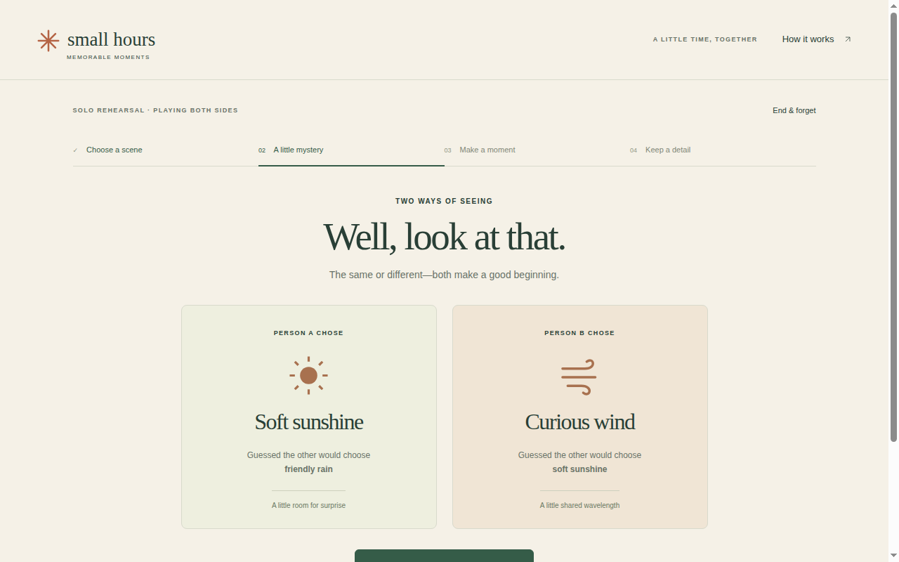
Solo rehearsal reveal [REAL] — "TWO WAYS OF SEEING: Well, look at that." Person A chose "Soft sunshine" (guessed friendly rain, "A little room for surprise"); Person B chose "Curious wind" (guessed soft sunshine, "A little shared wavelength"). Header reads "SOLO REHEARSAL · PLAYING BOTH SIDES".

### Gallery expansion 2026-10-29

Every frame below was read as a PNG before captioning [REAL]; captions stay from the PNGs: the files audit (84/85 Moments pairs) found zero screen-level TXT/PNG mismatches, so a TXT confirms screen type, but selection state is invisible in TXT dumps (the A-choice TXTs are byte-identical across four selection states) and typed detail wording is absent from them — the unreliable layer is filenames, not TXTs. The pair flow was played by one operator playing both sides, so these frames prove the flow, not a true pair.

Entry screen [REAL] — "Ordinary time. Extraordinary little memories." Buttons "Make a moment" and "Try a solo rehearsal"; "2 people · ~5 minutes · 1 screen".

Scene chooser [REAL] — steps 01–04 across the top ("Choose a scene / A little mystery / Make a moment / Keep a detail"); "The pocket museum" marked "✓ CHOSEN", with "An impossible postcard" and "Weather for two" offered beside it, and "Let's play" below.

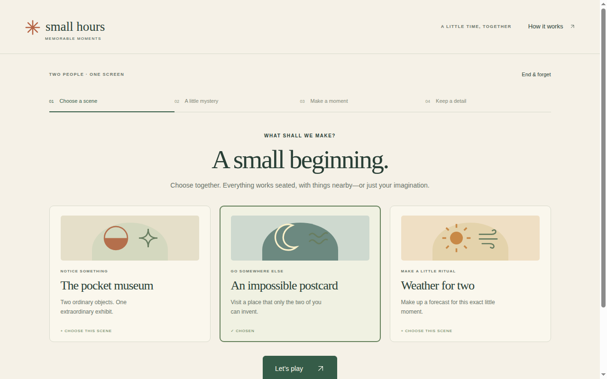
Scene chosen [REAL] — the same chooser with "An impossible postcard" now marked "✓ CHOSEN" and "The pocket museum" back to "+ CHOOSE THIS SCENE".

Person A curtain [REAL] — "A LITTLE PRIVACY, PLEASE — Person A, this is your turn. Make a choice and guess what Person B will choose. Keep your answers a little secret." The honesty clause reads "This curtain hides answers on screen; it does not secure the device." Button: "I have the screen".

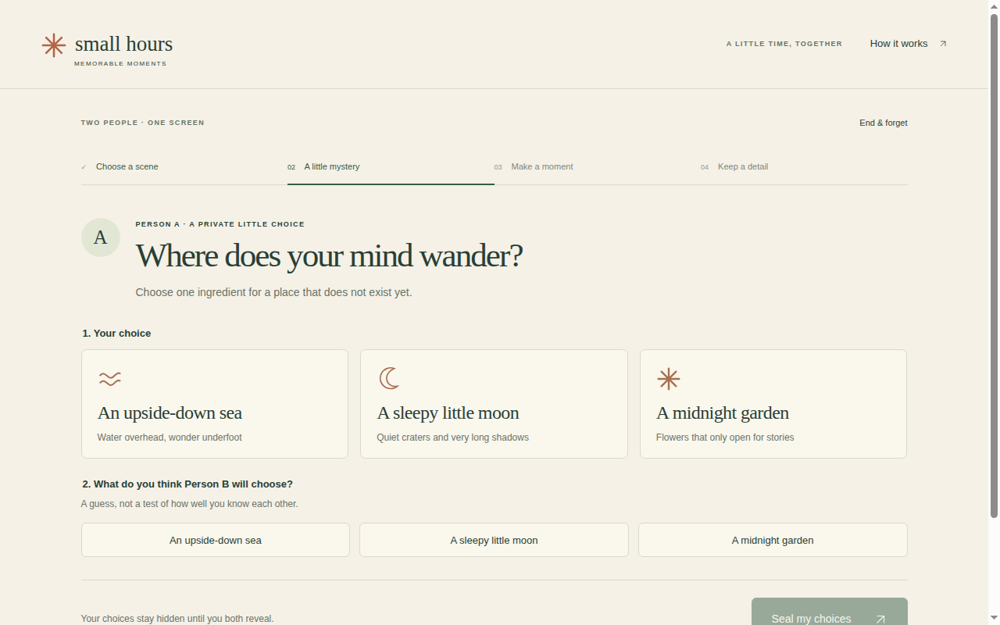
Misnomer note: this file is named "curtain-a" but the frame shows Person A's private choice screen before any selection — "Where does your mind wander? Choose one ingredient for a place that does not exist yet", with the three options and the guess section below and "Seal my choices" at the bottom. The true A curtain is `13-person-a` above.

Person A choice [REAL] — "An upside-down sea / Water overhead, wonder underfoot" highlighted in section 1 ("Your choice"); the guess section ("What do you think Person B will choose?") shows no selection yet in this frame.

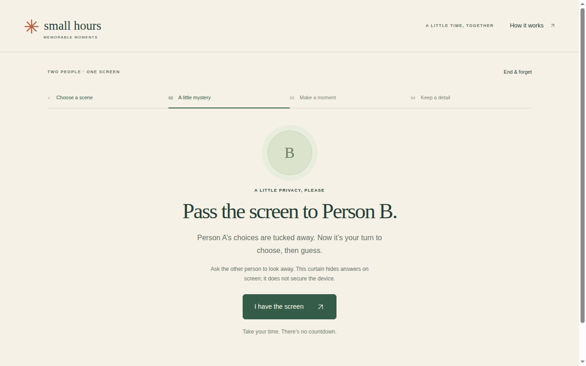
Handover curtain [REAL] — "A LITTLE PRIVACY, PLEASE — Pass the screen to Person B. Person A's choices are tucked away. Now it's your turn to choose, then guess." Button: "I have the screen".

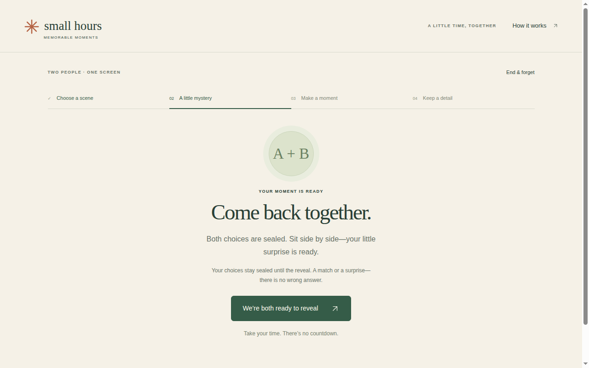
Both sealed [REAL] — "YOUR MOMENT IS READY — Come back together. Both choices are sealed. Sit side by side — your little surprise is ready." Button: "We're both ready to reveal" (the pair-flow label; the rehearsal uses a different label).

Activity [REAL] — "THE SCREEN CAN WAIT — Send a postcard from nowhere. Combine your two destinations into one place." Prompts: A "Imagine an upside-down sea", B "Imagine a midnight garden". Gentle timer shows 0:45 ("Optional. Time never ends your moment"). Button: "We made our moment".

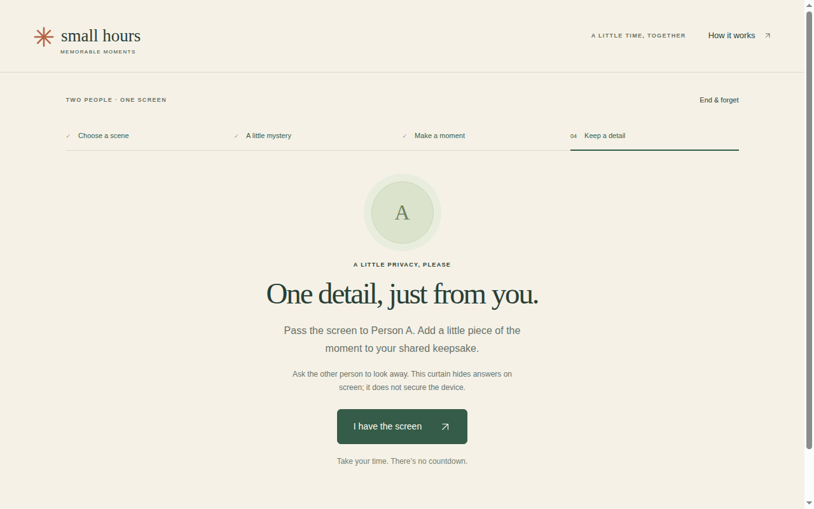
Detail curtain, Person A [REAL] — "A LITTLE PRIVACY, PLEASE — One detail, just from you. Pass the screen to Person A. Add a little piece of the moment to your shared keepsake." Button: "I have the screen".

Person A detail [REAL] — "One detail you would put on the postcard." The input reads "a brass key that hums when the tide comes in" with counter "44 / 120" and button "Tuck away my detail".

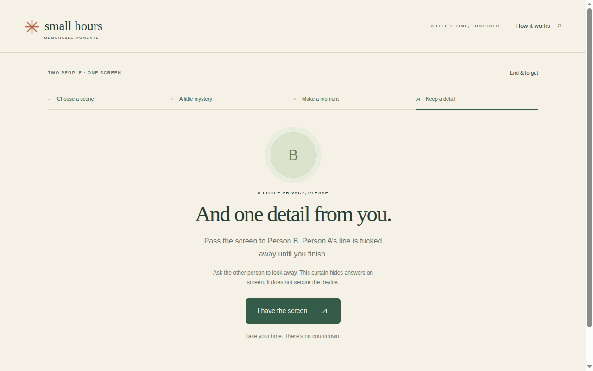
Misnomer note: this file is named "detail-A" but the frame shows the detail handover curtain for Person B — "A LITTLE PRIVACY, PLEASE — And one detail from you. Pass the screen to Person B. Person A's line is tucked away until you finish." Button: "I have the screen".

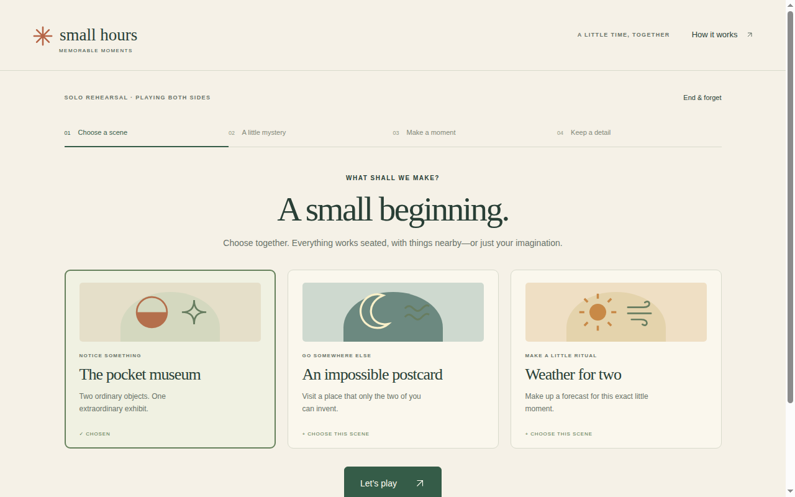
Rehearsal entry [REAL] — header "SOLO REHEARSAL · PLAYING BOTH SIDES" over the same scene chooser; "The pocket museum" pre-chosen.

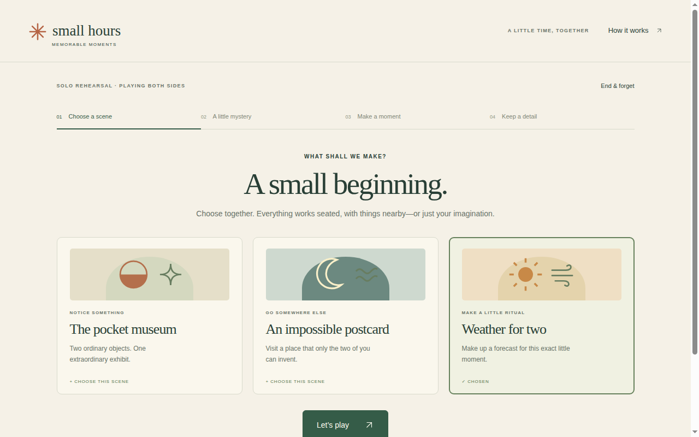
Rehearsal scene chosen [REAL] — "Weather for two / Make up a forecast for this exact little moment" marked "✓ CHOSEN" under the "SOLO REHEARSAL · PLAYING BOTH SIDES" header.

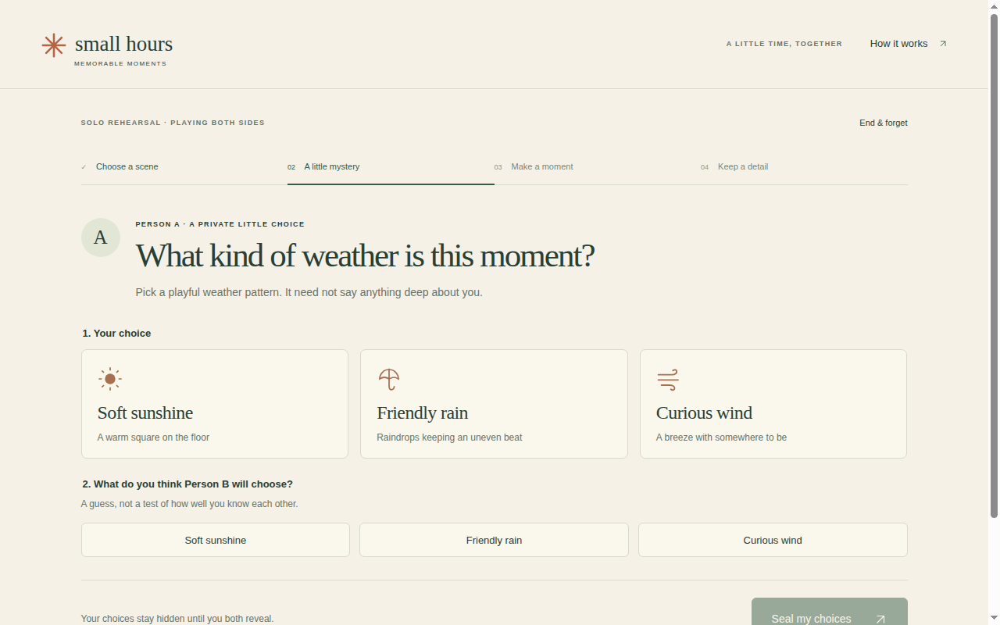
Misnomer note: this file is named "rehearsal-reveal" but the frame shows the rehearsal choice screen before selection — "What kind of weather is this moment? Pick a playful weather pattern." Options "Soft sunshine / Friendly rain / Curious wind" in both the choice and the guess sections. The true rehearsal reveal is `s5-rehearsal-reveal` in the original gallery above.

Rehearsal keepsake [REAL] — "A MOMENT, MADE BY YOU — It didn't exist before you two." The card reads "SMALL HOURS — The weather when we were here — October 28, 2026 · SOLO REHEARSAL — PERSON A: a rehearsal detail, one voice only — PERSON B: a second rehearsal detail, same voice — A FORECAST THAT ONLY HAPPENS ONCE". Note below the buttons: "This keepsake is marked as a solo rehearsal."

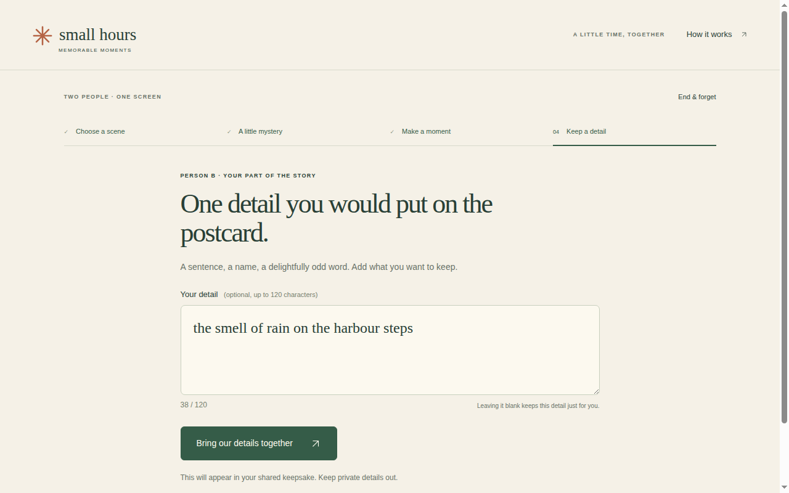
Person B detail input [REAL] — "PERSON B · YOUR PART OF THE STORY", "One detail you would put on the postcard.", input "the smell of rain on the harbour steps", counter 38/120, submit button "Bring our details together". This is the frame the journey cites for B's submit label. Misnomer note: the file is named as a keepsake capture, but the frame itself is the B detail input, not the keepsake screen. (81-detail-B, the 81-series B capture, remains a duplicate of A's and is not embedded.)
