# Keeper's Frame (Vivid 0.1.2) — Player Journey Record (2026-10-28)

**Game:** Keeper's Frame / Vivid 0.1.2, two stories: Iona "A Place for the Promise" and Mara "The Unfinished Postcard". Candidate `keepers-frame/0.1.2` (source `0c72da97994d9f2d315e6aba1afba5219936b78b`; inventory SHA-256 `e768b0fc12e34d1c4bdfc0cc5bdb194a39f10d07324e2951a6318373573572a4`; 15 files, 1,401,263 bytes).
**Session:** 2026-10-28, first-hand via Playwright + file:// on the exact frozen bytes (the agent browser refuses loopback URLs; the HTTP server was verified 200 on 127.0.0.1:8114 and file:// is only the play-access method). Iona played twice (iona5/iona6b, then a full replay in vivid15 after a VM restart lost the first completed profile); Mara played once (mara2).
**Evidence:** `evidence/vivid/` — PNG + full text dump per beat.

## Session identity

- **Edition:** Vivid 0.1.2, profile `remembered` (fresh browser context per run; no legacy `keepers-frame:v1` / `vivid:save:<story>:<profile>`).
- **Routes:** Iona `?profile=remembered#iona` (full: marks → signal → ending → return visit → recollection → private letter); Mara `?profile=remembered#mara` (objects → lightbox → ending).
- **Scored-play maximums:** 15 min (Iona) / 10 min (Mara) per the launch doc (session maximums, not targets); both completed inside them.

## Iona — "A Place for the Promise"

### Promise and arrival

Entry: a framed portrait of a harbour keeper in a weathered blue coat. "The last ferry is somewhere in the fog. Iona cannot reach beyond the painted frame. Two harbour marks will tell you how to call it home." Button: "Step closer to the frame". Header counter: "0/2 harbour marks found".

### Event journal

| # | Intention before acting | Observed feedback | Cost / friction | Evidence |
|---|---|---|---|---|
| 1 | Step closer | The framed scene; lean left / lean right controls | None | `m0-entry` |
| 2 | Lean left, read the tucked page | **Mark 1/2: "A PAGE BEHIND THE FRAME — FOG PROCEDURE · Aim EAST, toward the old breakwater. The west channel is closed."** Scene header shows "Bearing · EAST" | None | `m1-page` |
| 3 | Lean right, read the brass plate | **Mark 2/2: "A WORN BRASS PLATE — FERRY CALL · One short flash. One long flash. One short flash. Wait for the answering light."** Also "Notice the worn notch" → "A WORN NOTCH — A shallow notch has been rubbed smooth beside the lamp. A little wooden wedge rests below it. Someone has kept this ordinary scrap for a long time." | The plate and the notch are on the same edge; the notch is easy to miss | `m2-plate`, `27-after-signal` (notch panel visible in the signal-selection view; vivid15's replay did not re-capture it — `m3-notch` shows the brass plate, not the notch) |
| 4 | Send the signal with 0/2 marks (tested in iona5) | No ferry movement; the dump for this 0/2 state (27-after-signal.txt) carries "Find both harbour marks first. A good signal begins with evidence." — the frame shows the notch panel, not that message | The frame shows the notch panel; the rule sentence sits in the dump [SECONDARY] for this beat [Rectified 2026-10-29: corrected from "Nothing visible happens" — 27-after-signal.txt carries a 0/2 header and the Find-both message; the frame itself is a signal-selection view (East + Short·long·short highlighted, "Send the signal" highlighted) with no post-signal result visible, so the blocked-signal evidence is dump-only [SECONDARY]] | `27-after-signal` |
| 5 | Send the signal with 1/2 marks (tested) | "Find both harbour marks first. A good signal begins with evidence." | Good — the game states its rule here | `55-after-signal` [Rectified 2026-10-29: the blocked-signal sentence sits in 55-after-signal.txt [SECONDARY]; the frame is a signal-selection view (East + Short·long·short highlighted, "Send the signal" highlighted) with no result visible, so it does not by itself evidence an after-signal state] |
| 6 | Send the signal with 2/2 marks but the WRONG pattern (Long · short · long) | "No answering light yet. Compare the settings with the two harbour marks. Nothing is lost; you can try again." | Soft failure, no cost — the game is kind about mistakes | `65-after-signal` [Rectified 2026-10-29: the failed-signal sentence sits in 65-after-signal.txt [SECONDARY], scrolled out of the frame; the frame is a signal-settings view (brass plate panel, East + Long·short·long highlighted, "Send the signal" highlighted) with no outcome visible, so it weakly supports rather than shows the failed signal] |
| 7 | Signal: bearing East + Short · long · short | **"The ferry is safely home" + "Bearing · EAST · Rhythm · SHORT / LONG / SHORT"** (first ending reached; two panel elements joined) | None | `m5-ending` (settings, vivid15) + `74-iona-ending` ("The ferry is safely home" line, earlier run) |
| 8 | Return visit (same profile, reloaded) | "There. The answering light. The ferry has found the breakwater. We can leave the lamp steady now. Would you like to know why I kept that little wedge?" + button **"Remember an earlier watch"** | The return payoff is offered, not forced | `74-iona-ending` [Rectified 2026-10-29: return text is in this frame; `m6-return` is byte-identical to `m5-ending` and shows settings only] |
| 9 | Remember an earlier watch | Recollection scene: "THE WORN NOTCH · AN EARLIER WATCH — An earlier watch, years before this ferry. The shade rattled all night. I thought keeping the light meant never being frightened. First, help me brace the shade. It will stay where you put it." + action **"Brace the lamp shade — The catch stays closed. You do not need to hold a button."** | None | `i0-return` [Rectified 2026-10-29: recollection text is in this frame; `m7-recollection` is byte-identical to `m5-ending` and shows settings only] |
| 10 | Brace the lamp shade | Header changes to "A memory · fit the wedge" — the recollection advances one step | The next step's label is the only feedback; no text explains the wedge yet | `i2-braced` [Rectified 2026-10-29: fit-the-wedge state is in this frame; `m8-braced` is byte-identical to `m5-ending` and shows settings only] |
| 11 | Fit the wedge (action absent on first pass; the recollection completed itself after bracing) | **"Open the private letter" is offered** | The wedge step resolves without a separate click — slightly unclear whether the player did it or the game did it | `i2-braced`, `n0-letter` [Rectified 2026-10-29: `m9-wedge` is byte-identical to `m5-ending` and shows neither the wedge offer nor the letter action] |
| 12 | Open the private letter | "That was my letter. You could have asked. We can speak about it later. For now, please read the harbour marks; people are waiting." + **"A FOLDED LETTER — To whoever keeps this light after me: I was frightened every night. I turned it on anyway. — Iona"** | The letter is the payoff for RETURNING, not for finishing — the game's best structural decision | `n0-letter`, `68-private-letter` (letter panel visible in this frame) [Rectified 2026-10-29: letter text in `n0-letter` sits in the dump only] |

### What the letter means

The letter reframes the whole story: the keeper was frightened every night and kept the light on anyway. The game's rule ("a good signal begins with evidence") turns out to be a character rule, not a puzzle rule. The return visit is the game: the first visit earns the ending, the second earns the meaning.

## Mara — "The Unfinished Postcard"

### Promise and arrival

Entry: "A MYSTERY TOLD BY OBJECTS — The station closed on a Thursday. On Friday, its sign painter, Mara, was still at the workbench. The room is empty now. What was she making?" Button: "Look at the workbench".

### Event journal

| # | Intention | Observed feedback | Cost / friction | Evidence |
|---|---|---|---|---|
| 1 | Look at the workbench | Three examinable objects: "The cancelled timetable", "A postcard with paint on its edge", "Two architectural sketches" (each: "You have examined this. Look again whenever you like.") Counter: "3/3 objects examined · registration notch 0" | None | `11-workbench` |
| 2 | Open the lightbox | "Align the architectural sketches −/+ — REGISTRATION NOTCH 3 ALIGNS THE WINDOW EDGES. USE THE SLIDER OR STEP BUTTONS; DRAGGING IS OPTIONAL." | The instruction is complete before the player acts — good | `42-aligned-notch3` |
| 3 | Step + three times to notch 3, then "Read the completed picture" | **"The picture comes together"**: "The last train left. Someone kept a key. · An invitation to bring something broken. · The old room and a new arrangement, drawn on separate sheets." / "The layers move across the lightbox. Look for the window edges meeting at registration notch 3. There is no time limit; each step can be undone." | Drag-to-look-around works (mouse drag tested). No timer pressure — the game says so twice | `42-aligned-notch3`, `43-mara-ending` |

## Coverage checklist

- [x] Iona: both marks, wrong-pattern failure, correct signal, ending
- [x] Iona: return visit, recollection, brace, wedge, private letter opened
- [x] Mara: all three objects, lightbox notch 3, ending
- [ ] Iona neutral profile (`?profile=neutral#iona`) — not played (optional per launch doc)
- [ ] Human paired sessions (Nov-20 gate; needs humans)
- [ ] The letter's "speak about it later" — no further interaction was offered after the letter

## Reactions and fun episodes

- The signal failure messages are the game's best teaching: each failure names the rule ("A good signal begins with evidence", "Compare the settings with the two harbour marks", "Nothing is lost; you can try again"). The player is never punished for testing.
- The wedge is a small masterpiece of object storytelling: an ordinary scrap, kept for a long time, that turns out to be the reason the light stays steady. The game never explains it until the letter does.
- The letter's first line ("That was my letter. You could have asked.") is a gentle rebuke — the game knew the player would pry, and it lets Iona say so. That is the most human moment in any of the three demos.
- Friction worth naming: the wedge step resolves without a clear player action (did the player fit it, or did the game?); the letter action's label ("The keeper has not offered this letter to you") stays visible after the letter is opened, which reads as a stale state; the notch is easy to miss on the same edge as the plate.

## Drawn routes

- **Iona:** entry → step closer → lean left → tucked page (mark 1, EAST) → lean right → brass plate (mark 2, Short-Long-Short) → worn notch → signal (East + Short-Long-Short) → ferry home → reload → remember an earlier watch → brace the shade → fit the wedge → **private letter**.
- **Mara:** entry → workbench → three objects → lightbox → notch 3 → **the picture comes together**.

## What this record does not claim

- No claim about the Iona neutral profile (unplayed) or human paired sessions.
- The first Iona completion (iona5/iona6b) was lost to a VM restart; the letter was re-earned from scratch in vivid15 with the same outcome — the replay is the evidence, not the lost run.
- Vivid screenshots occasionally time out (WebGL canvas); text dumps are the [SECONDARY] backup evidence for those beats.

## Evidence gallery

Caption: Iona signal-selection state (vivid15): bearing EAST and rhythm SHORT / LONG / SHORT selected, "Send the signal" plain, and the letter action with the "not offered" sublabel. This frame does NOT show the "The ferry is safely home" panel; that sentence lives in 74-iona-ending.txt, not in this frame. The settings line is in m5-ending.txt. [Rectified 2026-10-29: m5-ending is a scrolled signal-selection frame, not an ending frame — no ending text is visible in it.]

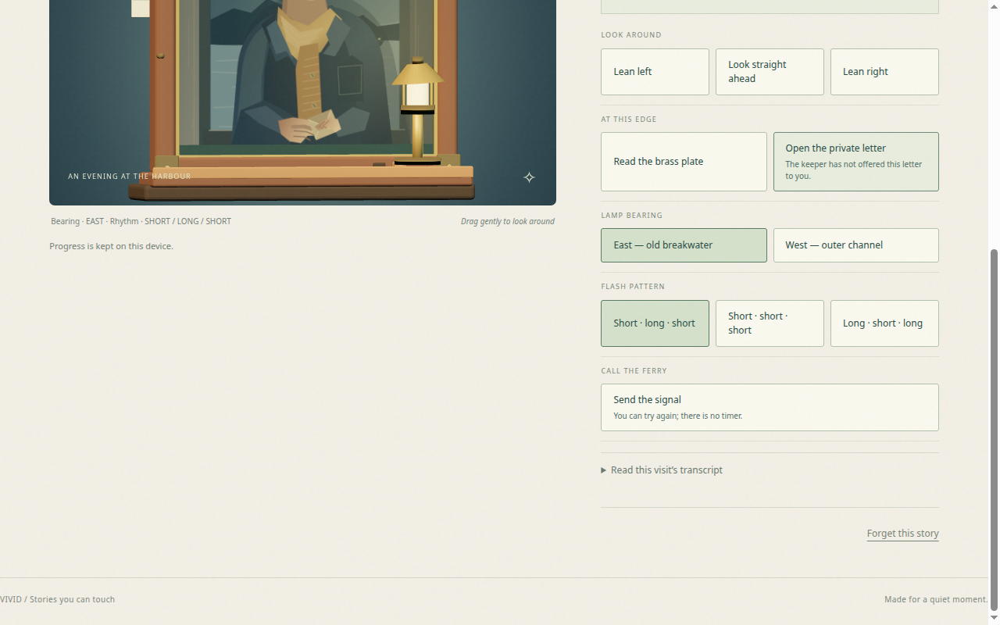
Caption: Iona on the return visit with "Open the private letter" selected; the button still reads "The keeper has not offered this letter to you" (the stale label the record notes). The letter text itself ("To whoever keeps this light after me: I was frightened every night. I turned it on anyway. — Iona") is in the companion dump n0-letter.txt, not visible in this frame.

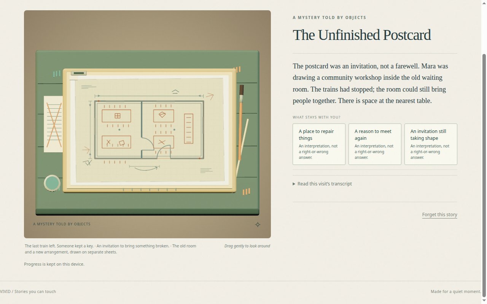
Caption: Mara's ending at registration notch 3: "The Unfinished Postcard" — the postcard as an invitation to a community workshop, three "what stays with you" interpretations, and the three-sentence picture caption below the lightbox ("The last train left. Someone kept a key. · An invitation to bring something broken. · The old room and a new arrangement, drawn on separate sheets.").

### Gallery expansion 2026-10-29

All frames below are first-hand Playwright captures [REAL]; each caption states only what the frame itself shows, with companion TXT dumps cited where the frame is scrolled and the sentence sits outside it.

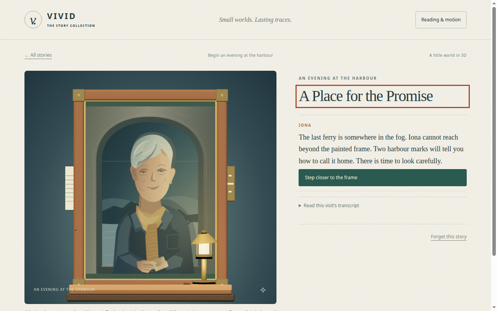
Caption: Iona entry [REAL]: the framed keeper portrait, the promise text ("The last ferry is somewhere in the fog. Iona cannot reach beyond the painted frame. Two harbour marks will tell you how to call it home."), and the "Step closer to the frame" button. Verified by PNG read + m0-entry.txt.

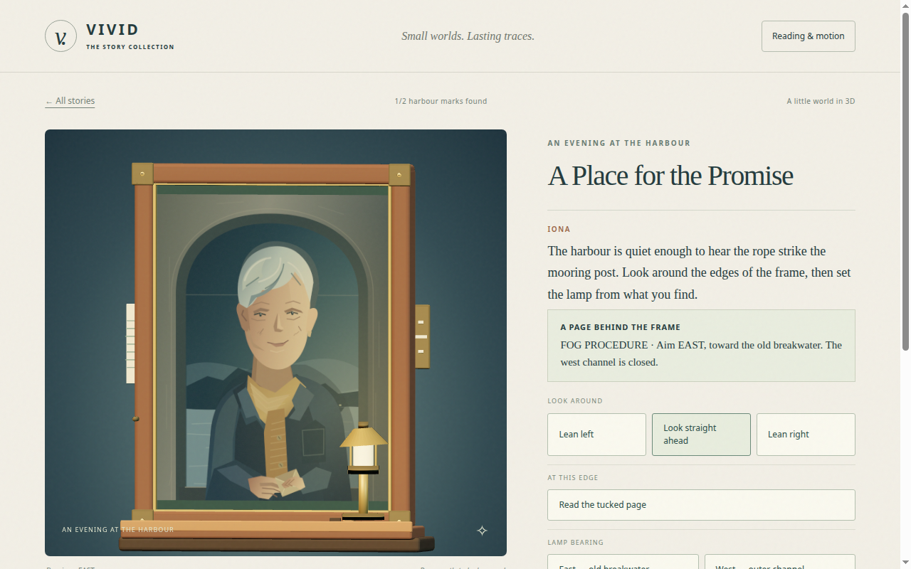
Caption: Mark 1/2 [REAL]: header "1/2 harbour marks found" and the panel "A PAGE BEHIND THE FRAME — FOG PROCEDURE · Aim EAST, toward the old breakwater. The west channel is closed." Lean controls visible below. Verified by PNG read + m1-page.txt.

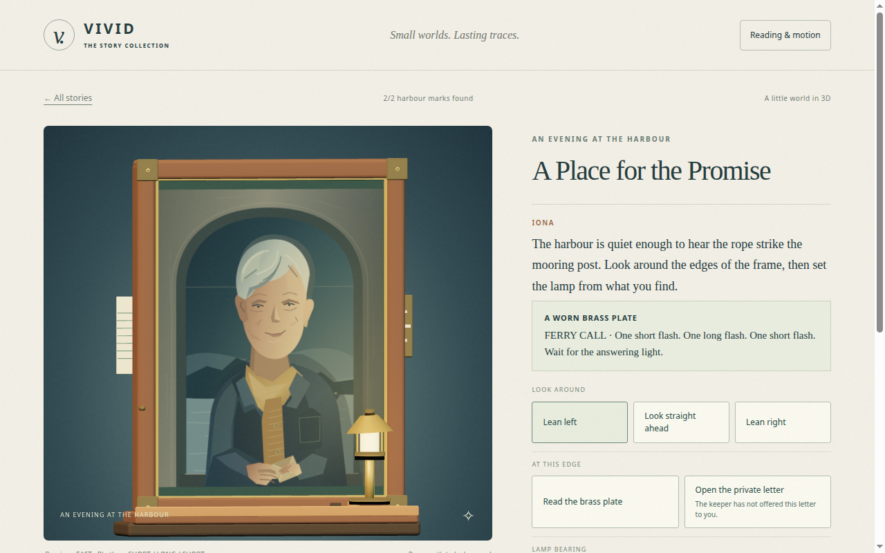
Caption: Mark 2/2 [REAL]: header "2/2 harbour marks found" and the panel "A WORN BRASS PLATE — FERRY CALL · One short flash. One long flash. One short flash. Wait for the answering light." The letter button already reads "The keeper has not offered this letter to you." Verified by PNG read + m2-plate.txt.

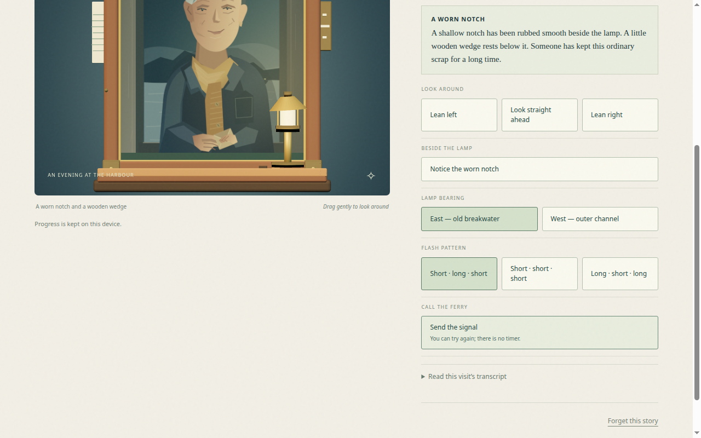
Caption: Signal-selection view showing the worn-notch panel [REAL]: the panel "A WORN NOTCH — A shallow notch has been rubbed smooth beside the lamp. A little wooden wedge rests below it. Someone has kept this ordinary scrap for a long time." with the "Notice the worn notch" action, East + Short·long·short highlighted, and "Send the signal" highlighted. No post-signal result is visible in this frame; the blocked-signal sentence ("Find both harbour marks first") sits in 27-after-signal.txt [SECONDARY]. Verified by PNG read + 27-after-signal.txt. [Rectified 2026-10-29: frame re-described from a standalone notch beat to the signal-selection view it is; it does not evidence an after-signal state.]

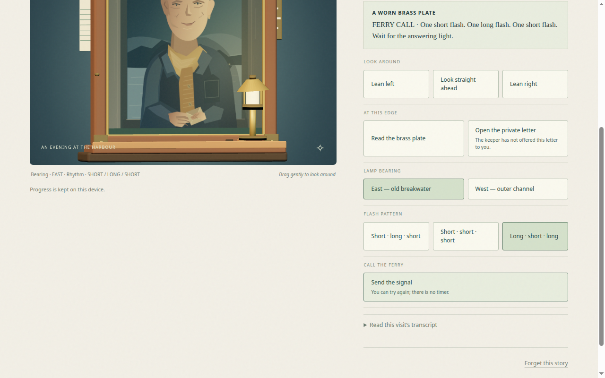
Caption: Wrong-pattern signal [REAL]: the "Long · short · long" pattern button selected and the brass plate panel visible. The response sentence ("No answering light yet. Compare the settings with the two harbour marks. Nothing is lost; you can try again.") is in 65-after-signal.txt, scrolled out of this frame. Verified by PNG read + 65-after-signal.txt.

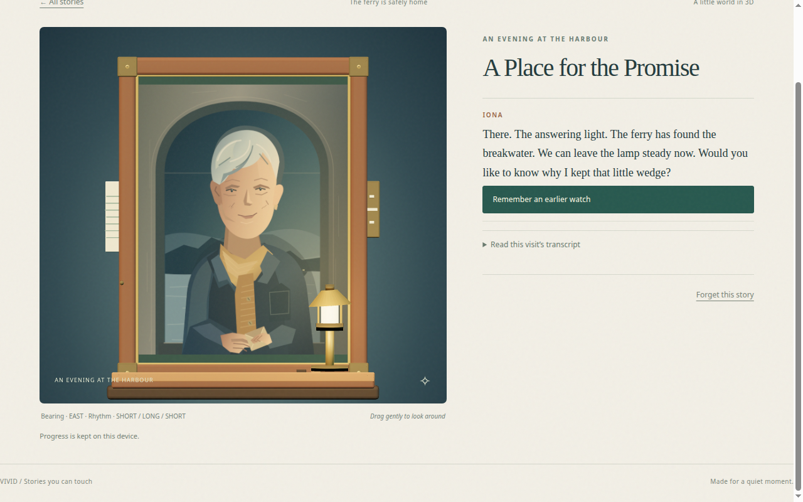
Caption: Iona ending and return offer [REAL]: header "The ferry is safely home", the return text ("There. The answering light. The ferry has found the breakwater. We can leave the lamp steady now. Would you like to know why I kept that little wedge?"), the "Remember an earlier watch" button, and the settings line "Bearing · EAST · Rhythm · SHORT / LONG / SHORT". Verified by PNG read + 74-iona-ending.txt.

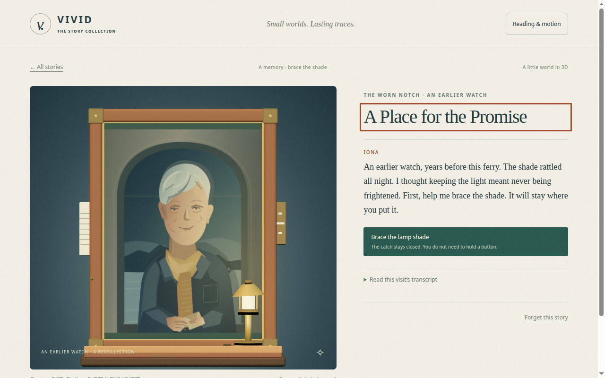
Caption: Recollection [REAL]: header "A memory · brace the shade", the text "An earlier watch, years before this ferry. The shade rattled all night. I thought keeping the light meant never being frightened. First, help me brace the shade. It will stay where you put it." and the "Brace the lamp shade" button. Verified by PNG read + i0-return.txt.

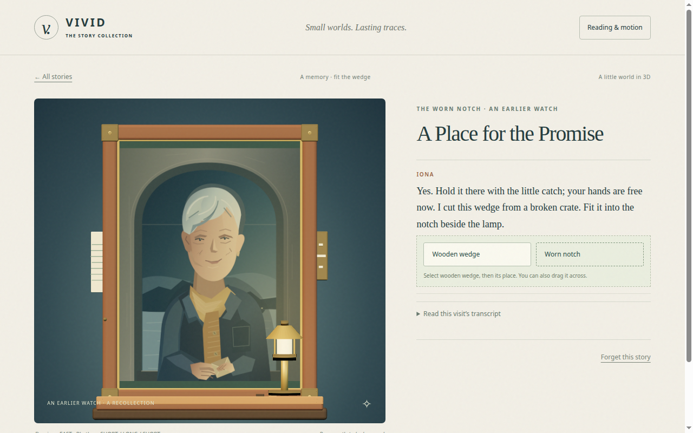
Caption: Fit the wedge [REAL]: header "A memory · fit the wedge", the text "Yes. Hold it there with the little catch; your hands are free now. I cut this wedge from a broken crate. Fit it into the notch beside the lamp." and the "Wooden wedge" / "Worn notch" selectors. Verified by PNG read + i2-braced.txt.

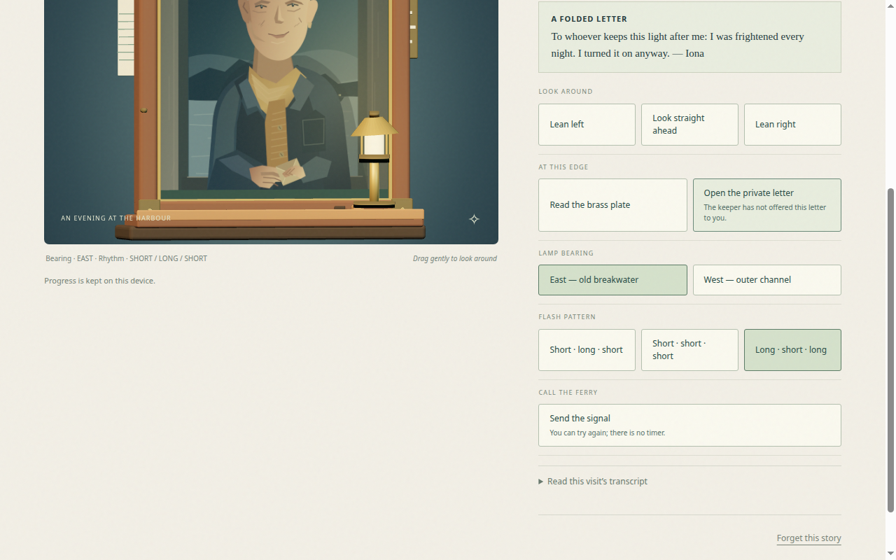
Caption: Private letter [REAL]: the panel "A FOLDED LETTER — To whoever keeps this light after me: I was frightened every night. I turned it on anyway. — Iona" is visible in this frame (unlike n0-letter.png, where the letter text sits in the dump only). The letter button still carries the stale label "The keeper has not offered this letter to you." Lamp settings in this earlier-run frame are not relied on. Verified by PNG read + 68-private-letter.txt.

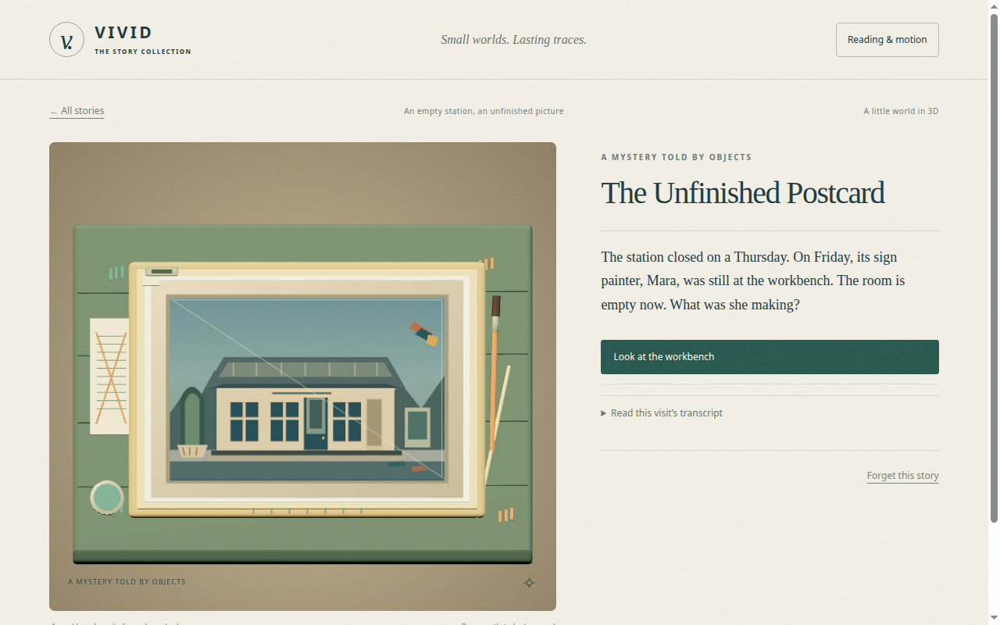
Caption: Mara entry [REAL]: "The station closed on a Thursday. On Friday, its sign painter, Mara, was still at the workbench. The room is empty now. What was she making?" with the "Look at the workbench" button. Verified by PNG read + 06-mara-entry.txt.

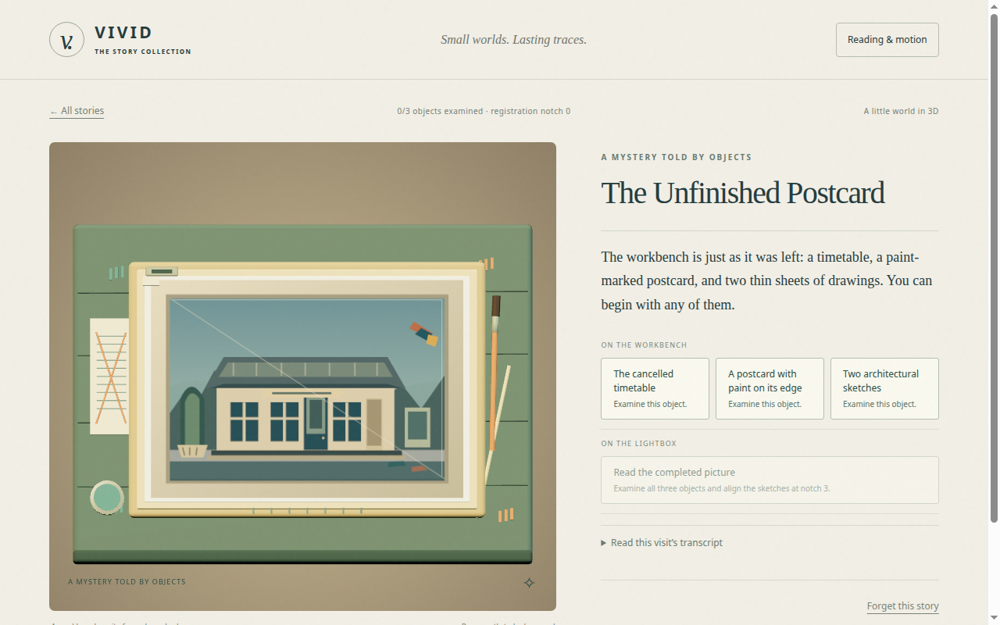
Caption: Mara workbench [REAL]: counter "0/3 objects examined · registration notch 0" and the three object buttons ("The cancelled timetable", "A postcard with paint on its edge", "Two architectural sketches"), each "Examine this object." Verified by PNG read + 11-workbench.txt.

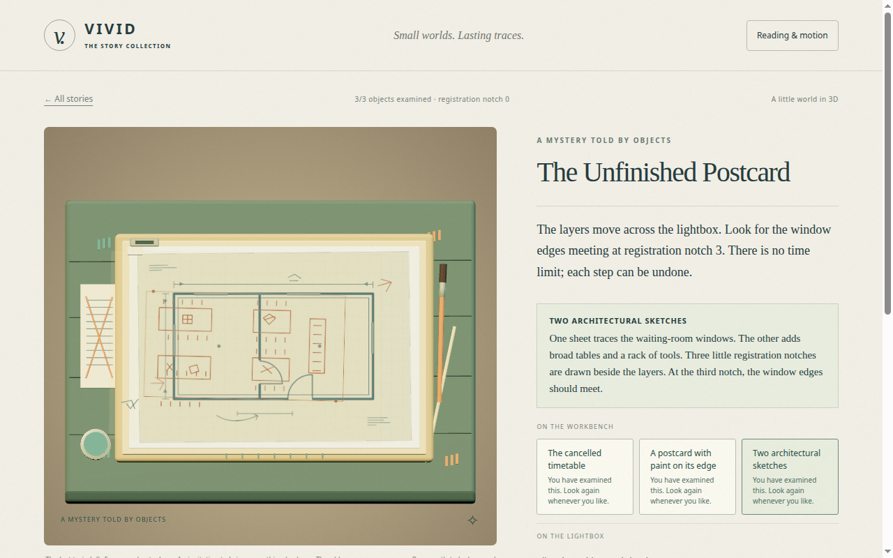
Caption: Mara objects examined [REAL]: counter "3/3 objects examined · registration notch 0", all three buttons reading "You have examined this. Look again whenever you like.", and the sketches panel ("At the third notch, the window edges should meet."). Verified by PNG read + 41-examined.txt.

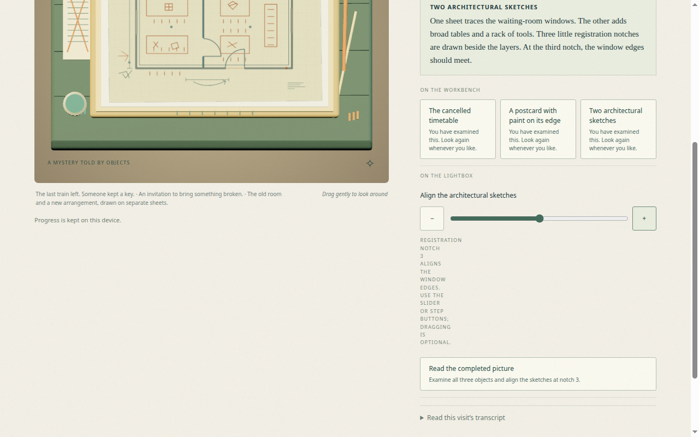
Caption: Mara lightbox at notch 3 [REAL]: the slider with step buttons, the "REGISTRATION NOTCH 3 ALIGNS THE WINDOW EDGES" instruction, the three examined object buttons, and the three-sentence picture caption ("The last train left. Someone kept a key. · An invitation to bring something broken. · The old room and a new arrangement, drawn on separate sheets."). Verified by PNG read + 42-aligned-notch3.txt.
