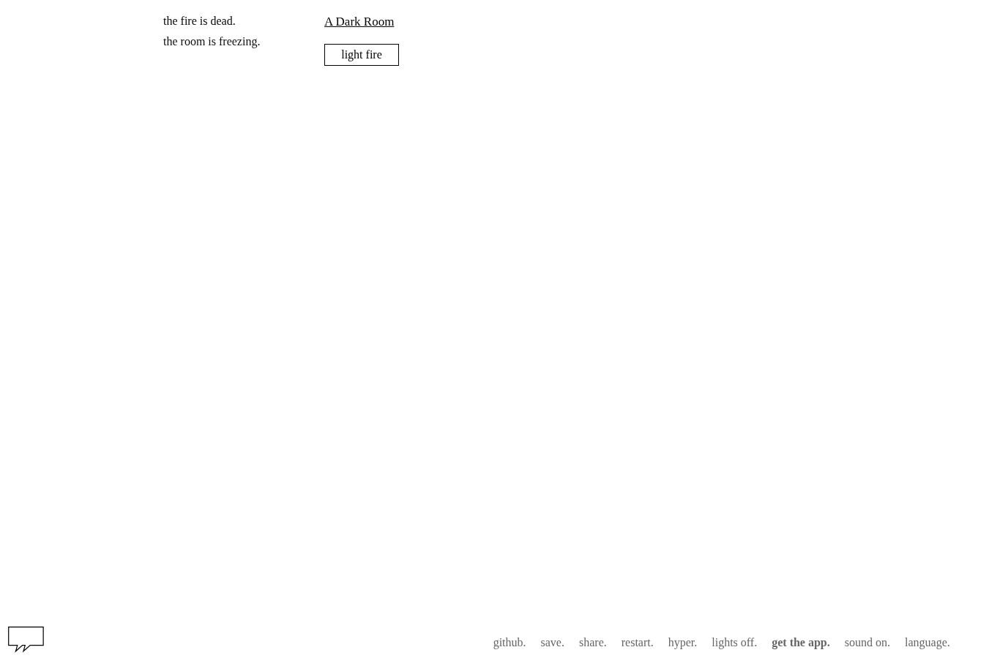
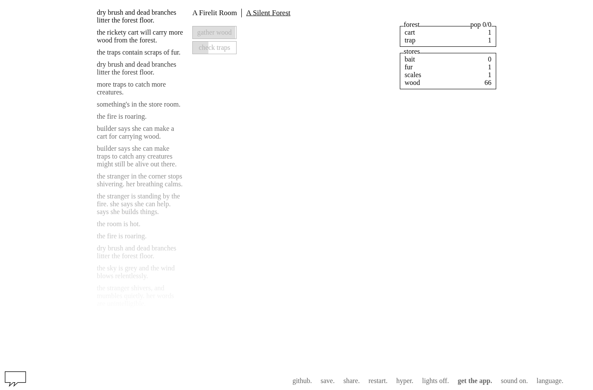
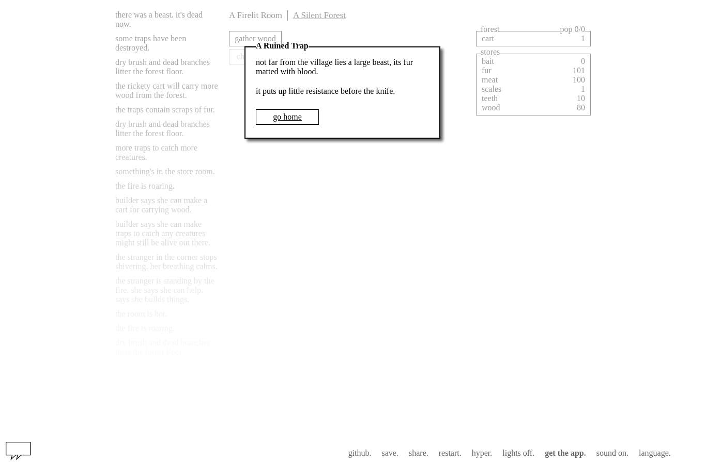

# A Dark Room — player-journey observation

**Method: agent-operated public browser play, not a human session or a release qualification.**

| Record | Value |
|---|---|
| Run | TN-RESEARCH-A-DARK-ROOM-20261114 |
| Public game | [A Dark Room](https://adarkroom.doublespeakgames.com/) |
| Observed window | 2026-11-14T09:04:48.452Z → 2026-11-14T09:12:21.568Z |
| Environment | Chromium 151.0.7922.173 / Playwright 1.62.1, Linux, 1366 × 900, English, pointer-operated UI |
| Observation count | 25 captured states; 20 UI action attempts in the main run |
| Evidence identity | Public live build as served November 14; no source commit independently established |
| Endpoint | Bounded opening: fire, stranger, forest, trap/cart economy and two events; no full-game ending. |

Elapsed wall time includes interleaved observations of the other two games and tool latency. It is **not a human reading-time or completion-time estimate**. Actions used visible controls; no game variables were changed, no timers accelerated and no walkthrough was used. Critic articles were read during the research, so this is not a blinded first-impression study. Thoughts below are agent design interpretation, not reported human emotions.

## Complete attempted journey

| UTC / capture | Goal and action | Observed result / uncertainty |
|---|---|---|
| 09:04:48 / `006-darkroom.png` | Enter fresh public game; inspect the sole main action. | A freezing room, dead fire and light-fire control provide a concrete first task with little explanation. |
| 09:04:49 / `007-darkroom.png` | Click the visible light-fire control. | Title changes to A Firelit Room; sensory log changes immediately and stoke replaces light. |
| 09:05:27 / `015-darkroom.png` | Dismiss the later audio-choice dialog. | A stranger has arrived during real elapsed time; room temperature and narrative log continue evolving. |
| 09:05:30 / `016-darkroom.png` | Stoke the fire. | Fire becomes roaring. This is repeated maintenance, with a developing stranger narrative rather than a new choice each time. |
| 09:06:40 / `023-darkroom.png` | Open the newly available forest tab. | A second place and wood supply appear; the stranger is warming. |
| 09:06:41 / `024-darkroom.png` | Gather wood. | Visible wood rises4→14. A later gather attempt during cooldown does not increase it; the attempt is retained at027. |
| 09:07:47 / `033-darkroom.png` | Return to room and stoke; inspect builder unlocks. | Builder offers trap/cart; a store-room noises event offers investigate/ignore. |
| 09:08:09 / `036-darkroom.png` | Investigate the noises. | The event reports missing wood and yields one scale; the world becomes stranger without a cutscene. |
| 09:08:41 / `040-darkroom.png` | Leave event and build a trap. | Wood24→14; another trap costs20. Building produces a new forest activity. |
| 09:09:37 / `047-darkroom.png` | Return outside, gather and check the trap. | First trap check yields one fur. Resource and narrative progress are connected through actual new controls. |
| 09:10:01 / `051-darkroom.png` | Build a cart. | Wood40→10; the log promises increased carrying capacity. |
| 09:10:34 / `055-darkroom.png` | Return to forest and gather with cart. | Wood16→66: the same gathering action now produces50, and hut appears. This closes the observed invest→improve loop. |
| 09:10:57 / `058-darkroom.png` | Observe a new interruption before stopping. | Traps have been destroyed; a track/ignore choice appears. The first planned stopping point was extended to resolve this event. |
| 09:11:42 / `062-darkroom.png` | Follow the tracks. | A wounded beast encounter resolves immediately; fur/meat/teeth are added. The click did not reveal a separate tactical encounter. |
| 09:12:21 / `066-darkroom.png` | Return home and stop the bounded observation. | First building loop and both optional events resolved. Hut available; settlement/exploration/endgame not played. |

## Criticism from different roles

- **Player:** uncertainty about the stranger and later footprints supplied reasons to continue. The cart reward was especially legible because the next gather changed10→50. Repeated gather attempts were less engaging once their result was predictable; this is an interpretation of the observed loop, not a retention measurement.
- **Designer:** a small action vocabulary expands through use. The experience teaches by changed titles, logs and unlocked controls rather than a front-loaded tutorial. A later branch resolves the beast immediately, showing that evocative choice text can promise more action than the resulting interaction supplies.
- **Art/interaction:** large blank space and spare text leave room for imagined scenes. Cooldown and update text carry essential meaning; the run did not verify keyboard or assistive access for the div-based controls.
- **Operator:** browser entry required no account or payment. Audio prompting interrupted the opening. A visible saved indicator existed, but this run did not validate cross-device saving. The initial certificate problem belonged to the research environment; a locator timeout and pre-play browser restart are harness events, not confirmed game defects.

## Comparison with published criticism

[Michael Thomsen’s 2014 New Yorker article](https://www.newyorker.com/tech/annals-of-technology/a-dark-room-the-best-selling-game-that-no-one-can-explain) connects the expanding interface with environmental storytelling and explains the original browser’s background-play context. Our fire→forest→builder→cart sequence supports that specific observation. We did not reach the late revelations discussed in the article or reproduce its commercial claims. The short Notebook chapter should not inherit the idle game’s waiting demands.

## Decisions for Borrowed Words

1. Make the first mark change a visible reply or page state immediately; let uncertainty concern the correspondent, not whether a control worked.
2. Reveal later affordances through story use, while keeping recovery and exit discoverable from the start.
3. Show the consequence beside the decisive original phrase. Avoid repeating a ritual unless the next exchange changes its meaning.
4. Treat a self-contained narrative chapter as a different operating rhythm from background resource accumulation; test the proposed pacing with humans.

## Captured evidence

## Evidence limits and audit trail

The complete local action/DOM/screenshot sequence is retained privately under `research/left/` in the November 14 task backup. Scripts and raw logs are not part of this public research record. Capture hashes below permit comparison with that archive; missing frames are retained privately rather than represented as unperformed observations.

| Public capture | SHA-256 |
|---|---|
| `006-darkroom.png` | `14df391986677ca154195cb6f9f1434dde56ad708141b36ff1d2b8dfd7246647` |
| `055-darkroom.png` | `3105f642a5e87ebebf41041c1f00cb3cd79f6c0e582b2aeca94f28a720078876` |
| `062-darkroom.png` | `f43bd7099c70984bf085221c01ad824e3e5e075f06f0927f54e382db8805bdad` |

No mobile hardware, screen reader, keyboard-only completion, alternate full route, retention, market size or human enjoyment claim follows from this run. The observed entry/setup failures are described separately from in-game friction.
