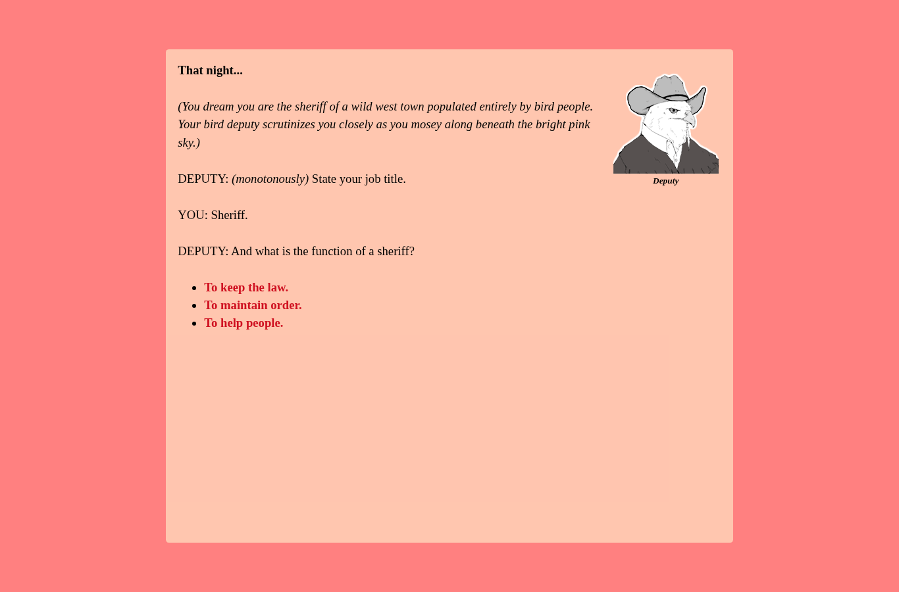
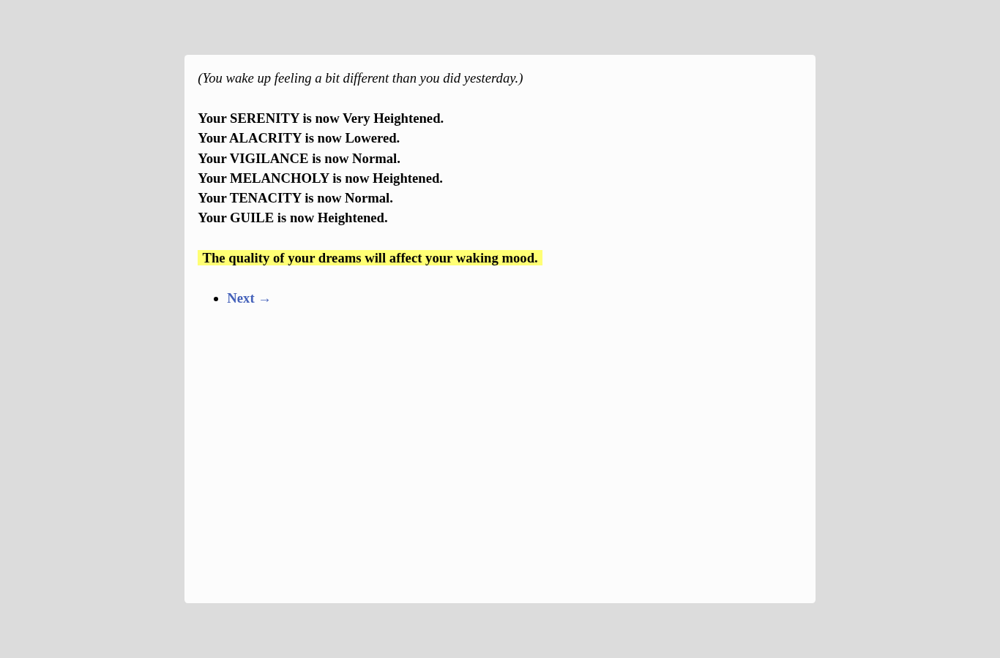
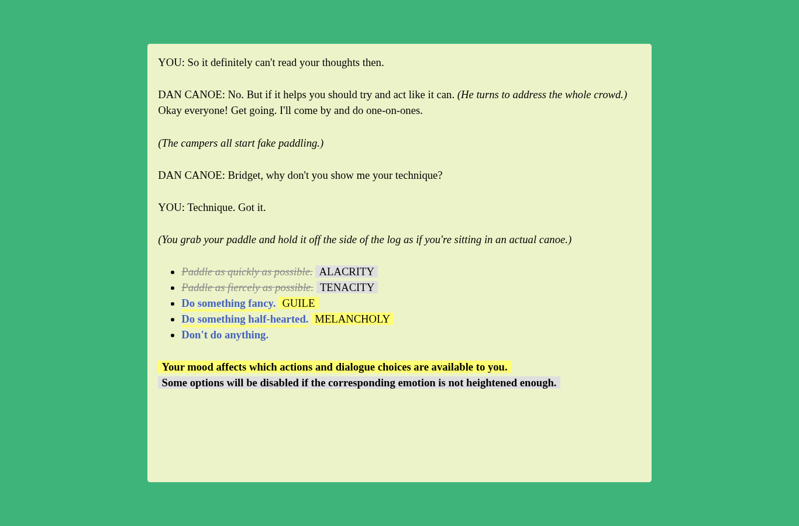

# Birdland — player-journey observation

**Method: agent-operated public browser play, not a human session or a release qualification.**

| Record | Value |
|---|---|
| Run | TN-RESEARCH-BIRDLAND-20261114 |
| Public game | [Birdland](https://birdland.camp/) |
| Observed window | 2026-11-14T09:04:57.545Z → 2026-11-14T09:14:01.824Z |
| Environment | Chromium 151.0.7922.173 / Playwright 1.62.1, Linux, 1366 × 900, English, pointer-operated UI |
| Observation count | 20 captured states; 17 UI action attempts in the main run |
| Evidence identity | Public live build as served November 14; no source commit independently established |
| Endpoint | Opening letter, first dream and complete first waking canoe scene; stopped on entering midday scene, not a full-story ending. |

Elapsed wall time includes interleaved observations of the other two games and tool latency. It is **not a human reading-time or completion-time estimate**. Actions used visible controls; no game variables were changed, no timers accelerated and no walkthrough was used. Critic articles were read during the research, so this is not a blinded first-impression study. Thoughts below are agent design interpretation, not reported human emotions.

## Complete attempted journey

| UTC / capture | Goal and action | Observed result / uncertainty |
|---|---|---|
| 09:04:57 / `010-birdland.png` | Open public title screen. | Start, Chapters, Options and About are visible; no account or payment required. |
| 09:05:11 / `013-birdland.png` | Start and wait for the opening to appear. | A parental letter establishes camp isolation. Initial transition capture011 was briefly empty; later capture records the completed reveal. |
| 09:05:32 / `017-birdland.png` | Continue into bunkmate conversation. | Two short answers offer a stance toward the remaining camp days. |
| 09:06:01 / `019-birdland.png` | Choose Days left. | Bridget voices frustration and ends the conversation; a small option immediately establishes voice. |
| 09:06:38 / `022-birdland.png` | Enter the first dream and inspect sheriff-role choices. | A bird deputy asks what a sheriff does; law/order/help choices give different expressions of role. |
| 09:07:12 / `026-birdland.png` | Choose helping people. | The response characterizes Bridget, then offers how to treat a drunken bird. |
| 09:07:44 / `031-birdland.png` | Leave the drunk alone. | A bespoke exchange follows, then saloon versus robbery is offered. |
| 09:08:07 / `035-birdland.png` | Choose to foil a robbery. | Hostage situation presents negotiate versus infiltrate. |
| 09:08:38 / `038-birdland.png` | Negotiate. | Threat continues; shootout versus reverse psychology becomes available. |
| 09:09:12 / `042-birdland.png` | Choose reverse psychology. | A long comic exchange resolves the robbery with surrender. This is a narrative payoff, not a separate action minigame. |
| 09:09:34 / `046-birdland.png` | Leave the dream. | Named mood results are shown, including heightened Guile and very heightened Serenity; a sentence explicitly relates dreams to waking mood. |
| 09:09:57 / `049-birdland.png` | Continue to the canoe lesson. | Instructor metaphor invites literal, anxious or dismissive questions. |
| 09:10:28 / `053-birdland.png` | Ask whether the paddle senses anxiety. | The instructor distinguishes metaphor from literal mind reading. |
| 09:10:56 / `057-birdland.png` | Press the literal-question thread. | Actual action choices now show mood labels: Alacrity/Tenacity unavailable; Guile/Serenity alternatives can be used. The game explains the dependency. |
| 09:11:40 / `060-birdland.png` | Choose the Guile fancy-paddling action. | Bridget improvises; five specific names for the invented stroke appear. |
| 09:12:19 / `064-birdland.png` | Call it a Furious Minnow. | The instructor responds to that answer and asks for a J stroke. |
| 09:12:58 / `068-birdland.png` | Choose the available Serenity J-stroke option. | A specific misunderstanding produces more dialogue; an enabled stat option does not simply guarantee praise. |
| 09:14:01 / `074-birdland.png` | Continue to the next scene, then stop. | Swimming dock opened but its choices were not attempted. The observed dream→mood→waking-choice loop is complete; the full plot is not. |

## Criticism from different roles

- **Player:** the dialogue offers ways to inhabit Bridget even when it is not a puzzle. The unselected answers help define who she might be. The named mood bridge made it possible to connect dream behavior with later affordances; some options remained unavailable in this route.
- **Designer:** the first dream and canoe scene demonstrate expressive choices becoming later conditions. A stat-enabled answer still produces a characterful imperfection, avoiding a simple correct-answer ladder. The run does not establish all branch permutations or late-story payoff.
- **Art/interaction:** modest portraits, color and compact links distinguish speakers and choices. The reverse-psychology payoff and J-stroke scene were much longer than surrounding choice fragments; this changes reading rhythm, which deserves human pacing observation rather than an automatic brevity rule.
- **Operator:** direct browser play required no login. Brief empty transition captures recovered without reload. Chapters/options exist, but their save, replay and accessibility behavior was not exercised. This record covers one route, not completion, replay demand or audience-wide enjoyment.

## Comparison with published criticism

[Greg Buchanan’s 2019 IFDB review](https://ifdb.org/viewgame?id=ap1651hvjldbuugj&review=49618) praises choice wording as characterization and the dream-to-waking relationship, while noting occasional large text blocks interrupt the expected rhythm. The observed sheriff choices, mood summary and canoe options provide direct examples of that relationship. Our long payoff screens also show the pacing variation, but this bounded run cannot assess his whole-story conclusion.

## Decisions for Borrowed Words

1. Write Notebook alternatives as distinct intentions and voices, not interchangeable buttons followed by the same reply.
2. Let the later exchange visibly refer back to the earlier marked phrase; preserve the record that explains the connection.
3. Keep the correspondent’s motives uncertain while making available actions and their relationship to prior decisions understandable.
4. Break lengthy replies into readable beats with an optional immediate reveal; do not equate a stat or an ending count with emotional impact.

## Captured evidence

## Evidence limits and audit trail

The complete local action/DOM/screenshot sequence is retained privately under `research/left/` in the November 14 task backup. Scripts and raw logs are not part of this public research record. Capture hashes below permit comparison with that archive; missing frames are retained privately rather than represented as unperformed observations.

| Public capture | SHA-256 |
|---|---|
| `022-birdland.png` | `773bc808283c1af50eca710d61cdec49cd2c40f1c3b63c88aeadebd2f7b1f89c` |
| `046-birdland.png` | `30567245c65729e9fb0ea1bd5af17389c9049f30b513260508f9bd872bea302b` |
| `057-birdland.png` | `23ce747aadccd1ba304a2bc6277529212fcf6c8c374cc7a1e5ab4975be3f9328` |

No mobile hardware, screen reader, keyboard-only completion, alternate full route, retention, market size or human enjoyment claim follows from this run. The observed entry/setup failures are described separately from in-game friction.
