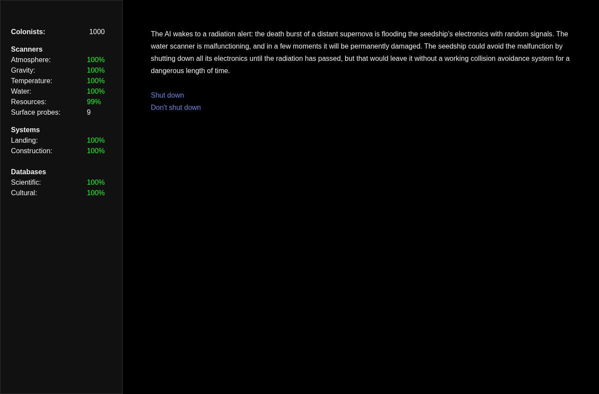
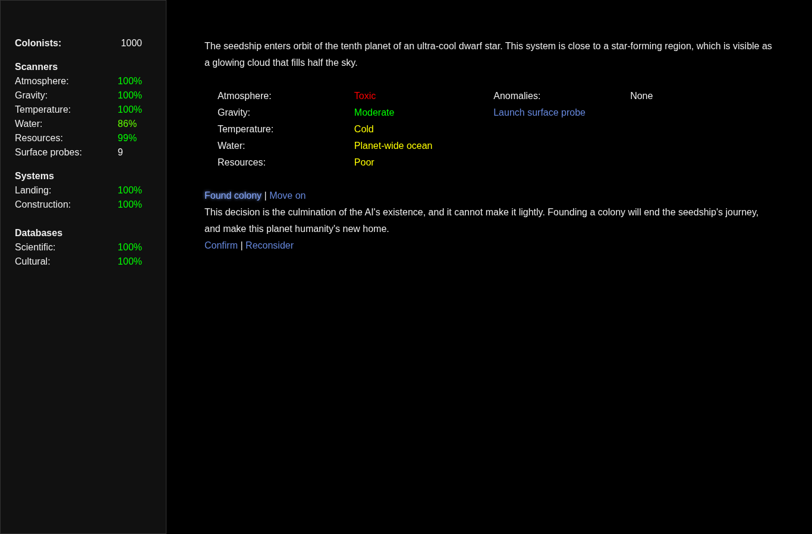
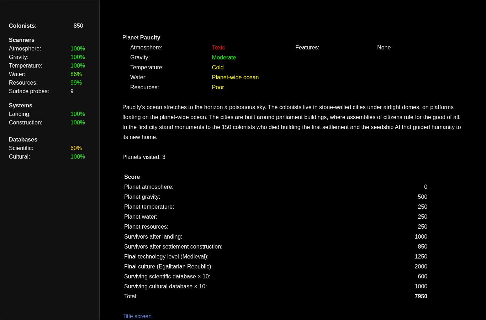
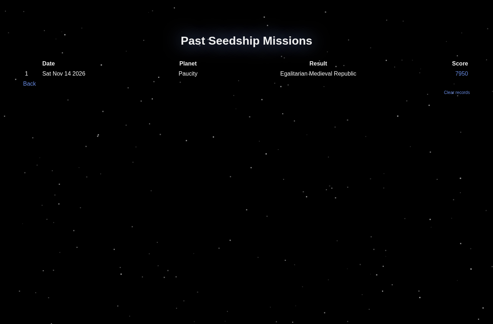

# Seedship — player-journey observation

**Method: agent-operated public browser play, not a human session or a release qualification.**

| Record | Value |
|---|---|
| Run | TN-RESEARCH-SEEDSHIP-20261114 |
| Public game | [Seedship](https://spacegoblingames.itch.io/seedship) |
| Observed window | 2026-11-14T09:05:59.529Z → 2026-11-14T09:18:58.069Z |
| Environment | Chromium 151.0.7922.173 / Playwright 1.62.1, Linux, 1366 × 900, English, pointer-operated UI |
| Observation count | 34 captured states; 30 UI action attempts in the main run |
| Evidence identity | Public live build as served November 14; no source commit independently established |
| Endpoint | Completed one mission: Paucity, three planets visited,850 settlers, egalitarian medieval republic,7950points; inspected Past missions, no second run. |

Elapsed wall time includes interleaved observations of the other two games and tool latency. It is **not a human reading-time or completion-time estimate**. Actions used visible controls; no game variables were changed, no timers accelerated and no walkthrough was used. Critic articles were read during the research, so this is not a blinded first-impression study. Thoughts below are agent design interpretation, not reported human emotions.

## Complete attempted journey

| UTC / capture | Goal and action | Observed result / uncertainty |
|---|---|---|
| 09:03:16 / `002-seedship.png` | Open the originally supplied johnayliff game URL. | It now shows a mission-report page without a score. Its public Play Seedship link leads to itch.io; this is entry-route drift, not gameplay. |
| 09:04:55 / `009-seedship.png` | Click Run game on itch.io. | The embedded viewport remains blank at the observed captures; the actual public iframe URL is available in the rendered page. |
| 09:05:59 / `018-seedship-direct.png` | Open that same public iframe URL as a top-level page. | Seedship version1.4.0 title screen renders. No downloaded copy, modified script or saved-state injection was used. |
| 09:06:35 / `021-seedship-direct.png` | Start New game and read the intro via Continue. | The fiction establishes1000 frozen colonists and a finite mission. Skip intro exists but was not used in this run. |
| 09:08:35 / `037-seedship-direct.png` | Run Systems check. | Colonists and scanner/system/database status establish the resources being entrusted to the player. |
| 09:09:31 / `045-seedship-direct.png` | Scan first planet and wait for readings. | Toxic, very-high-gravity, very-cold, icy and resource-poor. Settlement and continued search are both available. |
| 09:09:42 / `048-seedship-direct.png` | Reject the first planet. | The ship continues. No surface probe spent on an evidently hostile world. |
| 09:10:13 / `052-seedship-direct.png` | Read an overheating event and compare four sacrifices. | Sleep chambers, scanners, landing/construction or databases can absorb the damage; the uncertainty now concerns which cost to accept. |
| 09:10:37 / `056-seedship-direct.png` | Sacrifice scanner quality to protect people and settlement capability. | Resources scanner loses1point; colonists and other systems remain intact. The result is visible beside the narrative. |
| 09:11:40 / `061-seedship-direct.png` | Inspect the second planet. | Breathable but very cold/low gravity/poor resources; possible structures and vegetation justify further investigation. |
| 09:12:17 / `063-seedship-direct.png` | Spend one surface probe. | Probe count10→9; readings confirmed. Each Continue reveals another surface finding rather than another strategic decision. |
| 09:14:09 / `075-seedship-direct.png` | Read the full probe report. | Outstanding beauty and monumental ruins coexist with unstable geology and poisonous plants. Probe finishes and settlement/search options return. |
| 09:14:22 / `076-seedship-direct.png` | Reject the second world; face radiation en route. | Water scanner is threatened; shutting down protects it but removes collision avoidance. Explicit uncertainty is presented before the decision. |
| 09:14:31 / `077-seedship-direct.png` | Keep collision avoidance active. | Water scanner falls100→86; colonists remain1000. Rationale was recorded before choosing in the private action log. |
| 09:16:58 / `079-seedship-direct.png` | Wait for third-planet scan to finish. | Toxic air, moderate gravity, cold, planet-wide ocean, poor resources and no detected anomalies. |
| 09:17:17 / `080-seedship-direct.png` | Choose a compromised settlement before further travel damage. | Found colony produces a distinct Confirm/Reconsider step explaining that the journey ends here. |
| 09:17:28 / `081-seedship-direct.png` | Confirm settlement. | All1000 land safely on Paucity, named for scarce resources; this is a deliberate imperfect outcome, not an optimal-play claim. |
| 09:17:59 / `082-seedship-direct.png` | Read construction consequences. | 150 die from environment-suit failures;850 remain. The narrative ties that cost to the known hostile environment. |
| 09:18:01 / `083-seedship-direct.png` | Read technology outcome. | Poor resources reduce the final technology to medieval; robust airtight habitats preserve life. |
| 09:18:17 / `084-seedship-direct.png` | Read government outcome. | The preserved cultural database supports an egalitarian republic despite losses. |
| 09:18:18 / `085-seedship-direct.png` | Reach final colony account and score. | Three planets visited;850 surviving settlers; egalitarian medieval republic; total7950. A complete mission endpoint was reached. |
| 09:18:58 / `087-seedship-direct.png` | Return to title and open Past missions. | The completed mission appears in a history row. No second run or share-link publication was performed. |

## Criticism from different roles

- **Player:** choosing which system to lose creates responsibility before the planet decision. The ending supplied a concrete account of the compromise I selected, rather than only a score. Potential interest in another run is an agent interpretation of the exposed alternatives; no voluntary human replay was measured.
- **Designer:** the decision loop alternates readable planet evidence, a bounded information purchase and travel risk. The final colony translates earlier constraints into specific lives, technology and government. This one random route cannot isolate every causal rule or establish balance; the bad worlds and modest initial damage could differ on replay.
- **Art/interaction:** the persistent status column keeps the stakes visible while the main text changes. Colored descriptors are reinforced by words. Readings animate from scanning to facts, so an early screenshot can be incomplete. The game should be judged after the actual reading arrives, not from an arbitrary screenshot delay.
- **Operator:** the old URL no longer starts the game and the itch embedded frame was blank in this environment. Opening its same public asset directly recovered play with strict TLS. The completed mission appears in Past missions within the same browser context; persistence after a new session or on another device was not tested. The game generated a share URL, but it was not posted or followed.

## Comparison with published criticism

[Eloquence’s 2021 lib.reviews article](https://lib.reviews/review/886cbb08-a32b-4abb-8499-9cd6a570bf54) praises economical text, consequence-rich events and colony endings while identifying chance as a large influence. Our route supports the specific mechanism: scanner sacrifice, unsuitable worlds and a final account explaining settlement losses. It does not substantiate the article’s general enjoyment claim, replay duration or the frequency of favorable planets.

## Decisions for Borrowed Words

1. Give Notebook players the evidence needed to form an intention before committing; retain uncertainty about motives, not about what was selected.
2. Separate reversible phrase marking from the final commitment, with a clear return/reconsider option before the ending.
3. Make the final page recall concrete earlier choices and their consequences; a generic success score would weaken this game's authorship theme.
4. Preserve a readable local transcript or ending artifact and make replay an explicit fresh start. Verify hosted entry paths rather than assuming a previously working URL remains a game launcher.

## Captured evidence

## Evidence limits and audit trail

The complete local action/DOM/screenshot sequence is retained privately under `research/left/` in the November 14 task backup. Scripts and raw logs are not part of this public research record. Capture hashes below permit comparison with that archive; missing frames are retained privately rather than represented as unperformed observations.

| Public capture | SHA-256 |
|---|---|
| `076-seedship-direct.png` | `de06378c0b3c4d1f794ccb0394db4d7a73682292b3e0e1ca019530c3361e9128` |
| `080-seedship-direct.png` | `89803f8f07a0d39e5e6add523746b87dfd33d86bccf78c1194d8f79f53cdade3` |
| `085-seedship-direct.png` | `445835b9ae48fc958752433133f43a226a568325693dc1ec073ceb6902146bb1` |
| `087-seedship-direct.png` | `9e49bf0b1b128c06bec984a6bbb7edf7c2141983ff114f4c25c32fb0eb4e23a4` |

No mobile hardware, screen reader, keyboard-only completion, alternate full route, retention, market size or human enjoyment claim follows from this run. The observed entry/setup failures are described separately from in-game friction.
