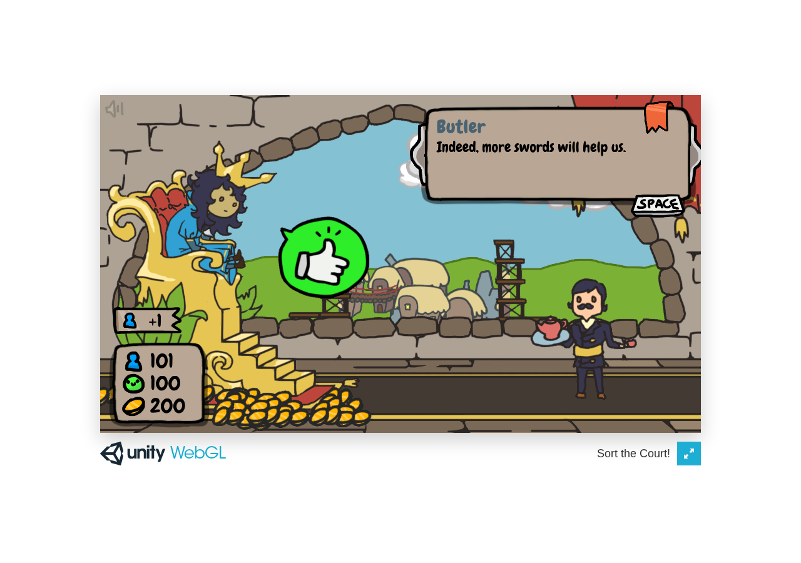
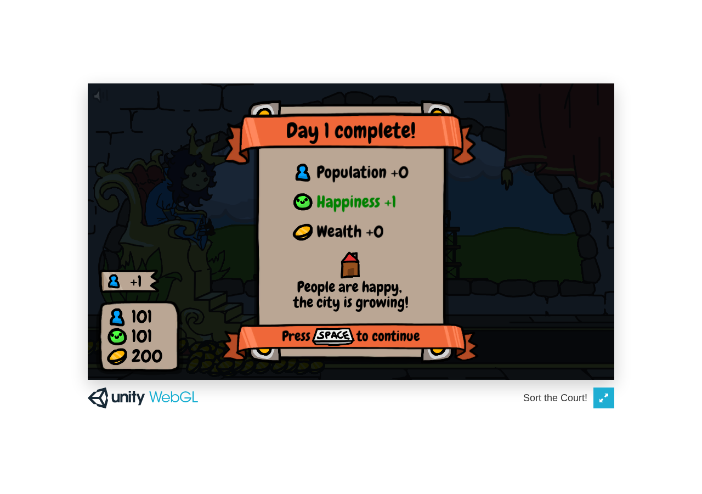

# Sort the Court! — one complete day

**Observed November 14, 2026. Agent-operated browser play, not a human participant session.** A new Queen run completed the tutorial and Day 1. The later kingdom, Council of Crowns, long-term balance and overall ending were not tested.

| Identity | Record |
|---|---|
| Public entry | [Creator's itch page](https://graebor.itch.io/sort-the-court) |
| Played artifact | [Linked public iframe](https://html-classic.itch.zone/html/347310/index.html), visibly labelled **Version 2.2.0** |
| Actual window | 09:22:54–09:28:40 UTC in the direct game; itch entry captured at 09:22:26 |
| Environment | Chromium 151.0.7922.173, Linux, 1280×900; canvas coordinate clicks, then actual Y/N and Space keyboard input |
| Evidence | [Selected capture identities](evidence.json); complete private captures 91–111, including every decision and response |
| Limitations | Canvas text was read from screenshots, not hidden game state. No audio, real phone, tablet, screen-reader, restart persistence or later-day claim. |

## What I actually did

| UTC / steps | Intent and action | Visible outcome |
|---|---|---|
| 09:22–09:23 / 91–95 | Opened the creator page, then its public game iframe; selected New Game and Queen | The start screen displayed version 2.2.0. Initial counters were population 100, happiness 100 and gold 200. The advisor taught yes/no through one concrete question. |
| 09:23–09:25 / 96–101 | Pressed Y to acknowledge the rule; used Space through the explanatory passages | Confirmation and continuation were distinct inputs. A speech bubble, character and persistent counters provided a stable layout. The first visitor offered gold for citizens' souls. |
| 09:25 / 102–103 | Refused Georgie's offer with N | The refusal received an immediate response and a red thumbs-down icon. Counters remained 100/100/200. Red represented refusal rather than an observed bad outcome. |
| 09:26 / 104–106 | Read the guard proposal and accepted a stranger with Y | The Butler acknowledged the additional swords, and population visibly rose to 101. The green icon appeared alongside the exact numerical change. |
| 09:27 / 107–109 | Agreed to capture the roaming chicken | The reply described danger, and population fell by one to 100, despite the same green yes icon. A simple verb did not guarantee a beneficial consequence. |
| 09:28 / 110–111 | Agreed that a citizen was cool, then continued | Happiness rose to 101. Day 1 summary reported population +0, happiness +1 and wealth +0, followed by a separate growth tick taking population to 101. Stopped at the explicit day boundary. |

## Criticism from several perspectives

| Perspective | Observed strength or friction | Implication for Borrowed Words |
|---|---|---|
| Player | A two-key decision is immediately understandable, while consequences still surprise. Capturing a chicken caused a cost I had not predicted. | Keep the basic verb small; put complexity into interpretation and remembered consequence, not control discovery. |
| Systems designer | Immediate reactions, individual stat deltas and the day summary provide three views of cause and accumulation. The final growth tick is distinct from the sum of decisions. | Show the notebook's response and retain the original action in a ledger. At the ending, echo actual earlier choices rather than a generic moral label. |
| Art/interaction | Character silhouettes and staging distinguish speakers; the decision balloon remains stable. Green/red encode yes/no even when yes harms a resource. | Give accept and correct equal visual weight. Do not teach that one option is the universally correct route through color alone. |
| Operator/accessibility | The original creator page explicitly directs mobile/other-language users to a newer Poki version and warns about old builds. This session tested the older desktop artifact only. | Pin the tested artifact and support claim; do not transfer another host's device/language claims to our own build. Canvas accessibility was not established by working keyboard shortcuts. |

## Comparison with published criticism

[Dora's Jay Is Games review, January 2, 2016](https://jayisgames.com/review/sort-the-court.php), read after Day 1, describes a small yes/no simulation whose effects are not always known immediately. My chicken outcome supports that interpretation in this later version. Its comments ask for a clearer endpoint and content-completion signal. I observed an effective **day** boundary, not overall completion. Historical character counts and targets were not revalidated and are not reused as current facts.

## Decision and remaining question

Adopt separate commit/continue actions, a durable consequence ledger and an explicit chapter endpoint. Do not import an endless resource loop into the short diary story. Whether players voluntarily replay a different interpretation must be observed in our own human sessions; completing Day 1 here does not establish retention or enjoyment for Notebook.
