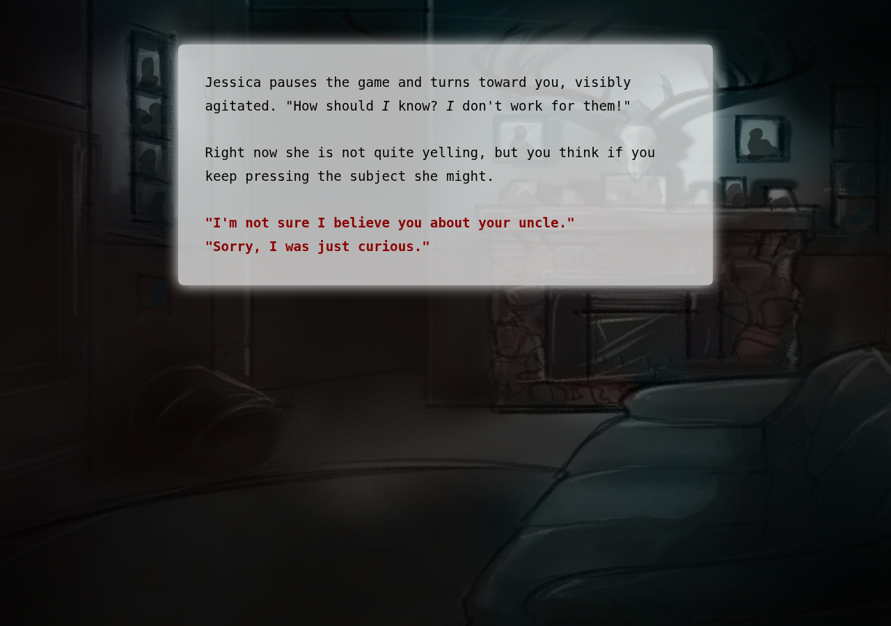
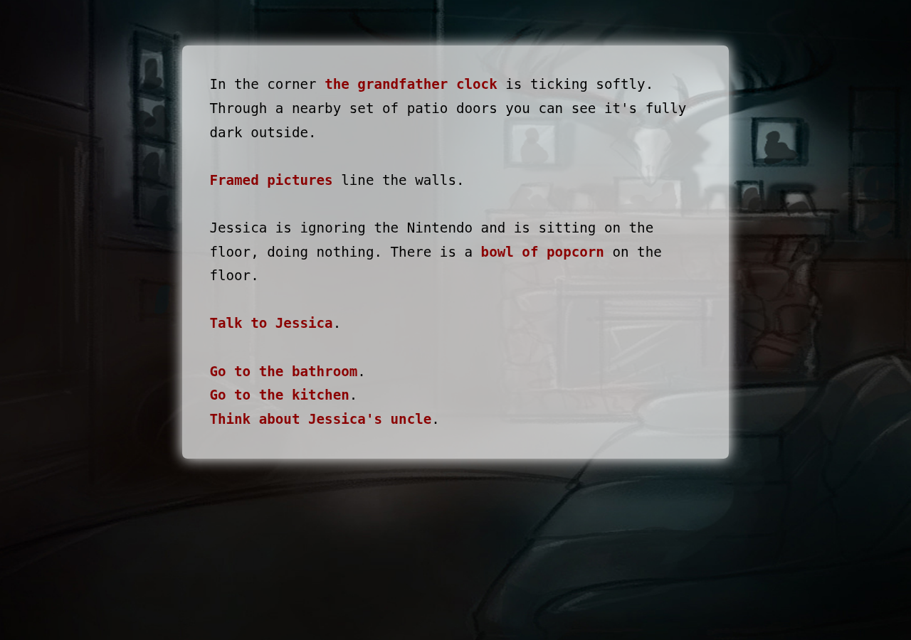

# The Uncle Who Works for Nintendo — a bounded player journey

**Observed November 14, 2026. Agent-operated browser play, not a human participant session.** This was a first exploratory attempt, stopped at the visible in-game 10:00 clock before midnight. No ending, complete-route coverage, retention or human enjoyment result is claimed.

| Identity | Record |
|---|---|
| Public entry | [Creator's itch page](https://ztul.itch.io/the-uncle-who-works-for-nintendo) |
| Played artifact | [Public iframe linked by that page](https://html-classic.itch.zone/html/485403/UWWFN/Files/index.html); no displayed semantic version observed |
| Actual window | 09:03:43–09:22:16 UTC; initial itch access/blank embed observed from 09:03:01 |
| Environment | Chromium 151.0.7922.173, Linux, 1280×900 desktop viewport; pointer actions through Playwright |
| Evidence | [Selected capture identities](evidence.json); original step JSON/PNGs, driver and errors retained privately under `research/right/uncle-nintendo` |
| Limitations | Audio was not audibly assessed. No phone/tablet, keyboard-only, assistive-technology or alternative-ending test. Direct public iframe used after embedded view remained blank. |

## What I actually did

| UTC / captured steps | Goal and action | Observed consequence and interpretation |
|---|---|---|
| 09:03–09:05 / 3–7 | Opened content warnings, returned, started the story | The page explained its tension/content scope before entry. The start action then offered the friend's name. A hidden duplicate title initially confused the driver; a visible link resolved it. |
| 09:05–09:07 / 8–17 | Chose Jessica; inspected the link about asking mother; returned; chose a friendly goodbye and entered the house | The optional detail revealed the narrator's concern about household costs and returned to the same passage. Inspection and continuation were different operations, although both looked like red text links. |
| 09:08–09:10 / 18–31 | Explored the television detail, dinner, unusual consoles and the uncle claim; inspected the clock | An ordinary comfortable room established the baseline. The visible clock read 7:00. Some scene transitions temporarily showed no text; normal waiting restored the next passage. |
| 09:10–09:13 / 32–47 | Talked about games, chose becoming another person as their appeal, followed the discussion of exclusion, apologized and affirmed friendship | The conversation expanded into relationship-specific choices and a grateful response. It did not require a tactical puzzle solution to express a position. The room then returned with changed time/light. |
| 09:13–09:17 / 48–65 | Recalled the friend's unusually strong Pokémon, explored the kitchen and took soda; received the mother's announcement | The memory was accessible through a detour, while the late visitor was introduced again in the present. I could inspect context before challenging the claim. |
| 09:17–09:20 / 66–78 | Pressed why the uncle was visiting, disputed his job, did not retaliate after being pushed, then asked whether Jessica was okay | The friend's agitation became explicit. On returning to the room, Jessica was no longer playing and the Watch action was absent. This was a visible consequence, not an inferred hidden relationship score. |
| 09:20–09:22 / 79–90 | Inspected the bathroom, returned, tried talking about school, checked the clock | The conversation was rebuffed; an hour passed, rain began, and the clock showed 10:00. I stopped to preserve a bounded sample and cover the other competitors. No midnight encounter was observed. |

## Criticism from several perspectives

| Perspective | Finding grounded in this attempt | Implication for Borrowed Words |
|---|---|---|
| Player | Naming the friend and making small social choices gave later distrust a personal referent. The changed room made the confrontation legible. This is my interpretation of this route, not a measured human emotion. | Establish one small ordinary exchange before the notebook revises the player's account; make its later callback specific. |
| Narrative designer | Optional memory links return to the current scene; relationship choices and time progression carry different costs. The player can understand an event without consuming the next major action. | Separate inspect-original from commit/correct/accept. Inspection must not spend a choice or secretly advance the story. |
| Interaction/art | Sparse passages and a persistent domestic backdrop support close reading. Uniform red links sometimes conceal the distinction between a detail, an expressive choice and continuation. | Use readable paper text and visibly distinct action labels. Preserve comparison context instead of replacing all evidence with the newest reply. |
| Operator/accessibility | The itch embed was blank while its public iframe worked. Transitional DOM text could include an outgoing passage, and long rendering waits complicated automation. No audible or mobile claim is justified. | Test actual entry URLs and delayed transitions; avoid blank blocked states and allow reveal skipping. A loaded storefront is not a completed game test. |

## Comparison with published criticism

[Dora's Jay Is Games review, October 15, 2014](https://jayisgames.com/review/the-uncle-who-works-for-nintendo.php), was read **after** this attempt. It emphasizes exploratory detail, gradual unease and sound rather than jump scares. My route supports the detail-and-consequence observations; it cannot verify the review's sound, endings or replay assessment. Some reader comments describe fatigue while searching for endings. Those comments suggest a replay-cost question for Notebook, not a population-level finding or a reason to copy a walkthrough.

The article's hints were not used during the recorded route. Current game version was not equated with the review's 2014 build.

## Decision and remaining question

Adopt short contextual detours, explicit causal callbacks and a readable ordinary setting that becomes suspect. Do not adopt indistinguishable inspect/commit controls or forced waits. Notebook's human study should ask which earlier words caused a changed reply, without telling the player what answer is expected. The route here does not establish that our own implementation is frightening, enjoyable or worth replaying.
