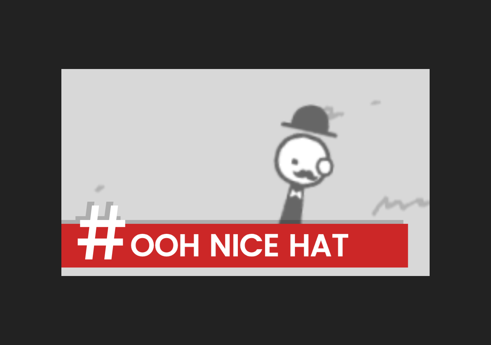
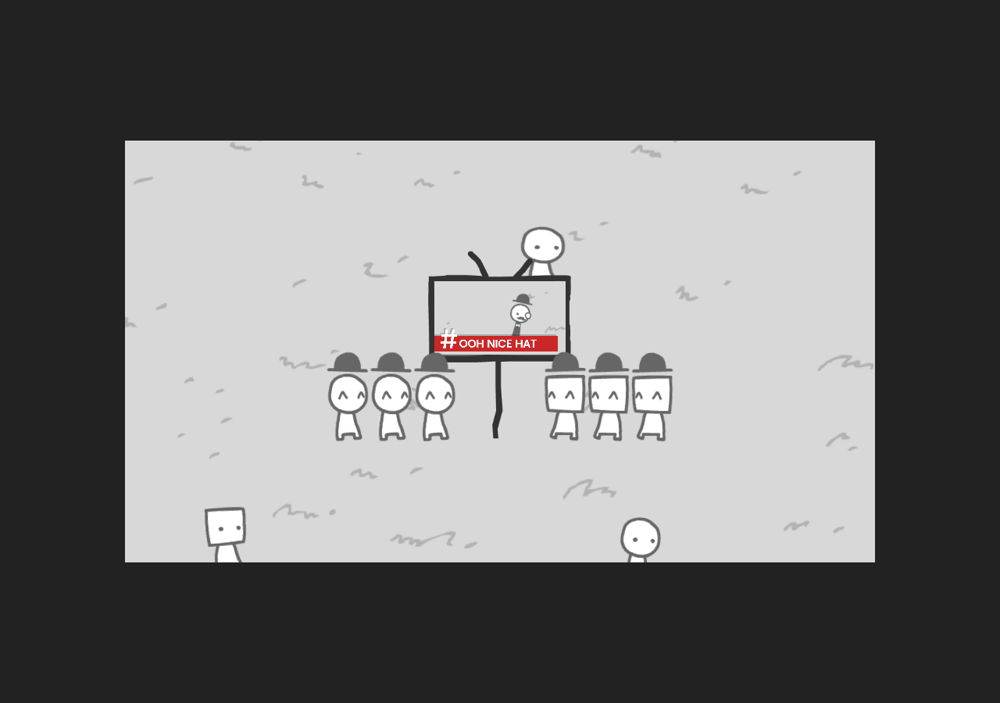

# We Become What We Behold — framing, headlines and a visible response

**Observed November 14, 2026. Two bounded agent-operated browser attempts, not human playtests.** The first attempt captured ordinary and empty scenes. A separate replay reached the hat headline and the crowd adopting hats. Later conflict escalation and the ending were **not** reached or claimed.

| Identity | Record |
|---|---|
| Public entry | [Nicky Case's itch page](https://ncase.itch.io/wbwwb) |
| Played artifact | Public iframe `https://html-classic.itch.zone/html/300364/index.html?v=1782253839`, linked by the entry page; no semantic version observed |
| Attempt 1 | 09:29:13–09:32:13 UTC; manual agent-selected screenshot coordinates through Playwright |
| Attempt 2 | 09:34:15–09:35:43 UTC; restarted browser, observed normal intro, then one screenshot-pixel-assisted camera click |
| Environment | Chromium 151.0.7922.173, Linux, 1280×900; audio not audibly assessed; no mobile/accessibility/end-to-end claim |
| Evidence | [Selected capture identities](evidence.json); private first-run steps 112–122 and replay steps 1–5, original target screenshot, helper and failed attempts retained |

## What I actually did

| UTC / attempt | Goal and input | Visible consequence |
|---|---|---|
| 09:29 / first | Opened the itch page and linked game, read the visible content warning, pressed Play | A short quotation led to a moving crowd and a camera frame. The title advertises five minutes; this record does not verify that completion time. |
| 09:30 / first | Tried to frame a distinctive figure using a previously captured screen position | A normal figure was captured instead, then published on the central television with the headline **just a normal peep**. |
| 09:31 / first | Tried the hat-wearer's earlier position | The target had moved. The empty capture produced **WOWWEE, IT'S NOTHING**. Another broad shot produced an ordinary-group headline. Tool round-trip latency materially affected aiming. |
| 09:34 / replay | Restarted rather than altering the game's state or timing; played the intro normally | This was a learned second attempt, not another fresh observation. An early target attempt during the quotation found nothing and was retained as a failed tool action. |
| 09:35 / replay | Used the screenshot-only aid described below to click the visible hat-wearer | The captured person appeared with **OOH NICE HAT**. After normal elapsed time, six figures around the television visibly wore hats. This verifies an early capture → headline → world-response loop. |
| 09:35:43 / replay | Stopped at the visible group response | No later hostility, violence, whole-story completion or replay preference was measured. |

### Exact automation boundary

Moving figures travelled substantially between separate tool calls. To test one consequential capture without changing the simulation, the replay helper took a fresh PNG, located a compact dark figure using only visible pixel components, and immediately sent a real mouse click at its screen coordinates. The recorded selected box was `[925,341,963,407]`, click `(944,374)`, before the published hat image. It did not read canvas/game variables, call hidden game actions, change clocks or pause/accelerate the simulation. This is explicitly an **automation-assisted agent action**, unsuitable as human aiming-performance evidence.

## Criticism from several perspectives

| Perspective | Finding grounded in these attempts | Implication for Borrowed Words |
|---|---|---|
| Player | A mundane shot and an empty shot received different editorial responses. The gap between what I selected and what the medium called it was immediately visible. | Keep original player wording separate from the notebook's reinterpretation; let the player inspect both. |
| Narrative designer | The hat photograph returned as a headline, then as a visible social pattern. Meaning was carried by a repeatable action and its consequence, not only explanatory text. | Make revising or accepting a phrase produce an observable change in the next reply and ending. A decorative ink effect alone is insufficient. |
| Interaction/art | Simple figures and a central television make the feedback path readable. Tool-mediated target acquisition was difficult; it does not prove that ordinary human pointing is difficult. | Use stable authored word targets with keyboard equivalents. Avoid moving targets or precision gestures for essential story decisions. |
| Operator/agency | The early headlines reward distinctive framing and dismiss ordinary material. These observations do not establish all later options or the global branching structure. | Do not force sensational or confrontational choices by treating quiet acceptance as invalid. Both Notebook endings must remain complete authored outcomes. |

## Comparison with published criticism

[Kyle Weber's RAWG review, September 19, 2020](https://rawg.io/reviews/1069161), was read after the attempts. It describes the game as a brief, strongly directed message experience and praises the fit between its interaction and intended message. My hat loop supports the interaction/message connection; I cannot independently endorse its ending or long-term memorability assessment. This is one player's published criticism, not a representative audience sample. A Brainwavez review fetch failed with 403 and a Leetdom page returned 410; neither is presented as a fully read source.

The creator also links [the game's public source](https://github.com/ncase/wbwwb) from itch. Source availability is a useful future architecture reference; this session did not inspect its internal state to win or copy its implementation into Notebook.

## Decision and remaining question

Adopt the separation between source, interpretation and a visible downstream change. Preserve ordinary choices and show their consequences rather than demanding the most dramatic response. Ask our human testers to explain one original phrase and what the notebook did with it. The runs here establish a design mechanism worth testing, not that our chapter is fun, frightening or socially meaningful.
