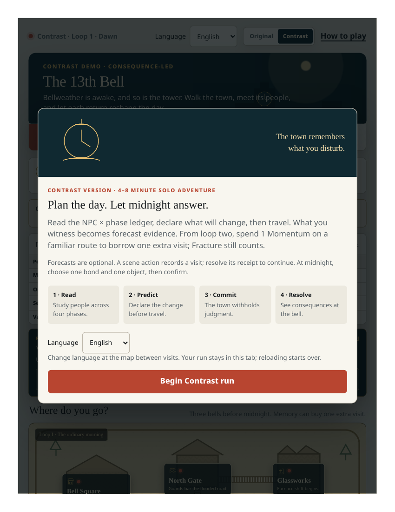
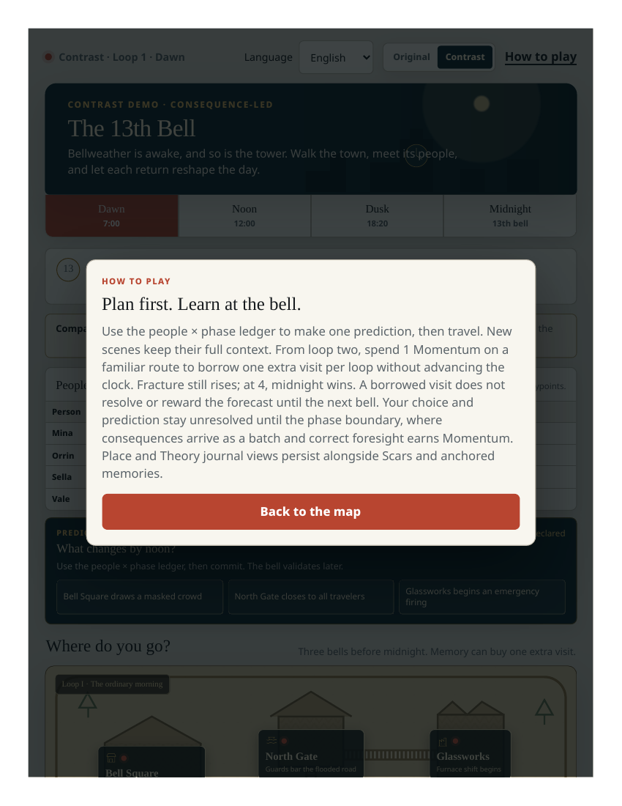
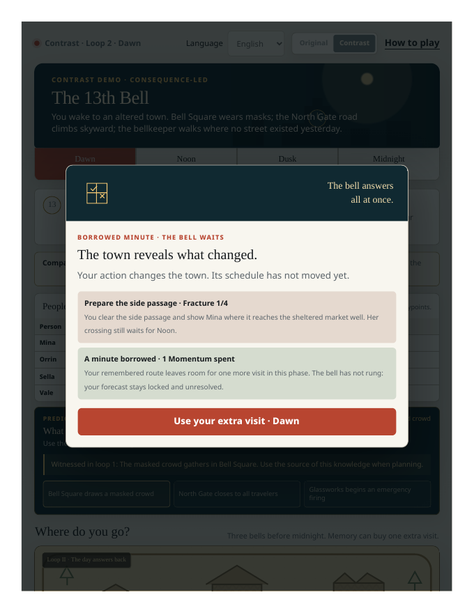
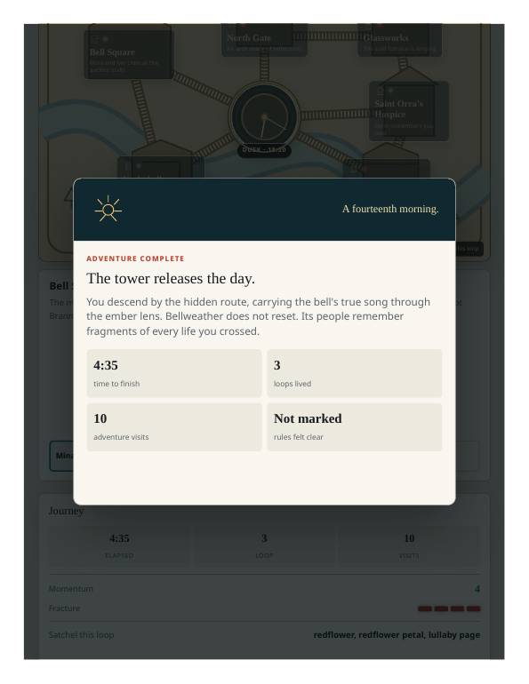

# The 13th Bell — Art and Sensory Journey (2026-11-17)

Companion to `journey--bell-0.2.0-2026-11-17.md`. Same session, same evidence (`evidence/bell/`).

## Journey board (Contrast run — 8 beats)

| Beat | What the player sees | What it does | Evidence |
|---|---|---|---|
| 1. Arrival | "The 13th Bell" / "Bellweather is awake, and so is the tower. Walk the town, meet its people, and let each return reshape the day." / "Contrast · Loop 1 · Dawn" | The promise is a day that answers back. The town is awake before the player acts. | `00-start` |
| 2. Learning | The start modal: "The town remembers what you disturb." Four steps: 1·Read, 2·Predict, 3·Commit, 4·Resolve. Then How to play: "Plan first. Learn at the bell." | The rule is now taught, not hidden: the modal states the borrow, the How to play states the whole rule. October's center defect is taught away. | `00-start`, `01-how-to-play` |
| 3. Meaningful choice | The people × phase ledger: four people, four phases. Mina: Flower auction / Market crossing / Roof lanterns / Tower vigil. Prediction "What changes by noon?" — "Bell Square draws a masked crowd" locked. | The ledger is the planning surface: the player reads patterns, not waypoints. The prediction is a bet made before travel. | `02-mina` |
| 4. Confusion / recovery | Loop 1 Dusk: the ledger updates (Mina: Auction stalls at Noon and Dusk). Prediction "Where does midnight strike first?" — "Underbell opens below the tower" selected. | The ledger changes under the player: what was true at Dawn is not true at Dusk. The recovery is the ledger itself — it always shows the current truth. | `03-dusk1` |
| 5. Escalation | The borrowed visit: "The bell answers all at once." / "BORROWED MINUTE · THE BELL WAITS" / "Prepare the side passage · Fracture 1/4" / "A minute borrowed · 1 Momentum spent". | The escalation is mechanical: the player spends Momentum to buy time, and Fracture counts the cost. The rule is felt, not read. | `04-borrowed` |
| 6. Payoff | Loop 3 Dusk: "Dawn arrives in pieces. Streets overlap, voices echo ahead of their speakers, and the tower door stands open." / "Bring three anchored memories to the clocktower." / Witness note: "Witnessed in loop 1: Underbell opens before the thirteenth bell." | The payoff is memory made visible: what the player saw in Loop 1 becomes planning evidence in Loop 3. The town is coming apart and the text says so plainly. | `05-dusk3` |
| 7. Ending | "A fourteenth morning." / "ADVENTURE COMPLETE" / "The tower releases the day." / "You descend by the hidden route, carrying the bell's true song through the ember lens. Bellweather does not reset. Its people remember fragments of every life you crossed." / 4:35, 3 loops, 10 visits, Not marked / rules felt clear. | The ending is a release, not a score: the town keeps its memories and lets the player go. The stats are a receipt, not a grade. | `06-ending` |
| 8. Exit / re-entry | "Your run stays in this tab; reloading starts over." | The exit is a clean cut: no save, no resume. Re-entry is a new run. | `00-start` |

## Journey board (three locales — 3 beats)

| Beat | What the player sees | What it does | Evidence |
|---|---|---|---|
| 1. English — the run | The full Contrast run in English, start modal to "Adventure Complete". | The English run is the reference: every rule stated, every beat played. | `00-start`–`06-ending` |
| 2. Japanese — the map | "十三番目の鐘" / "コントラスト・ループ1・夜明け" / ledger "人物×時間帯の一覧" / prediction "正午までに何が変わる？" (未宣言) / map "ループI・いつもどおりの朝". | The Japanese map renders fully — the ledger, the prediction, the town — but the run was never completed, so the locale is proven as a surface, not as a play. | `07-map-ja` |
| 3. Simplified Chinese — the map | "第十三声钟" / "对照 · 循环1 · 黎明" / ledger "人物×时段记录表" / prediction "到正午时会发生什么变化？" (尚未宣告) / map "循环I · 平常的早晨". | Same as Japanese: the surface renders, the run is unproven. | `08-map-zh-hans` |

## Art questions (answered from play)

- **Composition:** Dark header (title + tagline), phase bar (Dawn / Noon / Dusk / Midnight), ledger, prediction panel, map. The layout never changes between loops — the player learns it once, then reads it three times.
- **Silhouette:** The map is the silhouette: a line-drawn town with named places (Bell Square, North Gate, Glassworks) and a "You are here" marker. It is the only object the player navigates, and it looks like a town.
- **Text / scale:** Short lines throughout ("The town remembers what you disturb.", "A fourteenth morning."). The longest text is the How to play rule — and it earns its length, because it is the whole rule.
- **Clue fairness:** The ledger is the fairness: every person's schedule is visible before the player predicts. The prediction is a bet on a visible pattern, not a guess at a hidden one.
- **Acknowledgment / motion:** The borrowed-visit modal is the acknowledgment (Momentum spent, phase held, forecast locked). The ending's stats are the settled result. Motion is minimal — the game is mostly still text, ledger, and map.
- **Style / action:** Dark, clock-towered, unhurried. The actions are reading, predicting, traveling, resolving — all small, all committed once made.
- **Memory:** The witness note IS the memory: "Witnessed in loop 1" carries what the player saw into Loop 3. The game ends by handing the player their own observations back.
- **Cue redundancy:** The phase bar repeats the loop and phase in the header and in the ledger; the "Three bells before midnight" line repeats under the map. The redundancy is the tutorial.
- **Sound:** Not assessed — the play runs were silent (no audio evidence captured). [OPEN]
- **Social authorship:** The player is the author (their predictions + their witnesses make the run). The game is a town, not a writer.

## Evidence strips

**Strip 1 — clue → theory → action → confirmation (prediction):** The ledger shows Mina at the Flower auction at Dawn and the Auction stalls at Noon and Dusk (clue) → the player predicts "Underbell opens below the tower" (theory) → the player travels and the phase boundary arrives (action) → the consequences arrive as a batch and correct foresight earns Momentum (confirmation — and the confirmation is a batch, not a single ding).

**Strip 2 — before → acknowledgment → settled result (borrowed visit):** Before: Momentum 2, phase Dawn, forecast locked. Acknowledgment: the modal — "A minute borrowed · 1 Momentum spent", "Your remembered route leaves room for one more visit in this phase. The bell has not rung; your forecast stays locked and unresolved." Settled result: the extra visit is used, the phase holds, Fracture 1/4. The rule leaves the screen as a spent resource.

**Strip 3 — first appearance → later reinterpretation (the witness note):** First appearance: Loop 1, "Underbell opens below the tower" — a prediction, a guess. Later: Loop 3, "Witnessed in loop 1: Underbell opens before the thirteenth bell. Use the source of this knowledge when planning." — and the player realizes the prediction was never a guess; it was the first observation, carried forward. The loop's memory is the game.

## Evidence gallery

Contrast start modal [REAL] — "The town remembers what you disturb." "CONTRAST VERSION · 4–8 MINUTE SOLO ADVENTURE", "Plan the day. Let midnight answer." "From loop two, spend 1 Momentum on a familiar route to borrow one extra visit; Fracture still counts." Four steps: Read, Predict, Commit, Resolve. Button: "Begin a Contrast run".

How to play [REAL] — "Plan first. Learn at the bell." The full advance rule: borrow one extra visit per loop without advancing the clock; Fracture still rises; at 4, midnight wins; a borrowed visit does not resolve or reward the forecast until the next bell; consequences arrive as a batch; correct foresight earns Momentum. Button: "Back to the map".

Borrowed visit [REAL] — "The bell answers all at once." "BORROWED MINUTE · THE BELL WAITS", "The town reveals what changed." "Prepare the side passage · Fracture 1/4 — You clear the side passage and show Mina where it reaches the sheltered market well. Her crossing still waits for Noon." "A minute borrowed · 1 Momentum spent". Button: "Use your extra visit · Dawn".

Adventure Complete [REAL] — "A fourteenth morning." "ADVENTURE COMPLETE", "The tower releases the day." "You descend by the hidden route, carrying the bell's true song through the ember lens. Bellweather does not reset. Its people remember fragments of every life you crossed." Stats: 4:35 time to finish, 3 loops lived, 10 adventure visits, Not marked / rules felt clear.
