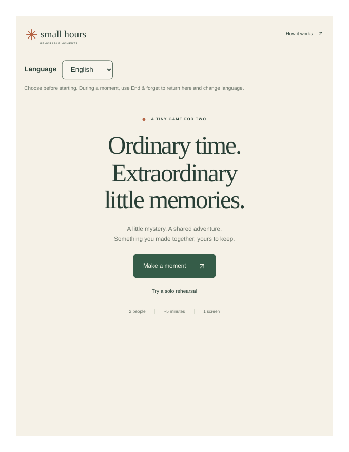
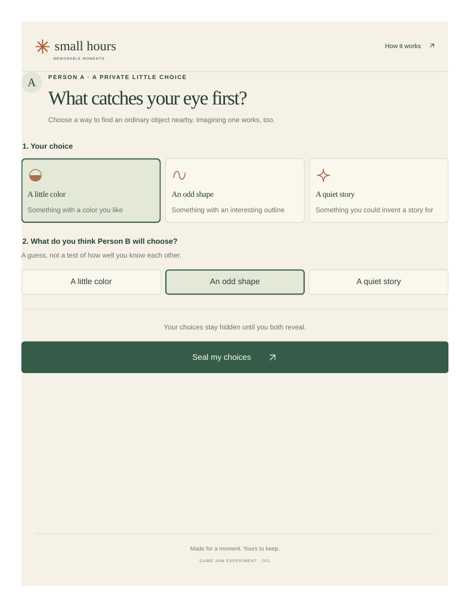
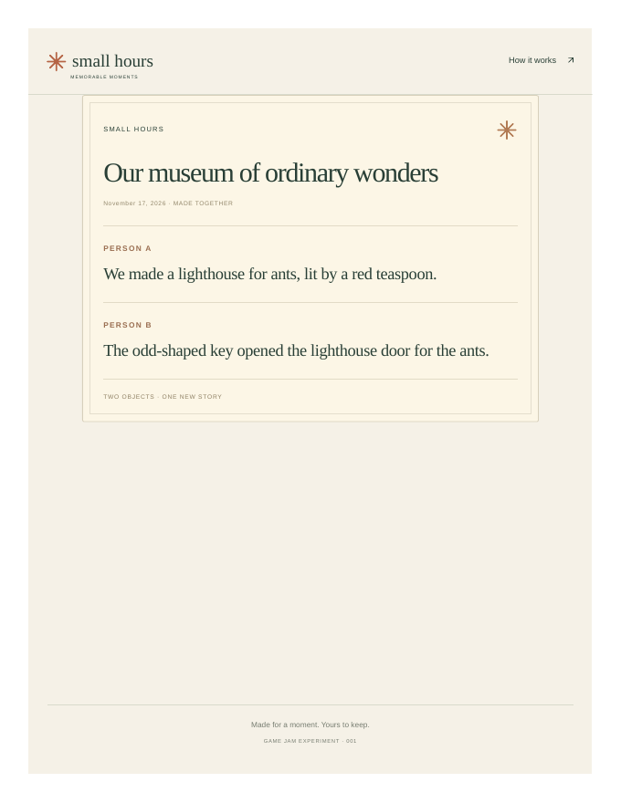

# Small Hours — Art and Sensory Journey (2026-11-17)

Companion to `journey--small-hours-2026-11-17.md`. Same session, same evidence (`evidence/moments/`).

## Journey board (pair flow — 8 beats, English museum)

| Beat | What the player sees | What it does | Evidence |
|---|---|---|---|
| 1. Arrival | "Ordinary time. Extraordinary little memories." "2 people · ~5 minutes · 1 screen." Language selector at the top. | The promise is small and the time is small. Nothing oversells. | `00-entry` |
| 2. Learning | Four steps: 01 Choose a scene / 02 A little mystery / 03 Make a moment / 04 Keep a detail. Three scenes: pocket museum, impossible postcard, weather for two. | The four steps are the whole game on one screen — the player always knows where they are. | `01-choice` |
| 3. Meaningful choice | The privacy curtain: "A LITTLE PRIVACY, PLEASE — Person A, this is your turn." + "I have the screen". | The curtain is a social ritual, not a lock: "This curtain hides answers on screen; it does not secure the device." The game trusts the players. | `01-choice` |
| 4. Confusion / recovery | Two choice sections share the same three labels ("1. Your choice" / "2. What do you think Person B will choose?"). | The only confusing beat: the sections look identical until read. The recovery is the section heading — if the player reads it. | `01-choice` |
| 5. Escalation | The reveal: both choices and both guesses shown; the mismatch is named kindly. | The escalation is emotional, not mechanical: the reveal names the match or the mismatch kindly. | task prose [SECONDARY] |
| 6. Payoff | The activity ("Make something with this") → "We made our moment" → the detail step ("One detail, just from you"). | The payoff is making, not winning. The detail is the smallest possible creative act. | `02-keepsake` |
| 7. Ending | The keepsake postcard: "Our museum of ordinary wonders — November 17, 2026 · MADE TOGETHER — PERSON A: We made a lighthouse for ants, lit by a red teaspoon. — PERSON B: The odd-shaped key opened the lighthouse door for the ants. — TWO OBJECTS · ONE NEW STORY". | The keepsake is the game object: two details side by side, unranked, dated. "TWO OBJECTS · ONE NEW STORY" is the game's best line in this round. | `02-keepsake` |
| 8. Exit / re-entry | "Save our keepsake ↓" (verified SVG download) + "Make another moment". "Your keepsake lives here until you leave or reload." | The exit is a download, not a score screen. Re-entry is one click ("Make another moment"). | `keepsake--museum-en.svg` |

## Journey board (three locales — 3 beats)

| Beat | What the player sees | What it does | Evidence |
|---|---|---|---|
| 1. English — museum | "Our museum of ordinary wonders" — a lighthouse for ants, lit by a red teaspoon; an odd-shaped key opening the lighthouse door. | The English keepsake is the museum made strange: two ordinary objects become one new story. | `02-keepsake`, `keepsake--museum-en.svg` |
| 2. Japanese — postcard | "ふたりのありえない場所からのはがき" — a sleepy moon dropping lighthouse light on an upside-down sea; ants saying goodnight to the sleepy moon. "地図はない · ふたりだけ". | The Japanese keepsake keeps its own voice: the same structure, different poetry. "No map, just us" survives the crossing. | `keepsake--postcard-ja.svg` |
| 3. Simplified Chinese — weather | "我们在这里时的天气" — sunlight warming the wind's footsteps; the wind carrying sunlight's laughter to every cloud. "只会发生一次的预报". | The Chinese keepsake closes on its own line: a forecast that only happens once. The localization is a voice, not a translation. | `keepsake--weather-zh-hans.svg` |

## Art questions (answered from play)

- **Composition:** Four numbered steps across the top; one scene at a time below. The layout never changes between locales — the player learns it once.
- **Silhouette:** The postcard is the silhouette: a bordered card with two details and a date. It is the only object the game makes, and it looks like a keepsake.
- **Text / scale:** Short lines throughout ("Ordinary time. Extraordinary little memories.", "TWO OBJECTS · ONE NEW STORY"). The longest text is the curtain's honesty clause — and it earns its length.
- **Clue fairness:** Not applicable in the puzzle sense; the "fairness" here is social (the curtain tells the truth about what it can and cannot do).
- **Acknowledgment / motion:** The reveal is the acknowledgment (both choices shown, neither judged). The keepsake's render is the settled result. Motion is minimal — the game is mostly still text and cards.
- **Style / action:** Warm, paper-like, unhurried. The actions are choosing, guessing, sealing, detailing — all small, all reversible until the seal.
- **Memory:** The keepsake IS the memory: dated, two-voiced, downloadable. The game ends by handing the players their own words back.
- **Cue redundancy:** The step numbers (01–04) repeat in the header and in the flow; the "I have the screen" button repeats at every curtain. The redundancy is the tutorial.
- **Sound:** Not assessed — the play runs were silent (no audio evidence captured). [OPEN]
- **Social authorship:** The players are the authors (their choices + their details make the keepsake). The game is a frame, not a writer.

## Evidence strips

**Strip 1 — clue → theory → action → confirmation (pair choice):** A chooses "A little color" and guesses B will choose "An odd shape" (theory about the other person) → B chooses and guesses (action) → the reveal shows both, names the mismatch kindly (confirmation — and the confirmation is kind, not scored).

**Strip 2 — before → acknowledgment → settled result (keepsake):** Before: two sealed choices and two details, hidden from each other. Acknowledgment: the keepsake renders both details side by side with a date. Settled result: the SVG downloads — "An image file, no account needed. Nothing is uploaded." The moment leaves the screen as a file.

**Strip 3 — first appearance → later reinterpretation (the keepsake across locales):** First appearance: the English museum keepsake ("Our museum of ordinary wonders"). Later: the Japanese postcard keepsake ("ふたりのありえない場所からのはがき") and the Chinese weather keepsake ("我们在这里时的天气") — and the player realizes the keepsake was never one card; it is a shape that holds each locale's own words. The localization is the game.

## Evidence gallery

Entry screen [REAL] — "Ordinary time. Extraordinary little memories." Buttons "Make a moment" and "Try a solo rehearsal"; "2 people · ~5 minutes · 1 screen". Language selector set to English, with the note "Choose before starting. During a moment, use End & forget to return here and change language."

Person A choice [REAL] — "What catches your eye first?" "A little color" highlighted in section 1, above the guess section showing "An odd shape" selected. The two sections share option labels, so the section heading carries the meaning.

Keepsake screen [REAL] — "Our museum of ordinary wonders — November 17, 2026 · MADE TOGETHER — PERSON A: We made a lighthouse for ants, lit by a red teaspoon. — PERSON B: The odd-shaped key opened the lighthouse door for the ants. — TWO OBJECTS · ONE NEW STORY".
