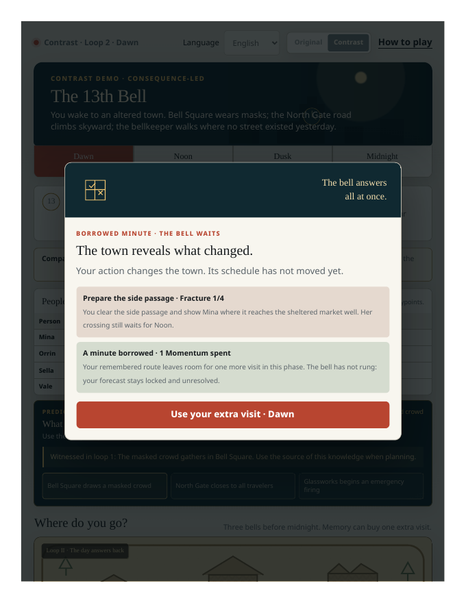
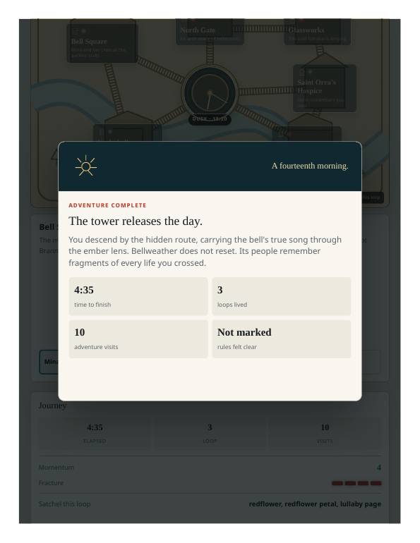

# The 13th Bell — Concept Decision Brief (2026-11-17)

**Demo:** The 13th Bell 0.2.0 (`the-thirteenth-bell` @ `58e5cf1`). **Audience:** the 20 November 2026 release gate. **Evidence:** first-hand Contrast run to the ending ([REAL] for frame-supported states, [SECONDARY] for task-report prose), competitor coverage (`coverage--bell-0.2.0-2026-11-17.md`, carried from October 28), journey + art records. Third-person throughout.

## §1 — Why play it

One town, one day, three loops, one bell. The 13th Bell asks the player to read a ledger, declare what will change, travel, and learn at midnight whether the guess was right. The loop is the premise, not a secret: the town answers back — masks in Bell Square, the road climbing into the sky, the tower door standing open — and what the player witnesses in Loop 1 becomes planning evidence in Loop 3. The demo proves the run works: the full Contrast run reaches "Adventure Complete" in 4:35, the advance rule is stated in-game and works in play (Momentum 2 → 1, one extra visit, phase held, Fracture 1/4), and Dusk → Midnight is played three ways — normal, catastrophe, release. What it cannot prove alone is the fresh player.

## §2 — Why choose it on this platform

| Competitor | What it does | Why Bell instead |
|---|---|---|
| ROLLBACK (free browser) | Loop-deduction; notebook remembers everything; 8 endings | ROLLBACK's notebook is Bell's journal — but ROLLBACK *shows* the notebook as a first-class object and names its loop rule up front. Bell's witness rule is stricter and more interesting: only seeing counts. |
| Core Rush (free browser) | Loop-mining; the loop is a secret to discover; 12 hidden field notes | Core Rush hides its loop; Bell states its loop. The field notes are Core Rush's eyewitness clues — knowledge hidden in the world. Bell's clues are *earned* by being there. |
| Blue Prince ($29.99) | Puzzle-roguelike; a house that rearranges daily | The daily-reset reference: players accept a loop when the space changes. Bell's Loop 2 town (masks, the road climbs into the sky) is the same move. |
| Until Then ($19.99) | Narrative adventure; a day that will not repeat cleanly | The loop can be emotional, not just mechanical. Bell's Mina is the same bet — the loop matters because a person is in it. |
| Duck Detective ($9.99) | Deduction; observe, deduce, accuse | The player is told what counts as evidence. Bell's boundary panel ("A report or a late visit is not the same as seeing it happen") is the same move — the one place Bell *does* state its rule. |
| Tactical Breach Wizards ($19.99) | Tactics; rewind, plan-then-execute | The prediction idea: declare, then test. Bell's prediction is the same — but Bell never shows the plan's cost until the player pays it. |

No competitor in the six states its loop rule in-game and then lets the player spend a resource on it. Bell 0.2.0 does both: the rule is stated (start modal + How to play) and the borrowed visit is a mechanic with a price (1 Momentum, Fracture still counts). That is the differentiator to protect.

## §3 — Distinctive experience (three candidates)

**Candidate A — the advance rule, stated and working, is the product.** The player reads the rule, spends Momentum, borrows a visit, and feels the phase hold. Supported: the start modal states the borrow, the How to play states the whole rule, and the Loop 2 Dawn borrowed visit proves it in play (Momentum 2 → 1, extra visit granted, phase held, Fracture 1/4). *Keep.*

**Candidate B — the prediction ledger alone is the product.** A table of four people across four phases, read and bet on. Rejected on play evidence: the ledger without travel is a table; the run's meaning comes from the consequences at the phase boundary — the batch resolution, the Momentum earned, the Fracture risen. The ledger is the planning surface, not the game. *Reject as standalone; keep as the surface inside A.*

**Candidate C — the three-locale rendering is the product.** Rejected on play evidence: the locales render (Japanese and Simplified Chinese maps verified), but the Japanese run was never completed and the Original mode was never run — the localization is proven as a surface, not as a play experience. *Reject.*

## Proposed decision

**The 13th Bell 0.2.0 does NOT ADVANCE.** The October 28 condition is met as far as an agent session can meet it: the advance rule is stated in-game (start modal line, new in 0.2.0, `messages.js:162`; full rule in How to play, `messages.js:223`) and the borrowed visit works in play. But advance requires the human gate — six fresh sessions plus an independent human decision — and the gate is empty: no human session, no independent human decision. The 20 November date has passed with the gate unmet. No revision is required by this play, with one open item: spec rules 3/4/5/7 remain unstated in-game (the modal line covers rules 2 + 6 only; `rulesText` is byte-identical frozen → tip). Run the human gate with fresh players who have not read the rule; do not ship on solo evidence alone.

## Evidence ledger

- Journey: `records/journey--bell-0.2.0-2026-11-17.md` (Contrast run, event journals; Japanese start; Original start; drawn route)
- Art/sensory: `records/art--bell-0.2.0-2026-11-17.md` (8-beat Contrast board, 3-beat locale board, three evidence strips)
- Coverage: `records/coverage--bell-0.2.0-2026-11-17.md` (six titles carried from October 28, unchanged; 0 new competitor sessions this round)
- Beats: `evidence/bell/` (PNG + TXT per beat)
- Raw captures: `evidence/bell/pdf/95953d33-0d23-5362-bef6-bf5e63c0fb40/` (13 PDFs, original names)
- Session: `records/session--bell-0.2.0-agent-2026-11-17.md` (agent session, Contrast run, honestly labeled not a human session)
- [OPEN] Six-session human gate: not run; facilitator, participants, reviewer unassigned. The 20 November date has passed with the gate unmet.
- [OPEN] Spec rules 3/4/5/7: unstated in-game. The October 28 patch spec was never applied.
- [OPEN] Japanese Contrast run (started, not completed); Original mode run.
- [OPEN] Vivid 0.2.0: not played — no public URL for its built dist; the preview-branch push awaits the owner's word.
- GitHub issues #30 (advance-rule re-test) and #31 (Dusk → Midnight): both now satisfied in play for Contrast — #30 by the Loop 2 Dawn borrowed visit, #31 by the three Dusk → Midnight paths.

## Evidence gallery

Borrowed visit [REAL] — "The bell answers all at once." "BORROWED MINUTE · THE BELL WAITS", "The town reveals what changed." "Prepare the side passage · Fracture 1/4 — You clear the side passage and show Mina where it reaches the sheltered market well. Her crossing still waits for Noon." "A minute borrowed · 1 Momentum spent". Button: "Use your extra visit · Dawn".

Adventure Complete [REAL] — "A fourteenth morning." "ADVENTURE COMPLETE", "The tower releases the day." "You descend by the hidden route, carrying the bell's true song through the ember lens. Bellweather does not reset. Its people remember fragments of every life you crossed." Stats: 4:35 time to finish, 3 loops lived, 10 adventure visits, Not marked / rules felt clear.
