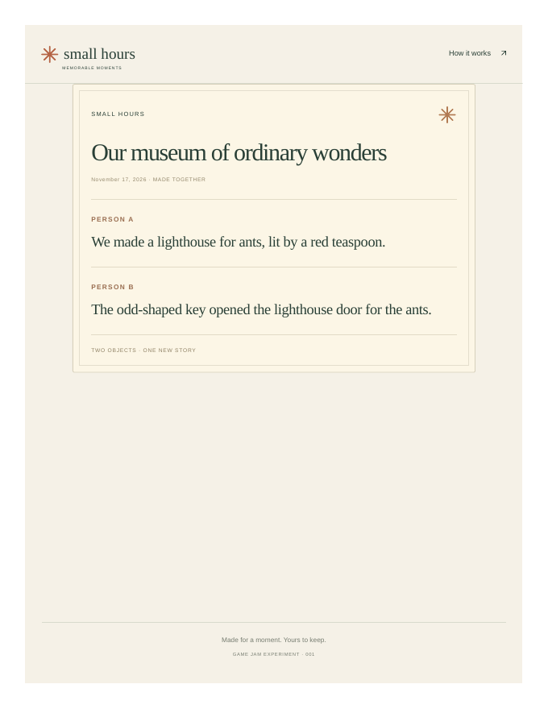

# Small Hours — Concept Decision Brief (2026-11-17)

**Demo:** Small Hours 0.2.0 (`memorable-moments-game` @ `6e09d4f`). **Audience:** the 20 November 2026 release gate. **Evidence:** first-hand pair flows in three locales ([REAL] for frame-supported states, [SECONDARY] for task-report prose), competitor coverage (`coverage--small-hours-2026-11-17.md`, carried from October 28), journey + art records. Third-person throughout.

## §1 — Why play it

Two people, one screen, five minutes, one keepsake. Small Hours asks a pair to choose privately, guess each other, reveal together, and make something small from the difference. The game never scores them and never fails them. The only artifact is a postcard the pair saves — a lighthouse for ants, lit by a red teaspoon; an odd-shaped key opening the lighthouse door — and the only question the design has to answer is whether two real people feel that postcard is worth keeping. The demo proves the machine works in three locales: the full pair flow runs from "Make a moment" to the keepsake screen in English, Japanese, and Simplified Chinese, and the SVG download lands in each (the English SVG verified, 720×850). What it cannot prove alone is the pair.

## §2 — Why choose it on this platform

| Competitor | What it does | Why Small Hours instead |
|---|---|---|
| Gartic Phone (free browser) | Telephone + draw-guess; album export as GIF | Gartic's reveal is the draw chain; Small Hours' reveal is the *difference between two people's choices* — no drawing skill required, and the pair already knows each other. |
| skribbl.io (free browser) | Live draw-guess with strangers | skribbl proves the loop works with zero social context; Small Hours bets the opposite — the pair is the whole game. No strangers, no lobby, no wait. |
| Split Fiction ($49.99) | Two-player co-op story, hours long | The same promise (two people, one story) in five minutes, no account, no purchase, one screen. |
| PICO PARK 2 ($8.99) | One-screen co-op puzzle | Shared screen, shared failure — but PICO PARK 2 fails you. Small Hours has no fail state; there is no wrong answer. |
| Jackbox Party Pack 11 ($29.99) | Party; phones as controllers | The screen is the stage; Small Hours makes the screen the private space, passed back and forth under a curtain. |
| Tiny Glade ($14.99) | Solo make-to-keep diorama | The artifact is the point — but Tiny Glade is solo. Small Hours makes the artifact *together*. |

No competitor in the six makes a keepsake the pair owns. That is the differentiator to protect. This round adds one fact: the keepsake now speaks three locales, each in its own voice — the Japanese postcard ("地図はない · ふたりだけ") and the Chinese weather keepsake ("只会发生一次的预报") are not translations of the English card; they are their own poems.

## §3 — Distinctive experience (three candidates)

**Candidate A — the keepsake is the product.** Two people make a postcard and save it as an SVG. Supported: the full pair flow ran first-hand in three locales; the downloads verified; each keepsake renders both details with a date. *Keep.*

**Candidate B — the reveal alone is the product.** Two private choices, one reveal, nothing made afterwards. Rejected on play evidence: the reveal leads directly into making ("Make something with this. No right answer. The interesting part is what happens next") and the keepsake step; a reveal with nothing made leaves nothing to keep, and the pair flow's own text treats the reveal as a beginning, not an ending. Weaker than in October: the mismatched-guess reveal was not separately observed in this round. *Reject as standalone; keep as the moment inside A.*

**Candidate C — the solo rehearsal is the product.** Rejected: the rehearsal was not played in this round, and October already showed it as a tutorial label ("See the rehearsal reveal"), not a game moment. A solo player has nobody to surprise. *Reject.*

## Proposed decision

**Small Hours 0.2.0 does NOT ADVANCE.** The machine is ready in three locales: the pair flow, the reveal, the keepsake download all ran first-hand. But advance requires the human gate — six real pairs, two people sharing one screen, measured against the release policy (at least 5/6 unaided reveals, 4/6 both contributing, 3/6 voluntarily saving or replaying) — and the gate is empty: no human session, no independent human decision. The 20 November date has passed with the gate unmet. No revision is required by this play; the gate's job is the one thing a solo operator cannot prove. Run the six-pair human gate; do not ship on solo evidence alone.

## Evidence ledger

- Journey: `records/journey--small-hours-2026-11-17.md` (three pair flows, one per locale; event journals; drawn routes)
- Art/sensory: `records/art--small-hours-2026-11-17.md` (8-beat pair board, 3-beat locale board, three evidence strips)
- Coverage: `records/coverage--small-hours-2026-11-17.md` (six titles carried from October 28, unchanged; 0 new competitor sessions this round)
- Beats: `evidence/moments/` (PNG + TXT per beat; three keepsake SVGs, one per locale)
- Raw captures: `evidence/moments/pdf/3d4287c3-b37e-5527-ae00-e6d966cc3492/` (4 PDFs, original names)
- Session: `records/session--small-hours-agent-2026-11-17.md` (agent session, three pair flows, honestly labeled not a true pair)
- [OPEN] Six-pair human gate: not run; facilitator, participants, reviewer unassigned. The 20 November date has passed with the gate unmet.
- [OPEN] Solo rehearsal, 45-second timer, mismatched-guess reveal: not observed in this round.
- [OPEN] Vivid 0.2.0: not played — no public URL for its built dist; the preview-branch push awaits the owner's word.

## Evidence gallery

Keepsake screen [REAL] — "Our museum of ordinary wonders — November 17, 2026 · MADE TOGETHER — PERSON A: We made a lighthouse for ants, lit by a red teaspoon. — PERSON B: The odd-shaped key opened the lighthouse door for the ants. — TWO OBJECTS · ONE NEW STORY", with "Save our keepsake ↓" and "Make another moment" buttons.
