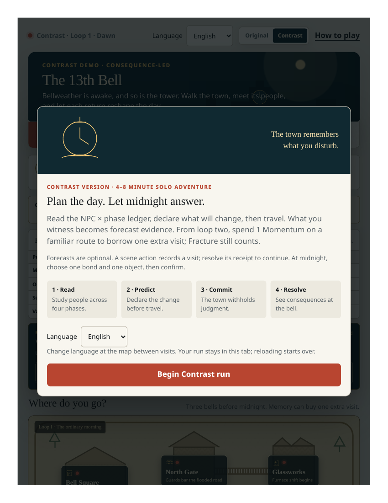
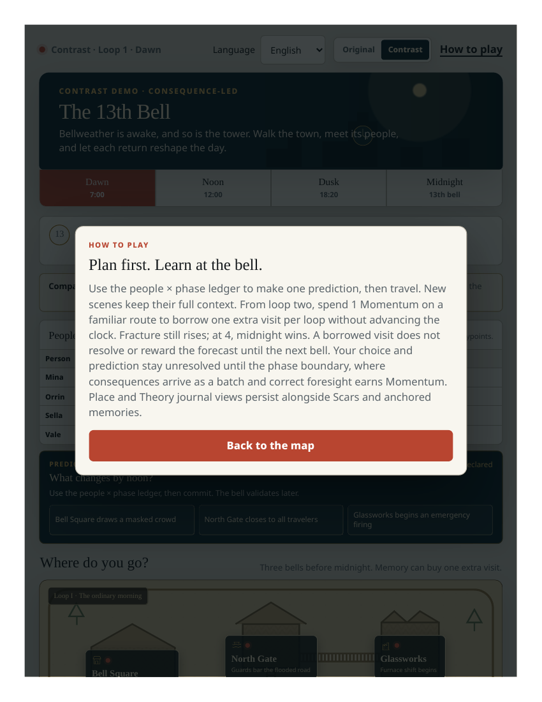
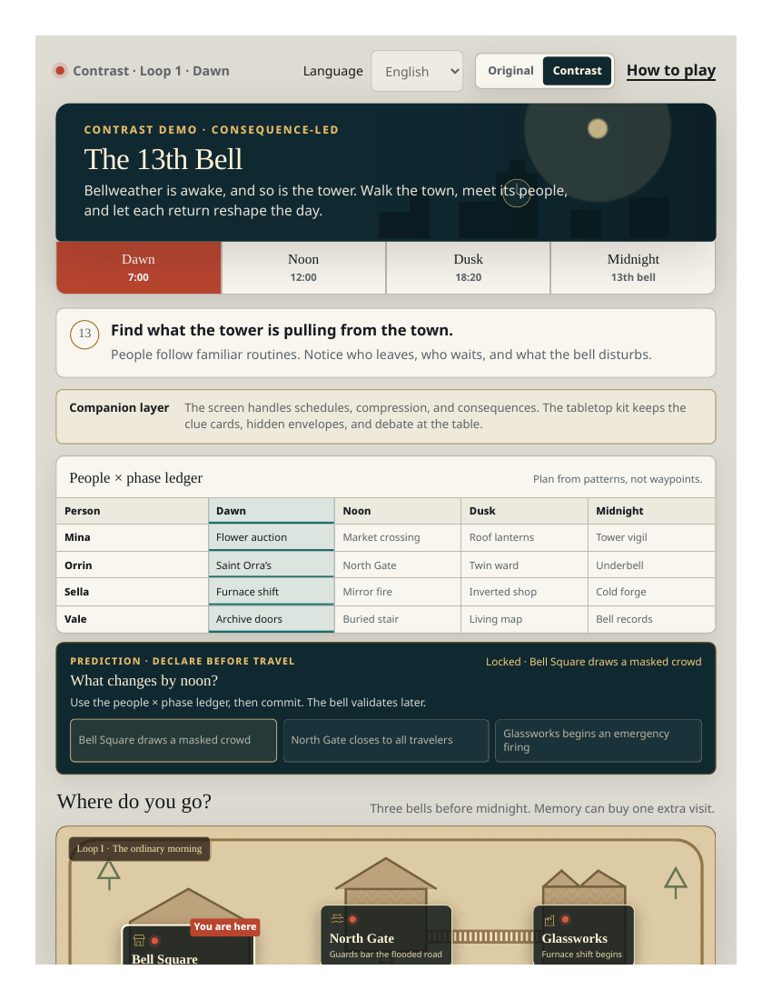
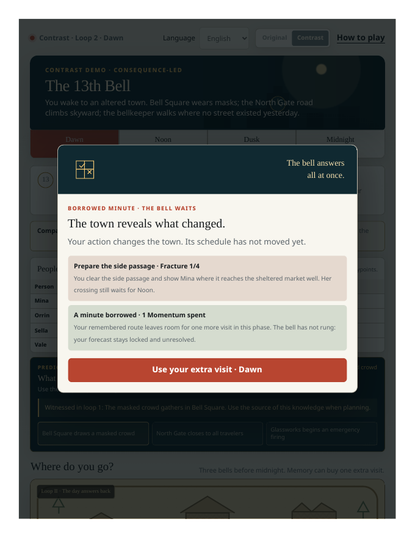
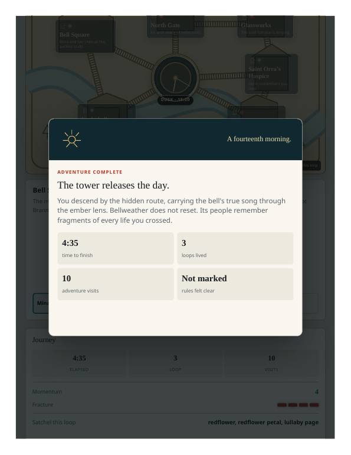

# The 13th Bell — Player Journey Record (2026-11-17)

**Game:** The 13th Bell 0.2.0 (`the-thirteenth-bell` @ `58e5cf1`; built dist `thirteenth-bell-playable-demo.html`, 284,279 bytes, SHA-256 `af89415f841f29249fbb4d81b9204da4e3153159b1bea8d8cdaf1ed855666fa4`).
**Session:** 2026-11-17, first-hand via a browser task against the exact branch bytes served from raw.githack.com pinned to the tip SHA (the agent browser cannot reach loopback URLs; exec Chromium is hard-blocked in this environment). One full Contrast run, English, to "Adventure Complete" in 4:35. One operator, solo.
**Evidence:** `evidence/bell/` — PNG + text dump per beat; raw PDFs under `pdf/95953d33-0d23-5362-bef6-bf5e63c0fb40/`.

## Session identity

- **Edition:** The 13th Bell 0.2.0 (Game Jam experiment 002), Contrast demo, "4–8 minute solo adventure".
- **Routes:** (1) Contrast run, English, full — Loop 1 Dawn → Loop 3 Midnight, ending reached; (2) Contrast run, Japanese, started, not completed; (3) Original mode, start modal only (English + Simplified Chinese).
- **Operator:** one agent, solo. No second human was present.

## Promise and arrival

Entry screen: "The 13th Bell" / "Bellweather is awake, and so is the tower. Walk the town, meet its people, and let each return reshape the day." The promise is a day planned in the morning and answered at midnight: read the people × phase ledger, declare what will change, travel, and let the consequences arrive as a batch at the phase boundary.
Start modal (new in 0.2.0): "The town remembers what you disturb." / "Plan the day. Let midnight answer." / "From loop two, spend 1 Momentum on a familiar route to borrow one extra visit; Fracture still counts." / "At midnight, choose one bond and one object, then confirm." Four steps: 1·Read, 2·Predict, 3·Commit, 4·Resolve. "Begin a Contrast run".

## Event journal (Contrast run — English)

| # | Intention before acting | Observed feedback | Cost / friction | Evidence |
|---|---|---|---|---|
| 1 | Start the Contrast run | Start modal (see Promise and arrival); "Begin a Contrast run" | None | `00-start` |
| 2 | Read the rules | How to play: "Plan first. Learn at the bell." — the full advance rule: borrow one extra visit per loop without advancing the clock; Fracture still rises; at 4, midnight wins; a borrowed visit does not resolve or reward the forecast until the next bell; consequences arrive as a batch; correct foresight earns Momentum. | None — the rule is now stated in-game, where October found it hidden | `01-how-to-play` |
| 3 | Loop 1 Dawn — meet Mina | People × phase ledger: Mina Flower auction / Market crossing / Roof lanterns / Tower vigil; Orrin Saint Orra's / North Gate / Twin ward / Underbell; Sella Furnace shift / Mirror fire / Inverted shop / Cold forge; Vale Archive doors / Buried stair / Living map / Bell records. Prediction "What changes by noon?" — "Bell Square draws a masked crowd" locked. "You are here" at Bell Square. | None | `02-mina` |
| 4 | Loop 1 Dusk | Dusk 18:20; ledger updated (Mina: Auction stalls at Noon and Dusk). Prediction "Where does midnight strike first?" — "Underbell opens below the tower" selected. | None | `03-dusk1` |
| 5 | Loop 1 Midnight — normal | Dusk → Midnight, normal path | None | task prose [SECONDARY] |
| 6 | Loop 2 Dawn — borrow a visit | "The bell answers all at once." / "BORROWED MINUTE · THE BELL WAITS" / "The town reveals what changed." / "Prepare the side passage · Fracture 1/4 — You clear the side passage and show Mina where it reaches the sheltered market well. Her crossing still waits for Noon." / "A minute borrowed · 1 Momentum spent" / "Use your extra visit · Dawn" | **The advance rule works in play: Momentum 2 → 1, one extra visit granted, phase held at Dawn, Fracture 1/4.** | `04-borrowed` |
| 7 | Loop 2 Midnight — catastrophe | Fracture reaches 4; midnight wins | None | task prose [SECONDARY] |
| 8 | Loop 3 Dusk | "Dawn arrives in pieces. Streets overlap, voices echo ahead of their speakers, and the tower door stands open." / Quest: "Bring three anchored memories to the clocktower." / Witness note: "Witnessed in loop 1: Underbell opens before the thirteenth bell. Use the source of this knowledge when planning." / Map: "Loop III · The fractured day". | The Loop 3 Noon prediction buttons were observed disabled in the task report [SECONDARY] | `05-dusk3` |
| 9 | Loop 3 Midnight — release | Dusk → Midnight, release path | The resolution modal's verbatim wording is not in the capture text layer [SECONDARY] | task prose [SECONDARY] |
| 10 | Ending | "A fourteenth morning." / "ADVENTURE COMPLETE" / "The tower releases the day." / "You descend by the hidden route, carrying the bell's true song through the ember lens. Bellweather does not reset. Its people remember fragments of every life you crossed." / 4:35, 3 loops, 10 visits, Not marked / rules felt clear. Momentum 4, Fracture 4, satchel: redflower, redflower petal, lullaby page. | None | `06-ending` |

## Event journal (Japanese Contrast — started, not completed)

| # | Intention | Observed feedback | Cost / friction | Evidence |
|---|---|---|---|---|
| 1 | Start the Contrast run in Japanese | Map rendered in Japanese: "十三番目の鐘" / "コントラスト・ループ1・夜明け" / ledger "人物×時間帯の一覧" (ミナ 花の競り / 市場の横断 / 屋根のランタン / 塔での夜通しの見守り; オーリン; セラ; ヴェイル) / prediction "正午までに何が変わる？" (未宣言) / map "ループI・いつもどおりの朝" | The "I know how to play" button was observed staying Japanese after a JA → EN switch in the task report [SECONDARY] | `07-map-ja` |
| 2 | Complete the run | Not completed [OPEN] | — | — |

## Event journal (Simplified Chinese map + Original start)

| # | Intention | Observed feedback | Cost / friction | Evidence |
|---|---|---|---|---|
| 1 | Map in Simplified Chinese | "第十三声钟" / "对照 · 循环1 · 黎明" / ledger "人物×时段记录表" (米娜 鲜花拍卖 / 穿过市场 / 屋顶灯笼 / 钟守之夜; 奥林; 塞拉; 维尔) / prediction "到正午时会发生什么变化？" (尚未宣告) / map "循环I · 平常的早晨" | None | `08-map-zh-hans` |
| 2 | Original mode | Start modal only, English and Simplified Chinese; no Original run [OPEN] | "Begin a different path" was observed skipping the start modal in the task report [SECONDARY] | raw PDFs |

## Coverage checklist

- [x] Entry + start modal (advance rule stated in-game, new in 0.2.0)
- [x] How to play (full advance rule)
- [x] People × phase ledger (all four people, all four phases)
- [x] Prediction (declared before travel; locked; resolved at the phase boundary)
- [x] Borrowed visit (Loop 2 Dawn, verified: Momentum 2 → 1, extra visit, phase held, Fracture 1/4)
- [x] Dusk → Midnight three ways (normal, catastrophe at Fracture 4, release)
- [x] Ending ("Adventure Complete", 4:35, 3 loops, 10 visits)
- [x] Three locales render (English run; Japanese + Simplified Chinese maps)
- [ ] Japanese Contrast run completed
- [ ] Original mode run
- [ ] Fresh-player re-test (needs a human who has not read the rule)

## Reactions and fun episodes

- The borrowed visit is the run's best moment: the modal says "The bell answers all at once" and then shows the rule working — Momentum spent, phase held, forecast still locked. The rule is no longer hidden; it is a mechanic the player can feel.
- The Loop 3 header ("Dawn arrives in pieces. Streets overlap, voices echo ahead of their speakers, and the tower door stands open.") is the strongest writing in the run — the town is coming apart and the text says so plainly.
- The witness note ("Witnessed in loop 1: Underbell opens before the thirteenth bell") is the loop's memory made visible: what the player saw in Loop 1 becomes planning evidence in Loop 3.
- Friction worth naming: the Loop 3 Noon prediction buttons were observed disabled (task prose); the resolution modal's wording is not in the captures; the Japanese run was never finished.

## Drawn route (Contrast run)

Entry → start modal → How to play → Loop 1 Dawn (Mina, prediction locked) → Loop 1 Dusk (prediction) → Loop 1 Midnight (normal) → Loop 2 Dawn (borrowed visit, Momentum 2 → 1) → Loop 2 Midnight (catastrophe, Fracture 4) → Loop 3 Dusk (anchored memories) → Loop 3 Midnight (release) → **"Adventure Complete" (4:35, 3 loops, 10 visits)**.

## What this record does not claim

- No claim about a fresh player: the operator knew the flow. The October 28 condition (one in-game advance-rule line + fresh-player re-test) is met as far as an agent session can meet it; the re-test itself needs a human.
- No claim about spec rules 3/4/5/7: they remain unstated in-game. The modal line covers spec rules 2 + 6 only; `rulesText` is byte-identical frozen → tip.
- No claim about the Japanese Contrast run (started, not completed) or the Original mode (start modal only).
- No claim about the resolution modal's verbatim wording or the Loop 3 Noon button state beyond the task report [SECONDARY].

## Evidence gallery

Contrast start modal [REAL] — "The town remembers what you disturb." "CONTRAST VERSION · 4–8 MINUTE SOLO ADVENTURE", "Plan the day. Let midnight answer." "From loop two, spend 1 Momentum on a familiar route to borrow one extra visit; Fracture still counts." Four steps: Read, Predict, Commit, Resolve. Button: "Begin a Contrast run".

How to play [REAL] — "Plan first. Learn at the bell." "From loop two, spend 1 Momentum on a familiar route to borrow one extra visit per loop without advancing the clock. Fracture still rises; at 4, midnight wins. A borrowed visit does not resolve or reward the forecast until the next bell. Your choice and prediction stay unresolved until the phase boundary, where consequences arrive as a batch and correct foresight earns Momentum." Button: "Back to the map".

Loop 1 Dawn [REAL] — People × phase ledger: Mina Flower auction / Market crossing / Roof lanterns / Tower vigil; Orrin Saint Orra's / North Gate / Twin ward / Underbell; Sella Furnace shift / Mirror fire / Inverted shop / Cold forge; Vale Archive doors / Buried stair / Living map / Bell records. Prediction "What changes by noon?" — "Bell Square draws a masked crowd" locked. "You are here" at Bell Square.

Borrowed visit [REAL] — "The bell answers all at once." "BORROWED MINUTE · THE BELL WAITS", "The town reveals what changed." "Prepare the side passage · Fracture 1/4 — You clear the side passage and show Mina where it reaches the sheltered market well. Her crossing still waits for Noon." "A minute borrowed · 1 Momentum spent". Button: "Use your extra visit · Dawn".

Adventure Complete [REAL] — "A fourteenth morning." "ADVENTURE COMPLETE", "The tower releases the day." "You descend by the hidden route, carrying the bell's true song through the ember lens. Bellweather does not reset. Its people remember fragments of every life you crossed." Stats: 4:35 time to finish, 3 loops lived, 10 adventure visits, Not marked / rules felt clear.
