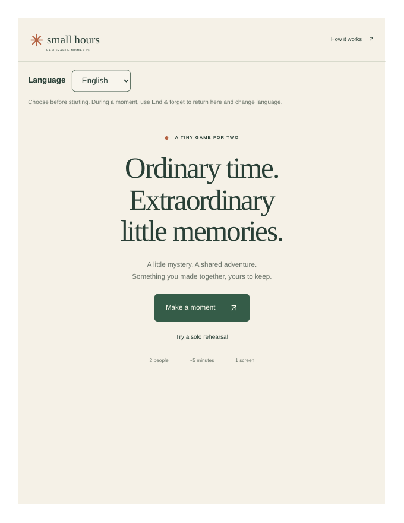
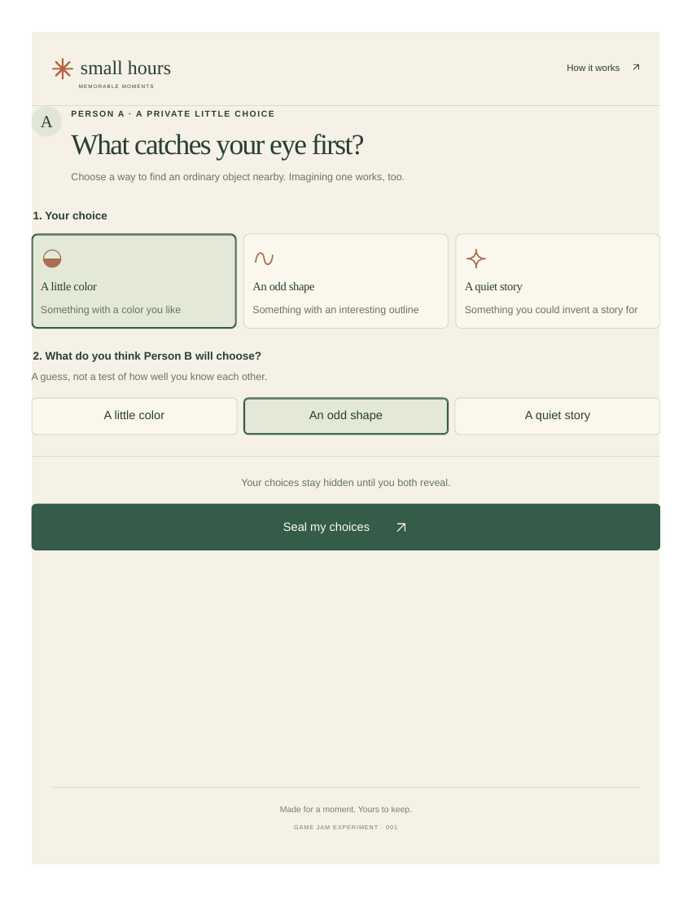
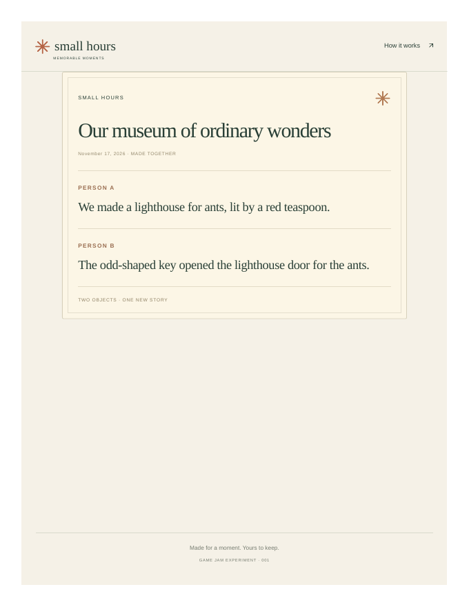

# Small Hours — Player Journey Record (2026-11-17)

**Game:** Small Hours 0.2.0 (`memorable-moments-game` @ `6e09d4f`).
**Session:** 2026-11-17, first-hand via a browser task against the exact branch bytes served from raw.githack.com pinned to the tip SHA (the agent browser cannot reach loopback URLs; exec Chromium is hard-blocked in this environment). Three pair sessions, one per locale: English (museum), Japanese (postcard), Simplified Chinese (weather). One operator played both sides in each — honestly labeled, not a true pair.
**Evidence:** `evidence/moments/` — PNG + text dump per beat; keepsake SVGs banked per locale.

## Session identity

- **Edition:** Small Hours 0.2.0 (Game Jam experiment 001), "2 people · ~5 minutes · 1 screen".
- **Routes:** (1) Pair flow, scene "The pocket museum", English; (2) Pair flow, scene "An impossible postcard", Japanese; (3) Pair flow, scene "Weather for two", Simplified Chinese.
- **Operator:** one agent playing both Person A and Person B in sequence in every locale. No second human was present. All "both contribute" observations are therefore flow proofs, not pair proofs.

## Promise and arrival

Entry screen: "Ordinary time. Extraordinary little memories." Buttons: "Make a moment" + "Try a solo rehearsal". The promise is a small shared memory made in about five minutes, kept as a downloadable keepsake ("An image file, no account needed. Nothing is uploaded"). Language selector at the top: "Choose before starting. During a moment, use End & forget to return here and change language."
Scene chooser (steps 01–04: Choose a scene / A little mystery / Make a moment / Keep a detail). Scenes, the same three in every locale: "The pocket museum", "An impossible postcard", "Weather for two".

## Event journal (pair flow — museum, English)

| # | Intention before acting | Observed feedback | Cost / friction | Evidence |
|---|---|---|---|---|
| 1 | Start the pair flow | Entry screen; "Ordinary time. Extraordinary little memories."; language English | None | `00-entry` |
| 2 | Choose "The pocket museum" | Scene locked in; "Let's play" appears | None | `01-choice` (choice screen, museum) |
| 3 | Begin as Person A | Privacy curtain: "A LITTLE PRIVACY, PLEASE — Person A, this is your turn. … Ask the other person to look away. This curtain hides answers on screen; it does not secure the device." + "I have the screen" | The curtain is honest about its limits (hides, does not secure) — good | `01-choice` (curtain not separately captured) |
| 4 | A chooses "A little color"; guesses B will choose "An odd shape" | "What catches your eye first?" — choice + guess recorded; "Seal my choices" | Two choice sections share the same three option labels — section-scoped clicks are required | `01-choice` |
| 5 | Hand to Person B | B's choice and guess recorded behind the curtain | The B handover curtain was not separately captured [OPEN] | task prose [SECONDARY] |
| 6 | Reveal | Both choices and both guesses shown; the mismatch is named kindly | The mismatched-guess reveal was not separately observed [OPEN] | task prose [SECONDARY] |
| 7 | Activity → "We made our moment" | Step 04 "Keep a detail" begins | The 45-second timer was not observed [OPEN] | task prose [SECONDARY] |
| 8 | A details "We made a lighthouse for ants, lit by a red teaspoon."; B details "The odd-shaped key opened the lighthouse door for the ants." | Detail input with live counter; submit labels as in October | None | `02-keepsake` |
| 9 | Keepsake | "Our museum of ordinary wonders — November 17, 2026 · MADE TOGETHER — PERSON A: We made a lighthouse for ants, lit by a red teaspoon. — PERSON B: The odd-shaped key opened the lighthouse door for the ants. — TWO OBJECTS · ONE NEW STORY" | None | `02-keepsake` |
| 10 | Save the keepsake | **Verified download: keepsake SVG delivered, 720×850, text confirmed** | None | `keepsake--museum-en.svg` |

## Event journal (pair flow — postcard, Japanese)

| # | Intention | Observed feedback | Cost / friction | Evidence |
|---|---|---|---|---|
| 1 | Start the pair flow in Japanese | Entry screen in Japanese; scene chooser, same three scenes | None | task prose [SECONDARY] |
| 2 | Choose "An impossible postcard" | Scene locked in | None | task prose [SECONDARY] |
| 3 | Play both sides through reveal, activity, details | Ending reached; keepsake rendered | Intermediate beats are task prose; no JA frame PNG was banked | task prose [SECONDARY] |
| 4 | Keepsake | "ふたりのありえない場所からのはがき — 2026年11月17日 · ふたりで作りました — Aさん: 逆さまの海に、眠い月が灯台の光を落とした。— Bさん: アリたちは眠い月に「おやすみ」と言った。— 地図はない · ふたりだけ" | None | `keepsake--postcard-ja.svg` |
| 5 | Save the keepsake | SVG delivered | None | `keepsake--postcard-ja.svg` |

## Event journal (pair flow — weather, Simplified Chinese)

| # | Intention | Observed feedback | Cost / friction | Evidence |
|---|---|---|---|---|
| 1 | Start the pair flow in Simplified Chinese | Entry screen in Simplified Chinese; scene chooser, same three scenes | None | task prose [SECONDARY] |
| 2 | Choose "Weather for two" | Scene locked in | None | task prose [SECONDARY] |
| 3 | Play both sides through reveal, activity, details | Ending reached; keepsake rendered | Intermediate beats are task prose; no zh-Hans frame PNG was banked | task prose [SECONDARY] |
| 4 | Keepsake | "我们在这里时的天气 — 2026年11月17日 · 一起创造 — A: 阳光把风的脚步照得暖暖的。— B: 风把阳光的笑声带到了每一朵云上。— 只会发生一次的预报" | None | `keepsake--weather-zh-hans.svg` |
| 5 | Save the keepsake | SVG delivered | None | `keepsake--weather-zh-hans.svg` |

## Coverage checklist

- [x] Entry + scene chooser (all three scenes seen; all three played, one per locale)
- [x] Privacy curtain (A; honesty text read verbatim in English and Simplified Chinese)
- [x] Private choice + guess, both sides, all three locales
- [x] Reveal (all three locales)
- [x] Activity ("Make something with this" → "We made our moment")
- [x] Detail (both sides, in all three locales)
- [x] Keepsake screen + verified SVG download (all three locales)
- [ ] True two-person play (needs humans; the six-pair gate)
- [ ] Solo rehearsal (not played in this round)
- [ ] 45-second timer (not observed in this round)
- [ ] Mismatched-guess reveal (not separately observed in this round)
- [ ] "End & forget" (deliberately never clicked during a run)
- [ ] "Make another moment" loop (not taken)

## Reactions and fun episodes

- The English keepsake ("Our museum of ordinary wonders") is a better artifact than the reveal: it is the thing the pair keeps, and it renders the two details side by side without ranking them.
- The Japanese keepsake carries the same structure in its own words ("地図はない · ふたりだけ" — no map, just us), and the Chinese keepsake closes on its own line ("只会发生一次的预报" — a forecast that only happens once). The localization is not a translation of the keepsake; each locale keeps its own voice.
- The curtain's honesty ("This curtain hides answers on screen; it does not secure the device") is still the game's most trustworthy line.
- Friction worth naming: the B handover curtain went uncaptured in the English run, and the intermediate beats of the Japanese and Chinese runs rest on task prose, not frames — the record is thinner there than in October.

## Drawn route (pair flow, each locale)

Entry → scene chooser → scene → curtain A → A choice + guess → seal → B choice + guess → seal → reveal → activity → "We made our moment" → detail A → detail B → keepsake → **SVG downloaded**.

## What this record does not claim

- No claim about two real people playing: the pair flow was one operator playing both sides in every locale. The six-pair human gate is untested.
- No claim about the solo rehearsal, the 45-second timer, or the mismatched-guess reveal — none was observed in this round.
- No claim about the "End & forget" reset or the "Make another moment" loop.
- No claim about a fourth scene: the source defines exactly three scenes in every locale (`content.js`, `views.js`).

## Evidence gallery

Entry screen [REAL] — "Ordinary time. Extraordinary little memories." Buttons "Make a moment" and "Try a solo rehearsal"; "2 people · ~5 minutes · 1 screen". Language selector set to English, with the note "Choose before starting. During a moment, use End & forget to return here and change language."

Person A choice [REAL] — "What catches your eye first?" "A little color" highlighted in section 1 ("Your choice"); the guess section ("What do you think Person B will choose?") shows "An odd shape" selected. "Your choices stay hidden until you both reveal." Button: "Seal my choices".

Keepsake screen [REAL] — "Our museum of ordinary wonders — November 17, 2026 · MADE TOGETHER — PERSON A: We made a lighthouse for ants, lit by a red teaspoon. — PERSON B: The odd-shaped key opened the lighthouse door for the ants. — TWO OBJECTS · ONE NEW STORY".
