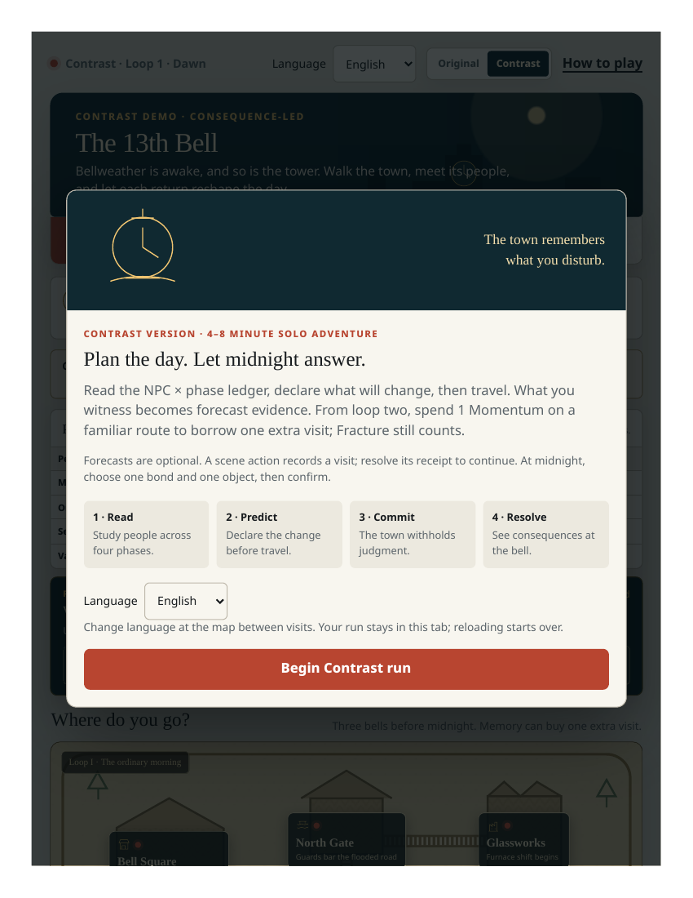
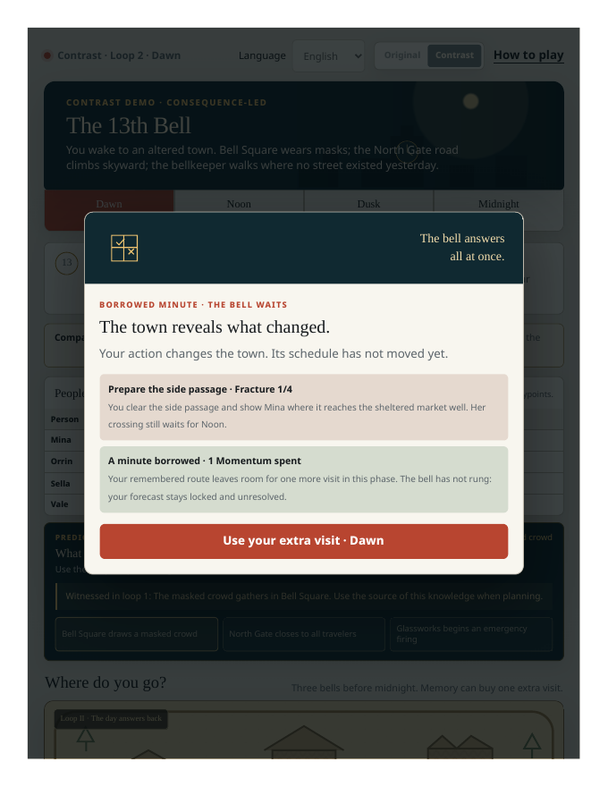
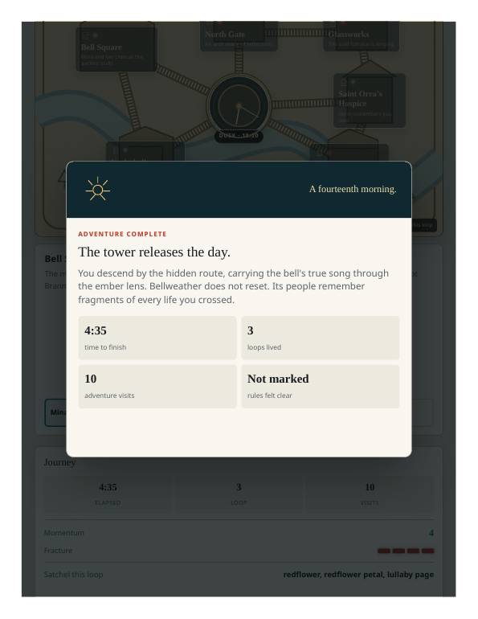

# The 13th Bell — Agent Session Record (2026-11-17)

**AGENT session, not a human session.** Played by one assistant operator, via a browser task against the exact branch bytes served from raw.githack.com pinned to the branch tip SHA, because the agent browser cannot reach loopback URLs and exec Chromium is hard-blocked in this environment. This record follows the October 28 record shape. **It is not gate evidence and enters no release denominator — a solo run by one operator proves the run, not the experience.** Full detail: `records/journey--bell-0.2.0-2026-11-17.md`.

## Identity, preparation and actual timing

- Protocol ID / registration: none — agent session, 2026-11-17, unregistered
- Source commit / build: `the-thirteenth-bell` @ `58e5cf1`; built dist `thirteenth-bell-playable-demo.html`, 284,279 bytes, SHA-256 `af89415f841f29249fbb4d81b9204da4e3153159b1bea8d8cdaf1ed855666fa4`; played from `https://raw.githack.com/PaperStrange/IndiaGames/58e5cf1/...` (same public branch bytes)
- Browser task: `browser-task:95953d33-0d23-5362-bef6-bf5e63c0fb40`, 2026-11-17, 23:32–23:39 PST (runtime-measured)
- Actual date: 2026-11-17
- Participant pseudonym: none — one operator, solo run
- Human observer: none — agent operator, self-observed
- Device: agent browser task; viewport not recorded in the task receipts [OPEN]
- Mode played: Contrast (full run to the ending); Original mode start modal only; Japanese Contrast run started, not completed

## Actual player journey (Contrast run, English)

| Observation | Stage / action | Visible response / consequence | Help, confusion, pause |
|---|---|---|---|
| 1 | Entry | "The 13th Bell" / "Bellweather is awake, and so is the tower. Walk the town, meet its people, and let each return reshape the day." / "Contrast · Loop 1 · Dawn" | none |
| 2 | Start modal | "The town remembers what you disturb." / "CONTRAST VERSION · 4–8 MINUTE SOLO ADVENTURE" / "Plan the day. Let midnight answer." / "Read the NPC × phase ledger, declare what will change, then travel. What you witness becomes forecast evidence. From loop two, spend 1 Momentum on a familiar route to borrow one extra visit; Fracture still counts." / "Forecasts are optional. A scene action records a visit; resolve its receipt to continue. At midnight, choose one bond and one object, then confirm." / 1·Read, 2·Predict, 3·Commit, 4·Resolve / "Begin a Contrast run" | none |
| 3 | How to play | "Plan first. Learn at the bell." / "Use the people × phase ledger to make one prediction, then travel. New scenes keep their full context. From loop two, spend 1 Momentum on a familiar route to borrow one extra visit per loop without advancing the clock. Fracture still rises; at 4, midnight wins. A borrowed visit does not resolve or reward the forecast until the next bell. Your choice and prediction stay unresolved until the phase boundary, where consequences arrive as a batch and correct foresight earns Momentum." / "Back to the map" | none |
| 4 | Loop 1 Dawn — Mina | People × phase ledger (Mina: Flower auction / Market crossing / Roof lanterns / Tower vigil; Orrin: Saint Orra's / North Gate / Twin ward / Underbell; Sella: Furnace shift / Mirror fire / Inverted shop / Cold forge; Vale: Archive doors / Buried stair / Living map / Bell records). Prediction "What changes by noon?" — "Bell Square draws a masked crowd" locked. "You are here" at Bell Square. | none |
| 5 | Loop 1 Dusk | Dusk 18:20; ledger updated (Mina: Auction stalls at Noon and Dusk). Prediction "Where does midnight strike first?" — "Underbell opens below the tower" selected. | none |
| 6 | Loop 2 Dawn — borrowed visit | "The bell answers all at once." / "BORROWED MINUTE · THE BELL WAITS" / "The town reveals what changed." / "Your action changes the town. Its schedule has not moved yet." / "Prepare the side passage · Fracture 1/4 — You clear the side passage and show Mina where it reaches the sheltered market well. Her crossing still waits for Noon." / "A minute borrowed · 1 Momentum spent — Your remembered route leaves room for one more visit in this phase. The bell has not rung; your forecast stays locked and unresolved." / "Use your extra visit · Dawn" | **Advance rule verified in play: Momentum 2 → 1, one extra visit granted, phase held at Dawn, Fracture 1/4.** |
| 7 | Loop 3 Dusk | "Dawn arrives in pieces. Streets overlap, voices echo ahead of their speakers, and the tower door stands open." / Quest: "Bring three anchored memories to the clocktower." / Witness note: "Witnessed in loop 1: Underbell opens before the thirteenth bell. Use the source of this knowledge when planning." / Map: "Loop III · The fractured day". | The Loop 3 Noon prediction buttons were observed disabled in the task report [SECONDARY] |
| 8 | Midnight — release | Dusk → Midnight via the release path (Loop 3) | The resolution modal's verbatim wording is not in the capture text layer [SECONDARY] |
| 9 | Ending | "A fourteenth morning." / "ADVENTURE COMPLETE" / "The tower releases the day." / "You descend by the hidden route, carrying the bell's true song through the ember lens. Bellweather does not reset. Its people remember fragments of every life you crossed." / 4:35 time to finish, 3 loops lived, 10 adventure visits, Not marked / rules felt clear. Momentum 4, Fracture 4, satchel: redflower, redflower petal, lullaby page. | none |

## Other modes and locales

- Japanese Contrast: run started, map rendered in Japanese ("十三番目の鐘", "コントラスト・ループ1・夜明け"), not completed [OPEN]. The "I know how to play" button was observed staying Japanese after a JA → EN switch in the task report [SECONDARY].
- Simplified Chinese Contrast: map rendered ("第十三声钟", "对照 · 循环1 · 黎明"), run not completed [OPEN].
- Original mode: start modal only, English and Simplified Chinese; no Original run [OPEN]. "Begin a different path" was observed skipping the start modal in the task report [SECONDARY].

## Outcome and assistance evidence

| Field | Agent value | Reason |
|---|---|---|
| `reached_ending_unaided` | true (agent) | "Adventure Complete" reached with no help; but "unaided" here means unassisted by a human — the operator knew the flow |
| `advance_rule_verified_in_play` | true (agent) | Loop 2 Dawn borrowed visit: Momentum 2 → 1, extra visit granted, phase held, Fracture 1/4 |
| `dusk_to_midnight_three_ways` | true (agent) | Normal (Loop 1), catastrophe at Fracture 4 (Loop 2), release (Loop 3) |

- Save/replay: not applicable — the run is a single tab; reloading starts over ("Your run stays in this tab; reloading starts over").
- Issues: none found in the Contrast run. The advance rule is now stated in-game (start modal + How to play) and works in play — the October 28 center defect is closed as far as an agent session can close it. Spec rules 3/4/5/7 remain unstated in-game [OPEN].
- Evidence against the desired hypothesis: a solo operator run proves the run, not the experience — whether a fresh player reads the rule, plans from the ledger, and feels the loop is untested. The six-session human gate is the only way to test it.

## Shareable record check

- [x] Contains only agent observations; no personal text.
- [x] Outcomes reflect this attempt; assistance and failures remain visible (JA run incomplete, Original unplayed, resolution modal wording [SECONDARY], Loop 3 Noon buttons [SECONDARY]).
- [ ] Saved into the private study folder — this record lives in the play dir, not Git, until Sakura confirms it (confirmation gate).

## Evidence gallery

Contrast start modal [REAL] — "The town remembers what you disturb." "CONTRAST VERSION · 4–8 MINUTE SOLO ADVENTURE", "Plan the day. Let midnight answer." "From loop two, spend 1 Momentum on a familiar route to borrow one extra visit; Fracture still counts." Four steps: Read, Predict, Commit, Resolve. Button: "Begin a Contrast run".

Borrowed visit [REAL] — "The bell answers all at once." "BORROWED MINUTE · THE BELL WAITS", "The town reveals what changed." "Prepare the side passage · Fracture 1/4 — You clear the side passage and show Mina where it reaches the sheltered market well. Her crossing still waits for Noon." "A minute borrowed · 1 Momentum spent". Button: "Use your extra visit · Dawn".

Adventure Complete [REAL] — "A fourteenth morning." "ADVENTURE COMPLETE", "The tower releases the day." "You descend by the hidden route, carrying the bell's true song through the ember lens. Bellweather does not reset. Its people remember fragments of every life you crossed." Stats: 4:35 time to finish, 3 loops lived, 10 adventure visits, Not marked / rules felt clear.
