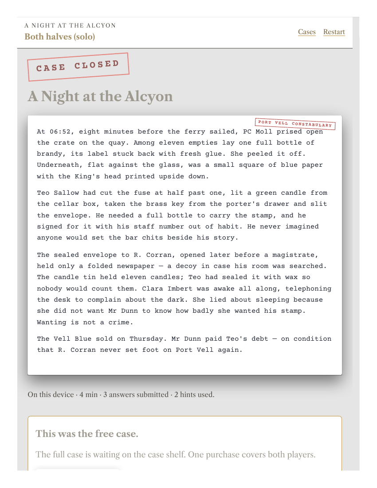
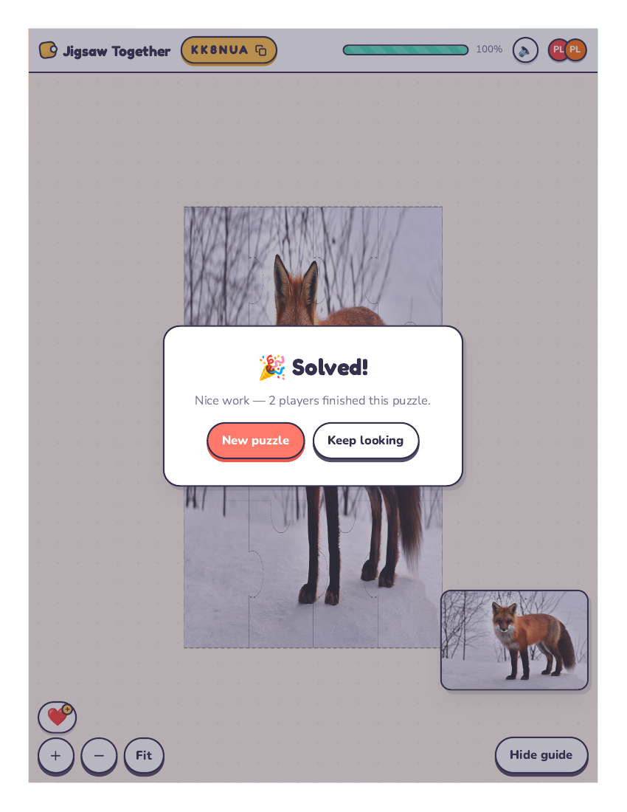
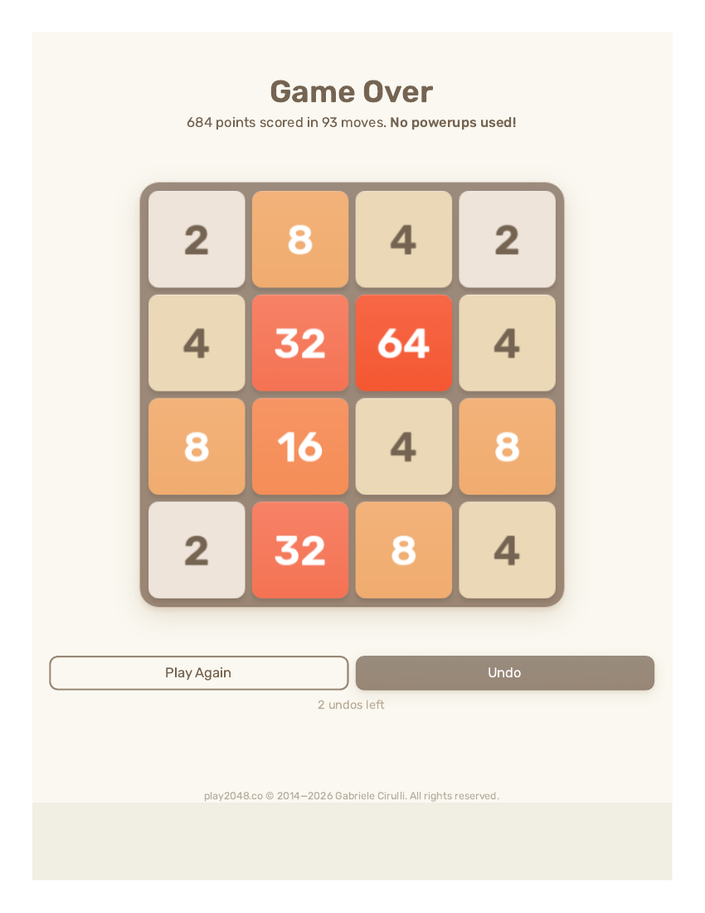

# One-Page Critique — Competitor Scan 2026-11-24

**Verdict: the second-deep-family requirement is MET. The scan closed the gap the Oct-28 and Nov-17 packages left open.**

## What landed

15 browser sessions, 79 PDFs banked. Two deep comparisons from two different families, both solved end to end with full captures:

- **Counterfoil** (narrative-deduction) — the free case solved in 4 minutes, 3 answers, 2 hints. Each player holds half the evidence; the case closes only when the halves meet.
- **Jigsaw Together** (co-op puzzle) — a 12-piece fox solved end to end, two seats live, one picture revealed. No install, no account, no payment.

The strongest contrast of the wave: the shared-story candidates (Fireboy, Connected by Puzzles) both failed in this browser; the simple shared board worked end to end.

## What else the wave proved

- **Draw-guess refreshes** (Gartic, skribbl, Drawasaurus, Drawize): the loop works with strangers — and the operator's own drawing turn fails in every round. The argument for choice-based design, again.
- **Draw a Stickman Episode 2**: the draw-to-play loop works when the surface is SVG, not canvas. The player's drawing IS the character — the closest rival to the keepsake's ownership feeling.
- **High-score family**: 2048's full run (684 points, 93 moves) is the cleanest session of the wave. Codenames Daily adds the retention shape the own games lack — a daily set, a percentile, a countdown to tomorrow.
- **The Missing Heir**: a complete mystery in ~4 minutes, 10 clues, one accusation, a hard ending. Same family as Counterfoil — it does not add a family.

## What stays open

Ten slots [OPEN]: Gartic's telephone loop (needs humans), Drawasaurus drawing turn, Drawize drawing verification, ADOFAI level 0, Fireboy (held keys), Connected by Puzzles (Cloudflare), Slither run, TETR.IO gameplay (WebGL), Slope capture-verified run, EPIC 2 (download). None is a release blocker; each names what would clear it.

## What it means for the own games

No competitor in the fifteen makes a keepsake the pair owns. Small Hours sits between the two deeps — a shared story that ends in a shared picture — and the six-pair human gate is still the only way to test whether two real people feel the keepsake is worth keeping. The high-score family adds the missing retention shape: none of the own games has a reason to return tomorrow.

## Evidence

Counterfoil [REAL] — deep #1.

Jigsaw Together [REAL] — deep #2.

2048 [REAL] — 684 points, 93 moves.
