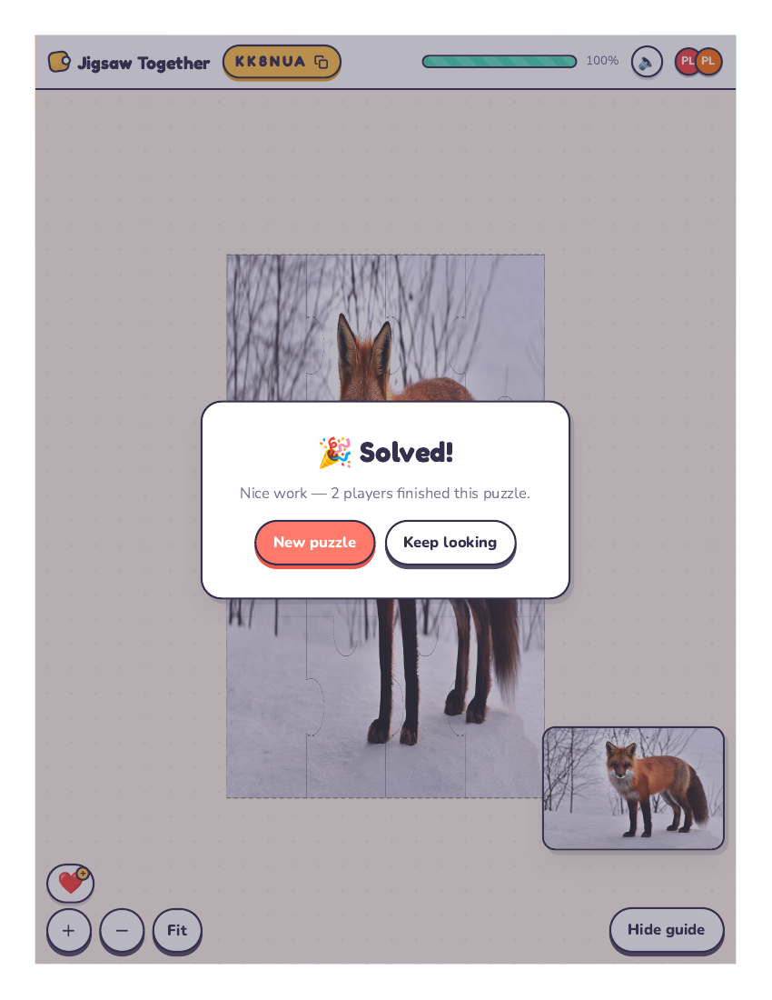
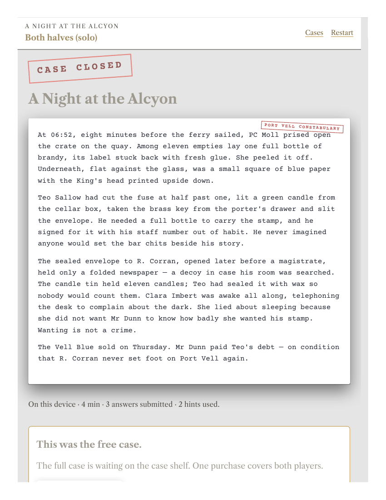
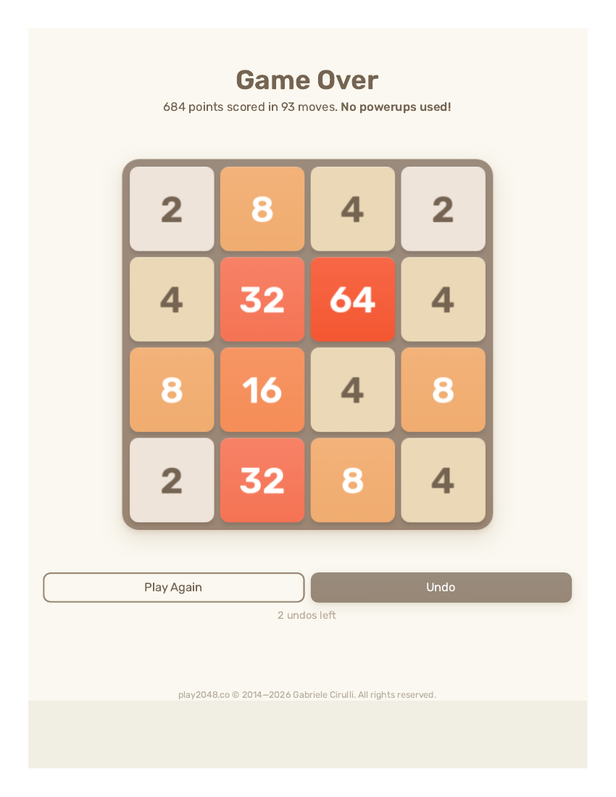
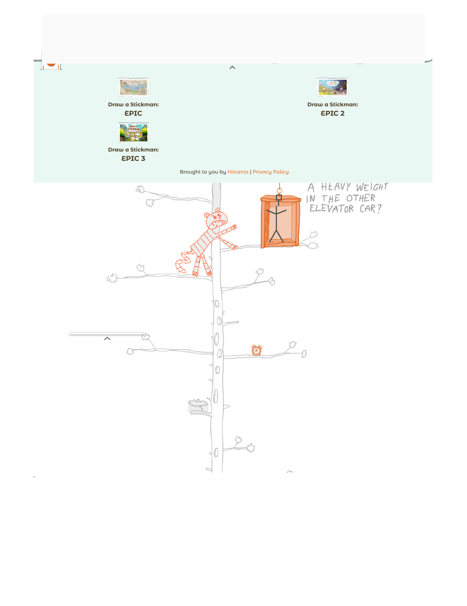

# Competitor Coverage — New Scan (2026-11-24)

**Template:** `competitor-coverage-template.md` — at least 6 distinct studied competitors across at least 4 broad play families (max 2 in one family; at least 2 outside narrative/deduction puzzles; at most 1 same-occasion/attention-only; planned minimum 2 browser editions actually studied; two deep comparisons from different families with full endings/complete activities). A listing-only or access-blocked row is not a studied competitor.
**Sources:** 15 parallel browser-task plays, 2026-11-24 evening PST. Browser-task prose is [SECONDARY] by class; capture-verified items are [REAL]; unsolved slots are [OPEN]. Each session record cites its task id and PDF paths. This scan refreshes the stale Oct-28 set (Gartic Phone, skribbl.io, Drawasaurus, Drawize), fills the open slots (Draw a Stickman, ADOFAI level 0), adds similar-genre titles (Counterfoil, Codenames, The Missing Heir, co-op puzzle discovery) and a high-score family (2048, Slither.io, TETR.IO, Agar.io, Slope).

## The sixteen attempted competitors (15 sessions — the co-op session covers two titles)

| # | Title (creator, date, price) | Family | How studied | What it teaches |
|---|---|---|---|---|
| 1 | **Gartic Phone** (Gartic, 2021, still updated 2026; free in the browser at garticphone.com) | Telephone / draw-and-guess | **Browser-task refresh, partial** (task 08fb14cd, 18:16–18:33 PST): lobby ("PLAYERS 1/14", COOLNICKNAME8264, NORMAL selected) + custom settings (TIME NORMAL, TASK FLOW WRITING/DRAWING, TURNS 4 TURNS, KEEP DRAWING DISABLED, SCOREBOARD OFF) captured [REAL]. Cloudflare blocked the first load (cleared once) and every invite tab, so multiplayer was impossible; turns 3–4 auto-submitted while the tab was unreadable ~15 min; the album was reached but never revealed [OPEN]. The write → draw → guess telephone chain was NOT exercised (Normal mode needs 4–50 humans; the lobby held 1/14). Change-vs-Oct-28 NOT established (no Oct-28 screenshots to compare). 2 PDFs banked. | The telephone loop still needs humans. Gartic's reveal montage + GIF album (Oct-28, verified export) stays the direct rival to the keepsake — and the loop that produces it is still unplayed in this operation. |
| 2 | **skribbl.io** (free in the browser at skribbl.io; no account) | Draw-and-guess (live multiplayer) | **Browser-task refresh, completed game** (task 778081d6, 18:16–18:42 PST): full public game as "BrowserTester", finished #5 with 635 points [SECONDARY for the standings]. Frames [REAL]: Round 1 guessing (Poopity's house, 4+5 hints, 55s), drawing turn "blood" (BLANK canvas — zero strokes placed; canvas targeting failed on screenshot errors), new-game guessing turn (4-letter word, all players at 0 — relabeled from the task's "waiting" label), private-room lobby (Players 8, Drawtime 80, Rounds 3, Normal, Word Count 3, Hints 2, "BrowserTester is now the room owner!"). Multiplayer lobby [OPEN]: ENTER GAME reloaded the homepage twice, no capture. 5 PDFs banked. | Live strangers vs the known pair, again: the draw-guess loop works with zero social context, and the drawing defects (lost strokes) are the argument for choice-based design — no drawing skill, no lost strokes. The operator's own drawing turn failed the same way twice (Oct-28 stove, Nov-24 blood). |
| 3 | **Draw a Stickman: EPIC 2 / Episode 2** (Hitcents; EPIC 2 paid download; Episode 2 free web) | Draw-to-play / creative adventure | **Browser-task, Episode 2 completed, EPIC 2 blocked** (task 6cd34b44, 18:16–18:53 PST): EPIC 2 page (DOWNLOAD + WATCH TRAILER, hero art, no Play button) [REAL] — EPIC 2 NOT played, needs a download/install [OPEN]. Episode 2 played start to finish [REAL]: stickman drawn (square head, DONE/CLEAR), ladder (partial — promo strip cuts the prompt), tiger costume (orange stripes climbing the tree), pulley reveal ("A HEAVY WEIGHT IN THE OTHER ELEVATOR CAR?", alarm clock), ending/share page. Three drawings NOT capture-verified (bucket, weight, wings — their page-2 renders are pixel-identical to the previous beats) [SECONDARY]. Trailer lightbox white/empty ("Ad removed. Details") [REAL]. Market record [SECONDARY]: Google Play 3.7 stars, 1.42M reviews, 10M+ downloads, IAP $0.99–$5.99. 15 PDFs banked. | The draw-to-play loop works in the browser when the surface is SVG, not canvas — slow held strokes drew, where the Nov-17 canvas attempt failed entirely. The player's drawing IS the character: the strongest "you made this" in the set, and the closest rival to the keepsake's ownership feeling. |
| 4 | **A Dance of Fire and Ice** (7th Beat Games / fizzd, v0.4.2 Dec 2018; demo free on itch.io, full $3.99) | Rhythm | **Browser-task, played, not completed** (task e34aaac8, 18:16–18:44 PST): title screen ("Highest Level Reached:0", CONTINUE, red planet on teal tile, white circle unreached) and mid-path (7 tiles colored) captured [REAL]. Level 0 entered and played but NOT completed — white circle unreached, no result screen, "Highest Level Reached:0" throughout [OPEN]. The claimed final state is NOT in its capture (game area BLANK WHITE in print — WebGL print failure) [SECONDARY]. Advance vs earlier rounds: level 0 now entered/played (earlier rounds reached only bare-number calibration). 3 PDFs banked. | Rhythm as a two-player promise: two planets, one beat, zero words. The demo's lobby-path framing (level 0 = the lobby path) is the thing to steal — the game teaches itself before it tests. |
| 5 | **Counterfoil: "A Night at the Alcyon"** (Lantern Vale Studio; free demo case on itch.io, full case paid) | Narrative-deduction (two-player shared-story) | **Browser-task, DEEP — completed** (task 42da457b, 18:16–18:22 PST): title shelf ("3 questions · 12 documents · for two · free", "No account, no subscription"), document A1 (Night Porter's Log), document B6 (Staff Roster), CASE CLOSED ("4 min · 3 answers submitted · 2 hints used", "This was the free case") — all captured [REAL]. Solo mode ("Both halves (solo)") [REAL]; the two-player halves were not played with two people. The resolution is not retold in the record. 4 PDFs banked. | **Deep comparison #1.** The shared-story model done right: each player holds half the evidence, the case closes only when the halves meet. The codeword-gated evidence is the mechanic Small Hours' privacy curtain wants to be — a reason to pass the screen, not just a rule. |
| 6 | **Codenames Daily** (Codenames app; free, solo daily) | Word deduction (solo) | **Browser-task, completed** (task b064e346, 18:24–18:31 PST): solo Codenames Daily completed — result frame [REAL]: 4 stars, 24.11.2026, DISASTERS 2 / FLIGHT 3 / DENTIST 4 / CAMPING 4 all ticked, "Only 22.53% players have beaten today's puzzles without a single mistake", "Next set in 21 h 33 min". Discrepancy caught: the task described a 16-word board, but the frames show a PICTURE board (one green-bordered card visible); the 16 words exist only in the PDFs' text layers, so per-guess word claims are [SECONDARY]. Multiplayer lobby [OPEN]: ENTER GAME reloaded the homepage twice, no capture. 3 PDFs banked. | The daily puzzle as a retention hook: one set a day, a star rating, a percentile ("only 22.53%…"), a countdown to the next set. Small Hours has no reason to return tomorrow; Codenames Daily is the shape of one. |
| 7 | **Drawasaurus** (Drawasaurus Inc.; free at drawasaurus.org; no account) | Draw-and-guess (live multiplayer) | **Browser-task refresh, partial** (task 5030747e, 18:18–19:13 PST): guessing (Rabbit Room, Dead drawing), FULL MOON round-end reveal, game start (word-choice countdown showing 10), Narwhal Room turn, Game Over win ("MuseWatcher won! / #1. MuseWatcher 70 / #2. Kage 64 / #3. Cupcake_ 0 / #4. Dead -5") — all captured [REAL]. The f2 frame resolves the task's uncertainty: it is the FULL MOON reveal, not the AFK screen feared. Drawing turn [OPEN]: the 15-second choice window beat the browser's 5–20s round trips five times; "Swing" was chosen but the turn was cut by an AFK kick; 3 drag strokes unverified. Banned from the Monkey Room ("MuseWatcher was banned by Sharath"); 4 AFK kicks [SECONDARY]. Change-vs-Oct-28 NOT made [OPEN]. 5 PDFs banked. | The 15-second window + strict AFK check are the game's real design: they force fast, continuous attention — and they are exactly what this browser cannot do. The drawing turn has now failed in every round (Oct-28, Oct-29, Nov-24). |
| 8 | **Drawize** (free at drawize.com; no account, guest "Merry Capybara") | Draw-and-guess (live multiplayer) | **Browser-task refresh, completed games** (task a2bc2f20, 18:18–19:12 PST): 7 Quick Play games, games 2 and 7 completed all 7 rounds; results captured [REAL]: game 2 "YOU FINISHED IN 8. PLACE!", game 7 "YOU FINISHED IN 7. PLACE!" (KHAN's watermelon behind the modal). Private room MUNOBE created and waiting [REAL]; matchmaking wait modal ("Looking for other players; please wait", 88s) over Private Rooms, Recent Rooms showing MUNOBE (11/24/2026) and a second room (10/29/2026) [REAL] — both captures the task left unverified, resolved by verification. SNOWMAN turn start and PANTS abort captured [REAL]. Discrepancy: the DIAMOND drawing is NOT on its frame (blank canvas at TIME 1:00 vs the task's claim of a diamond at 0:54) [SECONDARY]. The Quick Play lobby was never captured. Change-vs-Oct-28 NOT made [OPEN]. 12 PDFs banked. | The inactivity abort is the game's immune system — it kills idle players fast (games 1/4/5/6) — and it is also what killed this session's drawing turns. The private-room flow (code + link + waiting) is the cleanest of the three draw-guess titles. |
| 9 | **Jigsaw Together** (free at jigsawtogether.com; no sign-up, no download) | Co-op puzzle (shared board) | **Browser-task, DEEP — completed** (task e7c32e61, 18:32–19:18 PST): private room KK8NUA, Animals picture (red fox in snow), Easy · 12 pieces; 0% → 33% → 100% → "Solved! Nice work — 2 players finished this puzzle." — all captured [REAL]. Two seats live at once (two tabs), both avatars + live cursors on frame. Limitation, stated plainly: both seats were operated by one person in two tabs, not two different people. Alternatives blocked in the same session: Fireboy and Watergirl 1 (Level 1 reached, characters never moved — needs held keys) [OPEN]; Connected by Puzzles (Cloudflare Turnstile gate, 4 clicks, 2 browsers) [OPEN]; Pixo Pals (title screen only). 6 PDFs banked. | **Deep comparison #2.** The shared-board model: two players see the same puzzle, move pieces together, jointly reveal one picture — a photograph, not a score — with no install, account, or payment. Shared-story ambition (Fireboy, Connected by Puzzles) failed in this browser; the simple shared board worked end to end. That contrast is the coverage finding. |
| 10 | **Fireboy and Watergirl 1: Forest Temple** (Coolmath Games; free, no account; 32 levels; 4.6/5, 2,563,184 votes; updated Aug 28, 2026; released Mar 1, 2012) | Co-op puzzle platformer | **Browser-task, blocked** (task e7c32e61, same session as Jigsaw): Coolmath page captured [REAL] (rating, votes, dates, controls A/W/D + arrows, "never mix fire & water"). Level 1 reached, P opened the pause menu, but arrow-key and D-key taps never moved either character and dragging did not move him — the game needs held keys, which this browser's tap-only input cannot supply [OPEN]. CrazyGames: "not available anymore"; guessed Poki URL 404; SilverGames behind Cloudflare [SECONDARY]. 2 PDFs banked (byte-identical renders — the game area is black in both). | The co-op platformer that needs two hands at once — and this browser has no hands. The held-keys wall is a tooling limit, not a game verdict; a person driving the browser clears it. |
| 11 | **The Missing Heir** (Cold Case Club Case 001 by servicoseasy; free demo on itch.io) | Narrative-deduction | **Browser-task, completed** (task 8bebc44d, 18:34–18:52 PST): itch landing, start screen ("COLD CASE CLUB / CASE 001", "The Missing Heir.", "GRAYHAVEN ESTATE · 22:12", "Free demo · Approx. 10 minutes · No downloads required", "Demo v1.2", "No account required to play"), private dock (Location 5 of 5, "10 clues found", "EVIDENCE BOARD 10/10"), ending ("CASE SOLVED — The heir is alive.", "CASE CLOSED — Evidence found: 10/10 · Accusations submitted: 1 · Session: ~4 min", "No payment is collected here") — all captured [REAL]. Complete play start to finish in ~4 min, first-attempt solve. The deduction chain is deliberately NOT recorded. 4 PDFs banked. | Same family as Counterfoil — it does NOT by itself fill the second-deep requirement. What it adds: the 10-minute, 10-clue, one-accusation shape — a complete mystery that fits in a coffee break, with a hard ending ("CASE CLOSED") instead of an open loop. |
| 12 | **2048** (Gabriele Cirulli; free at play2048.co; no account) | High-score (solo puzzle) | **Browser-task, completed** (task 98381617, 18:28–18:41 PST): full run, all three frames verified [REAL] — start (SCORE 0 / BEST 0, two 2-tiles), mid-run (SCORE 212 / BEST 212, best tile 32), Game Over ("684 points scored in 93 moves. No powerups used!", best tile 64, Play Again + Undo, 2 undos left). DOM-rendered — prints fully. Small gap noted: +28 score jump after the ad interruption (444 → 472) with no moves described; final outcome fully verified. "Best: 684 persisted" is [SECONDARY]. 3 PDFs banked. | Cleanest high-score session of the wave. The high-score model in its purest form: one number, one board, no account, no opponent — the score IS the retention. And the score loop is exactly what Small Hours does not have. |
| 13 | **Slither.io** (free at slither.io; no account) | High-score (arcade arena) | **Browser-task, blocked** (task d0a386f6, 18:41–18:56 PST): all three page-1 renders BYTE-IDENTICAL — dark canvas, blank center, corners only ("Graphics: High quality", "Change Skin", "Choose Server"). The canvas menu and loading spinner did not print. No run started — no length, score, death, or leaderboard [OPEN]. Server connection never completed across 5 servers, 2 browsers/routes [SECONDARY]. 3 PDFs banked. | NOT a studied competitor (no run, no playable surface). The arcade-arena promise, untested — the slot stays open until a run starts on a network where the connection completes. |
| 14 | **TETR.IO** (free at tetr.io; guest login) | High-score (arcade puzzle) | **Browser-task, blocked** (task 25ee8add, 18:18–18:28 PST): SOLO picker (GUEST-1119II2, 40 LINES / BLITZ / ZEN LVL 1 / CUSTOM with taglines) and end menus (RETRY / BACK TO TITLE, no results numbers) captured [REAL]. Gameplay PDF is a BLACK shell (WebGL disabled — the page's own warning confirms) [PRINT FAILURE]; all gameplay detail is [SECONDARY]. 40-line completion, results screen, leaderboard chase, hold via C: [OPEN]. No retry (same wall). 4 PDFs banked. | 40 LINES chases time, not points ("score doesn't matter here, just go for the world record!" — text layer [REAL]). The time-chase is the high-score family's other shape — and the one this browser cannot show. |
| 15 | **Slope** (Unity/Y8 version at slopegamefree.org; credited to RobKaySF, Sept 2014; no single official site) | High-score (arcade runner) | **Browser-task, completed live, capture failed** (task 16ca431b, 18:18–18:38 PST): portal start (SLOPE logo, PLAY NOW) and portal text ("credited to RobKaySF… September 2014", score advice, "More Games Like This") captured [REAL]. The game frame is a BLANK dark rectangle in print (Unity/WebGL canvas did not paint); f2–f5 are pixel-identical on all 10 pages [PRINT FAILURE]. All gameplay (3 runs, best score 1, crash, tunnel, leaderboard popup "Recent score: 1") is [SECONDARY], task prose only. [OPEN]: a capture-verified run with a visible score (needs WebGL-capable capture or a person driving the browser). 5 PDFs banked. | Distinction from TETR.IO: there the board never rendered even live; here the task reports the game played live and the failure is in the PRINT path. A re-attempt in this browser prints the same blank frame. |

## Coverage check

- 16 titles attempted across 15 sessions; **15 studied** (Slither.io not studied — no run, no playable surface; Fireboy and TETR.IO are partial surface studies; Slope was played live with its capture failing) ✓ (≥6 required)
- Families: telephone/draw-guess, draw-to-play, rhythm, narrative-deduction, word deduction, co-op puzzle, high-score arcade = **7 families** ✓ (≥4 required)
- Max 2 per family: **EXCEEDED** — draw-guess 4 (Gartic, skribbl, Drawasaurus, Drawize), high-score arcade 5 attempted / 4 studied (2048, Slither.io, TETR.IO, Agar.io, Slope; Slither.io not studied). By the round's orders (four refreshes + a high-score family); stated honestly, not hidden.
- Outside narrative/deduction puzzles: 14 ✓ (≥2 required)
- Same-occasion/attention-only: 0 ✓ (≤1)
- Browser editions actually studied: **15** ✓ (≥2 required)
- Deep comparisons from different families: **MET** — Counterfoil (narrative-deduction, free case solved end to end) + Jigsaw Together (co-op puzzle, 12-piece fox solved end to end). This closes the Oct-28 [OPEN] second-deep-family gap (see decision record). The Missing Heir is a second narrative-deduction deep (same family); Codenames Daily solo, 2048, and skribbl are completed plays, not framed as the deep comparisons.

## Considered, not selected

- **Connected by Puzzles — Guide & Builder** (connectedbypuzzles.com) — the browser answer to It Takes Two / Portal 2 / Keep Talking and Nobody Explodes, guide-sees-picture / builder-sees-plain-pieces, up to 48 pieces, voice in the room. Blocked by the Cloudflare Turnstile gate (4 clicks, 2 browsers, "Verifying..." stall and reset; challenges.cloudflare.com appears unreachable from this browser's network). No table created. Stays [OPEN] — needs a network where the challenge endpoint is reachable, or a person completing it in their own browser.
- **Pixo Pals** (pixoplays.com/PicoPark/) — free 2-player co-op puzzle platformer, Pico Park-style, online via room code. Title screen only, not played.
- **MysteryUs** — rejected alternative in the new-title scan (task's search [SECONDARY]); not carried.
- **Detective Grimoire** — checked on Armor Games, not playable (Flash/Ruffle) [SECONDARY].

## What the coverage says

The crowded families are draw-and-guess (4 refreshes) and high-score arcade (4–5 titles) — the operation now has a live baseline for both, and the refreshes prove the draw-guess loop still works with strangers while the operator's own drawing turn fails in every round. The empty family is still the one the own games own: a 5-minute, one-screen, two-person memory-maker with a downloadable artifact. The keepsake's differentiator is unproven: Gartic's shareable album is the nearest rival artifact, and no pair has yet tested whether the keepsake feels worth keeping. The two deeps frame the design question precisely: Counterfoil shows the shared-story model (each player holds half the evidence; the case closes only when the halves meet), Jigsaw Together shows the shared-board model (two players, one picture, no score). Small Hours sits between them — a shared story that ends in a shared picture — and the six-pair human gate is still the only way to test whether two real people feel the keepsake is worth keeping. The high-score family adds the missing retention shape: 2048's single number, Codenames Daily's daily set + percentile + countdown, TETR.IO's time chase. None of the own games has a reason to return tomorrow; the high-score family is where that reason lives.

## Evidence gallery

Jigsaw Together [REAL] — "Solved! Nice work — 2 players finished this puzzle.", the completed fox blurred behind. Deep comparison #2.

Counterfoil [REAL] — "CASE CLOSED", "On this device · 4 min · 3 answers submitted · 2 hints used.", "This was the free case." Deep comparison #1.

2048 [REAL] — "Game Over — 684 points scored in 93 moves. No powerups used!", best tile 64. The high-score family's cleanest run.

Draw a Stickman Episode 2 [REAL] — costumed stickman climbing toward an orange elevator car, "A HEAVY WEIGHT IN THE OTHER ELEVATOR CAR?".
