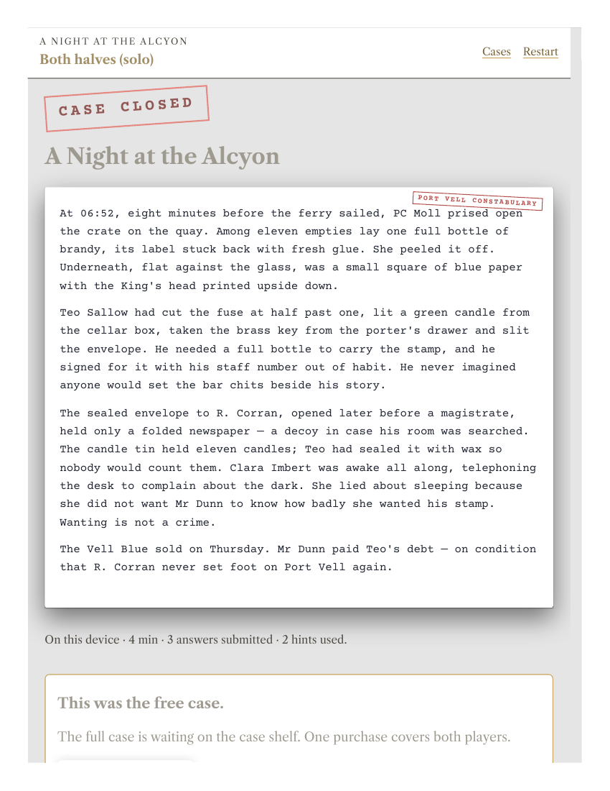
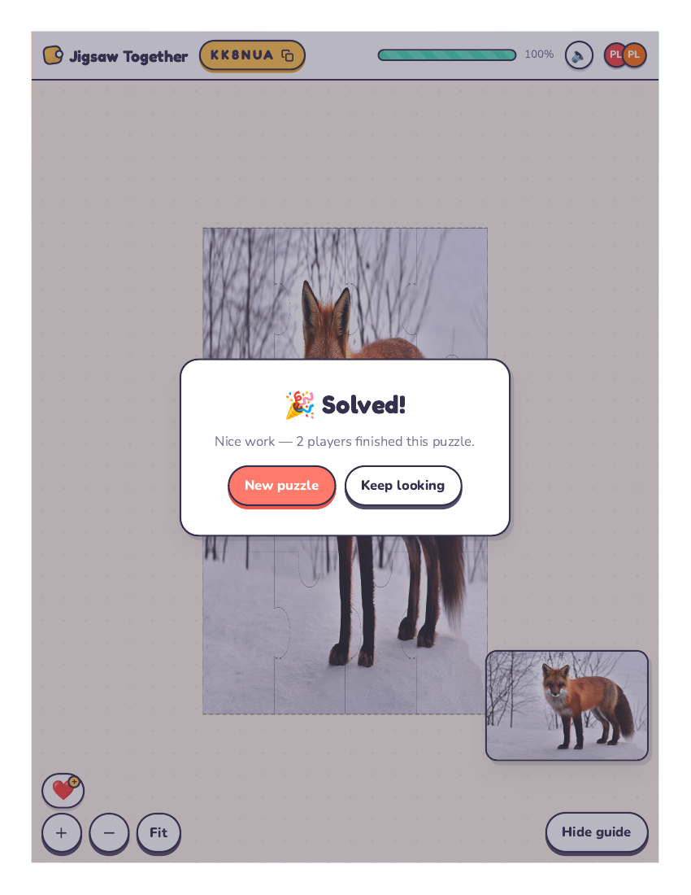
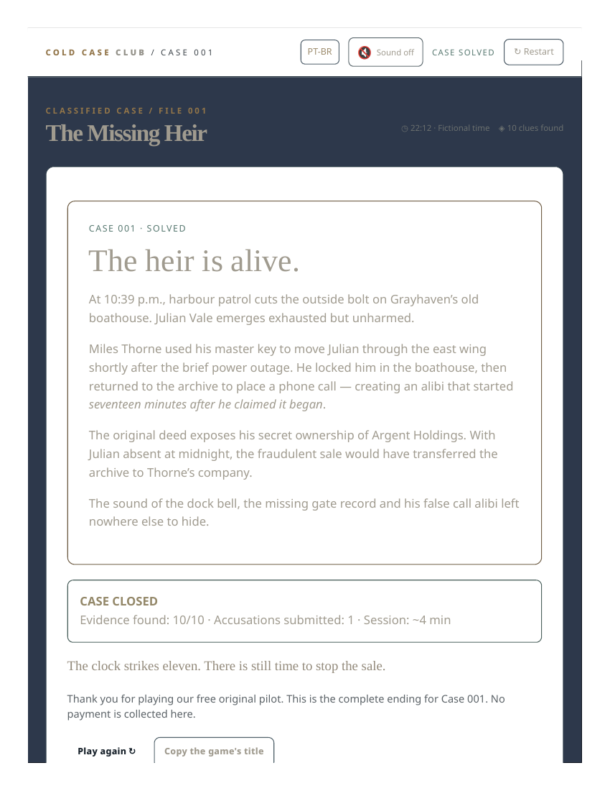

# Decision — Second Deep Comparison (2026-11-24)

**Template:** Oct-28 decision shape. Question carried from the Oct-28 package: the second-deep-family requirement was NOT MET ([OPEN] in both the Oct-28 and Nov-17 packages) — only one deep comparison from one family existed. The Nov-24 scan was ordered to close it with a new deep play from another family.

## §1 — Why play it

The coverage template requires two deep comparisons from different families, each with a full ending or complete activity. The Oct-28 set had one deep (ROLLBACK for Bell; Gartic + skribbl as the two first-hand browser studies for Moments). The Nov-17 package carried the Oct-28 six forward and marked the second-deep requirement NOT MET. The Nov-24 scan's orders were explicit: refresh the stale set, fill the open slots, add similar-genre titles and a high-score family, at least 10 more games. The decision this record makes: whether the Nov-24 wave closes the second-deep-family requirement, and what stays open.

## §2 — The competitor table (Nov-24 wave, verified)

| Title | Family | Depth reached | Evidence |
|---|---|---|---|
| Counterfoil — "A Night at the Alcyon" | Narrative-deduction | **Deep** — free case solved end to end, 4 min, 3 answers, 2 hints | 4 PDFs; CASE CLOSED frame [REAL] |
| Jigsaw Together | Co-op puzzle | **Deep** — 12-piece fox solved end to end, 0% → 100%, two seats live | 6 PDFs; Solved dialog [REAL] |
| The Missing Heir | Narrative-deduction | Completed — 10/10 clues, 1 accusation, ~4 min | 4 PDFs; CASE CLOSED [REAL] |
| Codenames Daily | Word deduction | Completed — 4 stars, all 4 clues ticked | 3 PDFs; result frame [REAL] |
| 2048 | High-score (solo puzzle) | Completed — 684 points, 93 moves | 3 PDFs; Game Over [REAL] |
| skribbl.io | Draw-and-guess | Completed game (finished #5, 635 points) | 5 PDFs; final standings [SECONDARY] |
| Draw a Stickman Episode 2 | Draw-to-play | Completed — start to share page | 15 PDFs; pulley reveal [REAL] |
| Drawize | Draw-and-guess | Completed games (2 of 7 all 7 rounds) | 12 PDFs; results [REAL] |
| Drawasaurus | Draw-and-guess | Partial — win, drawing turn open | 5 PDFs; Game Over win [REAL] |
| Gartic Phone | Telephone / draw-and-guess | Partial — lobby + settings only | 2 PDFs; lobby [REAL] |
| ADOFAI | Rhythm | Played, not completed — level 0 uncompleted | 3 PDFs; title + mid-path [REAL] |
| Agar.io | High-score (arcade arena) | Results-verified — best run 4 food, mass 16, top 84 | 3 PDFs; Match Results [REAL] |
| Fireboy and Watergirl 1 | Co-op puzzle platformer | Blocked — held keys | 2 PDFs; page [REAL] |
| TETR.IO | High-score (arcade puzzle) | Blocked — WebGL disabled | 4 PDFs; picker + menus [REAL] |
| Slope | High-score (arcade runner) | Played live, capture failed | 5 PDFs; portal [REAL] |
| Slither.io | High-score (arcade arena) | Blocked — no run started | 3 PDFs; blank center [PRINT FAILURE] |

## §3 — Candidates

### Keep — Counterfoil as deep #1 (narrative-deduction)
**Keep.** The free case was solved end to end with full start/document/ending captures. The shared-story model is captured in its cleanest form: each player holds half the evidence (Archive vs Field), the case closes only when the halves meet. Solo mode confirmed ("Both halves (solo)"); the two-player halves were not played with two people — stated, not hidden. The resolution is not retold. This is the deep from the narrative-deduction family.

### Keep — Jigsaw Together as deep #2 (co-op puzzle)
**Keep.** The 12-piece fox was solved end to end with full start/core/ending/result captures, two seats live at once with both avatars and live cursors on frame. It is a different family from Counterfoil: a shared board where two players jointly reveal one picture — a photograph, not a score — with no install, account, or payment. Limitation stated plainly: both seats were operated by one person in two tabs, not two different people. The stronger story-led candidates in the same session (Fireboy, Connected by Puzzles) were both blocked; the simple shared-board model worked end to end. That contrast is itself a finding.

### Reject — The Missing Heir as deep #2
**Reject (as the second deep, not as a study).** Completed end to end, 10/10 clues, one accusation, ~4 min — a strong play. But it is the same family as Counterfoil (narrative-deduction). It does not add a family, so it cannot close the second-deep requirement. It stays in the coverage as a second narrative-deduction study and as the 10-minute, 10-clue, one-accusation shape.

## Proposed decision

**The second-deep-family requirement is MET.** Counterfoil (narrative-deduction) + Jigsaw Together (co-op puzzle) are two deep comparisons from two different families, each with a full ending and complete captures. The [OPEN] item carried since Oct-28 is closed by this wave.

**What stays open (not a release blocker, listed for the record):**
- Gartic Phone's telephone loop (needs 4–50 humans; album never revealed).
- Drawasaurus drawing turn (15-second window vs browser round trips; 5 attempts failed).
- Drawize drawing verification (diamond claim not on its frame; Quick Play lobby never captured).
- ADOFAI level 0 completion (played, not completed; final state not captured).
- Fireboy and Watergirl play (held-keys wall — needs a person driving the browser).
- Connected by Puzzles (Cloudflare Turnstile — needs a network where the challenge endpoint is reachable, or a person).
- Slither.io run (server connection never completed).
- TETR.IO gameplay (WebGL disabled in this browser).
- Slope capture-verified run (played live, print failed).
- EPIC 2 play (needs a download/install).

## Evidence ledger

- Counterfoil: `evidence/competitors/counterfoil/pdf/42da457b-5588-585d-ab16-178937b20aac/` (4 PDFs) — session record `session--counterfoil-agent-2026-11-24.md`.
- Jigsaw Together: `evidence/competitors/jigsaw-together/pdf/e7c32e61-4b55-51eb-9367-598d2a1eef0c/` (6 PDFs) — session record `session--co-op-puzzle-agent-2026-11-24.md`.
- The Missing Heir: `evidence/competitors/the-missing-heir/pdf/8bebc44d-7534-50ef-8eb7-0a0a1697d0b7/` (4 PDFs) — session record `session--the-missing-heir-agent-2026-11-24.md`.
- All other sessions: `records/session--<game>-agent-2026-11-24.md` with PDFs under `evidence/competitors/<game>/pdf/<task-uuid>/`.

## Evidence gallery

Counterfoil [REAL] — "CASE CLOSED", "On this device · 4 min · 3 answers submitted · 2 hints used.", "This was the free case." Deep #1.

Jigsaw Together [REAL] — "Solved! Nice work — 2 players finished this puzzle.", the completed fox blurred behind. Deep #2.

The Missing Heir [REAL] — "CASE CLOSED — Evidence found: 10/10 · Accusations submitted: 1 · Session: ~4 min", "No payment is collected here." Same family as deep #1 — rejected as the second deep.
