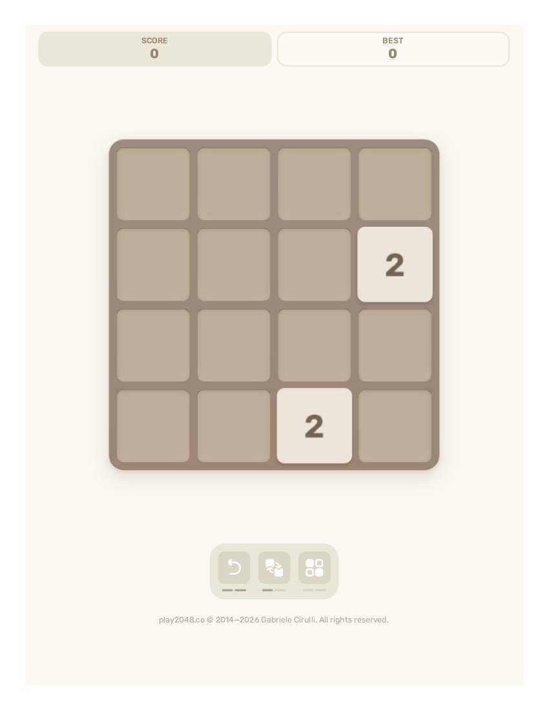
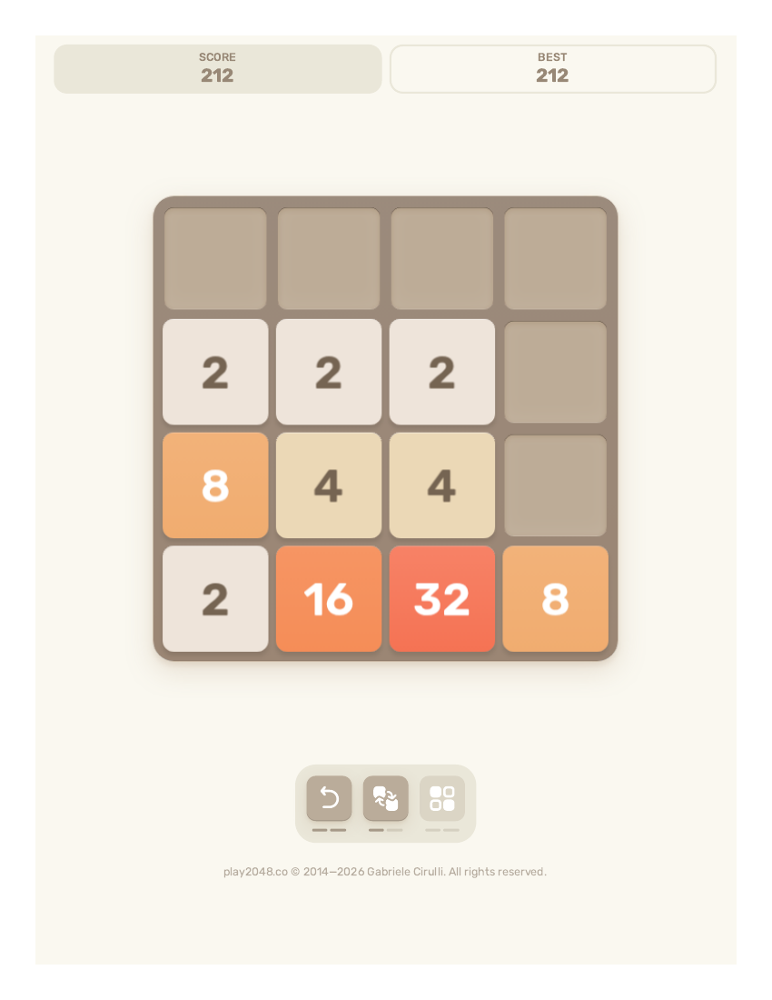
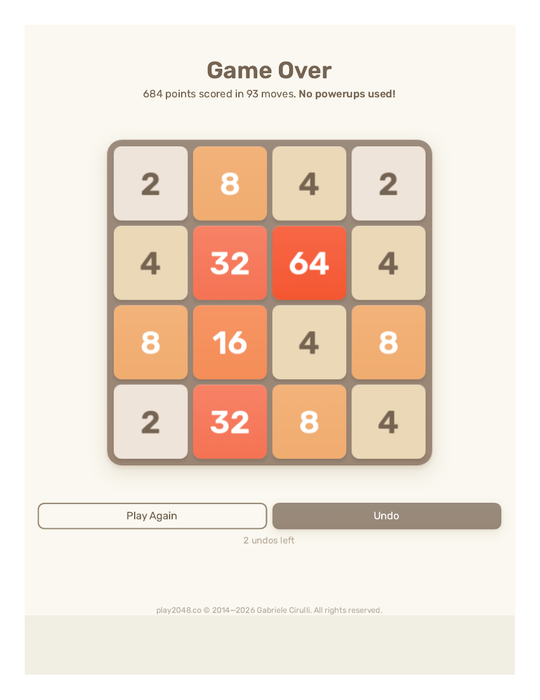

# 2048 — Agent Session Record (2026-11-24)

**AGENT session, not a human session.** Played by one assistant operator via the agent browser. **It is not gate evidence and enters no release denominator.**

## Identity, preparation and actual timing

- Protocol ID / registration: none — agent session, 2026-11-24, unregistered
- Source: https://play2048.co, free, no account; browser task 98381617-a8d4-56cd-aca1-9b323be507b0, ran 18:28–18:41 PST
- Actual UTC date: 2026-11-25, 02:28–02:41 UTC
- Participant pseudonym: none — no account
- Human observer: none — agent operator, self-observed
- Device: agent browser (cloud), print captures as full-page PDFs (DOM-rendered — prints fully)

## Actual player journey

| Observation | Stage / action | Visible response / consequence | Help, confusion, pause |
|---|---|---|---|
| 1 | Start | SCORE 0 / BEST 0, two 2-tiles (row 2 col 4, row 4 col 3) | — |
| 2 | Mid-run | SCORE 212 / BEST 212, 11 tiles, best tile 32 (bottom row 2-16-32-8) | — |
| 3 | Game Over | "Game Over — 684 points scored in 93 moves. No powerups used!", final board all 16 cells filled, no adjacent equals, best tile 64 (row 2 col 3), Play Again + Undo (2 undos left) | — |

## Outcome and assistance evidence

| Field | Agent value | Reason |
|---|---|---|
| `run_completed` | true (agent) | Full run start to Game Over, all three frames verified [REAL]. Cleanest high-score session of the wave. |
| `final_score` | 684 | Game Over frame [REAL] |
| `moves` | 93 | Game Over frame [REAL] |

- Small gap, noted: after the ad interruption at Score 444, reopening restored the run "now at Score 472" — a +28 jump with no moves described; the final outcome is fully verified, so the verdict is unchanged.
- "Best: 684 persisted" is [SECONDARY] (Best tracked Score in f1/f2, but f3's game-over frame shows no Best header).

## Shareable record check

- [x] Contains only agent observations; no personal text.
- [x] Outcomes reflect this attempt; assistance and failures remain visible (the +28 gap, the Best caveat).
- [ ] Saved into the private study folder — this record lives in the play dir, not Git, until Sakura confirms it (confirmation gate).

## Evidence gallery

Start [REAL] — SCORE 0 / BEST 0, two 2-tiles.

Mid-run [REAL] — SCORE 212 / BEST 212, 11 tiles, best tile 32.

Game Over [REAL] — "684 points scored in 93 moves. No powerups used!", best tile 64, Play Again + Undo (2 undos left).
