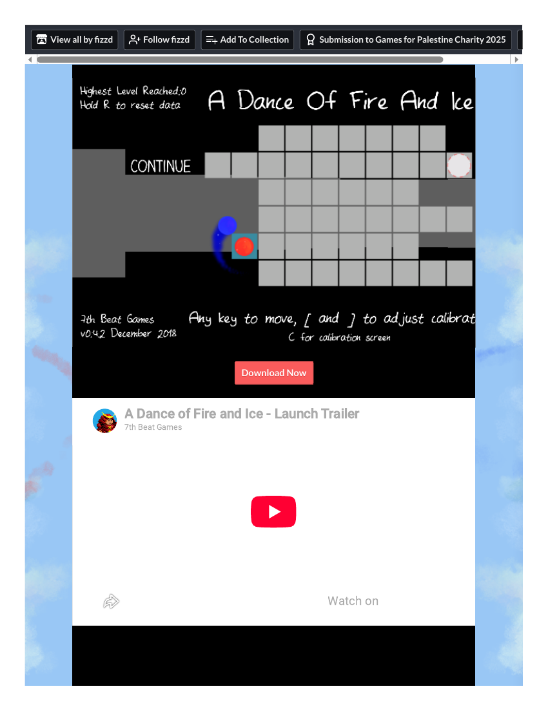
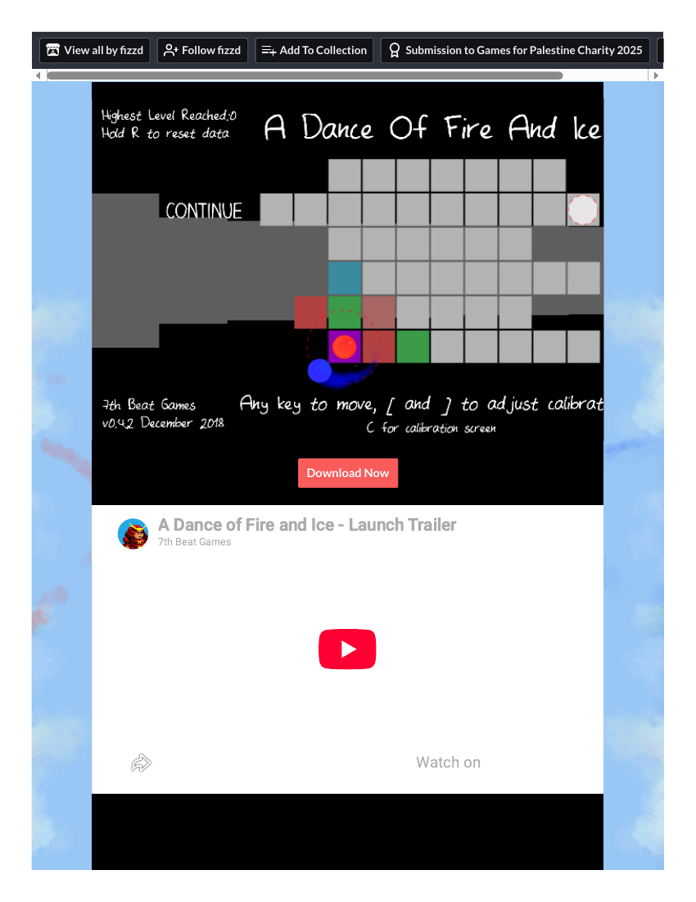
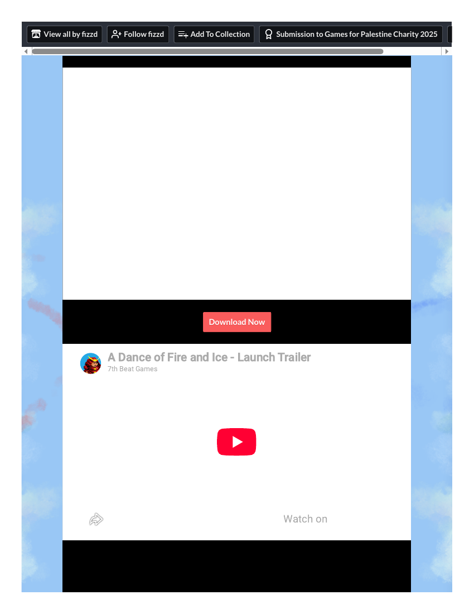

# A Dance of Fire and Ice (ADOFAI) — Agent Session Record (2026-11-24)

**AGENT session, not a human session.** Played by one assistant operator via the agent browser. **It is not gate evidence and enters no release denominator.**

## Identity, preparation and actual timing

- Protocol ID / registration: none — agent session, 2026-11-24, unregistered
- Source: official itch.io demo by fizzd (v0.4.2, Dec 2018, Unity WebGL), https://fizzd.itch.io/a-dance-of-fire-and-ice; browser task e34aaac8-dd68-5596-97b6-2f7494af93bc, ran 18:16–18:44 PST
- Actual UTC date: 2026-11-25, 02:16–02:44 UTC
- Participant pseudonym: none — no account
- Human observer: none — agent operator, self-observed
- Device: agent browser (cloud), print captures as full-page PDFs

## Actual player journey

| Observation | Stage / action | Visible response / consequence | Help, confusion, pause |
|---|---|---|---|
| 1 | Title screen | "A Dance Of Fire And Ice", "Highest Level Reached:0", "Hold R to reset data", CONTINUE, grey tile grid, red planet on teal tile + blue orbiting, white circle top-right unreached, "7th Beat Games v0.4.2 December 2018", "Any key to move, [ and ] to adjust calibrat…" | — |
| 2 | Mid-path | 7 tiles colored (teal/red/green/purple), red planet on the purple tile, blue below-left, white circle still unreached | Level 0 entered and played |
| 3 | Claimed final state | The game area is BLANK WHITE in print | The task's claimed final state (blue on teal, red southeast, most tiles colored) is [SECONDARY], NOT in the capture — WebGL print failure |

## Outcome and assistance evidence

| Field | Agent value | Reason |
|---|---|---|
| `level0_completed` | false | White circle unreached in f1/f2, no result screen in any capture, "Highest Level Reached:0" throughout — slot stays [OPEN]; the task states this honestly |
| `level0_entered` | true (agent) | Level 0 entered and played; advance vs earlier rounds (which reached only bare-number calibration, ~140 presses to cross the menu) |
| `level0_is_lobby_path` | task framing | "Level 0 = the lobby path" is the task's framing (no separate level-0 button); record as such |

- [SECONDARY]: Newgrounds bot-check ("NG Guard / Fetching a puzzle"), direct itch CDN embed unreachable, paid full version $3.99, downloadable files v3.3.1, ~28-min play account.

## Shareable record check

- [x] Contains only agent observations; no personal text.
- [x] Outcomes reflect this attempt; assistance and failures remain visible (level 0 not completed, final-state capture blank).
- [ ] Saved into the private study folder — this record lives in the play dir, not Git, until Sakura confirms it (confirmation gate).

## Evidence gallery

Title screen [REAL] — "A Dance Of Fire And Ice", "Highest Level Reached:0", CONTINUE, red planet on teal tile, white circle top-right unreached, "7th Beat Games v0.4.2 December 2018".

Mid-path [REAL] — 7 tiles colored (teal/red/green/purple), red planet on the purple tile, blue below-left, white circle still unreached.

Claimed final state [PRINT FAILURE] — the game area is BLANK WHITE in print. The task's claimed final state is NOT in this capture.
