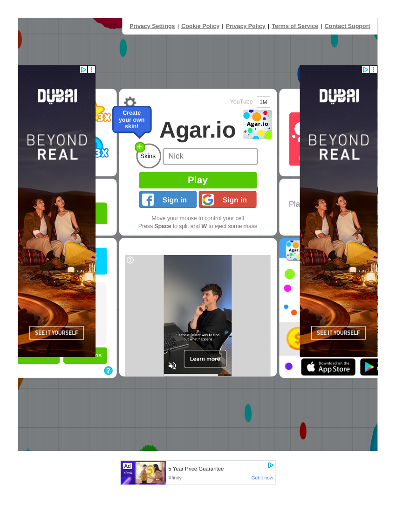
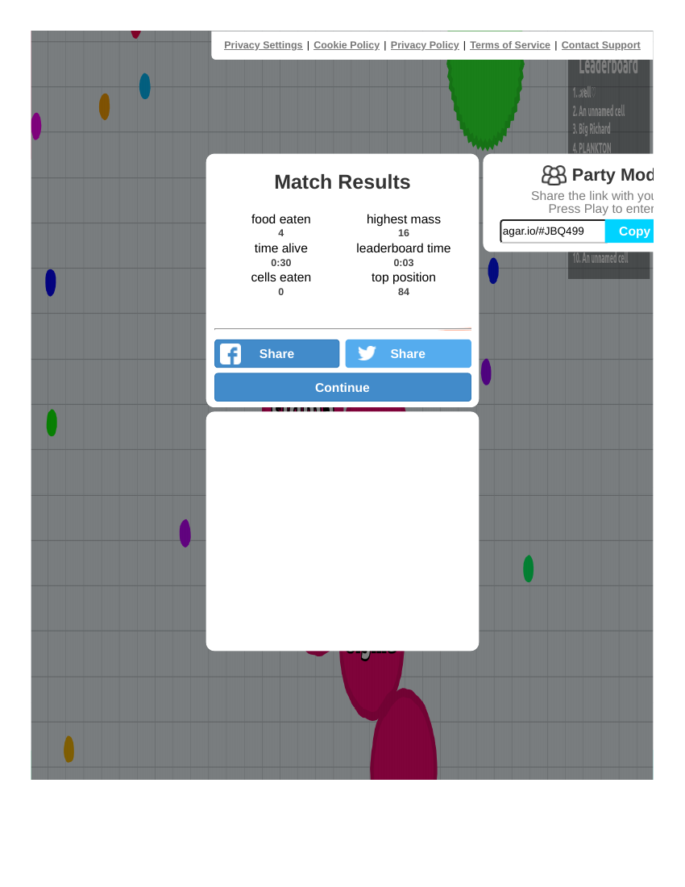
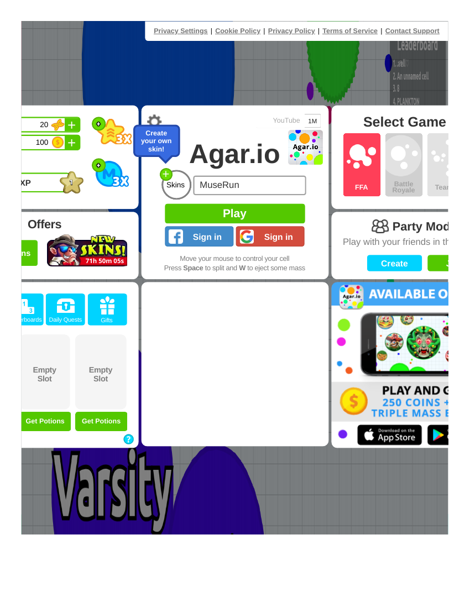

# Agar.io — Agent Session Record (2026-11-24)

**AGENT session, not a human session.** Played by one assistant operator via the agent browser. **It is not gate evidence and enters no release denominator.**

## Identity, preparation and actual timing

- Protocol ID / registration: none — agent session, 2026-11-24, unregistered
- Source: https://agar.io, free, guest; browser task 60e69edf-06be-538d-b88e-189478066a22, ran 18:18–18:45 PST
- Actual UTC date: 2026-11-25, 02:18–02:45 UTC
- Participant pseudonym: MuseRun (guest)
- Human observer: none — agent operator, self-observed
- Device: agent browser (cloud), print captures as full-page PDFs

## Actual player journey

| Observation | Stage / action | Visible response / consequence | Help, confusion, pause |
|---|---|---|---|
| 1 | Start menu | "Agar.io", Nick blank, green Play, Facebook/Google Sign in, "Move your mouse to control your cell / Press Space to split and W to eject some mass", Dubai ads both sides | — |
| 2 | Match Results (best run) | Food eaten 4, highest mass 16, time alive 0:30, leaderboard time 0:03, cells eaten 0, top position 84; Share buttons + Continue; top-10 leaderboard behind (1. …ell, 2. An unnamed cell, 3. Big Richard, 4. PLANKTON), big green cell, magenta split cells below | No gameplay PDF exists — the live play (steering, eating 4 pellets, eaten by "sigma") is [SECONDARY]; the results screen corroborates the best run's numbers only |
| 3 | Start menu, nick set | Nick "MuseRun", FFA selected (red), Battle Royale/Teams greyed, 20 stars, 100 coins, XP 1, Offers "NEW SKINS! 71h 50m 05s", Daily Quests, Gifts, Get Potions, Party Mode | — |

## Outcome and assistance evidence

| Field | Agent value | Reason |
|---|---|---|
| `best_run_verified` | true (agent) | Match Results frame [REAL]: 4 food, mass 16, 0:30 alive, top 84 |
| `gameplay_captured` | false | No gameplay PDF exists; other runs (12 mass, 10 mass ×2, 13 mass, 10 mass top 8, 0-mass spawn failure), the disconnect, and the Black Friday shop popup are [SECONDARY] |

## Shareable record check

- [x] Contains only agent observations; no personal text.
- [x] Outcomes reflect this attempt; assistance and failures remain visible (no gameplay capture).
- [x] Filed to the remote as PR #34 (branch competitor-plays-2026-11-24 → main), pending merge.

## Evidence gallery

Start menu [REAL] — "Agar.io", Nick blank, green Play, Facebook/Google Sign in, "Move your mouse to control your cell / Press Space to split and W to eject some mass".

Match Results [REAL] — food eaten 4, highest mass 16, time alive 0:30, leaderboard time 0:03, cells eaten 0, top position 84.

Start menu with nick "MuseRun" [REAL] — FFA selected, 20 stars, 100 coins, XP 1, Offers "NEW SKINS! 71h 50m 05s".
