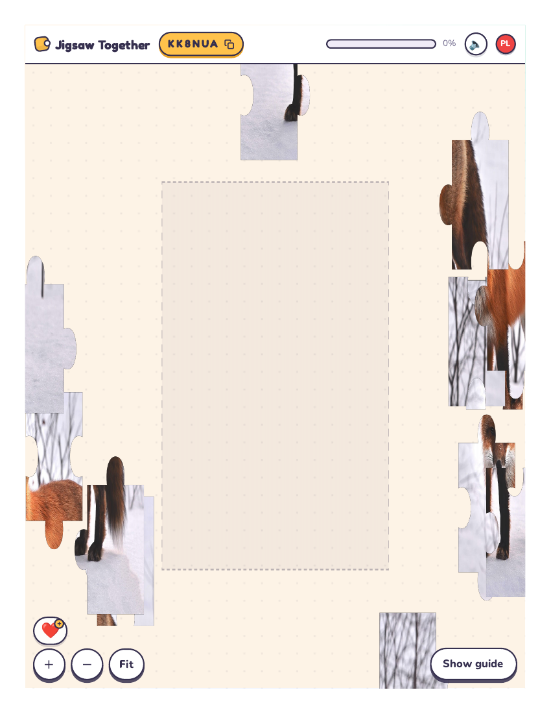
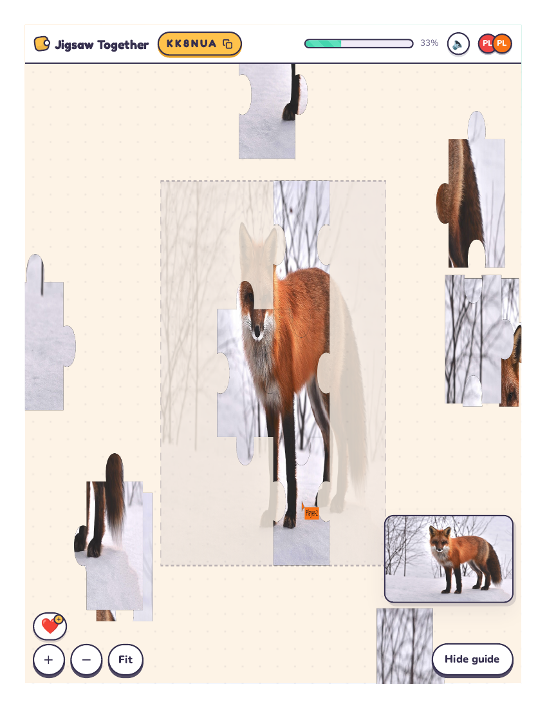
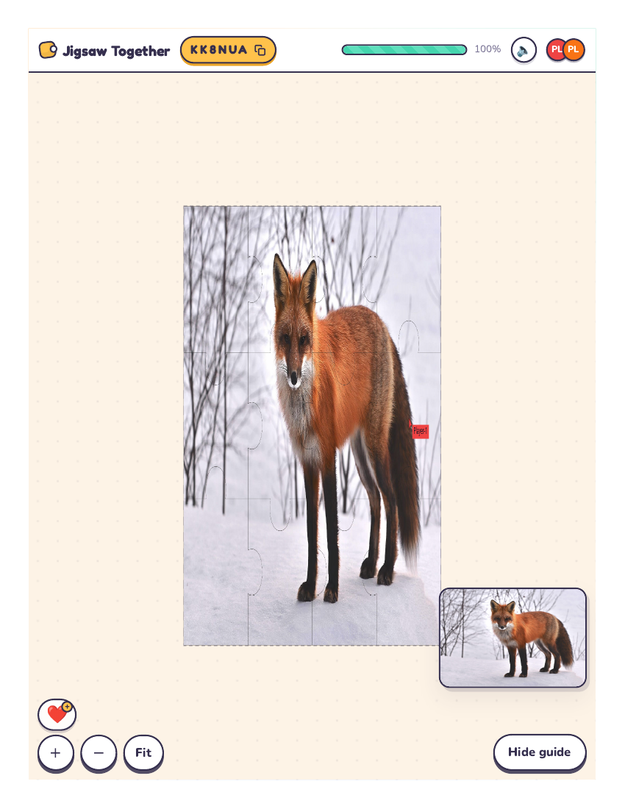
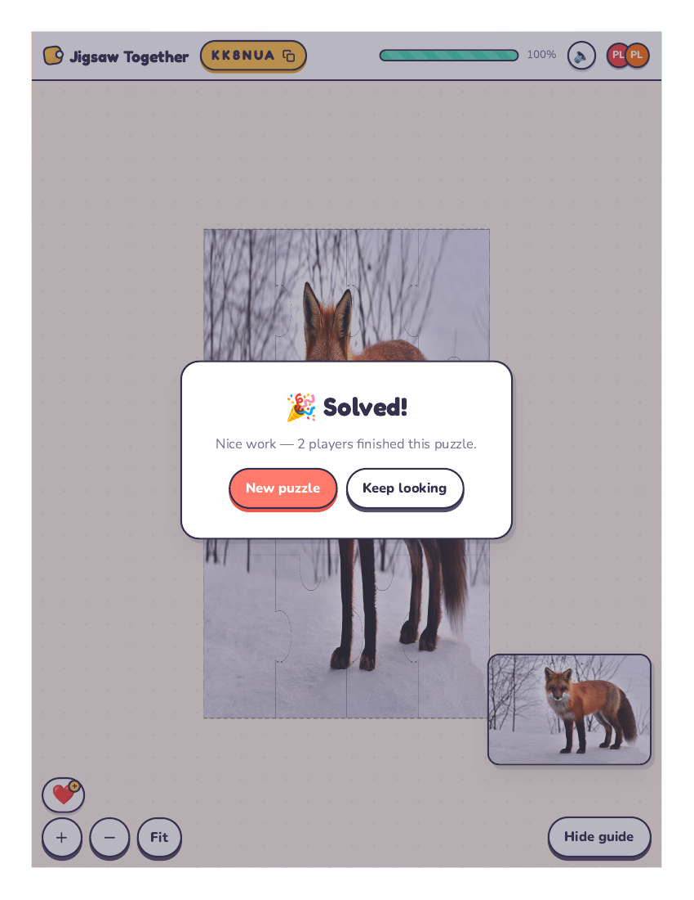
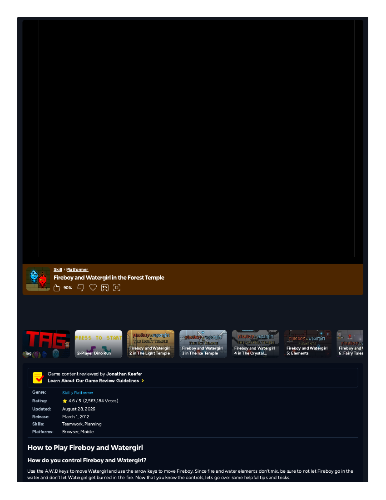

# Co-op puzzle discovery (Jigsaw Together) — Agent Session Record (2026-11-24)

**AGENT session, not a human session.** Played by one assistant operator via the agent browser. **It is not gate evidence and enters no release denominator.**

## Identity, preparation and actual timing

- Protocol ID / registration: none — agent session, 2026-11-24, unregistered
- Source: https://www.jigsawtogether.com — private room https://www.jigsawtogether.com/play/KK8NUA, room code KK8NUA; browser task e7c32e61-4b55-51eb-9367-598d2a1eef0c, ran 18:32–19:18 PST
- Actual UTC date: 2026-11-25, 02:32–03:18 UTC
- Participant pseudonyms: Player-1 / Player-2 (two browser tabs, one operator)
- Human observer: none — agent operator, self-observed
- Device: agent browser (cloud), print captures as full-page PDFs

## Actual player journey

| Observation | Stage / action | Visible response / consequence | Help, confusion, pause |
|---|---|---|---|
| 1 | Room created | Animals picture (a red fox standing in snow), difficulty Easy · 12 pieces, visibility Private (code only) | Free, no sign-up, no download, no account |
| 2 | Start | Empty dashed frame, 0% progress, 12 fox pieces scattered, room KK8NUA, Player-1 only | — |
| 3 | Core co-op play | 33% progress, 4 pieces placed forming the fox (head, back, body, legs), guide image on, Player-2's live cursor visible on the legs piece, both avatars in the header | Both tabs showed the same board, both avatars, and each player's live cursor in the other tab |
| 4 | Complete | 100% progress, completed red-fox picture, both avatars, Player-1's live cursor on the tail | — |
| 5 | Result | "Solved! Nice work — 2 players finished this puzzle.", "New puzzle" / "Keep looking" | Contributions panel per task prose [SECONDARY]: Player-2 placed 8 pieces (67%), Player-1 placed 4 (33%), 12 in total |

## Outcome and assistance evidence

| Field | Agent value | Reason |
|---|---|---|
| `puzzle_completed` | true (agent) | 12-piece fox, 0% → 33% → 100% → Solved dialog, all captured [REAL] |
| `two_player` | real in the room, one operator | Both seats live at once with shared board, live cursors, per-player counts — but both seats were operated by one person in two tabs, not two different people. Stated plainly. |
| `attempted_alternatives` | blocked | Fireboy and Watergirl 1 (Coolmath) reached Level 1 but the characters never moved — the game needs held keys, which this browser's tap-only input cannot supply [OPEN]; Connected by Puzzles blocked by a Cloudflare Turnstile gate (4 clicks, 2 browsers, "Verifying..." stall and reset) [OPEN]; Pixo Pals checked to its title screen only, not played |

## Shareable record check

- [x] Contains only agent observations; no personal text.
- [x] Outcomes reflect this attempt; assistance and failures remain visible (one operator, two blocked alternatives).
- [ ] Saved into the private study folder — this record lives in the play dir, not Git, until Sakura confirms it (confirmation gate).

## Evidence gallery

Start [REAL] — room "KK8NUA", 0% progress, empty dashed frame, fox pieces scattered, one avatar.

Core co-op play [REAL] — 33% progress, fox taking shape, guide image on, two avatars, "Player-2" cursor tag on the legs piece.

Complete [REAL] — 100% progress, the completed red fox in snow, both avatars.

Result [REAL] — "Solved! Nice work — 2 players finished this puzzle.", "New puzzle" / "Keep looking".

Fireboy and Watergirl 1, Coolmath page [REAL, market record] — "Fireboy and Watergirl in the Forest Temple", 90%, game area BLACK (embed did not print). "Rating: 4.6/5 (2,563,184 Votes)", "Updated: August 28, 2026", "Release: March 1, 2012", "Skills: Teamwork, Planning". Level 1 and the held-keys blocker are [SECONDARY].
