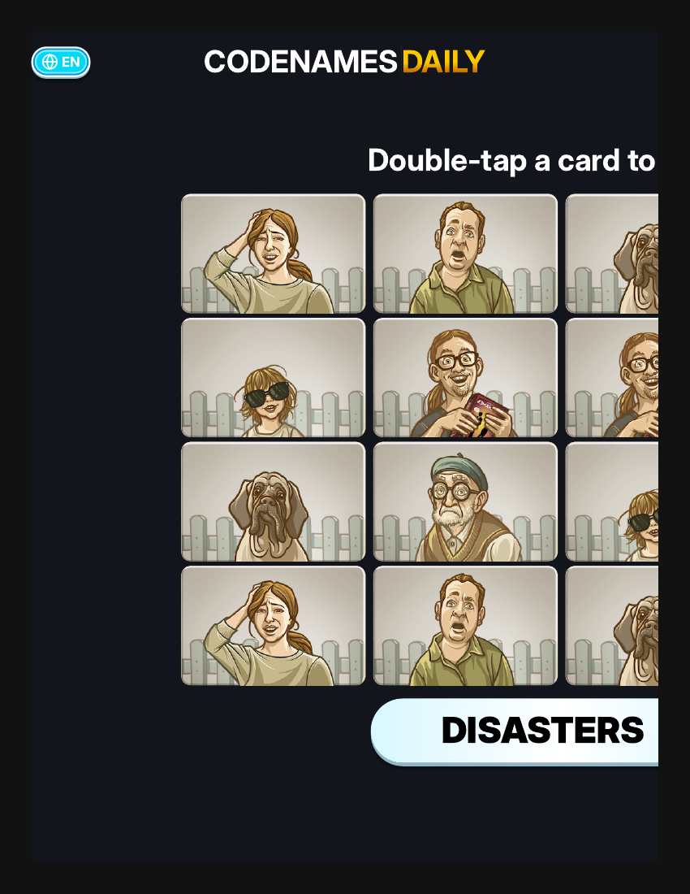
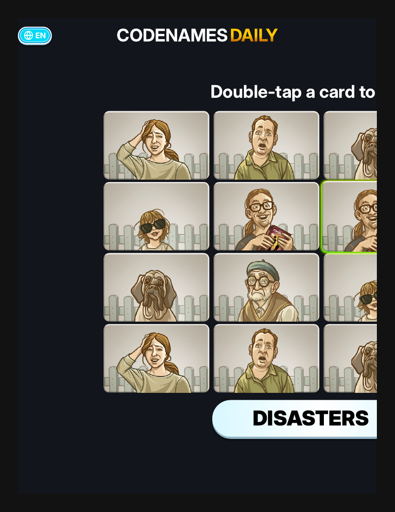
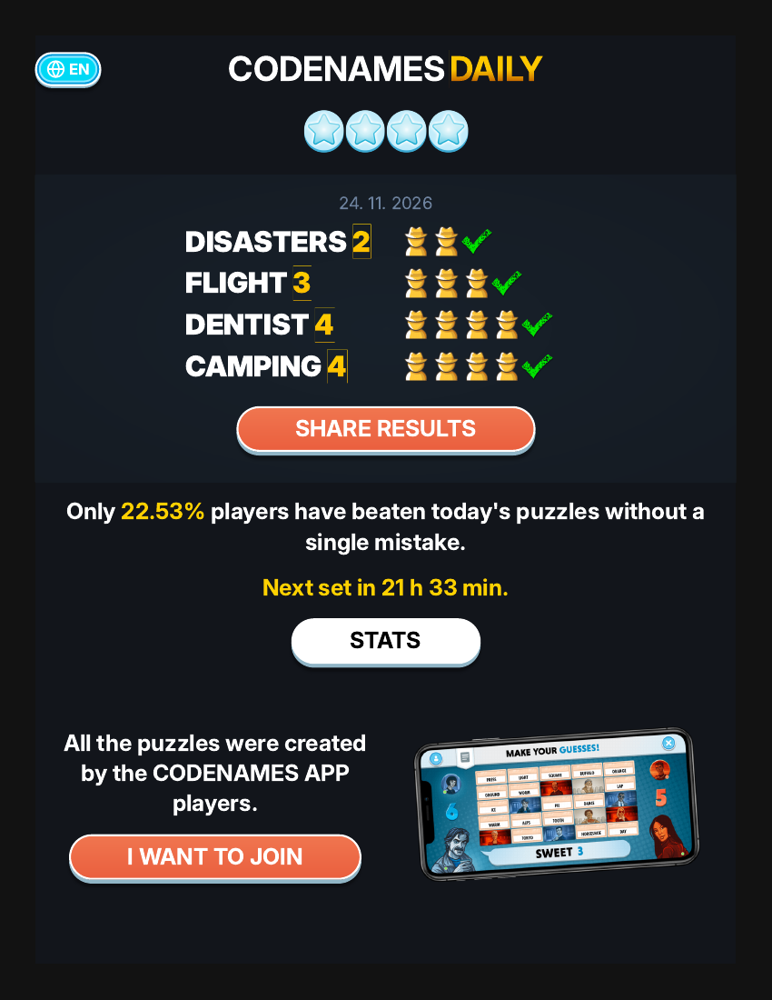

# Codenames (Daily, solo) — Agent Session Record (2026-11-24)

**AGENT session, not a human session.** Played by one assistant operator via the agent browser. **It is not gate evidence and enters no release denominator.**

## Identity, preparation and actual timing

- Protocol ID / registration: none — agent session, 2026-11-24, unregistered
- Source: Codenames Daily (solo), free; browser task b064e346-3a89-594c-af91-7bf7517affc5, ran 18:24–18:31 PST
- Actual UTC date: 2026-11-25, 02:24–02:31 UTC
- Participant pseudonym: none — no account
- Human observer: none — agent operator, self-observed
- Device: agent browser (cloud), print captures as full-page PDFs (frames cut off at the right edge in print)

## Actual player journey

| Observation | Stage / action | Visible response / consequence | Help, confusion, pause |
|---|---|---|---|
| 1 | Picture board | "CODENAMES DAILY", "Double-tap a card to…", a grid of illustrated portrait cards, "DISASTERS" clue button | The board is PICTURES — the task described a 16-word board, but the frames show a picture board; the 16 words exist only in the PDFs' text layers |
| 2 | One card selected | Exactly ONE green-bordered card on the board | Per-guess word claims are [SECONDARY] |
| 3 | Results | 4 stars, 24.11.2026, DISASTERS 2 / FLIGHT 3 / DENTIST 4 / CAMPING 4 all ticked, "Only 22.53% players have beaten today's puzzles without a single mistake", "Next set in 21 h 33 min" | Solo Codenames Daily completed |

## Outcome and assistance evidence

| Field | Agent value | Reason |
|---|---|---|
| `daily_completed` | true (agent) | Result frame captured [REAL]: 4 stars, all four clues ticked |
| `multiplayer_lobby` | [OPEN] | ENTER GAME reloaded the homepage twice per the task; no capture filed — a reported failure, not capture-verified |
| `word_board` | not observed | The frames show a picture board; the 16-word board is [SECONDARY] (text layer only) |

## Shareable record check

- [x] Contains only agent observations; no personal text.
- [x] Outcomes reflect this attempt; assistance and failures remain visible (picture-vs-word discrepancy, multiplayer lobby failure).
- [x] Filed to the remote as PR #34 (branch competitor-plays-2026-11-24 → main), pending merge.

## Evidence gallery

Picture board [REAL] — "CODENAMES DAILY", illustrated portrait cards, "DISASTERS" clue button. Cut at the right edge.

One card selected [REAL] — exactly ONE green-bordered card on the board.

Daily results [REAL] — 4 stars, 24.11.2026, DISASTERS 2 / FLIGHT 3 / DENTIST 4 / CAMPING 4 all ticked, "Only 22.53% players have beaten today's puzzles without a single mistake", "Next set in 21 h 33 min".
